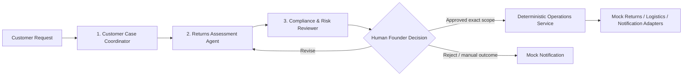

# Agent Context & Persistent Memory

> **Course**: USYD ELEC5620 Model-Based Software Engineering (Semester 2, 2026)  
> **Course Root**: `d:/AAA树下/硕士/26S2/5620`  
> **Project Repository**: `d:/AAA树下/硕士/26S2/5620/assignment/returnops-au`  
> **Topic**: ReturnOps AU (One-Person AI Company in E-Commerce & Retail)  
> **Target Rating**: 10/10 Project (Academic excellence + Portfolio value)

> **Baseline transition notice (2026-08-31)**: The project lead has approved
> [`docs/00-project-definition-v1.md`](docs/00-project-definition-v1.md) as the
> Baseline v1.0 candidate. It defines one Australian online store operated by a
> single Human Founder,
> three AI business roles, a deterministic Operations Service, and an MVP ending
> at an approved simulated return/label outcome plus notification. Use that
> candidate for new planning. The lead-directed publication to main occurred
> on 2026-09-06 (PRs #2/#4/#6), but current B/C approval, tutor feedback
> disposition and reviewed model-alignment adoption remain outstanding.
> Alignment and F.01 rc.2 were published for review in PR #9 on 2026-09-07,
> and the lead subsequently directed main publication. Check the PR's actual
> merge record and remaining review state before acting.
> Older seven-agent/multi-SME versions are historical inputs, not current scope.

---

## Allocation freeze — 2026-09-06

The lead approved [Frozen Work Allocation v1.0](docs/07-frozen-work-allocation.md)
and [Detailed Work Packages](docs/08-delivery-work-packages.md). Read both after
`docs/00` before assigning work. Nine feature owners, course-selected optionals,
hand-offs and acceptance boundaries stay fixed unless the lead explicitly
approves a material change. The plan has been published to main; this does not
claim B/C/tutor approval of the current revision, implementation completion or
live Jira updates.

C coordinates evaluation; A/B/C each implement tests for their own features and
participate in Gold label review. A implements Coordinator/Assessment and the
orchestrator; C implements Risk Reviewer, retrieval and image analysis. Consult
`docs/07` for submodule ownership rather than treating all agent code as A-owned.

## F.01 contract hand-off — 2026-09-07

The lead requested the first implementation-preparation step, F.01. Read
[the interface contract candidate](docs/09-interface-contract-v1.md) before
changing cross-member DTOs. `contracts/v1/schemas.json` is the shared wire
schema candidate and `openapi.json` defines planned public operations;
`tests/contracts` checks artifacts, not runtime authorization or safety.
B/C confirmation is pending. Do not mark F.01 accepted, claim a working API,
or treat old `packages/domain/models.py` as already migrated to this contract.
No change to the frozen nine-feature allocation is implied. The rc.2 revision
addresses the five identified contract-shape/hand-off gaps with offline
regressions: no-proposal manual handling, full retrieval/conflict propagation,
compatible citation capacities, analytics filters/denominators and strict ID
boundaries. The corresponding runtime guards are not implemented.

## Old-document alignment — 2026-09-07

`docs/01`, `02`, `04`, `05` and the five existing shared diagrams have been
aligned with `docs/00`, `07` and `08`; `docs/03` and navigation/status
wording were corrected as well. This is a lead-led integration draft, not B/C
individual authorship, accepted personal behaviour models or completed Stage 1.
Retain B's PR #8 source attribution and C's PR #7 branch history; do not treat
either PR as merged by this edit. F.01 rc.2 now includes the separate five-gap
contract revision. These changes are published in
[PR #9](https://github.com/shuxiachai/returnops-au/pull/9) on
`docs/5-f01-interface-contract`; review requests were sent to B and C.
Joint contract/model review remains pending; no runtime implementation
or Jira update is implied. The proposal-bound summary in docs/00 section 4.4
and FR-009 versus the failure-target manual exception remains an explicit
joint-confirmation item, not a silently adopted baseline change.

## 1. Project Background & One-Sentence Pitch

* **Product Name**: `ReturnOps AU`
* **Full Title**: *ReturnOps AU: A Human-Governed Multi-Agent Returns Operations System for a One-Person Australian Online Store*
* **One-Sentence Brief**:
  > ReturnOps AU turns a customer request, synthetic order data, customer evidence, store policy, and project-reviewed consumer guidance into a cited, non-executable decision packet for a single Australian online store operated by one Human Founder; only the Founder may approve an exact proposal, after which the prototype performs only the approved simulated return and parcel-label operation.

---

## 2. Topic Selection History & Discarded Alternatives

1. **Discarded Alternative 1: SME Grant & Tender Copilot (`BidPilot AU`)**
   * *Rationale for rejection*: Tender evaluation is subjective, making ground-truth benchmarks and quantitative scoring harder to defend in evaluation.
2. **Discarded Alternative 2: Academic Commercialisation Studio (`academic_agent`)**
   * *Rationale for rejection*: Reusing pre-existing personal codebase creates USYD academic integrity / recycling disclosure overhead and lacks clean team task separation.
3. **Discarded Alternative 3: Household Energy Optimisation (`EnergyPilot AU`)**
   * *Rationale for rejection*: Heavy reliance on mathematical optimization (OR-Tools) overshadowed the LLM Agent necessity; smart meter data acquisition was unrealistic.
4. **Selected Topic: `ReturnOps AU` (10/10 candidate)**
   * *Why it won*: Strong fit for "One-Person AI Company", three distinct AI business roles, strict human-in-the-loop governance, rich and traceable MBSE behaviour, reviewed Australian domain evidence, and a measurable 30-case Gold evaluation with parameterised safety/workflow coverage. It provides conditional guidance and does not claim legal compliance or legal correctness.

---

## 3. Team Structure & Workload Distribution (3-Person Team)

Aligned with **Lab 2 Requirement** (At least 3 distinct AI roles; each member individually implements at least 2 core features + 1 optional feature):

| Member | Role & Ownership | Planned Effort | Stage 1 (MBSE Modeling) Focus | Stage 2 (Implementation) Deliverables |
| :--- | :--- | :---: | :--- | :--- |
| **Member A (Lead / You)** | **System Architect & Backend / Agent Lead** | ~45% | System integration; Composite Structure, domain, approval/execution behaviour, and traceability models | **Core 1**: Authoritative return-case lifecycle.<br>**Core 2**: Exact-scope Founder approval and governed simulated execution.<br>**Optional**: Logistics sandbox/test adapter and recovery path. |
| **Member B (`@ChengsiLi`)** | **Frontend & User Experience Lead** | ~27% | Customer journey; use-case and intake behaviour; UI/UX flows | **Core 1**: Customer Intake & Clarification Portal.<br>**Core 2**: Founder Review & Approval Dashboard.<br>**Optional**: Operations Analytics Dashboard. |
| **Member C (`@lulucas-tao`)** | **Grounding, Risk & AI Evaluation Lead** | ~28% | Grounding/risk requirements and behaviour; evaluation metrics and traceability | **Core 1**: Versioned Guidance Retrieval & Citation Verification.<br>**Core 2**: Independent Risk Review & Escalation.<br>**Optional**: Product-image Evidence Analysis.<br>Coordinates Gold data, evaluation runner and `B1` versus `B4`; each member tests their own features and participates in label review. |

---

## 4. Multi-Agent Architecture & Governed Loop



### Agent Roles & Boundaries
1. **Customer Case Coordinator Agent**: Preserves the original request, extracts typed facts, identifies missing or conflicting information, and asks targeted follow-ups.
2. **Returns Assessment Agent**: Reads a synthetic order snapshot, constructs the evidence matrix, retrieves versioned sources, and drafts a cited conditional decision packet without making a final legal determination.
3. **Compliance & Risk Reviewer Agent**: Uses an independent invocation to verify evidence, citations, material conflicts, scope, and prompt-injection/authority risks. It can pass, warn, revise, request information, or escalate, but cannot approve or execute.
4. **Human Founder (Gatekeeper)**: The only actor who can approve, reject, request revision, or record a manual outcome for a current proposal.
5. **Deterministic Operations Service**: Revalidates identity, proposal version, exact approval scope, provider authority, allowlist, and idempotency before any approved simulated return/label and notification action. It is not an AI agent.

---

## 5. Planned Technology Stack & Target Directory Structure

> This is a target layout, not a statement of current implementation. At the
> v1.0-candidate stage, the repository contains requirements/UML, the existing
> `packages/domain` models, synthetic fixtures, and a small test set. API,
> frontend, agent, evaluation, CI, Docker, and deployment assets remain
> `Planned` until code and reproducible evidence exist.

```text
returnops-au/
├── apps/
│   ├── api/                 # Backend FastAPI application (Member A)
│   └── web/                 # Frontend Next.js + TailwindCSS UI (Member B)
├── packages/
│   ├── agent_core/          # A: orchestration/Coordinator/Assessment; C: Risk/image
│   ├── domain/              # Pydantic schemas, entities, state definitions (Member A)
│   ├── provider_adapters/   # A: order/returns/logistics/notification; C owns retrieval
│   └── evaluation/          # Benchmark suite & evaluation runner (Member C)
├── docs/                    # Project Charter, System Design, Team Workflow, Backlog
├── tests/
│   ├── fixtures/            # A: orders/providers; B: UI samples; C: corpus/evaluation
│   └── evaluation_cases/    # 30 Gold cases plus parameterised suites (Member C)
├── AGENTS.md                # This persistent memory file
├── docker-compose.yml       # Local development orchestration
└── README.md                # Project landing page
```

---

## 6. Key Assessment Milestones

* **Stage 1 (30 Marks; use the current official assessment schedule)**:
  * 15 Marks: Formal Report (Requirements classification, Feature Diagram, Use Cases, Package/Class/Activity/State/Sequence diagrams, Traceability).
  * 15 Marks: Presentation & Interview (Design rationale, discarded choices, model overview, acceptance criteria).
* **Stage 2 (20 Marks; use the current official assessment schedule)**:
  * Working Agile Prototype Demonstration to tutors.
  * Code submission on Canvas.
* **Exams (50%)**: Week 9 Mid-semester online quiz (10%) + Final exam (40%).

---

## 7. Instructions for Any Agent Working in this Codebase

1. **Preserve Architectural Rigor**: Every feature must map to a Requirement ID (`FR-xxx`, `NFR-xxx`) and MBSE model.
2. **Do Not Bypass Human Approval**: An LLM agent must never directly mutate authoritative state, create an `ApprovalRecord`, or call a high-impact provider. Every high-impact operation requires an exact-scope `ApprovalRecord`; ordinary case, clarification, and audit writes must still pass through deterministic application services and state guards.
3. **Keep Code Modular**: Maintain separation between `apps/api`, `apps/web`, and `packages/*`.
4. **Synthetic Data Only**: Never commit real personal customer data or copyrighted USYD lecture materials to public Git repos.
5. **Check Current Status**: Read the lead-approved candidate
   `docs/00-project-definition-v1.md`, its remaining adoption reviews, and
   GitHub Issues before creating new components. `docs/04` is a derived
   requirements/backlog view, not an alternate authority; its v0.2 version is
   retained in history. Use `docs/07` and `docs/08` for fixed ownership and
   work-package dependencies. Do not reintroduce the old seven-agent or
   multi-SME scope, or confuse main publication with final adoption.
6. **Preserve the Delivery Record**: Jira is the Agile planning/timeline system
   of record; GitHub Issues/PRs/commits/CI are the technical delivery record.
   Every delivery item must carry one Jira key and link the corresponding GitHub
   evidence. Do not create or maintain a duplicate GitHub Project status board.
7. **Respect Scope Freezes**: Do not routinely expand the frozen requirements
   research appendix, the 30-case Gold set, or the required `B1` versus `B4`
   comparison. `B2`/`B3` and expansion towards 100 scenarios are portfolio work.
