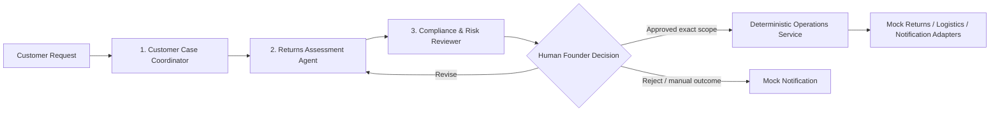

# Agent Context & Persistent Memory

> **Course requirements update (2026-09-14):** [docs/19](docs/19-course-assessment-requirements.md) is the dated Canvas/rubric evidence map; [docs/11](docs/11-stage1-readiness.md) is the submission checklist. Preserve the nine features and 89 WBS fixed fields. Each member has a personal AH/UC/Activity/Interaction/State chain and participates in all shared tasks; Lab 6 requires a named-instance Object Diagram distinct from Composite roles/ports. AI is allowed with acknowledgement, not fabricated personal completion. Older dated project-state snapshots below are history, not new acceptance evidence.

> **rc.5 publication reference (2026-09-07):** this revision is delivered through [PR #11](https://github.com/shuxiachai/returnops-au/pull/11), identified by the actual commit containing this notice. The PR records the exact source SHA, CI runs and review state; C must reproduce that SHA, not old `57d86fe` or a floating branch. Local-only/unpublished wording, test runs and raw-file hashes below are pre-publication history. Current Git content is recorded in `docs/reviews/rc5-publication-artifacts-20260907.json`. Publication does not establish acceptance, B/C review, C reproduction or a Jira update.

## Latest local defect correction — 2026-09-07

The lead authorised fixing six reviewed defects. Read [A-FIX-0.1](docs/reviews/a-defect-closure-20260907.md) before the older snapshots: local F.01 rc.5 / MA-0.3 / CS-0.2 / AD-0.2 / PD-0.2 / F03-D0.2 supersede the earlier local candidates. Changes cover deleted-receipt replay, durable known-label/artifact recovery, EXECUTING vocabulary, Composite connector parsing, proxy-independent Compose healthcheck and pinned local Docker context in the C reproduction packet. Wire shapes, seven operation states, fifteen routes, nine-feature ownership and 89 WBS dependencies stay unchanged; the 1-based count proposal is not adopted. HEAD remains 57d86fe and these fixes are uncommitted/unpublished. Existing PR #11/CI cover rc.4 only; no merge, Jira write, member signature, business implementation or F.01/F.02 acceptance occurred. C needs a future exact published fix SHA to reproduce. Earlier A-PREP hashes are historical; use the new correction manifest for current bytes.


## Latest local preparation — 2026-09-07

The lead requested completion of the ordered A preparation tasks. Read
[A-PREP-0.1](docs/reviews/a-preimplementation-readiness-20260907.md): new
AD-0.1 decisions, PD-0.1 Package/Deployment, F.03 authorization design,
A3 feasibility, C reproduction packet and A report draft are local candidates.
Existing rc.4 / MA-0.2 / CS-0.1 wire/behavior artifacts remain unchanged.
The shared-model checker now selects only `*-composite.puml` for CS parsing;
all nine PUML/SVG pairs remain covered. No F.01 acceptance or business API
implementation, personal human review, commit/push/merge or Jira write occurred.
HEAD remains `57d86fe`; the working tree is now dirty with these new materials.

Live read-only checks found PR #11 open at that head, no reviews, four successful
existing CI checks; main remains `9eb7b0b`. Jira KAN-32 still describes rc.2/PR #9;
KAN-14 only references F.02 as a dependency, so F.02's actual delivery key is
still unverified. The lead supplied Canvas course 74323: report 695832 and video
695833 both display Oct 4, 2026 23:59, locked until Sep 20 0:00; timezone and
locked upload rules are not visible. Canvas shows 25/5 points versus local
15/15 report/presentation-interview materials: seek clarification, do not remove
interviews. The lead explicitly says the team has no Australia Post/StarTrack
contract or test account; A3 access is unavailable today. Shippo is only a
public-documentation investigation direction, not an approved replacement.
Root handover files remain local; earlier snapshots below are historical.

> **Course**: USYD ELEC5620 Model-Based Software Engineering (Semester 2, 2026)  
> **Course Root**: `d:/AAA树下/硕士/26S2/5620`  
> **Project Repository**: `d:/AAA树下/硕士/26S2/5620/assignment/returnops-au`  
> **Topic**: ReturnOps AU (One-Person AI Company in E-Commerce & Retail)  
> **Target Rating**: 10/10 Project (Academic excellence + Portfolio value)

> **Baseline transition notice (2026-08-31)**: The project lead has approved
> [`docs/00-project-definition-v1.md`](docs/00-project-definition-v1.md) as the
> Baseline v1.0 candidate. It defines one Australian online store operated by a
> single Human Founder,
> three AI business roles, a deterministic Operations Service, and an MVP ending
> at an approved simulated return/label outcome plus notification. Use that
> candidate for new planning. The lead-directed publication to main occurred
> on 2026-09-06 (PRs #2/#4/#6), but current B/C approval, tutor feedback
> disposition and reviewed model-alignment adoption remain outstanding.
> Alignment and F.01 rc.2 were published for review in PR #9 on 2026-09-07,
> and the lead subsequently directed main publication. Check the PR's actual
> merge record and remaining review state before acting.
> Older seven-agent/multi-SME versions are historical inputs, not current scope.

---

## Allocation freeze — 2026-09-06

The lead approved [Frozen Work Allocation v1.0](docs/07-frozen-work-allocation.md)
and [Detailed Work Packages](docs/08-delivery-work-packages.md). Read both after
`docs/00` before assigning work. Nine feature owners, course-selected optionals,
hand-offs and acceptance boundaries stay fixed unless the lead explicitly
approves a material change. The plan has been published to main; this does not
claim B/C/tutor approval of the current revision, implementation completion or
live Jira updates.

C coordinates evaluation; A/B/C each implement tests for their own features and
participate in Gold label review. A implements Coordinator/Assessment and the
orchestrator; C implements Risk Reviewer, retrieval and image analysis. Consult
`docs/07` for submodule ownership rather than treating all agent code as A-owned.

## F.01 contract hand-off — 2026-09-07

**Current review package — 2026-09-07:** the lead explicitly authorised
committing the contract, model and environment changes, updating the existing
[PR #11](https://github.com/shuxiachai/returnops-au/pull/11) review entrance,
running real CI and requesting B/C review with C clean-environment reproduction.
The candidate versions are F.01 rc.4 / MA-0.2 / CS-0.1, plus health-only F.02.
Use that PR's exact commits, check runs and reviews for publication evidence;
earlier statements below about uncommitted work or PR #11 containing only rc.3
are preparation history. KAN-32 maps F.01, KAN-13 maps the A/shared model work;
F.02's actual Jira key is still unverified. Main and B/C PRs #7/#8 are preserved.
No merge, F.01/F.02 acceptance, member authorship or Jira change is implied.

**Local F.02 environment preparation — 2026-09-07:** the lead requested
environment preparation and asked why the preceding work was not committed.
The previous local-review boundary, not failing checks or B/C review, was the
reason; candidate commits/publication and acceptance are distinct. The current
working tree now includes health-only FastAPI, full hash dependency locks,
Alembic 0001_environment (no business tables), Compose and local CI files.
Read docs/10 before running anything. Native PostgreSQL 18.2 on a newly created
project-tmp cluster was used for environment/HTTP checks and stopped afterward;
the existing host PostgreSQL service on 5432 was not reused or stopped.
Subsequent lead-authorised Docker repair preserved the stale run and Secrets
Engine socket directories by same-parent rename; Desktop 4.85.0 / Engine 29.6.2
now runs without settings/ACL changes or data reset. Exact backups are in docs/10.
Compose build/start with PG17.11 passes; 30 Windows-venv tests against that
container and actual container HTTP success/outage/recovery checks pass.
The project's ignored .env now uses API_PORT=8001 to preserve academic_agent on
8000; project api/db remain running on loopback 8001/5433. Host PG18 is unchanged.
Real PR CI, C reproduction and joint F.02 acceptance remain pending.
No business API, F.01/F.02 acceptance, commit, push, Jira write or member review
is implied. The earlier rc.4/MA/CS work remains preserved in the dirty tree.

**Local defect-closure revision — 2026-09-07:** after the course/AI-application
career-fit audit the lead requested the next step. The current dirty branch
`docs/kan-13-a-model-chain` now holds rc.4 and MA-0.2 candidates, not a new
publication. PR #11 remains rc.3 at `90931562f7e8d038b994d8d3ff3b2f289e462643`.
Read docs/09 for two role-isolated history GETs (15 total), typed historical
material/provenance, bounded previews and snapshot/retention rules. Manual or
reject outcomes survive late operation confirmations; staged uploads do not
create a post-review customer append path. Internal input-capacity excess must
not silently truncate facts. Read docs/07–08 for sealed initial Gold labels
before timed-answer access, minimal review packets and separate R.05 source/
demo checks. IDs, owners, reviewers and S/F of the 89 WBS rows stay fixed.
KAN-13 was observed to cover M-A.01–06 and A-owned M-S.01/.02; docs/13 corrects
its earlier unmapped note. tools/model-checks provides tracked reproducible
static checks. No runtime service, F.01/model human acceptance, commit, upload,
PR/Jira write or member confirmation is performed by this local revision.
Older candidate descriptions below are chronological history, not current DTOs.

**Shared Composite candidate — 2026-09-07:** the lead then requested the next
step. [CS-0.1](docs/13-shared-composite-structure.md) adds three PlantUML/SVG
internal-structure views, 29 connectors with interface mappings and 12 static
walkthroughs. Domain remains the only CaseRepository caller and creates trusted
business AuditEvents; raw source receipts are observations until Domain accepts
their bindings. CS-D01/02/03 cover receipt forwarding, audit submission and mock
versus A3 configuration; CS-Q01/02 retain part-type and artifact-port details.
This remains local uncommitted work on `docs/kan-13-a-model-chain`, not part of
the earlier PR #11 publication. M-S.02 A/C ownership, S=M-S.01, F.01 acceptance,
actual B/C shared contribution and human review remain unchanged/pending.
Package/Deployment and final model-index work remain separate. No remote/Jira
action, runtime implementation or personal B/C completion is implied.

**Member A model candidate — 2026-09-07:** the lead asked to advance the model
chain. Read [MA-0.1](docs/12-member-a-model-chain.md): AH-10 / UC-04 with UC-03
admission, Activity, two Sequence panels and an OperationAttempt seven-state
model, plus 15 static walkthrough scenarios. Editable PlantUML and rendered
SVGs are under `docs/diagrams/member-a/`. This local work starts from rc.3
commit `90931562f7e8d038b994d8d3ff3b2f289e462643` on
`docs/kan-13-a-model-chain`; it was not part of PR #11's earlier publication.
It is AI-assisted preparation, not A's independent completion, C's review or
F.01 acceptance. MA-D01/02 propose attempt identity and query phases; MA-Q01/02/03
retain count/ID mapping, cross-approval recovery and runtime concurrency questions.
No new wire fields or runtime behavior are implemented. B/C models, shared
Composite Structure and original WBS ownership/dependencies remain unchanged.
Verify actual working-tree/publication state before any later remote action.

**Current-stage closure — 2026-09-07:** the lead asked to finish current
preparation before taking on the next task. Read
[Stage 1 readiness](docs/11-stage1-readiness.md): R.04.a–h cover requirements,
contract review, personal/shared models, report, ≤8-minute video, interview and
submission verification. A integrates/submits; C remains R.04 Owner for evidence
audit; B/C author their own materials. A maintains Jira, C verifies evidence;
C produces classification and B integrates M-S.03. Nine feature owners, 89 WBS
IDs and S/F dependencies are unchanged. Lab 5 pattern/method detail is now a
review draft in docs/02 and the shared class model, not accepted models.
E.09 validates the runner/adapter with labelled fixtures; R.03 verifies full B4.
Stage 1 submission follows the actual course deadline with open items disclosed,
without waiting for whole R.04/R.01 acceptance or final R.05/E.12. Actual Canvas
dates, member capacity, B/C reviews, complete personal/composite models and A3
test-access eligibility remain unverified or unfinished. These preparation
artifacts do not establish acceptance, a Jira update or a permission change.
The lead will record the course video personally later; B/C provide and verify
their model/contribution material and retain their individual interviews.

**Current review follow-up — 2026-09-07:** the lead authorised publication of
the F.01 consistency revision and its model/readiness materials for B/C review.
The follow-up branch carries candidate `1.0.0-rc.3`, not yet jointly accepted.
Technical review is tracked in [Issue #10](https://github.com/shuxiachai/returnops-au/issues/10)
on branch `fix/10-kan-32-contract-review`; #5 stays the baseline-adoption issue.
Read docs/09 and contracts/README for the
three exclusive decision targets: current proposal, technical failure, or
pre-proposal OrderLookupBlock. Only MANUAL_HANDLING may use a non-proposal
target; no approval or return/label dispatch follows. docs/00 and shared
models contain the corresponding candidate clarification, not new execution
authority. F.01 is actually mapped to
[KAN-32](https://lucastaooo.atlassian.net/browse/KAN-32); baseline review is
KAN-12 / Issue #5. PR #9 was merged as rc.2 and must not be re-merged or treated
as acceptance of rc.3. A now leads Jira maintenance without changing feature
owners or C's permissions. docs/10 records F.02 preparation and outstanding
API/PostgreSQL/migration/CI acceptance; its Jira key remains unmapped. Recheck
live remote and local state before later publication or workflow changes.

The paragraphs below retain the earlier rc.2 hand-off history.

The lead requested the first implementation-preparation step, F.01. Read
[the interface contract candidate](docs/09-interface-contract-v1.md) before
changing cross-member DTOs. `contracts/v1/schemas.json` is the shared wire
schema candidate and `openapi.json` defines planned public operations;
`tests/contracts` checks artifacts, not runtime authorization or safety.
B/C confirmation is pending. Do not mark F.01 accepted, claim a working API,
or treat old `packages/domain/models.py` as already migrated to this contract.
No change to the frozen nine-feature allocation is implied. The rc.2 revision
addresses the five identified contract-shape/hand-off gaps with offline
regressions: no-proposal manual handling, full retrieval/conflict propagation,
compatible citation capacities, analytics filters/denominators and strict ID
boundaries. The corresponding runtime guards are not implemented.

## Old-document alignment — 2026-09-07

`docs/01`, `02`, `04`, `05` and the five existing shared diagrams have been
aligned with `docs/00`, `07` and `08`; `docs/03` and navigation/status
wording were corrected as well. This is a lead-led integration draft, not B/C
individual authorship, accepted personal behaviour models or completed Stage 1.
Retain B's PR #8 source attribution and C's PR #7 branch history; do not treat
either PR as merged by this edit. F.01 rc.2 now includes the separate five-gap
contract revision. These changes are published in
[PR #9](https://github.com/shuxiachai/returnops-au/pull/9) on
`docs/5-f01-interface-contract`; review requests were sent to B and C.
Joint contract/model review remains pending; no runtime implementation
or Jira update is implied. The proposal-bound summary in docs/00 section 4.4
and FR-009 versus the failure-target manual exception remains an explicit
joint-confirmation item, not a silently adopted baseline change.

## 1. Project Background & One-Sentence Pitch

* **Product Name**: `ReturnOps AU`
* **Full Title**: *ReturnOps AU: A Human-Governed Multi-Agent Returns Operations System for a One-Person Australian Online Store*
* **One-Sentence Brief**:
  > ReturnOps AU turns a customer request, synthetic order data, customer evidence, store policy, and project-reviewed consumer guidance into a cited, non-executable decision packet for a single Australian online store operated by one Human Founder; only the Founder may approve an exact proposal, after which the prototype performs only the approved simulated return and parcel-label operation.

---

## 2. Topic Selection History & Discarded Alternatives

1. **Discarded Alternative 1: SME Grant & Tender Copilot (`BidPilot AU`)**
   * *Rationale for rejection*: Tender evaluation is subjective, making ground-truth benchmarks and quantitative scoring harder to defend in evaluation.
2. **Discarded Alternative 2: Academic Commercialisation Studio (`academic_agent`)**
   * *Rationale for rejection*: Reusing pre-existing personal codebase creates USYD academic integrity / recycling disclosure overhead and lacks clean team task separation.
3. **Discarded Alternative 3: Household Energy Optimisation (`EnergyPilot AU`)**
   * *Rationale for rejection*: Heavy reliance on mathematical optimization (OR-Tools) overshadowed the LLM Agent necessity; smart meter data acquisition was unrealistic.
4. **Selected Topic: `ReturnOps AU` (10/10 candidate)**
   * *Why it won*: Strong fit for "One-Person AI Company", three distinct AI business roles, strict human-in-the-loop governance, rich and traceable MBSE behaviour, reviewed Australian domain evidence, and a measurable 30-case Gold evaluation with parameterised safety/workflow coverage. It provides conditional guidance and does not claim legal compliance or legal correctness.

---

## 3. Team Structure & Workload Distribution (3-Person Team)

Aligned with **Lab 2 Requirement** (At least 3 distinct AI roles; each member individually implements at least 2 core features + 1 optional feature):

| Member | Role & Ownership | Planned Effort | Stage 1 (MBSE Modeling) Focus | Stage 2 (Implementation) Deliverables |
| :--- | :--- | :---: | :--- | :--- |
| **Member A (Lead / You)** | **System Architect & Backend / Agent Lead** | ~45% | System integration; Composite Structure, domain, approval/execution behaviour, and traceability models | **Core 1**: Authoritative return-case lifecycle.<br>**Core 2**: Exact-scope Founder approval and governed simulated execution.<br>**Optional**: Logistics sandbox/test adapter and recovery path. |
| **Member B (`@ChengsiLi`)** | **Frontend & User Experience Lead** | ~27% | Customer journey; use-case and intake behaviour; UI/UX flows | **Core 1**: Customer Intake & Clarification Portal.<br>**Core 2**: Founder Review & Approval Dashboard.<br>**Optional**: Operations Analytics Dashboard. |
| **Member C (`@lulucas-tao`)** | **Grounding, Risk & AI Evaluation Lead** | ~28% | Grounding/risk requirements and behaviour; evaluation metrics and traceability | **Core 1**: Versioned Guidance Retrieval & Citation Verification.<br>**Core 2**: Independent Risk Review & Escalation.<br>**Optional**: Product-image Evidence Analysis.<br>Coordinates Gold data, evaluation runner and `B1` versus `B4`; each member tests their own features and participates in label review. |

---

## 4. Multi-Agent Architecture & Governed Loop



### Agent Roles & Boundaries
1. **Customer Case Coordinator Agent**: Preserves the original request, extracts typed facts, identifies missing or conflicting information, and asks targeted follow-ups.
2. **Returns Assessment Agent**: Reads a synthetic order snapshot, constructs the evidence matrix, retrieves versioned sources, and drafts a cited conditional decision packet without making a final legal determination.
3. **Compliance & Risk Reviewer Agent**: Uses an independent invocation to verify evidence, citations, material conflicts, scope, and prompt-injection/authority risks. It can pass, warn, revise, request information, or escalate, but cannot approve or execute.
4. **Human Founder (Gatekeeper)**: The only actor who can approve, reject, request revision, or record a manual outcome for a current proposal.
5. **Deterministic Operations Service**: Revalidates identity, proposal version, exact approval scope, provider authority, allowlist, and idempotency before any approved simulated return/label and notification action. It is not an AI agent.

---

## 5. Planned Technology Stack & Target Directory Structure

> This is a target layout, not a statement of current implementation. At the
> v1.0-candidate stage, the repository contains requirements/UML, the existing
> `packages/domain` models, synthetic fixtures, and a small test set. API,
> frontend, agent, evaluation, CI, Docker, and deployment assets remain
> `Planned` until code and reproducible evidence exist.

```text
returnops-au/
├── apps/
│   ├── api/                 # Backend FastAPI application (Member A)
│   └── web/                 # Frontend Next.js + TailwindCSS UI (Member B)
├── packages/
│   ├── agent_core/          # A: orchestration/Coordinator/Assessment; C: Risk/image
│   ├── domain/              # Pydantic schemas, entities, state definitions (Member A)
│   ├── provider_adapters/   # A: order/returns/logistics/notification; C owns retrieval
│   └── evaluation/          # Benchmark suite & evaluation runner (Member C)
├── docs/                    # Project Charter, System Design, Team Workflow, Backlog
├── tests/
│   ├── fixtures/            # A: orders/providers; B: UI samples; C: corpus/evaluation
│   └── evaluation_cases/    # 30 Gold cases plus parameterised suites (Member C)
├── AGENTS.md                # This persistent memory file
├── docker-compose.yml       # Local development orchestration
└── README.md                # Project landing page
```

---

## 6. Key Assessment Milestones

* **Stage 1 (30 Marks; current source map in docs/19)**:
  * 15 Marks: Report: full requirements, individual AH/UC/Activity/Interaction/State and shared Feature/overall UC/Class/Complex Structure, with actual contributions.
  * 5 Marks: Video within 8 minutes; 10 Marks: individual interview in Week 11/12 practicals under the current rubric.
  * Ad hoc diagram, Architecture Analysis, Package and Deployment are optional rubric rows; useful existing models and Lab design explanations remain. Lab 6 separately requires an Object Diagram.
  * Canvas report/video display Oct 4, 2026 23:59, locked until Sep 20 0:00; timezone/locked rules and 25/5 task-point grouping remain to verify. Do not remove interview or infer submission success.
* **Stage 2 (20 Marks; use the current official assessment schedule)**:
  * Working Agile Prototype Demonstration to tutors.
  * Code submission on Canvas.
* **Exams (50%)**: Week 9 Mid-semester online quiz (10%) + Final exam (40%).

---

## 7. Instructions for Any Agent Working in this Codebase

1. **Preserve Architectural Rigor**: Every feature must map to a Requirement ID (`FR-xxx`, `NFR-xxx`) and MBSE model.
2. **Do Not Bypass Human Approval**: An LLM agent must never directly mutate authoritative state, create an `ApprovalRecord`, or call a high-impact provider. Every high-impact operation requires an exact-scope `ApprovalRecord`; ordinary case, clarification, and audit writes must still pass through deterministic application services and state guards.
3. **Keep Code Modular**: Maintain separation between `apps/api`, `apps/web`, and `packages/*`.
4. **Synthetic Data Only**: Never commit real personal customer data or copyrighted USYD lecture materials to public Git repos.
5. **Check Current Status**: Read the lead-approved candidate
   `docs/00-project-definition-v1.md`, its remaining adoption reviews, and
   GitHub Issues before creating new components. `docs/04` is a derived
   requirements/backlog view, not an alternate authority; its v0.2 version is
   retained in history. Use `docs/07` and `docs/08` for fixed ownership and
   work-package dependencies. Do not reintroduce the old seven-agent or
   multi-SME scope, or confuse main publication with final adoption.
6. **Preserve the Delivery Record**: Jira is the Agile planning/timeline system
   of record; GitHub Issues/PRs/commits/CI are the technical delivery record.
   Every delivery item must carry one Jira key and link the corresponding GitHub
   evidence. Do not create or maintain a duplicate GitHub Project status board.
7. **Respect Scope Freezes**: Do not routinely expand the frozen requirements
   research appendix, the 30-case Gold set, or the required `B1` versus `B4`
   comparison. `B2`/`B3` and expansion towards 100 scenarios are portfolio work.
