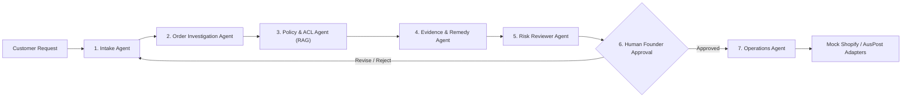

# Agent Context & Persistent Memory

> **Course**: USYD ELEC5620 Model-Based Software Engineering (Semester 2, 2026)  
> **Course Root**: `d:/AAA树下/硕士/26S2/5620`  
> **Project Repository**: `d:/AAA树下/硕士/26S2/5620/assignment/returnops-au`  
> **Topic**: ReturnOps AU (One-Person AI Company in E-Commerce & Retail)  
> **Target Rating**: 10/10 Project (Academic excellence + Portfolio value)

---

## 1. Project Background & One-Sentence Pitch

* **Product Name**: `ReturnOps AU`
* **Full Title**: *ReturnOps AU: An Evidence-Grounded Multi-Agent Returns and Remedy Operations Company for Australian E-Commerce SMEs*
* **One-Sentence Brief**:
  > For Australian e-commerce SME founders handling product-problem requests, resolution is slow and inconsistent because customer messages, order records, store policies, consumer-law guidance (ACCC), and logistics state are fragmented. ReturnOps AU coordinates intake, investigation, policy, resolution, and audit agents to produce an evidence-grounded proposed remedy within two minutes and complete approved follow-up, while the human founder retains full accountability and approves refunds, replacements, repairs, and other high-impact actions.

---

## 2. Topic Selection History & Discarded Alternatives

1. **Discarded Alternative 1: SME Grant & Tender Copilot (`BidPilot AU`)**
   * *Rationale for rejection*: Tender evaluation is subjective, making ground-truth benchmarks and quantitative scoring harder to defend in evaluation.
2. **Discarded Alternative 2: Academic Commercialisation Studio (`academic_agent`)**
   * *Rationale for rejection*: Reusing pre-existing personal codebase creates USYD academic integrity / recycling disclosure overhead and lacks clean team task separation.
3. **Discarded Alternative 3: Household Energy Optimisation (`EnergyPilot AU`)**
   * *Rationale for rejection*: Heavy reliance on mathematical optimization (OR-Tools) overshadowed the LLM Agent necessity; smart meter data acquisition was unrealistic.
4. **Selected Topic: `ReturnOps AU` (10/10)**
   * *Why it won*: Perfect fit for "One-Person AI Company", distinct business roles, strict human-in-the-loop governance, rich MBSE UML states (13 states + exceptions), Australian Consumer Law (ACL/ACCC) compliance, and measurable 100-case evaluation benchmark.

---

## 3. Team Structure & Workload Distribution (3-Person Team)

Aligned with **Lab 2 Requirement** (At least 3 distinct AI roles; each member individually implements at least 2 core features + 1 optional feature):

| Member | Role & Ownership | Planned Effort | Stage 1 (MBSE Modeling) Focus | Stage 2 (Implementation) Deliverables |
| :--- | :--- | :---: | :--- | :--- |
| **Member A (Lead / You)** | **System Architect & Backend / Agent Lead** | ~48% (~160h) | System Architecture, Package Diagram, Domain Class Diagram, State Machine, Core Sequence Diagrams, Report Integration | **Core 1**: FastAPI & PostgreSQL schema & Domain API.<br>**Core 2**: LangGraph Multi-Agent Orchestrator & State Flow (Intake, Order, Policy, Remedy, Risk).<br>**Optional**: Mock Adapters (Shopify/AusPost) & Docker containerization. |
| **Member B** | **Frontend & User Experience Lead** | ~25% (~90h) | User Journey, Use Case Diagrams & detailed use-case steps, UI/UX Wireframes & screen flow | **Core 1**: Customer Submission & Evidence Portal.<br>**Core 2**: Founder Operations & Approval Dashboard.<br>**Optional**: Analytics Dashboard for return trends & handling times. |
| **Member C** | **QA & AI Evaluation Lead** | ~27% (~100h) | Acceptance Criteria, Evaluation Metrics Matrix, Requirements Traceability Matrix, Policy/ACCC Corpus | **Core 1**: 100-case Benchmark Dataset & Ground Truth Labeling.<br>**Core 2**: Automated AI Evaluation Pipeline (4 architecture comparisons, accuracy/recall/cost scripts).<br>**Optional**: Prompt Injection / Safety Guardrail testing & GitHub Actions CI. |

---

## 4. Multi-Agent Architecture & Governed Loop



### Agent Roles & Boundaries
1. **Intake Agent**: Extracts structured facts (order ID, item, issue, claimed date, expected outcome) from natural language; asks targeted follow-ups.
2. **Order Investigation Agent**: Queries mock Shopify GraphQL adapter for payment status, purchase date, item records.
3. **Policy & ACL Agent**: RAG retrieval over store 14-day policy and ACCC statutory warranty rules. Distinguishes *Faulty Item* vs *Change of Mind*.
4. **Evidence & Remedy Agent**: Evaluates major vs minor failure evidence and drafts a typed remedy proposal (repair, replace, refund).
5. **Risk Reviewer Agent**: Validates citations, detects hallucinations/unsupported claims, triggers escalation if confidence < 80% or conflict detected.
6. **Human Founder (Gatekeeper)**: Mandatory human gate for all financial/inventory impact actions. AI CANNOT self-authorize refunds.
7. **Operations Agent**: Executes approved commands with idempotency keys (creates return label, updates mock order status).

---

## 5. Technology Stack & Directory Structure

```text
returnops-au/
├── apps/
│   ├── api/                 # Backend FastAPI application (Member A)
│   └── web/                 # Frontend Next.js + TailwindCSS UI (Member B)
├── packages/
│   ├── agent_core/          # LangGraph multi-agent workflows & prompts (Member A)
│   ├── domain/              # Pydantic schemas, entities, state definitions (Member A)
│   ├── provider_adapters/   # Mock Shopify, AusPost, Knowledge Base (Member A)
│   └── evaluation/          # Benchmark suite & evaluation runner (Member C)
├── docs/                    # Project Charter, System Design, Team Workflow, Backlog
├── tests/
│   ├── fixtures/            # Mock orders, policies, products (Member B & C)
│   └── evaluation_cases/    # 100 labelled synthetic evaluation cases (Member C)
├── AGENTS.md                # This persistent memory file
├── docker-compose.yml       # Local development orchestration
└── README.md                # Project landing page
```

---

## 6. Key Assessment Milestones

* **Stage 1 (30 Marks - Week 8)**:
  * 15 Marks: Formal Report (Requirements classification, Feature Diagram, Use Cases, Package/Class/Activity/State/Sequence diagrams, Traceability).
  * 15 Marks: Presentation & Interview (Design rationale, discarded choices, model overview, acceptance criteria).
* **Stage 2 (20 Marks - Week 13)**:
  * Working Agile Prototype Demonstration to tutors.
  * Code submission on Canvas.
* **Exams (50%)**: Week 9 Mid-semester online quiz (10%) + Final exam (40%).

---

## 7. Instructions for Any Agent Working in this Codebase

1. **Preserve Architectural Rigor**: Every feature must map to a Requirement ID (`FR-xxx`, `NFR-xxx`) and MBSE model.
2. **Do Not Bypass Human Approval**: No autonomous money transfers or database mutations without an explicit `ApprovalRecord`.
3. **Keep Code Modular**: Maintain separation between `apps/api`, `apps/web`, and `packages/*`.
4. **Synthetic Data Only**: Never commit real personal customer data or copyrighted USYD lecture materials to public Git repos.
5. **Check Current Status**: Read `docs/04-requirements-and-backlog.md` and GitHub Issues before creating new components.
