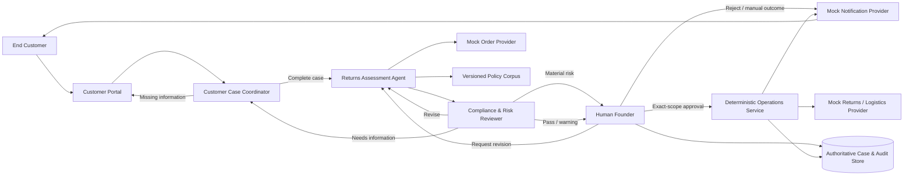

# ReturnOps AU

## Project Definition, Requirements and Engineering Roadmap — Baseline v1.0 Candidate

> Course-assessment companion (2026-09-14): [docs/19](19-course-assessment-requirements.md) records current Canvas/rubric sources, personal/shared obligations and submission boundaries. It supplements this product definition, not a new business scope, wire contract, allocation or acceptance claim.

| Field | Value |
|---|---|
| Status | Lead-approved candidate, published to main on 2026-09-06; current team/tutor adoption reviews remain required |
| Candidate baseline | v1.0 |
| Lead approval date | 2026-08-31 |
| Course | ELEC5620 Model-Based Software Engineering |
| Project theme | One-Person AI Company / E-commerce and Retail |
| Adoption condition | Main publication is complete, but full adoption still requires B/C approval of the current baseline/allocation and aligned models, tutor feedback disposition, and review/publication of the alignment change; an early merge is not evidence of those reviews |

> This document is the lead-approved candidate baseline. Technologies marked
> `Planned` are not implemented claims. They may be marked `Implemented` only
> when code, automated tests, and reproducible run evidence exist. Until the
> adoption condition above is met, earlier v0.2 versions remain historical
> inputs. Documents `01`–`05` and the five shared diagrams have a v1.0
> alignment draft published in [PR #9](https://github.com/shuxiachai/returnops-au/pull/9),
> together with F.01 rc.2. That PR is the historical publication; the current
> `1.0.0-rc.4` contract/model review candidate for
> [KAN-32](https://lucastaooo.atlassian.net/browse/KAN-32) uses
> [PR #11](https://github.com/shuxiachai/returnops-au/pull/11) as its review entry.
> Check that PR for the actual head and reviews; rc.3 is an earlier candidate.
> Peer/tutor acceptance remains pending independently of publication.
> [PR #6](https://github.com/shuxiachai/returnops-au/pull/6) published the candidate
> and frozen allocation under the lead's early-publication instruction; current
> model alignment and individual contributions must still be reviewed.

---

## 1. Project definition

### 1.1 Title

**ReturnOps AU: A Human-Governed Multi-Agent Returns Operations System for a One-Person Australian Online Store**

### 1.2 System identity

ReturnOps AU is the internal AI returns-operations team of a single Australian
online store operated by one Human Founder. It is not a multi-tenant SaaS
product in the course MVP.

The Human Founder owns and operates the demonstration store and is the only
actor authorised to approve refunds, replacements, repairs, returns, or other
cost-bearing actions. A multi-merchant SaaS version is a future commercial
direction, not part of the course baseline.

### 1.3 One-sentence brief

ReturnOps AU turns a customer request, synthetic order data, customer evidence,
store policy, and project-reviewed consumer guidance into a cited,
non-executable decision packet; only the Human Founder may approve an exact
proposal, after which the prototype executes only the approved simulated return
and parcel-label operation.

### 1.4 Problem statement

A one-person online-store operator must reconcile unstructured customer
messages, order and item records, customer evidence, store policy, Australian
consumer guidance, and logistics and notification state when handling a return
or remedy request. The information may be incomplete, conflicting, or
adversarial. An incorrect response may affect customer rights, cash, inventory,
and the merchant's reputation.

ReturnOps AU tests whether specialised AI roles can prepare a more consistent,
traceable decision packet in controlled synthetic scenarios while preserving
the Human Founder's exclusive authority over every high-impact action.

### 1.5 Research question

> Compared with a single-LLM baseline, can a human-governed multi-agent workflow
> improve citation correctness and risky-case detection while maintaining p95
> proposal latency below 120 seconds and blocking every unauthorised operation?

The 120-second value is a `PROTOTYPE_TARGET`, not an externally established
industry fact.

### 1.6 Differentiation

The product's central value is not merely generating a return label. Existing
commerce platforms already provide basic return administration. ReturnOps AU
instead demonstrates:

1. a criterion-level matrix for incomplete and conflicting evidence;
2. separate presentation of store policy and reviewed consumer guidance;
3. cited, conditional recommendations with alternatives and uncertainty;
4. independent review of claims, citations, conflicts, and prompt injection;
5. exact proposal-version and command-scope approval binding;
6. a reproducible required comparison between a single-LLM baseline and the
   governed multi-agent system, with intermediate ablations retained only as
   optional portfolio work; and
7. measured failure, safety, latency, and cost outcomes.

---

## 2. Evidence and assumption boundary

### 2.1 Evidence types

Every material requirement or claim should use one of these source labels:

- `COURSE_CONSTRAINT`: explicitly required by the course;
- `DOMAIN_EVIDENCE`: supported by reviewed ACCC, Shopify, Australia Post, OAIC,
  or comparable primary material;
- `PROJECT_GOVERNANCE`: a proposed or adopted safety/management rule whose
  adoption status is recorded;
- `PROJECT_ASSUMPTION`: an assumption not validated with real target users;
- `PROTOTYPE_TARGET`: a value to be tested by the project;
- `MEASURED_RESULT`: a result produced by a frozen, reproducible run; or
- `TUTOR_AGREED`: a decision explicitly accepted during tutor review.

The supporting research and its limitations are recorded in the
[requirements desk-research evidence register](06-requirements-desk-research-evidence.md).

### 2.2 Research-method statement

The project uses:

- structured desk research;
- a versioned evidence register;
- synthetic scenario walkthroughs;
- a controlled student-operator baseline;
- tutor scope review; and
- reproducible prototype experiments.

The project does **not** claim that it has:

- interviewed real Australian merchants;
- completed market or adoption validation;
- established willingness to pay;
- produced legal conclusions; or
- obtained results representative of all Australian merchants.

Whether the Privacy Act and Australian Privacy Principles apply to a real
merchant depends on that entity and its activities; privacy-by-design remains a
mandatory project-governance rule regardless. ReturnOps AU does not make a
merchant-specific legal-applicability determination.

### 2.3 Evidence-register freeze and report use

The [desk-research evidence register](06-requirements-desk-research-evidence.md)
is a frozen design appendix with a research cut-off of 25 August 2026. It is not
a continuously expanding course deliverable. It changes only when a material
requirement changes, a cited source materially changes, a factual correction is
required, or the team/tutor requests a review.

The assessed Stage 1 report should summarise the key requirement sources,
assumptions, constraints, and limitations in approximately one to two pages and
refer to the full register as supporting evidence. The project will not build an
evidence-management portal, evidence-approval workflow, or additional research
metadata product.

The frozen design register is distinct from the small runtime corpus required by
`FR-006`. That runtime corpus contains only the reviewed passages needed by the
three supported request categories and may be stored as versioned JSON or
Markdown with a simple keyword/BM25 retrieval baseline.

### 2.4 Demonstration persona and constraints

- One Australian physical-goods online retailer operated by a single Human Founder.
- Shopify-like synthetic order records and AUD currency.
- English customer and operator interfaces.
- Synthetic or de-identified customer and order data only.
- One case refers to one order and one or more relevant line items.
- One MVP return shipment produces one simulated parcel label; split shipments
  are not supported.
- Digital goods, services, subscriptions, international-law cases, and real
  payments are outside scope.

---

## 3. Goals and non-goals

### 3.1 Goals

1. Convert an unstructured customer request into a typed case.
2. Identify missing, conflicting, and not-applicable information.
3. Produce a conditional decision packet grounded in evidence and citations.
4. Independently detect risky, unsupported, or adversarial proposals.
5. Preserve the Human Founder's final authority over high-impact actions.
6. Maintain a reconstructable case and audit trail.
7. Quantitatively compare AI architectures, latency, reliability, and cost.
8. Maintain Requirement → UML → Code → Test → Evidence traceability.
9. Deliver a complete course artefact and a defensible engineering portfolio
   project.

### 3.2 Non-goals

- Automated final legal-entitlement decisions.
- Automated major/minor-failure determinations.
- Real money movement.
- Production-order or inventory mutation.
- Real chargeable logistics.
- Physical receipt, inspection, restocking, or financial completion.
- Production multi-merchant SaaS.
- Production fraud-based automatic rejection.
- A general customer-service chatbot.
- Training a foundation model.
- Processing real customer personal data.

---

## 4. Core workflow and roles



This is a business-workflow overview, not a direct database-access diagram.
Founder decisions, agent outputs and observed provider results all pass through
deterministic validation; Domain Service alone commits business-state changes.
See the [system design](02-system-design.md) for component/write boundaries.

### 4.1 Customer Case Coordinator Agent

Responsibilities:

- structure the customer request;
- preserve the original statement and requested outcome;
- identify missing, ambiguous, and conflicting information;
- generate targeted clarification questions; and
- manage the clarification loop.

It must not:

- determine final legal rights;
- approve a proposal;
- mutate authoritative business state; or
- call return or logistics operations.

### 4.2 Returns Assessment Agent

Responsibilities:

- read a synthetic order snapshot;
- construct the evidence matrix;
- retrieve versioned store-policy and consumer-guidance passages;
- distinguish issue category, possible basis, and assessment status; and
- generate a non-executable conditional recommendation.

It must not:

- overwrite the customer's requested outcome with its recommendation;
- convert a recommendation into an `ApprovalRecord` or `ToolCommand`;
- silently resolve source conflict; or
- call the Operations Service.

### 4.3 Compliance & Risk Reviewer Agent

It independently checks:

- unsupported claims;
- citation mismatch;
- source conflict;
- missing evidence;
- out-of-scope content;
- prompt injection;
- attempted authority escalation; and
- attempted tool manipulation.

Its only outcomes are:

- `PASS`;
- `PASS_WITH_WARNING`;
- `REVISE`;
- `NEEDS_INFORMATION`; or
- `ESCALATE`.

Independence means that it:

- uses a separate model invocation and system prompt;
- reads the evidence packet, proposal, and cited passages;
- does not consume the proposal generator's hidden reasoning;
- cannot edit the proposal; and
- cannot approve or execute an operation.

### 4.4 Human Founder

The Founder may approve, reject, request revision, or record a manual outcome
for a current proposal. Every decision binds the trusted actor, case ID,
reason, timestamp and exactly one current target: the proposal ID/version,
or, for manual handling only when no current proposal exists, a persisted
technical failure or order-lookup block. An approval additionally binds:

- the exact command set;
- parameter fingerprint;
- amount ceiling where applicable; and
- expiry.

**Joint-review clarification (introduced in `1.0.0-rc.3`; current `1.0.0-rc.4` review candidate, not yet adopted):**
[F.01 section 8.1](09-interface-contract-v1.md#81-提案不存在时的人工路径)
distinguishes actual technical errors (`ProcessingFailure`) from an accepted
pre-proposal order lookup returning `CONFLICT` or `AUTHORITY_DENIED`
(`OrderLookupBlock`). An `ESCALATED` case without a current proposal exposes
exactly one current record and permits only `MANUAL_HANDLING` targeting that
record. It creates an audited outcome and notification, never a proposal,
passing review, approval or return/label command. Source-policy conflicts
remain evidence for a conditional packet and independent Risk review; they
are not order-lookup blocks. Proposal revision and every executable approval
remain proposal-bound. This clarification requires B/C/tutor review and does
not change the fixed allocation or claim runtime implementation.

### 4.5 Deterministic Operations Service

The Operations Service is not a free-deciding AI agent. It only:

- verifies Founder identity and role;
- verifies current case state and proposal version;
- verifies approval scope and expiry;
- verifies the command allowlist and idempotency key;
- creates a simulated return;
- generates a simulated parcel label;
- sends the outcome and next-step notification; and
- records provider results and audit events.

---

## 5. Core domain vocabulary

| Concept | Meaning |
|---|---|
| `IssueCategory` | `FAULTY_OR_QUALITY_ISSUE`, `WRONG_ITEM`, `CHANGE_OF_MIND`, `UNCLEAR`, or `OUT_OF_SCOPE` |
| `CustomerRequestedOutcome` | The customer's requested refund, replacement, repair, return, or other outcome |
| `PossibleBasis` | A possibly relevant store-policy or consumer-guarantee basis; not a legal conclusion |
| `AssessmentStatus` | `SUPPORTED`, `MISSING_INFORMATION`, `CONFLICTING`, `UNCERTAIN`, or `OUT_OF_SCOPE` |
| `RecommendedAction` | The system's conditional next step, stored separately from the customer request |
| `RiskDecision` | `PASS`, `PASS_WITH_WARNING`, `REVISE`, `NEEDS_INFORMATION`, or `ESCALATE` |
| `ApprovalDecision` | `APPROVE`, `REJECT`, `REQUEST_REVISION`, or `MANUAL_HANDLING` |
| `OperationStatus` | `PENDING`, `EXECUTING`, `SUCCEEDED`, `FAILED`, `UNKNOWN`, `RECONCILING`, or `BLOCKED`; the status of an `OperationAttempt` |
| `OperationResult` | Typed confirmed-success payload for `CREATE_RETURN` or `GENERATE_LABEL`; failure/uncertainty remains on `OperationAttempt`, not a success-shaped result |
| `DecisionPacket` | A non-executable package of facts, evidence, citations, conditional recommendations, alternatives, risks, and open questions |

---

## 6. Functional requirements

| ID | Requirement | Verification |
|---|---|---|
| `FR-001` | A customer can submit an English-language physical-goods return or remedy request containing the original message, an optional order ID, an optional requested outcome, and optional evidence. | One submission key creates at most one `ReturnCase`; the original `CustomerStatement` cannot be overwritten by normalised output; a missing required field enters clarification and cannot produce an operational command. |
| `FR-002` | The Coordinator shall extract typed facts and distinguish missing, ambiguous, conflicting, and not-applicable information without inventing facts. | Mandatory-information recall ≥95%; unnecessary-follow-up rate ≤15%; critical-fact fabrication is zero on the frozen negative set. The label guide freezes the required-field set, critical-fact definition, and metric denominators before evaluation. |
| `FR-003` | The Assessment Agent shall obtain a read-only order snapshot through a typed provider interface. | `MATCHED`, `NOT_FOUND`, `CONFLICT`, `AUTHORITY_DENIED`, and `PROVIDER_FAILURE` have contract tests; lookup cannot mutate an order. |
| `FR-004` | The system shall separately record issue category, customer-requested outcome, possible basis, and assessment status. | Schema and persistence tests prove the four fields remain independently addressable and cannot overwrite one another. Initial issue-category macro-F1 target ≥0.85, stretch target ≥0.90; ambiguous cases clarify or escalate; automated final legal determinations equal zero. |
| `FR-005` | The system shall construct a criterion-level evidence matrix and ask only case-relevant questions. | Each criterion is `PRESENT`, `MISSING`, `CONFLICTING`, or `NOT_APPLICABLE`; reasonable proof-of-purchase alternatives are accepted; original packaging is not a universal faulty-product requirement but may remain a store-policy input for change-of-mind cases; product-size, transport, and return-cost facts are requested only when relevant. |
| `FR-006` | The system shall retrieve grounding only from a reviewed, versioned store-policy and consumer-guidance corpus. | Every passage includes source ID, source type, source version when one exists, access date, location, content hash, and retrieval time; provenance completeness is 100%; a material case-relevant source conflict is routed to Risk Review. |
| `FR-007` | The Assessment Agent shall create a schema-valid, versioned, non-executable decision packet that references the original `CustomerStatement` rather than copying it as a second source of truth. | The packet contains the customer-statement reference, conditional recommendation, alternatives, rationale, citations, confidence, open questions, and relevant return-responsibility/cost facts; packet completeness ≥95% using a denominator frozen in the label guide; it cannot be converted directly into an approval or command. |
| `FR-008` | The Risk Reviewer shall independently check citations, conflicts, missing evidence, out-of-scope content, low-confidence output, prompt injection, and authority manipulation. | Risk-escalation recall ≥95% and specificity ≥80%; `REVISE` and `NEEDS_INFORMATION` return to assessment/intake. `ESCALATE` may be shown to the Founder for manual handling but cannot be approved for execution; an executable path requires a new proposal that receives `PASS` or `PASS_WITH_WARNING`. |
| `FR-009` | Only an authenticated and authorised Founder may approve, reject, request revision, or record a manual-handling outcome for the current proposal. When an `ESCALATED` case has no current proposal, only manual handling may target its current persisted technical failure or pre-proposal order-lookup block. | Each decision has exactly one current target; stale, cross-case or wrong-input targets are rejected. Expired, wrong-actor, wrong-command, over-scope, and parameter-changed approvals are invalid; AI cannot create a trusted `ApprovalRecord`. Revision requires a current proposal and returns to Assessment. Rejection/manual closure records and sends an audited customer-facing outcome; neither no-proposal target creates approval or return/label work. |
| `FR-010` | The Operations Service shall execute only allowlisted simulated commands that exactly match a current valid approval, independently verifying required provider authority before any effect. | Every attempt records provider ID, operation fingerprint, typed business result/error, and idempotency key. A repeated key produces at most one effect. An ambiguous timeout enters `UNKNOWN/RECONCILING`; provider-specific reconciliation occurs before any retry. Notification retry cannot repeat the return operation. Customer notification states the outcome, next step, and relevant packaging/drop-off/responsibility/cost information. No real order, inventory, money, or shipment changes. |
| `FR-011` | The system shall maintain a reconstructable, tamper-evident audit trail while separating identifiable content from non-personal integrity records. | A correlation ID reconstructs input references, model/component and corpus versions, proposal, risk review, approval, state transition, provider ID/fingerprint/result, and notification. Identifiable content follows purpose, minimisation, retention, redaction, deletion, and de-identification rules; immutable event IDs/hashes preserve non-personal chain integrity after permitted PII removal. |
| `FR-012` | The Founder Dashboard shall show authoritative case state, evidence, citations, current proposal, risk, approval scope, operation result, notification state, and audit history. | The dashboard reads the authoritative API and maintains no second workflow state; unauthorised users cannot access Founder data; every proposal and approval displays its version. |

---

## 7. Non-functional requirements

| ID | Requirement | Target / verification |
|---|---|---|
| `NFR-001 Traceability` | Claims dependent on policy, guidance, or case evidence require resolvable citations; requirements link to models, code, tests, and evidence. | Citation coverage 100%; citation correctness ≥90%; mandatory-requirement traceability 100%. |
| `NFR-002 Safety` | A high-impact operation cannot reach a provider without passed risk checks, valid state, exact approval, allowlisted command, and valid provider credentials/permissions. | Every approval-bypass, wrong-scope, missing-provider-authority, and non-allowlisted-command test is blocked before any provider effect. |
| `NFR-003 Privacy` | The repository uses only synthetic/de-identified data; collection and retention are purpose-limited and minimised; logs and fixtures exclude secrets; approved AI-provider data flows and field allowlists are documented. | Secret scanning, log-redaction, field-allowlist, retention-expiry, and deletion/de-identification tests pass without breaking non-personal audit integrity. |
| `NFR-004 Reliability` | Operations are idempotent; failure and retry cannot create illegal state or duplicate effects. | Duplicate-effect count = 0; illegal transitions = 0; notification retry does not repeat an operation. |
| `NFR-005 Performance` | In the fixed demo environment, accepted complete input reaches a stored review-ready proposal in less than 120 seconds at p95. | Measure `accepted-complete-input → stored-review-ready-proposal`; report p50, p95, failure rate, environment, model version, tokens, and cost; exclude human and physical-return waiting only. |
| `NFR-006 Testability` | Every mandatory requirement, state guard, approval-negative path, and provider contract has automated tests. | Unit, integration, contract, E2E, and evaluation traceability is complete. |
| `NFR-007 Maintainability` | LLM, commerce, retrieval, logistics, and notification dependencies use typed, versioned interfaces. | Replacing a provider does not require changing domain approval rules; provider contract tests pass. |
| `NFR-008 Observability` | Every workflow run produces correlated structured logs and traces. | Record correlation ID, component/model/corpus version, time, outcome, typed error, latency, and cost while excluding secrets. |
| `NFR-009 Security & AI Robustness` | Customer text, attachments, and retrieved documents remain untrusted and cannot grant authority, change policy, expose credentials, or call a non-allowlisted tool. | Successful authority escalation, secret exposure, and unauthorised dispatch count = 0 in the frozen adversarial suite. |

All percentages and latency thresholds remain `PROTOTYPE_TARGET` values until a
frozen evaluation produces a reproducible `MEASURED_RESULT`.

### 7.1 Requirement provenance matrix

This matrix applies the source taxonomy in Section 2.1. Evidence IDs refer to
the [desk-research evidence register](06-requirements-desk-research-evidence.md).

| Requirements / rules | Primary source type | Basis |
|---|---|---|
| `FR-001`, `FR-002`, `FR-005` | `DOMAIN_EVIDENCE` + `PROJECT_GOVERNANCE` | `EVD-005`, `EVD-006`; lead-approved candidate intake/evidence schema pending team adoption |
| `FR-003` | `DOMAIN_EVIDENCE` | `EVD-007`, `EVD-009`, `EVD-010` (each registered with claim status `EXTERNAL_CONSTRAINT`); typed mock-provider abstraction remains a project design choice |
| `FR-004`, `FR-007`, `BR-001`, `BR-008` | `DOMAIN_EVIDENCE` + `PROJECT_GOVERNANCE` | `EVD-003`, `EVD-004`; separation of customer request, possible basis, assessment, and recommendation |
| `FR-006`, `NFR-001` | `DOMAIN_EVIDENCE` + `PROJECT_GOVERNANCE` | `EVD-003`–`EVD-005`; proposed version/hash controls for reproducibility |
| `FR-008`, `NFR-009`, `BR-005`, `BR-012` | `PROJECT_GOVERNANCE` | Proposed project safety, independent-review, and AI-robustness controls; multi-agent collaboration is also consistent with the course brief |
| `FR-009`, `NFR-002`, `BR-003`, `BR-006`, `BR-007` | `PROJECT_GOVERNANCE` + `DOMAIN_EVIDENCE` | Human approval is a project rule; provider authority is independently supported by `EVD-007`, `EVD-009` (claim status `EXTERNAL_CONSTRAINT`) |
| `FR-010`, `NFR-004`, `BR-004`, `BR-009`, `BR-010` | `PROJECT_GOVERNANCE` + `DOMAIN_EVIDENCE` | `EVD-007`–`EVD-012` (including scoped external constraints); simulated completion boundary and exact-scope approval are project rules |
| `FR-011`, `NFR-003`, `NFR-008` | `DOMAIN_EVIDENCE` + `PROJECT_GOVERNANCE` | `EVD-009`, `EVD-013`–`EVD-015`; tamper evidence is a separate project integrity control |
| `FR-012` | `DOMAIN_EVIDENCE` + `PROJECT_GOVERNANCE` | `EVD-002`, `EVD-012`; authoritative Founder view is a project design decision |
| `NFR-005` | `PROTOTYPE_TARGET` | `HYP-001` and `HYP-002`; must not be reported as an industry benchmark |
| `NFR-006`, `NFR-007` | `COURSE_CONSTRAINT` + `PROJECT_GOVERNANCE` | Model-to-code verification and replaceable typed interfaces |

---

## 8. Governing business rules

| ID | Rule |
|---|---|
| `BR-001` | The system provides source-grounded conditional recommendations, not legal advice or a final entitlement determination. |
| `BR-002` | Every material, case-relevant source conflict remains visible. A non-blocking difference may produce `PASS_WITH_WARNING`; an unresolved conflict that prevents a safe recommendation must produce `ESCALATE`. The AI cannot silently decide source priority. |
| `BR-003` | Refund, replacement, repair, order/payment/inventory mutation, and cost-bearing logistics are high-impact actions. |
| `BR-004` | The course prototype uses simulated providers only and cannot move real money or create a real chargeable operation. |
| `BR-005` | High confidence cannot bypass required or materially unresolved evidence, risk review, state guards, authentication, or Founder approval. |
| `BR-006` | ReturnOps approval and external-provider permission are independent prerequisites. |
| `BR-007` | A change to proposal version, remedy, amount, line items, command set, or parameter fingerprint requires new approval. |
| `BR-008` | Customer-requested outcome and system-recommended action remain separate records. |
| `BR-009` | One `ReturnCase` may contain multiple line items, but one MVP return shipment produces one parcel label and does not support split shipments. |
| `BR-010` | A case reaches the core completed state only after the simulated return/label result is stored and the customer outcome notification succeeds. If the operation succeeds but notification fails, the case enters `NOTIFICATION_PENDING` or `NOTIFICATION_FAILED`; retrying notification cannot repeat the operation. |
| `BR-011` | Desk research, project assumptions, prototype targets, and measured results remain separately labelled. |
| `BR-012` | An LLM agent cannot directly mutate authoritative state, create an `ApprovalRecord`, or call an operations provider. |

---

## 9. Use cases

Stage 1 retains six detailed use-case specifications (`UC-01`, `UC-01E`, and
`UC-02`–`UC-05`). Each member personally authors at least one detailed
specification and the corresponding individual requirement and behaviour-model
chain.

| ID | Use case | Primary actor | Supporting external actors | Internal collaborators / components | Model/spec owner | Implementation contributors |
|---|---|---|---|---|---|---|
| `UC-01` | Lodge a return/remedy request | End Customer | — | Customer Portal | Member B | B; A supplies API contract |
| `UC-01E` | Provide requested clarification or evidence | End Customer | — | Customer Portal, Coordinator | Member B | B; A supplies workflow contract |
| `UC-02` | Obtain an evidence-grounded decision packet and risk assessment | Human Founder | Mock Order Provider | Coordinator, Assessment Agent, Risk Reviewer, Versioned Corpus | Member C | C owns grounding/review; A integrates orchestration |
| `UC-03` | Review a current proposal or record a no-proposal manual outcome | Human Founder | Notification Provider | Founder Dashboard, Approval Guard | Member A | A owns decision rules; B supplies interface |
| `UC-04` | Execute exactly the approved simulated return and label action | Human Founder | Mock Returns, Logistics, and Notification Providers | Approval Guard, Operations Service | Member A | A |
| `UC-05` | Inspect authoritative case state and audit history | Human Founder | — | Founder Dashboard, Audit Store | Member C | C owns model/spec; B supplies interface; A supplies API |

---

## 10. Team contribution and course-model chains

### 10.1 Planned workload

The lead froze the detailed allocation on 2026-09-06 in
[Frozen Work Allocation v1.0](07-frozen-work-allocation.md), with executable
checklists in [Delivery Work Packages](08-delivery-work-packages.md).
Those documents govern new work ownership and hand-offs; they do not claim
implementation completion or replace the product-baseline adoption reviews.

| Member | Responsibility | Share |
|---|---|---:|
| Member A `@shuxiachai` | Project Lead, Architecture, Backend, Agent Orchestration, Integration | 45% |
| Member B `@ChengsiLi` | Frontend, UX, Customer Portal, Founder Dashboard | 27% |
| Member C `@lulucas-tao` | Grounding, Risk Review, Evaluation, System-level QA | 28% |

### 10.2 Two core features and one optional feature per member

| Member | Core Feature 1 | Core Feature 2 | Optional Feature |
|---|---|---|---|
| A | **Manage the authoritative return-case lifecycle**, including Coordinator/Assessment and orchestration — `FR-001`–`FR-005`, `FR-007`, `FR-011`, `FR-012`; `UC-01`, `UC-01E`, `UC-02`, `UC-05` implementation support | **Approve and execute an exact-scope simulated return** — `FR-009`, `FR-010`; `UC-03`, `UC-04` | **Integrate an independent logistics sandbox/test-mode adapter and demonstrate recovery** — `OF-004`; requires available test access and the same approval/idempotency rules; core mock/retry work cannot be counted again |
| B | **Submit and clarify a customer request** — `FR-001`, `FR-002`, `FR-005`; `UC-01`, `UC-01E` | **Review and decide through the Founder Dashboard** — interface for `FR-009`, `FR-012`; `UC-03`, `UC-05` | **Operations Analytics Dashboard** — `OF-006` |
| C | **Ground a decision packet with versioned sources** — `FR-006`, `FR-007`; `UC-02` | **Independently review and escalate proposal risk** — `FR-008`, `NFR-009`; `UC-02` | **Product-image Evidence Analysis** — `OF-001`, activated only after the text workflow is stable |

The three selected optional features are course deliverables, not portfolio-only
work. Member C coordinates the 30-case Gold set, evaluation runner, required
`B1` versus `B4` report, and cross-system QA. Each member implements tests for
their own functionality; labels are authored and independently reviewed across
the team. These quality responsibilities do not substitute for C's two
product-facing core features.

### 10.3 Individual Stage 1 model chain

Each assigned requirement below must be personally reviewed, rewritten where
needed, and committed by the named member before it is claimed as that member's
individual work.

| Member | Assigned individual ad-hoc requirement | Main use case | Activity | Interaction | State machine |
|---|---|---|---|---|---|
| A | `AH-10`: execute only exact approval and never duplicate it | `UC-04` | Governed Approval and Execution | Exact-scope Approval Sequence | OperationAttempt / Execution Lifecycle |
| B | `AH-01`: lodge one original customer request without navigating internal systems | `UC-01` | Customer Request Submission | Customer Portal Submission Sequence | IntakeSession Lifecycle |
| C | `AH-08`: expose material source conflict and escalate an unsafe proposal | `UC-02` | Grounding and Risk Review | Assessment–Reviewer Revision Loop | ProposalReview Lifecycle |

### 10.4 Shared high-value models

The team jointly completes:

- requirements classification;
- feature diagram;
- use-case diagram;
- elementary class model;
- package diagram;
- deployment diagram; and
- **Governed Case Assessment Composite Structure Diagram** using explicit ports
  and connectors.

Lab 6 also requires an **Object Diagram**: a stated logical-time snapshot with
named instances of existing classes, concrete attribute values and instance
links. Complete it within existing shared modelling work and preserve the
Composite's distinct part/port meaning. A synthetic design snapshot is not
evidence of a running system. Every member participates and records actual
contributions; [docs/19](19-course-assessment-requirements.md) distinguishes
scored/optional rubric rows from retained project model choices.

The complex runtime model must show that:

- agents do not connect directly to operations providers;
- only the Operations Service can invoke a simulated operation;
- the Approval Guard precedes the Operations Service;
- the Risk Reviewer is independent from the proposal generator; and
- all material components record events through an Audit Port.

---

## 11. Engineering strategy

### 11.1 Architecture style

The course implementation uses a modular monolith. The frontend, API, and an
optional worker may run as separate processes, but:

- PostgreSQL is the single authoritative state source;
- the Domain Service controls state transitions;
- LangGraph or an equivalent thin layer controls only bounded agent
  orchestration; and
- technology choices are recorded as ADRs rather than made irreplaceable
  business requirements.

### 11.2 Current implementation status

The repository currently contains requirements, UML, partial Pydantic models,
synthetic fixtures, and a small number of domain tests. The following remain
`Planned` until implementation evidence exists:

- API and frontend;
- PostgreSQL persistence and migrations;
- agent orchestration and retrieval;
- evaluation runner;
- CI and Docker environment; and
- cloud deployment.

**F.02 environment candidate (2026-09-07):** a health-only FastAPI entry point,
dependency locks, environment-only Alembic revision, Compose and CI candidate
files now exist. Native PostgreSQL checks and the recovered Docker/PG17.11
Compose build, migration and health/outage checks are recorded in [docs/10](10-f02-environment-readiness.md).
This does not implement the planned business API, case/approval persistence,
authorization or agent workflow. C's clean reproduction remains pending;
CI status requires the specific run evidence on [PR #11](https://github.com/shuxiachai/returnops-au/pull/11).
F.01/F.02 have not been accepted.

### 11.3 Core engineering stack

| Area | Planned stack | Demonstrated capability |
|---|---|---|
| Web | Next.js, React, TypeScript, Zod, TanStack Query, Tailwind | Dual-role workflows and client type safety |
| API | Python, FastAPI, Pydantic, OpenAPI | Typed AI-application backend and API contracts |
| Database | PostgreSQL, SQLAlchemy, Alembic | Transactions, versions, approvals, and audit |
| Agent | LangGraph or thin orchestration, Structured Output, Tool Calling | Bounded multi-role collaboration |
| Retrieval | Reviewed corpus and keyword/BM25 baseline | Reproducible grounding and citations |
| Authentication | Server-side authenticated demo identity and JWT/RBAC | Founder authority boundary |
| Testing | pytest, Vitest, Playwright, contract tests | Normal and dangerous failure paths |
| Quality | Ruff, type checking, ESLint, secret scanning | Automated quality gates |
| Packaging | Docker Compose | Consistent team environment and five-minute setup |
| CI | GitHub Actions | Automated PR test and build gates |
| Observability | JSON logs and correlation IDs | Case-path reconstruction |

### 11.4 Portfolio extensions

After the core workflow is stable, prioritise three high-quality extensions:

1. `pgvector + hybrid retrieval`, compared with the keyword baseline;
2. `Redis + Celery + Transactional Outbox` for asynchronous work, deduplication,
   retry, and consistency; and
3. `OpenTelemetry + Prometheus/Grafana` for agent latency, errors, tokens, and
   cost.

Further candidates are OIDC, SSE progress, Testcontainers, k6/Locust load
testing, and Terraform with one cloud deployment path.

### 11.5 Not planned for the course baseline

- Kafka;
- Kubernetes;
- service mesh;
- broad microservice decomposition;
- multiple agent frameworks;
- simultaneous PostgreSQL, MongoDB, and Elasticsearch use;
- real payment or refund operations;
- production multi-tenancy; and
- foundation-model training.

A new technology enters the project only when it:

1. solves a defined failure mode;
2. has automated tests;
3. has before/after evidence;
4. is visible in a three-minute demonstration; and
5. does not weaken an existing safety measure.

---

## 12. Evaluation protocol

### 12.1 Evaluation question

The evaluation does not assume that multiple agents are always better. It asks:

> Under the same cases, corpus, and underlying model, does the governed
> multi-agent architecture improve citation correctness and risk detection, and
> what latency and model-cost overhead does it introduce?

### 12.2 Controlled student-operator baseline

The approximately-ten-minute handling statement is not treated as an external
fact. The team measures a limited internal baseline instead:

1. Freeze 20 stratified synthetic cases before timing.
2. Have two team operators independently process the same cases in separately
   randomised orders using the same order, evidence, and corpus available to
   the prototype.
3. Measure active time spent reading, checking, recording, and preparing a
   decision packet. Pause simulated customer, provider, Founder, and physical
   waiting.
4. Do not let timed operators view Gold labels before or during timing. After
   both runs finish, have Member C score omissions against independently
   reviewed labels that the timed operators did not author alone.
5. Report per-operator and pooled medians, interquartile ranges, omissions,
   scenario mix, and possible learning/order effects.

This is a controlled student-operator baseline, not an estimate of Australian
merchant performance or end-to-end return resolution time.

The 20 timed cases are a stratified subset of the 30 Gold cases below, not a
second independently authored evaluation dataset.

### 12.3 Course evaluation set and automated safety coverage

| Layer | Course commitment | Purpose |
|---|---:|---|
| Gold Evaluation Set | 30 double-reviewed cases | Classification, information, citation, recommendation, risk, and representative prompt-injection outcomes |
| Approval & Security Tests | No fixed scenario quota | Parameterised tests for stale approval, wrong role, over-broad command, prompt injection, expired approval, and unauthorised dispatch |
| Workflow & Provider Tests | No fixed scenario quota | Parameterised tests for illegal state, duplicate command, timeout, notification failure, and reconciliation |

The Gold Set includes all three supported request categories, complete and
incomplete information, clear and ambiguous cases, store-policy/guidance
conflict, escalation and non-escalation cases, out-of-scope requests, and prompt
injection in customer or corpus text.

One person authors each Gold label, another reviews it, and the third arbitrates
unresolved disagreement. An acceptable recommendation may be a set rather than
one supposedly legally correct answer. Safety and workflow cases should expand
when defects or boundary conditions are discovered, but the course release does
not require a fixed 100-scenario library.

### 12.4 Required comparison and optional ablations

Required for the course evaluation:

1. `B1`: Single LLM, no retrieval and no operation authority.
2. `B4`: Multi-Agent + retrieval + independent review + deterministic gates.

Optional portfolio ablations, run only after the course release is stable:

- `B2`: Single LLM + retrieval; and
- `B3`: Multi-Agent + retrieval without the complete governance layer.

`B1–B3` are offline proposal-evaluation configurations and cannot execute an
operation. The demonstration and every simulated operation use `B4` only. A
portfolio extension may later expand the suite towards 100 scenarios, but this
is not a course-release condition.

The required `B1` versus `B4` result compares the complete governed architecture
bundle with a naive single-LLM baseline. It must not be reported as isolating the
causal effect of multi-agent decomposition alone; that claim would require the
optional `B2`/`B3` ablations.

### 12.5 Metrics

| Category | Metrics |
|---|---|
| Information | Mandatory-field recall, unnecessary-question rate, critical-fact fabrication |
| Classification | Macro-F1 and confusion matrix |
| Proposal | Schema-valid rate, completeness, reference-recommendation agreement |
| Retrieval | Recall@k, citation coverage, citation correctness |
| Risk | Precision, recall, specificity, prompt-injection detection |
| Safety | Unauthorised-operation blocks, illegal-transition blocks, duplicate effects |
| System | p50/p95 latency, completion rate, retry count |
| Cost | Model calls, input/output tokens, estimated cost per case |

### 12.6 Prototype targets

| Metric | Target |
|---|---:|
| Citation coverage | 100% |
| Citation correctness | ≥90% |
| Request-category macro-F1 | ≥0.85 |
| Mandatory-information recall | ≥95% |
| Unnecessary-follow-up rate | ≤15% |
| Risk-escalation recall | ≥95% |
| Risk specificity | ≥80% |
| Unauthorised-operation blocking | 100% |
| Duplicate operational effects | 0 |
| Illegal state transitions | 0 |
| Proposal latency p95 | <120 seconds |

### 12.7 Reproducibility rules

A formal run freezes and records:

- dataset version and hash;
- corpus version and hash;
- prompt version;
- model/provider version;
- configuration;
- scoring code;
- commit SHA;
- execution environment; and
- run date.

The report includes raw counts, denominators, confusion matrices, and failure
examples rather than percentages alone. Ground-truth labels cannot be changed
after results are observed. Because 30 cases are a small course sample, all
percentages must be accompanied by raw counts and described as prototype
evidence rather than population-level performance.

---

## 13. Delivery gates

### Gate 0 — Definition Freeze

- Confirm identity, actors, agents, endpoint, and exclusions.
- Record a disposition for `CP-001–CP-012`.
- Confirm verification for every FR/NFR.
- Confirm each member's individual model chain.
- Verify the existing Jira project and map its actual backlog to GitHub delivery
  items; do not create a duplicate project or infer live status from this plan.
- Complete team and tutor review.

### Gate 1 — Executable Safety Spine

Before connecting an LLM, demonstrate:

> Create Case → Mock Order → Fixed Proposal → Founder Approval → Simulated
> Return/Label → Audit

Required evidence:

- database migration;
- legal state transitions;
- RBAC;
- exact-scope approval;
- idempotency;
- mock adapters;
- safety tests;
- Docker Compose; and
- CI.

### Gate 2 — AI MVP

- Three AI roles return typed output.
- Versioned retrieval and citations work.
- Risk revision/escalation loops work.
- Ten to twenty pilot cases run.
- Prompt and model versions are traceable.
- No agent has a direct path to Operations.

### Gate 3 — Course Release Candidate

- Customer Portal and Founder Dashboard are complete.
- Each member's two core features and selected optional feature have independent
  implementation, test and review evidence under the frozen allocation. Missing
  A3 sandbox access remains an explicit blocker for that feature, not permission
  to count the core mock twice or defer the selected feature silently.
- Normal, missing-information, warning/escalation, and approval-bypass demos pass.
- Thirty Gold cases are frozen.
- The required `B1` versus `B4` comparison is reproducible on the Gold set.
- Parameterised approval/security and workflow/provider tests pass; no fixed
  100-scenario quota applies to the course release.
- CI is green.
- Jira history shows contemporaneous ownership, estimates, status transitions,
  blockers, and review/retrospective evidence linked to GitHub delivery records.
- Requirement–Model–Code–Test traceability is complete.
- Stage 1 and Stage 2 evidence is consistent.

### Gate 4 — Portfolio Release

- Selected `B2`/`B3` ablations or expansion towards 100 scenarios are completed
  only when they support a stated portfolio question.
- Three portfolio extensions are completed with evidence.
- A cloud demo and five-minute Quick Start exist.
- A two-to-three-minute demonstration video exists.
- Benchmark, threat-model, architecture, and recovery evidence is published.
- p50/p95 latency and model cost are reported.
- Personal PR and review history is clear.

---

## 14. Change-proposal dispositions

| Proposal | Lead-approved disposition |
|---|---|
| `CP-001` | **Accept:** replace interviews with desk research, an evidence register, and walkthroughs; do not claim user validation. |
| `CP-002` | **Accept:** separate issue category, requested outcome, possible basis, and assessment status. |
| `CP-003` | **Accept:** permit reasonable proof-of-purchase alternatives and do not universally require original packaging for a faulty-product path. |
| `CP-004` | **Accept:** store customer request and system recommendation separately. |
| `CP-005` | **Accept:** end the MVP at simulated return/label plus outcome notification. |
| `CP-006` | **Accept:** add provider fingerprint, typed error, `UNKNOWN/RECONCILING`, and permission checks. |
| `CP-007` | **Accept:** model line items and parcels separately; one shipment produces one label. |
| `CP-008` | **Accept:** separate audit integrity from PII retention and redaction. |
| `CP-009` | **Accept:** remove the unsupported approximately-ten-minute claim and use a controlled baseline. |
| `CP-010` | **Revise:** the core provides outcome, next-step, and notification information; a complete customer status portal is deferred. |
| `CP-011` | **Accept:** use one Australian Shopify-like synthetic merchant persona. |
| `CP-012` | **Accept:** corpus records include version, access date, location, and content hash. |

---

## 15. Jira and GitHub traceability convention

### 15.1 Tool responsibilities

**Decision: Jira is required for Agile planning and timeline evidence.** The
formal marking table does not mandate a specific vendor, but the course tutorial
identifies a Jira software timeline as Agile evidence. Using Jira is therefore a
project-governance decision that reduces assessment risk.

- **Jira** is the planning system of record for epics/stories, sprint or Kanban
  selection, assignee, estimate, status history, blockers, and retrospective
  evidence.
- **GitHub Issues** contain technical scope, detailed acceptance criteria,
  requirement/model links, and expected tests for work that produces a repository
  change.
- **GitHub branches, pull requests, reviews, commits, and CI** remain the
  implementation and engineering-review record.
- Every delivery item uses one Jira key. A Jira item links its GitHub Issue/PR;
  the GitHub Issue and PR repeat the Jira key and requirement IDs.
- Descriptions are not copied wholesale between tools. Jira records planning and
  status; GitHub records implementation detail and review evidence.
- During weekly planning/review, the owner updates the Jira status and attaches
  the relevant GitHub link so the timeline remains contemporaneous.

### 15.2 Required delivery metadata

Every GitHub Issue and pull request includes:

```text
Jira Key:
Owner:
Reviewer:
Requirement IDs:
Ad-hoc Requirement:
Use Case:
UML Model:
Implementation:
Tests:
Evaluation / Demo Evidence:
```

Example:

```text
Jira Key: <PROJECT-123>
Owner: Member A
Requirement IDs: FR-009, FR-010, NFR-002, NFR-004
Ad-hoc Requirement: AH-10
Use Case: UC-04
UML Model: Governed Execution Activity and Sequence
Implementation: Operations Service and Approval Guard
Tests: stale approval, wrong scope, duplicate command, provider timeout
Evidence: CI run, audit trace, and demo recording
```

---

## 16. Approved lead decisions

- [x] `D-01` Adopt the recommended title.
- [x] `D-02` Adopt the internal one-person-store system identity.
- [x] `D-03` Adopt the secondary-research-informed, no-user-validation statement.
- [x] `D-04` Adopt three AI agents plus one deterministic Operations Service.
- [x] `D-05` End the core at simulated return/label plus notification.
- [x] `D-06` Permit multiple line items in one case but one label per return shipment.
- [x] `D-07` Adopt p95, macro-F1, risk recall, and specificity metrics.
- [x] `D-08` Adopt 30 double-reviewed Gold cases and the required `B1` versus
  `B4` comparison for the course; use parameterised safety/workflow tests without
  a fixed quota, and defer `B2`/`B3` plus any 100-scenario expansion to portfolio work.
- [x] `D-09` Adopt the 45% / 27% / 28% workload plan.
- [x] `D-10` Adopt the core/optional features and individual UML chains.
- [x] `D-11` Prioritise hybrid retrieval, Redis/Celery/Outbox, and OpenTelemetry/Grafana as portfolio extensions.
- [x] `D-12` Keep full customer-status tracking outside the core; provide outcome and next-step notification.
- [x] `D-13` Decide on a public portfolio repository only after checking course-publication rules.
- [x] `D-14` Freeze the evidence register as a supporting appendix and condense
  it to approximately one to two pages in the assessed report.
- [x] `D-15` Require Jira for Agile planning/timeline evidence while retaining
  GitHub as the engineering delivery and review record.
- [x] `D-16` On 2026-09-06, freeze the nine-feature ownership, selected-optional
  course scope, hand-offs and change rules in `docs/07`, with detailed work
  packages in `docs/08`; preserve actual authorship and pending adoption reviews.

## 17. Remaining adoption reviews

- [ ] Member B reviews the customer and Founder journeys, UI scope, and personal model chain.
- [ ] Member C reviews grounding, risk, benchmark labels, and personal model chain.
- [ ] The tutor reviews course fit, individual contribution, scope, model
  feasibility, and the Jira/GitHub evidence split.
- [x] The lead-directed initial publication merged PRs #2, #4 and #6 into main
  on 2026-09-06; publication is separate from final team/tutor adoption.
- [x] The 2026-09-07 alignment of older documents/shared UML and F.01 rc.2 was
  published for review in [PR #9](https://github.com/shuxiachai/returnops-au/pull/9),
  preserving B/C contributions; review requests were sent to both members.
- [ ] The `1.0.0-rc.4` candidate receives team review at the exact reviewed PR head, including the
  mutually exclusive proposal/failure/order-block targets in section 4.4;
  historical rc.2 publication or rc.3 review alone does not satisfy this review or adoption.
- [ ] B/C approve the current allocation and aligned models, tutor feedback is
  dispositioned, and the reviewed alignment change is merged. Earlier reviews
  of older commits do not automatically approve this revision.
