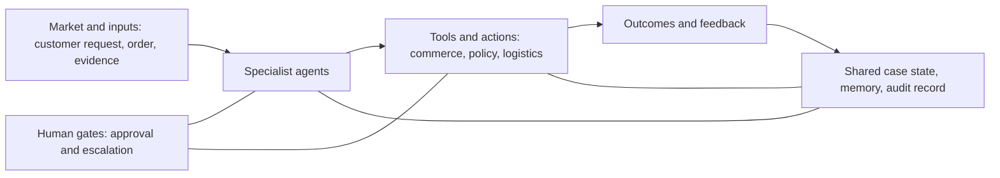

# Project Charter

## 1. Purpose

This charter defines the problem, customer, value, scope, success measures,
agent roles, human controls, and project assumptions for ReturnOps AU. It is the
starting point for Stage 1 requirements and modelling, not a frozen final
specification.

## 2. Problem statement

Australian e-commerce SME founders often handle product-problem requests across
email, order systems, store policies, payment records, and logistics portals.
The information needed to make a consistent decision is fragmented, while the
decision may affect customer rights, inventory, cash, and reputation.

The underlying need is not merely "answer the customer." It is to reach a
consistent, explainable, evidence-backed resolution with appropriate human
accountability.

## 3. Target users and stakeholders

### Primary customer

An Australian e-commerce SME founder or operations manager without a dedicated
returns team.

### Other stakeholders

- Customer requesting a repair, replacement, refund, or return.
- Store support worker reviewing a case.
- System administrator maintaining policies and integrations.
- Payment and commerce platforms.
- Logistics provider.
- Consumer-protection and compliance stakeholders.

## 4. Evidence to validate

The team must validate these assumptions through at least three interviews or
structured observations:

1. Case investigation is slowed by switching between systems.
2. Staff frequently need to request missing information.
3. Policy interpretation is inconsistent across cases.
4. High-impact actions require a responsible human decision.
5. A compliance matrix and recommended next action would reduce handling time.

Useful domain references include:

- ACCC business guidance on repair, replacement, and refund decisions:
  https://www.accc.gov.au/business/problem-with-a-product-or-service-you-sold/repair-replace-refund-cancel
- Shopify Return model:
  https://shopify.dev/docs/api/admin-graphql/latest/objects/return
- Australia Post return options:
  https://auspost.com.au/business/shipping/eparcel-contract/returns

These references establish the domain context. They do not replace user
research or legal review.

## 5. Goals

1. Reduce the time required to investigate a supported return case.
2. Improve consistency across similar cases.
3. Make every recommendation traceable to case evidence and a policy source.
4. Detect uncertainty and route risky cases to a human.
5. Keep the founder accountable for every high-impact action.
6. Produce models that remain traceable to the prototype and its tests.

## 6. Non-goals

- Giving legal advice or making a definitive legal determination.
- Automatically issuing a real refund.
- Replacing the founder in disputed or high-risk cases.
- Supporting services, digital goods, financial products, or international law.
- Building a general-purpose customer-service chatbot.
- Building production-scale fraud detection.
- Integrating every commerce and logistics platform during the course.

## 7. Agent operating model

| Role | Perceives | Decides | Acts and tools | Human gate |
|---|---|---|---|---|
| Intake Agent | Customer message and attachments | Request type and missing fields | Creates structured case and asks clarifying questions | Escalates abusive, unsafe, or unintelligible content |
| Order Investigation Agent | Order, item, payment, and fulfilment records | Whether the case matches a valid order | Queries the mock commerce adapter | Cannot alter the order |
| Policy and Guidance Agent | Store policy and approved guidance corpus | Relevant rules and possible conflict | Retrieves passages with source metadata | Must flag ambiguity and never claim legal certainty |
| Evidence Agent | Customer evidence and case history | Whether required evidence is present and consistent | Produces an evidence matrix and follow-up questions | Escalates suspected tampering or sensitive content |
| Resolution Planner | Structured case, evidence, and retrieved rules | Proposed remedy, alternatives, and confidence | Produces a typed decision proposal | Cannot execute refund, replacement, or repair |
| Risk Reviewer | Full proposal, citations, confidence, and audit history | Pass, revise, or escalate | Blocks unsupported or conflicting proposals | Mandatory before human approval |
| Operations Agent | Approved action | Required operational sequence | Calls mock returns, logistics, inventory, and notification adapters | Requires an approval record and idempotency key |

## 8. Governed loop

## 9. Measurable outcomes

| Measure | Definition | MVP acceptance target |
|---|---|---:|
| Request classification accuracy | Correct request type / labelled cases | >= 90% |
| Mandatory-information recall | Required fields detected / required fields in ground truth | >= 95% |
| Recommendation agreement | Proposed remedy category agrees with reviewed reference label | >= 85% |
| Citation correctness | Citations that directly support the associated claim | >= 90% |
| Escalation recall | Correctly escalated risky cases / all risky cases | >= 95% |
| Median handling time | Submission to proposed resolution | < 2 minutes |
| Tool success rate | Successful mock tool operations / attempted operations | >= 95% |
| Approval enforcement | High-impact tool calls with valid approval record | 100% |

Targets are provisional until the evaluation dataset and baseline are created.

## 10. MVP scenario

Customer message:

> My coffee machine stopped working after three weeks. Your website says returns
> are limited to 14 days. Order AU-1024. I want a refund.

Expected system behaviour:

1. Extract order number, product, issue, time, and requested outcome.
2. Retrieve the matching paid and fulfilled order.
3. Separate a claimed product problem from a change-of-mind return.
4. Retrieve the relevant store policy and approved guidance.
5. Identify missing diagnostic evidence and ask targeted questions.
6. Avoid declaring a major or minor failure when evidence is insufficient.
7. Produce a cited recommendation and confidence score.
8. Route the proposal to the founder.
9. After approval, create a simulated return and return label.
10. Record every decision, source, approval, and tool result.

## 11. Assumptions and constraints

- The prototype operates in English.
- Orders and integrations are simulated but follow realistic schemas.
- The approved guidance corpus is versioned and reviewed by the team.
- All high-impact actions require human approval.
- The system stores minimal personal information in the prototype.
- Uploaded examples must be synthetic or de-identified.
- The project has three student contributors.
- The team prioritises model-to-code traceability over feature breadth.

## 12. Decision gates

### Gate A: problem validation

Proceed only if user evidence supports the problem and the tutor accepts the
scope.

### Gate B: technical feasibility

Proceed to full Stage 1 architecture only after a thin slice can submit a case,
query a mock order, retrieve one policy passage, and produce a typed proposal.

### Gate C: Stage 2 scope

Optional features enter Stage 2 only after mandatory requirements have automated
tests and the core evaluation targets are measurable.

