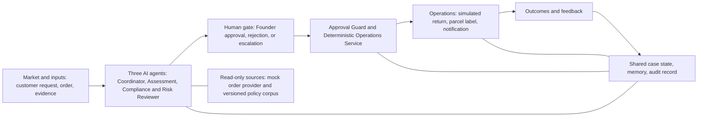

# Project Charter

## 1. Purpose

This charter defines the problem, customer, value, scope, success measures,
agent roles, human controls, and project assumptions for ReturnOps AU. It is the
starting point for Stage 1 requirements and modelling, not a frozen final
specification.

## 2. Problem statement

Australian e-commerce SME founders often handle return and remedy requests across
email, order systems, store policies, payment records, and logistics portals.
The information needed to make a consistent decision is fragmented, while the
decision may affect customer rights, inventory, cash, and reputation.

The underlying need is not merely "answer the customer." It is to reach a
consistent, explainable, evidence-backed resolution with appropriate human
accountability.

## 3. Target users and stakeholders

### Primary customer

An Australian e-commerce SME founder or operations manager without a dedicated
returns team.

### Other stakeholders

- Customer requesting a repair, replacement, refund, or return.
- Store support worker reviewing a case.
- System administrator maintaining policies and integrations.
- Payment and commerce platforms.
- Logistics provider.
- Consumer-protection and compliance stakeholders.

## 4. Evidence and assumptions to review

The course project uses the frozen desk-research appendix, controlled scenario
walkthroughs, the 20-case student-operator subset, and tutor review to examine
these assumptions:

1. Case investigation is slowed by switching between systems.
2. Staff frequently need to request missing information.
3. Policy interpretation is inconsistent across cases.
4. High-impact actions require a responsible human decision.
5. A compliance matrix and recommended next action would reduce handling time.

These methods do not constitute primary user, market, adoption, or
willingness-to-pay validation. Further interviews or field observation belong to
future commercial discovery and are not a course-delivery task.

Useful domain references include:

- ACCC business guidance on repair, replacement, and refund decisions:
  https://www.accc.gov.au/business/problem-with-a-product-or-service-you-sold/repair-replace-refund-cancel
- Shopify Return model:
  https://shopify.dev/docs/api/admin-graphql/latest/objects/return
- Australia Post return options:
  https://auspost.com.au/business/shipping/eparcel-contract/returns

These references establish the domain context. They do not replace user
research or legal review.

## 5. Goals

1. Reduce the time required to investigate a supported return case.
2. Improve consistency across similar cases.
3. Make every recommendation traceable to case evidence and a policy source.
4. Detect uncertainty and route risky cases to a human.
5. Keep the founder accountable for every high-impact action.
6. Produce models that remain traceable to the prototype and its tests.

## 6. Non-goals

- Giving legal advice or making a definitive legal determination.
- Automatically issuing a real refund.
- Replacing the founder in disputed or high-risk cases.
- Supporting services, digital goods, financial products, or international law.
- Building a general-purpose customer-service chatbot.
- Building production-scale fraud detection.
- Integrating every commerce and logistics platform during the course.

## 7. Agent operating model

ReturnOps AU uses three AI agents, one human decision-maker, and one
deterministic service. The Human Founder and the Operations Service are listed
in the same table because the governed loop is only legible when the deciding
and the acting roles are read together; neither of them is an AI agent.

| Role | Perceives | Decides | Acts and tools | Human gate |
|---|---|---|---|---|
| Customer Case Coordinator Agent | Customer request, attachments, and clarification replies from the Customer Portal | Request type, and whether information is missing, ambiguous, or conflicting | Structures the case, preserves the original statement and requested outcome, generates targeted clarification questions, and manages the clarification loop | Escalates abusive, unsafe, or unintelligible content; cannot determine final legal rights, approve a proposal, mutate authoritative business state, or call return or logistics operations |
| Returns Assessment Agent | Structured case, case history, synthetic order snapshot, customer evidence, and versioned store-policy and consumer-guidance passages | Whether the case matches a valid order; issue category, possible basis, and assessment status; and the recommended remedy, its alternatives, and confidence | Reads a synthetic order snapshot, constructs the evidence matrix, retrieves versioned store-policy and consumer-guidance passages with source metadata, and generates a non-executable conditional recommendation with alternatives, confidence, and follow-up questions | Cannot alter the order; escalates suspected tampering or sensitive content; must flag ambiguity and never claim legal certainty; cannot overwrite the customer's requested outcome, convert a recommendation into an `ApprovalRecord` or `ToolCommand`, silently resolve source conflict, or call the Operations Service |
| Compliance & Risk Reviewer Agent | Evidence packet, proposal, cited passages, stated confidence, and audit history, but never the proposal generator's hidden reasoning | `PASS`, `PASS_WITH_WARNING`, `REVISE`, `NEEDS_INFORMATION`, or `ESCALATE` | Independently checks unsupported claims, citation mismatch, source conflict, missing evidence, out-of-scope content, prompt injection, attempted authority escalation, and attempted tool manipulation, using a separate model invocation and system prompt, and blocks unsupported or conflicting proposals | Mandatory before Founder approval; cannot edit the proposal, approve, or execute an operation |
| Human Founder | Reviewed proposal, citations, risk decision, and authoritative case and audit history via the Founder Dashboard | `APPROVE`, `REJECT`, `REQUEST_REVISION`, or `MANUAL_HANDLING` | Binds trusted actor, case ID, proposal ID and version, reason, and timestamp; an approval also binds the exact command set, parameter fingerprint, amount ceiling where applicable, and expiry | Is the gate: no other role may approve a high-impact action |
| Deterministic Operations Service | Approval record, current case state, and proposal version | No discretionary decision; verifies Founder identity and role, case state and proposal version, approval scope and expiry, and the command allowlist and idempotency key | Creates a simulated return, generates a simulated parcel label, sends the outcome and next-step notification, and records provider results and audit events | Runs only inside an approval's exact scope and expiry; it is not a free-deciding AI agent |

## 8. Governed loop

## 9. Measurable outcomes

| Measure | Definition | MVP acceptance target |
|---|---|---:|
| Request classification accuracy | Correct request type / labelled cases | >= 90% |
| Mandatory-information recall | Required fields detected / required fields in ground truth | >= 95% |
| Recommendation agreement | Proposed remedy category agrees with reviewed reference label | >= 85% |
| Citation correctness | Citations that directly support the associated claim | >= 90% |
| Escalation recall | Correctly escalated risky cases / all risky cases | >= 95% |
| Median handling time | Submission to proposed resolution | < 2 minutes |
| Tool success rate | Successful mock tool operations / attempted operations | >= 95% |
| Approval enforcement | High-impact tool calls with valid approval record | 100% |

Targets are provisional until the evaluation dataset and baseline are created.

## 10. MVP scenario

Customer message:

> My coffee machine stopped working after three weeks. Your website says returns
> are limited to 14 days. Order AU-1024. I want a refund.

Expected system behaviour:

1. Extract order number, product, issue, time, and requested outcome.
2. Retrieve the matching paid and fulfilled order.
3. Separate a claimed product problem from a change-of-mind return.
4. Retrieve the relevant store policy and approved guidance.
5. Identify missing diagnostic evidence and ask targeted questions.
6. Organise evidence relevant to possible remedy paths while never issuing a
   final major/minor-failure or legal-entitlement determination.
7. Produce a cited recommendation and confidence score.
8. Route the proposal to the founder.
9. After approval, create a simulated return and return label.
10. Record every decision, source, approval, and tool result.

## 11. Assumptions and constraints

- The prototype operates in English.
- Orders and integrations are simulated but follow realistic schemas.
- The approved guidance corpus is versioned and reviewed by the team.
- All high-impact actions require human approval.
- The system stores minimal personal information in the prototype.
- Uploaded examples must be synthetic or de-identified.
- The project has three student contributors.
- The team prioritises model-to-code traceability over feature breadth.

## 12. Decision gates

### Gate A: problem validation

Proceed when the evidence/assumption boundary is explicit, the controlled
validation protocol is agreed, and the tutor accepts the course scope. Do not
claim primary-user validation.

### Gate B: technical feasibility

Proceed to full Stage 1 architecture only after a thin slice can submit a case,
query a mock order, retrieve one policy passage, and produce a typed proposal.

### Gate C: Stage 2 scope

Optional features enter Stage 2 only after mandatory requirements have automated
tests and the core evaluation targets are measurable.
