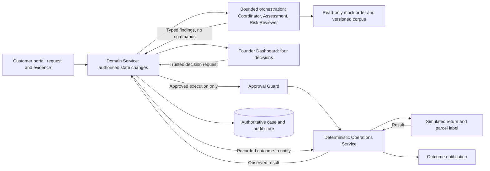

# Project Charter

> **Published v1 alignment draft — 2026-09-07:** [PR #9](https://github.com/shuxiachai/returnops-au/pull/9), not merged.
> This update follows the lead's
> working reference already published to `main` and the [fixed allocation](07-frozen-work-allocation.md).
> Shared review by B/C and tutor feedback remain outstanding. This alignment
> is not a claim that PR #8, F.01, or any runtime feature has been accepted.
>
> **Contribution provenance:** the three-agent role separation below reuses
> Member B (`ChengsiLi`)'s work in [PR #8](https://github.com/shuxiachai/returnops-au/pull/8),
> commit `cbba595` on `docs/6-baseline-uml-rebaseline`. The present alignment
> adds scope, metric and lifecycle corrections; B's source commits and authorship
> remain intact, and B has not yet approved this revision.

## 1. Purpose

This charter defines the problem, customer, value, scope, success measures,
agent roles, human controls, and project assumptions for ReturnOps AU. The
[project definition](00-project-definition-v1.md) owns the requirements;
[work allocation](07-frozen-work-allocation.md) and [work packages](08-delivery-work-packages.md)
own the agreed responsibilities and acceptance checks. This charter summarises
that fixed scope; it does not reopen the topic or declare implementation complete.

## 2. Problem statement

A single Australian physical-goods online store's Human Founder must reconcile
customer messages, order and item records, evidence, store policies, reviewed
consumer guidance, and logistics/notification results. Fragmented or conflicting
information can make the next step difficult to explain and check.

The underlying need is not merely "answer the customer." It is to reach a
consistent, explainable, evidence-backed decision packet with appropriate human
accountability. This is a desk-research-informed project problem, not a claim of
validated market demand, legal correctness, or a known ten-minute industry baseline.

## 3. Target users and stakeholders

### Primary customer

The one Human Founder operating the demonstration Australian physical-goods
online store. There is no separate support worker or operations-manager role in
the course product.

### Other stakeholders

- Customer requesting a repair, replacement, refund, or return.
- Synthetic order, return, logistics and notification providers.
- Team-reviewed store-policy and consumer-guidance sources.
- The three student developers and tutor, who review delivery and evidence but
  are not extra business operators inside the one-person company.

## 4. Evidence and assumptions to review

The course project uses the frozen desk-research appendix, controlled scenario
walkthroughs, the 20-case student-operator subset, and tutor review to examine
these assumptions:

1. Case investigation is slowed by switching between systems.
2. The Founder may need to request missing or conflicting information.
3. Policy interpretation is inconsistent across cases.
4. High-impact actions require a responsible human decision.
5. A criterion-level evidence matrix and conditional recommendation may reduce
   omissions and decision-packet preparation time in controlled cases.

These methods do not constitute primary user, market, adoption, or
willingness-to-pay validation. Further interviews or field observation belong to
future commercial discovery and are not a course-delivery task.

The [frozen evidence register](06-requirements-desk-research-evidence.md) retains
the reviewed ACCC, Shopify and Australia Post references, dates and limitations.
The assessed report uses an approximately one-to-two-page source/assumption
summary. A small versioned runtime corpus remains necessary for C1, but the
research appendix is not an ongoing expansion task.

## 5. Goals

1. Measure whether the governed workflow improves controlled decision-packet preparation.
2. Improve consistency across similar cases.
3. Make every recommendation traceable to case evidence and a policy source.
4. Detect uncertainty and route risky cases to a human.
5. Keep the founder accountable for every high-impact action.
6. Produce models that remain traceable to the prototype and its tests.

## 6. Non-goals

- Giving legal advice or making a definitive legal determination.
- Automatically issuing a real refund.
- Real order/inventory mutation, chargeable logistics, physical inspection,
  restocking, or financial completion.
- Replacing the founder in disputed or high-risk cases.
- Supporting services, digital goods, financial products, or international law.
- Building a general-purpose customer-service chatbot.
- Building production-scale fraud detection.
- Integrating every commerce and logistics platform during the course.
- Multi-merchant SaaS, split shipments, or more than one label per return parcel.

## 7. Agent operating model

There are exactly three AI business roles. The Founder and Operations Service
are shown alongside them to make the decision and execution boundaries explicit;
neither is an AI role. Domain Service is the sole authoritative state-write
entry point; agents return results to it through the bounded orchestrator.

| Role | Inputs and responsibility | Output and authority boundary | Implementer |
|---|---|---|---|
| Customer Case Coordinator Agent | Original request, authorised evidence and clarification replies; preserve customer intent and identify missing/ambiguous/conflicting information | Typed facts and targeted questions; no authoritative state write, approval or operation call | A |
| Returns Assessment Agent | Read-only order snapshot, evidence matrix and C1's versioned policy/guidance passages | Cited, versioned, non-executable `DecisionPacket`; keep requested outcome and conditional recommendation separate; no final legal determination | A, consuming C1 |
| Compliance & Risk Reviewer Agent | Proposal, independent source evidence and cited passages; separate prompt/model invocation without generator hidden reasoning | Exactly `PASS`, `PASS_WITH_WARNING`, `REVISE`, `NEEDS_INFORMATION`, or `ESCALATE`; cannot edit proposals, approve or execute | C |
| Human Founder | Current proposal, sources, risk and exact proposed action scope through the Founder Dashboard | `APPROVE`, `REJECT`, `REQUEST_REVISION`, or `MANUAL_HANDLING`; only this trusted actor can approve high-impact operations | Human role; A supplies rules, B supplies interface |
| Deterministic Operations Service | Current valid approval and typed allowlisted commands | Recheck identity, versions, scope, expiry, provider permission and idempotency; create simulated return/label and deliver recorded outcome notifications; report results through Domain Service | A |

### Fixed feature ownership

| Member / planned effort | Core 1 | Core 2 | Selected optional, due within the course |
|---|---|---|---|
| A / 45% | A1: authoritative case lifecycle, Coordinator/Assessment and orchestration | A2: exact-scope approval and governed execution | A3 / OF-004: independent logistics sandbox/test adapter with recovery evidence |
| B / 27% | B1: customer submission and clarification portal | B2: Founder review dashboard | B3 / OF-006: operations analytics page |
| C / 28% | C1: versioned retrieval and citation verification | C2: independent risk review | C3 / OF-001: image-evidence extraction |

These are nine feature boundaries, not nine new agents. Each member supplies
their own implementation, tests and evidence; C coordinates evaluation and Jira,
while A coordinates GitHub/integration. All three participate in shared models,
label review and reporting. Actual effort and authorship are recorded rather
than inferred from these planned percentages. The interfaces are a separate
[F.01 review candidate](09-interface-contract-v1.md), not an implemented API.

## 8. Governed loop

`REVISE` returns to Assessment; `NEEDS_INFORMATION` returns to the customer
clarification loop. `ESCALATE` is for manual handling and cannot be approved
directly; an executable path needs a new proposal and a new passed review.
Invalid, timed-out or stale review results never default to pass. Founder
revision creates a new proposal; changed inputs, proposal or scope invalidate
pending old authorisation.

Unknown provider results enter `UNKNOWN/RECONCILING` before any safe retry.
Operation and notification results are independent: a notification retry cannot
recreate a return or label. Successful simulated execution becomes `COMPLETED`
only after its results are stored and notification succeeds. Rejection/manual
outcomes are recorded and notified without return/label execution.

## 9. Measurable outcomes

| Measure | Definition | Prototype target, not measured result |
|---|---|---:|
| Issue-category macro-F1 | Mean per-category F1 under the frozen label guide | >= 0.85; stretch 0.90 |
| Mandatory-information recall | Required fields detected / required fields in ground truth | >= 95% |
| Unnecessary-follow-up rate | Unnecessary questions under the frozen annotation rules | <= 15% |
| Decision-packet completeness | Required packet fields satisfied under a frozen denominator | >= 95% |
| Citation coverage / correctness | Claims have resolvable citations / cited passages support those claims | 100% / >= 90% |
| Risk recall / specificity | Detect risky positives / correctly retain non-risky negatives | >= 95% / >= 80% |
| Proposal latency p95 | Accepted complete input to stored review-ready proposal, including machine review/revision work | < 120 seconds |
| Unauthorised-operation blocking | Invalid approval, state, command or provider authority blocked before any effect | 100% |
| Critical-fact fabrication / duplicate effects / illegal transitions | Counts on the applicable frozen or parameterised tests | 0 |

Use 10–20 separate pilot cases for development, then 30 double-reviewed Gold
cases for the required experimental B1 (single LLM, no retrieval/operation
authority) versus B4 (full governed system). The 20-case student-operator timing
subset belongs to that same Gold set. Both timed operators finish and lock
their outputs before seeing Gold labels, each other's outputs, or Gold-based
feedback. One person labels, another reviews, and the third arbitrates disputes.

Report p50/p95, failures, raw counts/denominators, recommendation agreement,
tokens/cost and versioned run conditions, even when targets are missed. Exclude
human and physical waiting from proposal latency, not machine retries or review
loops. No new 85% recommendation-agreement or 95% tool-success target is imposed
by this charter. Experimental B2/B3 and expansion towards 100 scenarios remain
portfolio work; these experiment names are separate from B's feature IDs.

## 10. MVP scenario

Customer message:

> My coffee machine stopped working after three weeks. Your website says returns
> are limited to 14 days. Order AU-1024. I want a refund.

Expected system behaviour:

1. Extract order number, product, issue, time, and requested outcome.
2. Retrieve the matching paid and fulfilled order.
3. Separate a claimed product problem from a change-of-mind return.
4. Retrieve the relevant store policy and approved guidance.
5. Identify missing diagnostic evidence and ask targeted questions.
6. Organise evidence relevant to possible remedy paths while never issuing a
   final major/minor-failure or legal-entitlement determination.
7. Produce a cited recommendation and confidence score.
8. Independently review the proposal and sources. An unresolved material conflict
   yields `ESCALATE`; present it for manual handling without execution approval.
9. Only a current proposal with passed risk review and all other guards may be
   approved for the exact simulated return/label scope. A request for a refund
   is preserved as customer intent; it does not authorise a real refund.
10. Store operation results, send the outcome/next steps and keep notification
    failures separate. Record every source, version, decision and provider result.

## 11. Assumptions and constraints

- The prototype operates in English.
- One case refers to one synthetic order with one or more line items; one
  return parcel has one label.
- Orders and integrations are simulated but follow realistic schemas.
- The approved guidance corpus is versioned and reviewed by the team.
- All high-impact actions require human approval.
- The system stores minimal personal information in the prototype.
- Uploaded examples must be synthetic or de-identified.
- The project has three student contributors.
- The team prioritises model-to-code traceability over feature breadth.

## 12. Decision gates

Use the dependency gates in [the work packages](08-delivery-work-packages.md).
The lead's publication of the working baseline is already complete; individual
model acceptance, B/C alignment, tutor feedback and runtime evidence remain
separate checks.

| Gate | Required outcome and order |
|---|---|
| Gate 0 — definition/model/contract alignment | Review existing requirements and models, record tutor feedback, and agree F.01 before dependent integration. Complete Lab 4's refined use cases, design principles and architecture viewpoints; a working AI slice is not a prerequisite to Stage 1 design. |
| Gate 1 — executable safety workflow | First prove Create Case → Mock Order → Fixed Proposal/Risk Stub → Founder Approval → Simulated Return/Label → Notification/Audit, with state, identity, scope, idempotency, recovery and reproducible test evidence. No LLM drives the execution chain yet. |
| Gate 2 — AI MVP | After Gate 1, integrate the three roles and bounded revision/clarification paths; use the separate pilot set to test and refine them. |
| Gate 3 — course delivery | Complete the six core and three selected optional features, personal/shared models, 30-case experimental B1/B4 evaluation, tests, report and demo evidence. No plan item counts as completed without its evidence. |

B's UI/mock work and C's offline corpus, risk and evaluation preparation may
proceed alongside models and contracts. A may test offline agent outputs without
operation authority. A3 test-access feasibility is checked early; missing access
is an explicit dependency, not permission to count the core mock twice. C3 is
integrated after the text workflow is stable but still within course delivery.
