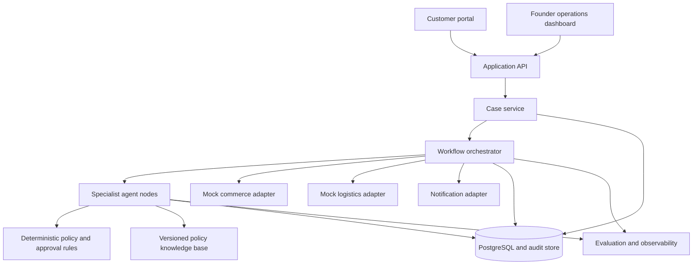
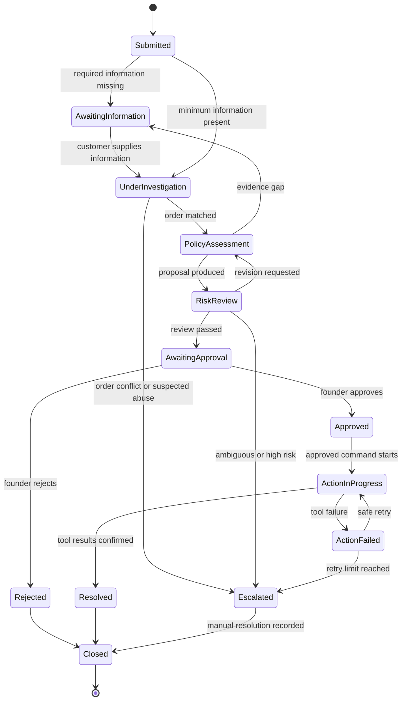
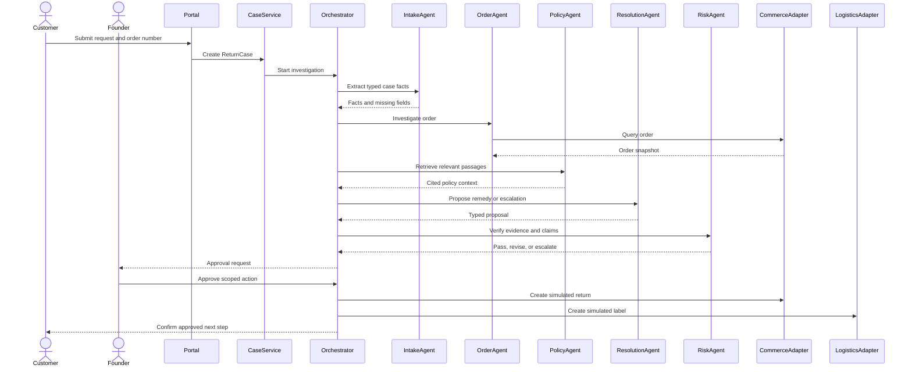

# System Design

## 1. Architectural drivers

The architecture is driven by six properties:

1. Traceability: every recommendation must point to case evidence and sources.
2. Human accountability: high-impact actions require explicit approval.
3. Determinism at boundaries: money, inventory, and case state use rules and
   typed commands rather than free-form model output.
4. Auditability: model calls, retrieved passages, decisions, approvals, and tool
   results are recorded.
5. Replaceability: LLM, retrieval, commerce, and logistics providers sit behind
   interfaces.
6. Evaluability: each agent and the end-to-end workflow can be tested against a
   labelled case set.

## 2. Proposed architecture

## 3. Proposed technology stack

| Area | Initial choice | Reason |
|---|---|---|
| Front end | Next.js and TypeScript | Portfolio-quality customer and operator experience |
| Application API | FastAPI and Python | Typed APIs and strong AI/agent ecosystem |
| Workflow | LangGraph or a small explicit state-machine abstraction | Persistent, inspectable agent workflow |
| Database | PostgreSQL | Transactional case, approval, and audit data |
| Retrieval | PostgreSQL with pgvector, if semantic retrieval proves necessary | One operational datastore and replaceable retrieval interface |
| Validation | Pydantic and JSON Schema | Reject malformed model and tool outputs |
| Testing | Pytest, Vitest, and Playwright | Unit, integration, and end-to-end coverage |
| Packaging | Docker Compose | Repeatable team environment and demonstration |
| Observability | Structured logs plus OpenTelemetry-compatible traces | Inspect agent and tool behaviour |

The team must validate the workflow and retrieval libraries with a time-boxed
technical spike. A library is not an architectural requirement.

## 4. Core domain model

| Entity | Responsibility |
|---|---|
| Customer | Minimal customer identity and contact data |
| Order | Purchase, payment, fulfilment, and line-item facts |
| ReturnCase | Aggregate root for the end-to-end workflow |
| CustomerStatement | Original and clarified customer messages |
| EvidenceItem | Submitted evidence and verification metadata |
| PolicyDocument | Versioned store policy or approved guidance source |
| PolicyPassage | Retrieved passage with source and location |
| DecisionProposal | Proposed remedy, rationale, alternatives, and confidence |
| RiskFinding | Unsupported claim, conflict, missing evidence, or escalation reason |
| ApprovalRecord | Human decision, actor, time, and scope |
| ToolCommand | Typed, idempotent external action request |
| AuditEvent | Immutable record of relevant system activity |

## 5. ReturnCase state model

## 6. Primary sequence

## 7. Human gates

Human approval is mandatory for:

- refund, replacement, or repair authorisation;
- any action that changes order, payment, or inventory state;
- low-confidence or conflicting policy interpretation;
- suspected fraud, abusive behaviour, or sensitive evidence;
- cases outside the three supported MVP request types.

An approval record must specify the case, permitted command, maximum amount if
applicable, approver, timestamp, and expiry. Approval is not a general permission
for an agent to take unrelated actions.

## 8. Agent collaboration contract

Agents exchange typed state, not conversational transcripts as the source of
truth. Each agent returns:

- `status`: success, needs_information, revise, or escalate;
- `facts`: claims supported by case evidence;
- `citations`: source identifier and location;
- `confidence`: calibrated score or categorical band;
- `open_questions`: information still required;
- `recommended_next_step`;
- `risk_flags`.

The orchestrator owns transitions. An agent cannot invoke another agent without
an allowed workflow transition.

## 9. Evaluation design

Create a versioned dataset of at least 100 synthetic cases covering:

- balanced supported request types;
- missing-order and missing-evidence cases;
- conflicting store policy and approved guidance;
- straightforward and ambiguous product problems;
- tool timeout, duplicate command, and failed refund simulations;
- prompt-injection text embedded in customer messages or policy files;
- cases that must be escalated.

Compare these configurations:

1. single LLM without retrieval;
2. LLM with policy retrieval;
3. multi-agent workflow with retrieval;
4. multi-agent workflow with retrieval, deterministic rules, and risk review.

Report accuracy, recall, citation correctness, escalation recall, latency, and
estimated model cost. Record failure examples, not only aggregate scores.

## 10. Architectural decisions to defend

| Chosen approach | Discarded alternative | Rationale |
|---|---|---|
| Explicit governed workflow | Unrestricted agents calling each other | Easier to model, test, audit, and control |
| Typed tool commands | Free-form actions generated by an LLM | Prevents malformed or over-broad actions |
| Human approval before impact | Fully autonomous refunding | Preserves accountability and limits harm |
| Mock provider adapters | Production payment and logistics access | Safe and achievable for a course prototype |
| Small approved corpus | Open web search for every case | Better provenance, repeatability, and evaluation |
| Three request types | Universal customer support | Keeps requirements and evaluation tractable |

## 11. Model-to-code traceability

| Stage 1 model | Stage 2 evidence |
|---|---|
| User requirements | Acceptance tests and demo scenarios |
| Feature model | Feature flags and MVP backlog |
| Use-case descriptions | API and end-to-end tests |
| Package diagram | Source modules and dependency rules |
| Class diagram | Domain entities and schemas |
| Activity diagram | Orchestrator paths and branch tests |
| State machine | ReturnCase transition implementation |
| Sequence diagram | Integration test traces |
| Assumptions | Configuration, limitations, and risk register |

