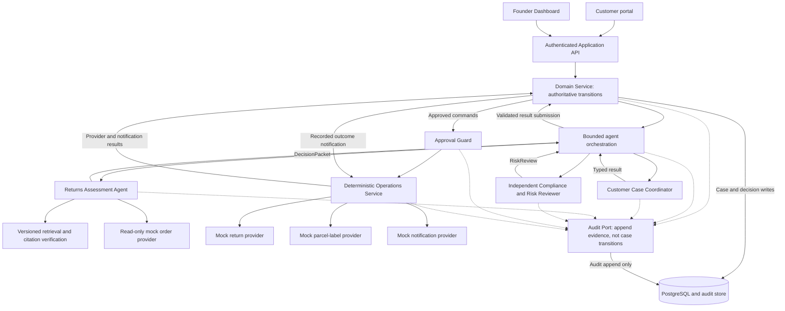
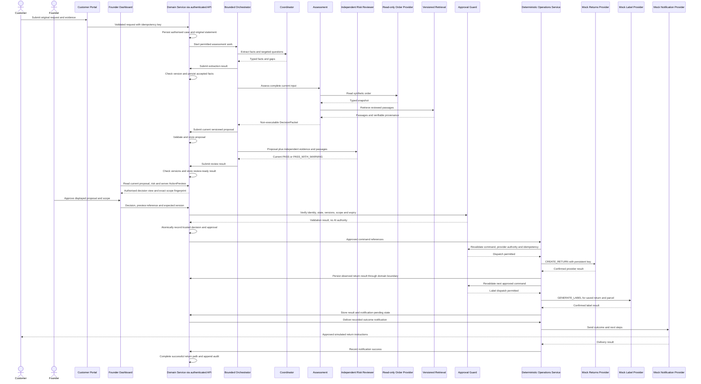

# System Design

> **Published v1 alignment draft — 2026-09-07:** [PR #9](https://github.com/shuxiachai/returnops-au/pull/9); its merge record is separate from pending acceptance.
> This design follows the lead's
> published working baseline, [fixed ownership](07-frozen-work-allocation.md)
> and [work packages](08-delivery-work-packages.md). B/C shared-model review
> and tutor feedback are still required. Diagrams describe intended behaviour,
> not an implemented or accepted API.
> The `1.0.0-rc.3` three-target clarification is tracked by
> [KAN-32](https://lucastaooo.atlassian.net/browse/KAN-32), remains a review
> candidate, and does not change PR #9's historical rc.2 publication.
>
> **Contribution provenance:** the three-agent architecture, separate read-only
> order provider and deterministic Operations Service reuse Member B
> (`ChengsiLi`)'s [PR #8](https://github.com/shuxiachai/returnops-au/pull/8),
> commit `cbba595`. The present revision corrects the state-write, recovery
> and notification boundaries, retains the Lab 4 analysis, and adds the
> Lab 5 pattern/method clarification under M-S.01. It does not
> merge PR #8, rewrite B's commits or claim B/C approval of this revision.

## 1. Architectural drivers

The architecture is driven by seven properties:

1. Traceability: every recommendation must point to case evidence and sources.
2. Human accountability: high-impact actions require explicit approval.
3. Determinism at boundaries: Domain Service controls authoritative business
   state; exact-scope rules control simulated return/label commands. Real money,
   inventory mutation and chargeable logistics are outside the course scope.
4. Auditability: model calls, retrieved passages, decisions, approvals, and tool
   results are recorded.
5. Replaceability: LLM, retrieval, commerce, and logistics providers sit behind
   interfaces.
6. Evaluability: each agent and the end-to-end workflow can be tested against a
   labelled case set.
7. Security and AI robustness: untrusted customer and retrieved content cannot
   grant authority, change workflow policy, expose secrets, or bypass tool and
   approval controls.

## 2. Proposed architecture

The course system is a modular monolith for one Australian physical-goods store
and one Human Founder. PostgreSQL is the sole authoritative case store.
The orchestrator coordinates bounded calls; it does not own a second business
state machine. Three AI roles return data, not authority.

Only Domain Service accepts and persists business-state changes. Operations
reports observed effects through that service; agents, API handlers and UI
components cannot write case state directly. Audit Port accepts correlated
evidence but grants no workflow authority. Rejection/manual-outcome notifications
follow recorded Founder decisions; they cannot invoke the return/label commands.

## 3. Proposed technology stack

| Area | Initial choice | Reason |
|---|---|---|
| Front end | Next.js, React and TypeScript | Customer portal and Founder interface |
| Application API | FastAPI and Python | Typed APIs and strong AI/agent ecosystem |
| Workflow | LangGraph or a thin explicit orchestrator | Bounded calls; Domain Service remains the state authority |
| Database | PostgreSQL | Transactional case, approval, and audit data |
| Retrieval | Reviewed versioned JSON/Markdown corpus with keyword/BM25 retrieval | Small reproducible baseline owned by C |
| Validation | Pydantic and JSON Schema | Reject malformed model and tool outputs |
| Testing | Pytest, Vitest, and Playwright | Unit, integration, and end-to-end coverage |
| Packaging | Docker Compose | Repeatable team environment and demonstration |
| Observability | Correlated structured JSON logs | Inspect versions, timings, errors, tokens and cost |

The team must validate the workflow and retrieval libraries with a time-boxed
technical spike. A library is not an architectural requirement.
These remain planned choices until code and run evidence exist. Hybrid/vector
retrieval, Redis/Celery/Outbox and OpenTelemetry/Grafana remain the already
identified portfolio extensions; they are not prerequisites for course delivery.

## 4. Core domain model

| Entity | Responsibility |
|---|---|
| Customer | Minimal customer identity and contact data |
| Order | Purchase, payment, fulfilment, and line-item facts |
| ReturnCase | Aggregate root for the end-to-end workflow |
| CustomerStatement | Immutable original or separate clarification message; not overwritten by extraction |
| EvidenceItem | Submitted evidence and verification metadata |
| EvidenceCriterion / evidence matrix | PRESENT, MISSING, CONFLICTING or NOT_APPLICABLE per criterion, with targeted questions |
| PolicyDocument | Versioned store policy or approved guidance source |
| PolicyPassage | Source ID/type, version when available, access date, content hash, location and retrieval time |
| DecisionPacket | Versioned non-executable conditional proposal referencing original statements, sources, alternatives and uncertainty |
| ProcessingFailure | Current case/input-bound technical failure; a no-proposal manual target, not a business-risk result |
| OrderLookupBlock | Current case/input-bound record of an accepted pre-proposal CONFLICT or AUTHORITY_DENIED lookup; a non-executable manual target |
| RiskFinding | Unsupported claim, conflict, missing evidence, or escalation reason |
| RiskReview | Independent five-outcome result bound to case/input/proposal and source versions |
| ActionPreview | Server-prepared read-only scope preview; neither an AI command nor an approval |
| FounderDecisionRecord | Trusted actor, case, reason/time and exactly one current target: proposal ID/version, processing failure ID or order-lookup block ID; no-proposal targets permit only MANUAL_HANDLING |
| ApprovalRecord | Produced only for APPROVE, bound to current versions, exact command scope/fingerprint and expiry |
| ToolCommand | Allowlisted typed, idempotent external action request bound to case, proposal, and approval |
| OperationAttempt | Provider-specific command, fingerprint, idempotency, outcome/error and reconciliation evidence |
| NotificationRecord | Independent delivery outcome and retry state for a recorded decision/operation |
| AuditEvent | Correlated evidence; non-personal integrity records remain verifiable after permitted PII removal |

One ReturnCase references one order and one or more line items; one return
parcel has one label. Issue category, customer-requested outcome, possible basis,
assessment status and recommendation remain distinct. PolicyDocument owns its
source passages; cases and proposals reference them, not a second exclusive copy.

`IntakeSession` (B), `ProposalReview` (C) and `OperationAttempt` (A) are the
subjects of the three personal state-machine chains. A lifecycle subject and a
wire DTO need not be the same class: C's independent call consumes
`RiskReviewRequest` and returns the rc.3 `RiskReview` DTO. Domain Service validates
that result before recording it in the conceptual `ProposalReview` lifecycle;
the lifecycle name is not another wire response. Shared
[class-model work](diagrams/01-domain-class-diagram.md) and the
[F.01 contract candidate](09-interface-contract-v1.md) require consistency review;
the legacy `DecisionProposal`/enum code has not been migrated by this document.

## 5. ReturnCase state model

The [state model](diagrams/02-state-machine-diagram.md), F.01 status vocabulary
and A1.03 transition guards must be reviewed together. This table summarises
the required behaviour without maintaining another full transition diagram.
Every transition goes through Domain Service; no API accepts an arbitrary state.

| Event/result | Required route and guard |
|---|---|
| New or clarified customer input | Preserve originals, validate ownership and versions; missing facts await information, complete facts proceed to investigation/assessment |
| Pre-proposal CONFLICT / AUTHORITY_DENIED lookup | Domain Service records the accepted OrderLookupBlock and ESCALATED state; only a manual outcome may target that current block |
| Pre-proposal technical recovery exhausted | Record the actual ProcessingFailure and safe escalation; no placeholder proposal or passing review; only a manual outcome may target that current failure |
| REVISE / NEEDS_INFORMATION | Return to Assessment / Coordinator respectively; new facts or proposal invalidate stale reviews and pending approvals |
| PASS / PASS_WITH_WARNING | Prepare Founder review only when all other prerequisites hold; warnings remain visible |
| ESCALATE | Manual-handling route; an executable return path requires a new proposal and a new passed review |
| APPROVE | Trusted Founder and current exact scope are required; dispatch rechecks state, versions, permissions, expiry and idempotency |
| Unknown provider effect | OperationAttempt records UNKNOWN then RECONCILING; case reflects RECONCILING; query the provider before deciding if a safe retry is possible |
| Confirmed provider failure | Record typed failure; retry only with revalidated authority and deduplication; unresolved recovery remains visible for manual handling |
| Return and label results stored | Schedule outcome notification; NOTIFICATION_PENDING/NOTIFICATION_FAILED are separate from operation success |
| Notification succeeds | Successful return/label route becomes COMPLETED; rejection/manual routes become REJECTED/MANUAL_HANDLED without counting as successful returns |

Notification retry never repeats a return or label. Historical unknown effects
can still be reconciled after a proposal changes; stale authority cannot dispatch
a new effect. Failure, timeout, invalid JSON and outdated risk results do not
default to a passed review.

## 6. Primary sequence

The successful path below is a summary of the existing
[sequence model](diagrams/03-sequence-diagram.md). The five risk outcomes, four
Founder decisions and recovery branches are governed by sections 5 and 7; this
happy-path view is not evidence that all exceptional paths are implemented.

## 7. Human gates

Only the authenticated Founder may decide. Server-side checks are independent
of UI button visibility and of external-provider permission. Approval binds the
current case/input/proposal/review, exact commands, parameter fingerprint,
applicable amount ceiling, trusted actor and expiry. A new proposal, input or
scope invalidates pending authorisation; a historical approval is not sufficient.

| Founder decision | Effect |
|---|---|
| APPROVE | Create exact-scope approval for a currently executable, passed-review proposal; independently revalidate each operation |
| REJECT | Target the current proposal, record the reason and notify; no return/label command |
| REQUEST_REVISION | Target the current proposal, record the reason; create a new proposal through Assessment and repeat independent review |
| MANUAL_HANDLING | Target the current proposal or, without a proposal, exactly one current ProcessingFailure or OrderLookupBlock; record the actual manual outcome and notify, without return/label work |

Under the [rc.3 clarification](09-interface-contract-v1.md), a no-proposal
target requires an `ESCALATED` case and matching current case/input/record
versions. It permits no `APPROVE`, `REJECT` or `REQUEST_REVISION`, and cannot
create a preview, passing review, approval or operation command. An
`OrderLookupBlock` is restricted to an accepted `CONFLICT/AUTHORITY_DENIED`
order-provider result; source-policy conflicts remain material for a conditional
packet and independent Risk review, not an order block or technical failure.

Material unresolved conflicts, injection, unsupported scope or evidence do not
become safe merely because the Founder clicks approve. An escalated proposal
cannot execute; its return to automation requires a new reviewed proposal and
all normal guards. Real payments, production order/inventory changes and
chargeable shipments remain excluded even if a user requests them.

## 8. Agent collaboration contract

The [F.01 candidate](09-interface-contract-v1.md) and its schema/examples define
role-specific messages: CoordinatorResult, DecisionPacket and RiskReview.
This design does not invent a shared generic `status/facts` payload that would
override those contracts. Model confidence is an uncalibrated reported value
unless separately evaluated; it never grants permission or overrides missing
evidence. No agent output contains a trusted approval or executable command.

A owns Coordinator, Assessment, the common model-call interface and orchestration;
C owns retrieval/citation checks, Risk Reviewer and image-evidence analysis.
C's results are checked for version/context compatibility by A's Domain Service.
The reviewer uses an independent invocation and receives source evidence rather
than hidden reasoning. B consumes authoritative read views and submits versioned
requests. Detailed nine-feature ownership remains in docs/07, not a new RACI here.

Uploads, evidence and retrieved text are untrusted data. A supplies the shared
identity/attachment boundary, input allowlists, correlated audit and retention
rules; B supplies uploads/display, and C analyses only authorised inputs. The
audit design separates removable personal content from non-personal integrity
records. None of these controls is proven by static schema validation alone.

## 9. Evaluation design

Create one versioned course-evaluation set of 30 double-reviewed synthetic Gold
cases covering:

- balanced supported request types;
- missing-order and missing-evidence cases;
- conflicting store policy and approved guidance;
- straightforward and ambiguous product problems;
- prompt-injection text embedded in customer messages or policy files;
- cases that must be escalated.

Use parameterised automated tests, without a fixed scenario quota, for approval,
security, illegal-state, duplicate-command, timeout, notification, and
reconciliation paths.

Compare these required configurations on the same Gold set:

1. single LLM without retrieval;
2. multi-agent workflow with retrieval, deterministic rules, and risk review.

Single-LLM-with-retrieval and ungoverned multi-agent ablations, plus any
expansion towards 100 scenarios, are optional portfolio work after the course
release is stable.

The required comparison evaluates the complete governed architecture bundle
against a naive baseline; it does not isolate the causal contribution of
multi-agent decomposition without the optional ablations.

Use the same frozen case inputs and underlying model while preserving the
defined configuration difference: experimental B1 has no retrieval or operation
authority; experimental B4 has the full workflow. Pilot cases are separate from
Gold. The 20-case student-operator timing subset is drawn from the 30 Gold cases;
both operators lock their outputs before labels, peer answers or Gold-based
feedback are revealed. Each Gold label has a different reviewer and unresolved
disagreements are arbitrated by the third member.

Report issue-category macro-F1 (target >=0.85, stretch 0.90), information recall
(>=95%), unnecessary-follow-up rate (<=15%), packet completeness (>=95%), citation
coverage/correctness (100%/>=90%), risk recall/specificity (>=95%/>=80%), and safety
counts (zero unauthorised effects, fabricated critical facts, duplicate effects
and illegal state transitions).
Proposal latency is accepted-complete-input to stored-review-ready-proposal,
including machine review/revision work and excluding only human/physical waiting;
report p50/p95 (p95 target <120 seconds), failures, tokens/cost and raw denominators.
Freeze dataset, corpus, prompt/model/config, scoring code, environment and commit.
Targets remain prototype targets until a reproducible run produces measurements.

A tests state, approvals, adapters and recovery; B tests UI and E2E behaviour;
C tests retrieval/risk/images and coordinates the runner, labels and report.
C does not inherit A/B's implementation-test duties. B's analytics page consumes
A's authoritative aggregates and distinguishes current risk results, absent
reviews and failures rather than double-counting proposal versions.

## 10. Architectural decisions to defend

### 10.1 Lab 5: selected patterns and their concrete application

These patterns describe the architecture already shown in sections 2, 6 and 8;
they introduce no framework, process, business AI role or public endpoint.
The modular monolith is the deployment and module organisation choice. Layering,
ports/adapters and bounded supervision explain different aspects of the same
design rather than competing implementation stacks.

| Adopted style or pattern | Existing components and interaction | Problem addressed | Benefit and limitation | Requirement evidence to inspect |
|---|---|---|---|---|
| Modular monolith with a repository and one transactional case store | API, Domain Service, orchestration and Operations are modules; `CaseRepository` is realised by the PostgreSQL adapter. Domain Service commits case versions, decisions and associated work/audit through that boundary. Provider effects still occur outside the database transaction. | Concurrent UI/agent/provider results must not become conflicting sources of case state; a small team needs a reproducible integration unit. | One state authority simplifies version checks, trace reconstruction and local integration. A single store is also a failure/contention boundary; a transaction cannot undo an external effect, so idempotency and UNKNOWN reconciliation remain necessary. This is not a high-availability claim. | FR-009/011/012; NFR-004/006/008. Trace a stale decision, concurrent duplicate request and provider success followed by local persistence failure. |
| Layered responsibilities with ports and adapters | Portal/Dashboard request actions through API → Domain Service. Domain/Operations use typed `OrderProviderPort`, `RetrievalPort`, `ReturnsLogisticsPort`, `NotificationPort`, `AuditPort` and `CaseRepository`; adapters translate provider-specific data. The shared class model shows interface realisation and the sequence model shows call direction. | UI state and provider-specific details must not bypass approval rules or leak into every business module. | Providers can be replaced behind tested contracts, and UI/AI tests can use controlled substitutes. Mapping and version validation add work; an interface alone does not establish provider permission, correct provenance or safe retry. | FR-003/006/009/010/012; NFR-002/003/006/007/009. Inspect request/result mappings, denied-provider cases and a replacement adapter retaining the same approval guards. |
| Bounded Supervisor–Worker orchestration | `WorkflowOrchestrator` invokes Coordinator, Assessment and an independently prompted Risk Reviewer, submits their typed results to Domain Service and follows permitted revision/information/escalation branches. The supervisor is deterministic control, not a fourth AI role; only Operations can invoke approved effects. | Three specialised analyses need controlled hand-offs and recovery without unrestricted peer calls, hidden reasoning sharing or an agent-created approval. | Role-specific contracts and an independent Risk invocation make failures and source disagreements visible. Central coordination remains a dependency, and repeated model calls add latency/cost; independent invocation does not guarantee statistically independent errors. Budgets and evaluation must show the limits. | FR-002/005–008; NFR-001/002/005/008/009. Walk through PASS, REVISE, NEEDS_INFORMATION, ESCALATE and malformed/stale output, preserving the complete retrieval result. |

The store is shared infrastructure, not an open blackboard that agents may
mutate. Assessment prepares a non-executable recommendation; deterministic
scope preparation plus Founder approval separates that analysis from execution.
The project does not require unrestricted ReAct, a free-form executable LLM
planner or every pattern listed as a Lab 5 example. Choosing a pattern does not
replace the state, authority, concurrency and provider tests named above.

### 10.2 Alternatives and design rationale

| Chosen approach | Discarded alternative | Rationale |
|---|---|---|
| Domain-controlled workflow with bounded agent calls | Unrestricted agents calling each other | Easier to model, test, audit, and control |
| Typed tool commands | Free-form actions generated by an LLM | Prevents malformed or over-broad actions |
| Human approval before impact | Fully autonomous refunding | Preserves accountability and limits harm |
| Mock provider adapters | Production payment and logistics access | Safe and achievable for a course prototype |
| Small approved corpus | Open web search for every case | Better provenance, repeatability, and evaluation |
| Three request types | Universal customer support | Keeps requirements and evaluation tractable |

### 10.3 Lab 5: service methods and acceptance boundary

The [shared class model's method contracts](diagrams/01-domain-class-diagram.md#21-method-contracts-and-trusted-context)
connect representative method parameters and returns to the existing F.01 rc.3
DTOs. They distinguish a transport request from authenticated server context,
and distinguish a returned model/provider observation from an authoritative
persisted result. Domain records remain data-oriented where appropriate;
the model does not add arbitrary CRUD methods to every DTO.

A leads M-S.01 using these three checks; C reviews source/risk/authority details,
and B contributes and reviews the UI/application interactions and their mapping:

1. Identify each selected pattern in the existing component and sequence views;
   explain one relevant benefit, limitation and discarded choice against its
   FR/NFR references. Record each member's actual shared contribution.
2. Check major service inputs, outputs, associations, multiplicities and
   interface realisations. Follow one normal and one rejected/stale/unknown
   interaction from a method parameter to its guarded result. Method names,
   role-specific DTOs and personal behavioural models must agree.
3. Keep the runtime instances, ports and connectors in M-S.02 and the personal
   AH → UC → Activity/Interaction/State chains in their existing work packages.
   Neither this table nor a Mermaid syntax pass accepts those deliverables or
   demonstrates an implemented runtime. B/C joint review and tutor feedback
   remain outstanding.

## 11. Model-to-code traceability

| Stage 1 model | Stage 2 evidence |
|---|---|
| User requirements | Acceptance tests and demo scenarios |
| Feature model | Six core plus three selected optional features and their acceptance evidence; no feature-flag product is implied |
| Use-case descriptions | API and end-to-end tests |
| Package diagram | Source modules and dependency rules |
| Class diagram | Domain entities and schemas |
| Activity diagram | Domain-authorised paths, agent/operation calls and branch tests |
| State machine | ReturnCase guards plus each member's IntakeSession, ProposalReview or OperationAttempt behaviour |
| Sequence diagram | Integration test traces |
| Assumptions | Configuration, limitations, and risk register |

## 12. Lab 4 design principles and 4+1 viewpoints

This is a compact analysis draft for tutor discussion, not a claim that the
Lab 4 check-in or every Stage 1 model has been completed. Requirements and model
contracts guide implementation; a running AI slice is not needed before drawing
the architecture. The gate order is fixed in the [charter](01-project-charter.md#12-decision-gates)
and docs/08: Gate 1 verifies a fixed-proposal safety workflow before an LLM can
drive the execution chain. Offline AI, retrieval and UI preparation can proceed
in parallel.

### Control, function and model of computation

- **Control/function separation:** Domain Service validates state and authority;
  Coordinator/Assessment/Reviewer compute typed results; Operations executes
  approved effects; UI presents data and requests decisions.
- **Central control:** accepted events pass through one authoritative transition
  boundary. Optimistic version checks and persistent idempotency address
  concurrent requests; the orchestrator's execution position is not case state.
- **Model of computation:** event-triggered, guarded transitions with typed
  request/reply calls. LLM/provider calls may be awaited asynchronously and may
  fail; completions become version-checked results. There is no hard real-time
  assumption, extra event-bus requirement or unrestricted actor network. Unknown
  effects require reconciliation; machine revision loops are bounded.

### Viewpoint coverage and remaining model evidence

| View | What it must explain | Existing material and remaining work |
|---|---|---|
| Logical | Domain objects, three AI roles, exact authority boundaries | [Class model](diagrams/01-domain-class-diagram.md), section 4 and F.01 provide material; B's PR #8 contribution and the alignment published in PR #9 still need shared review. |
| Development | UI/API/domain/agent/retrieval/provider dependencies and owners | Section 3 and [docs/07 code boundaries](07-frozen-work-allocation.md#3-公共基础与代码边界); a reviewed package diagram is still a deliverable under M-S.01. |
| Process | Calls, asynchronous completions, version conflicts and recovery | [Sequence](diagrams/03-sequence-diagram.md) and [state model](diagrams/02-state-machine-diagram.md); each member must complete and explain their own activity/interaction/state chain. |
| Physical | Browser, application process, authoritative database and simulated/test provider boundaries | Proposed stack and Docker plan only; deployment-model review and actual run evidence remain required. No live deployment is claimed. |
| +1 scenarios | Show the views agree for normal, missing-information, risk and ambiguous-timeout cases | [Use cases](diagrams/05-use-case-diagram.md) and [Lab 3 material](05-lab-3-requirement-modelling.md) are inputs; run consistency walkthroughs and record tutor findings, rather than counting historical Lab 3 work as current acceptance. |

The required runtime complex-structure model with instances, ports and
connectors remains a separate M-S.02 deliverable. This architecture flowchart or
a static class diagram does not substitute for it. [Feature modelling](diagrams/04-feature-diagram.md)
must also agree with the nine features, 45/27/28 planned effort and selected
course optionals. Three-person contributions, missing models and review status
are recorded in the linked work packages and actual Jira/GitHub evidence.
