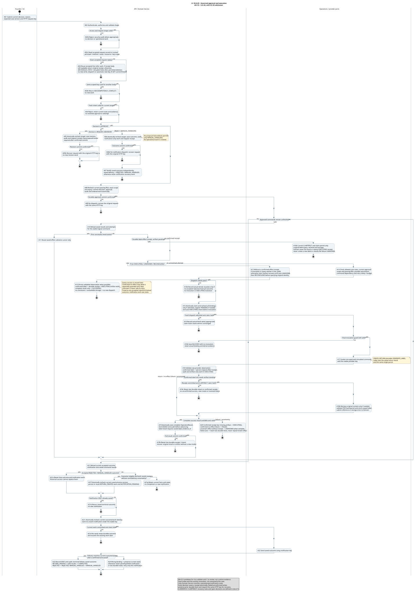
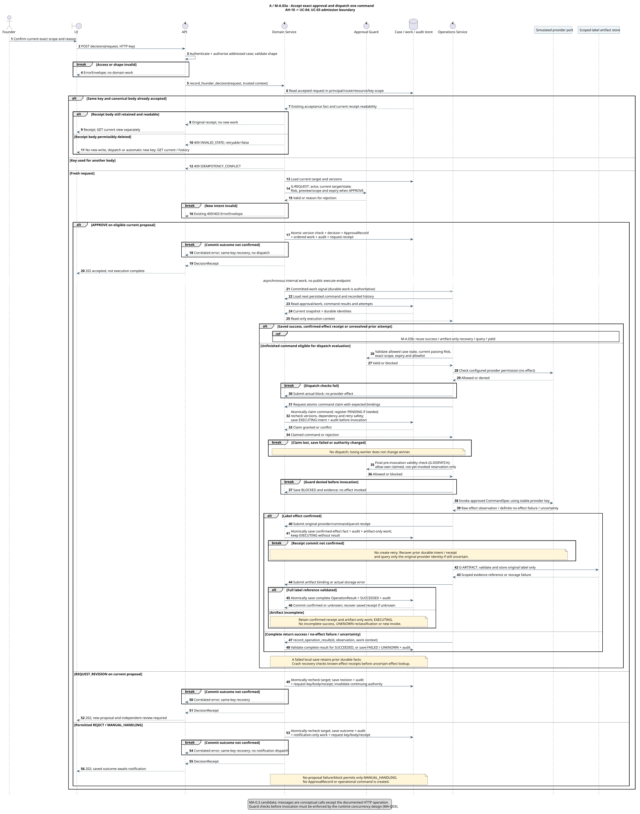
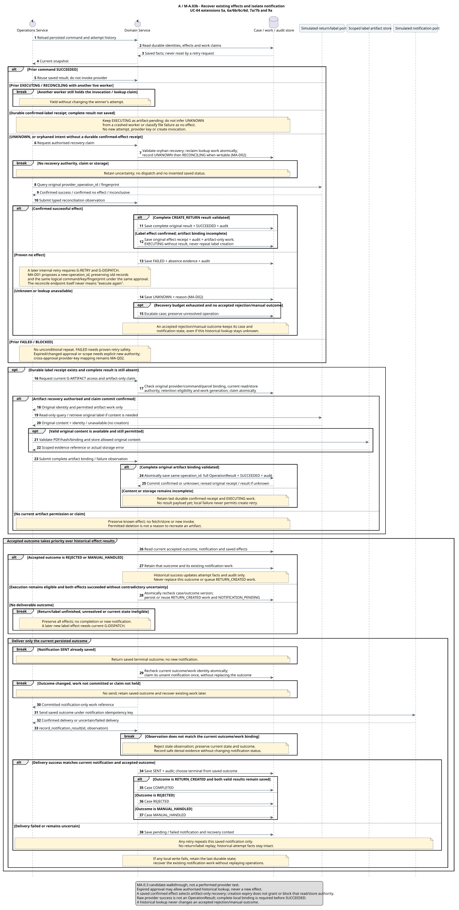
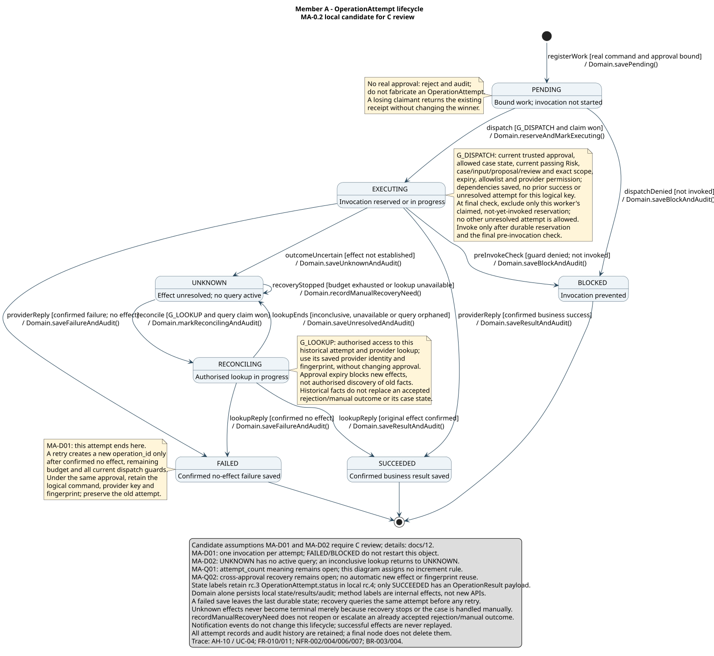

# A 个人模型链：精确批准、执行与恢复

> 版本：`MA-0.2`，2026-09-07；**评审候选，未完成人审或运行验收**。Owner A，Reviewer C；对应 [KAN-13](https://lucastaooo.atlassian.net/browse/KAN-13) 与 M-A.01–.06。
>
> rc.3 提交 `90931562f7e8d038b994d8d3ff3b2f289e462643` 是历史起点；MA-0.2 与 F.01 rc.4 对齐候选的评审入口为 [PR #11](https://github.com/shuxiachai/returnops-au/pull/11)。具体 head、提交和评审状态以该 PR 的记录为准；发布不代表本模型或 F.01 已获接受。
>
> 本稿由 AI 辅助起草并静态走查；A 须亲自理解、修订和解释，C 须本人评审。未生成 A 的独立完成声明、C 的认可、tutor 接受或课程提交回执。

## 1. 来源与交付边界

个人主链是 **AH-10 → UC-04 → Activity → Interaction（两个 Sequence 面板）→ OperationAttempt State**。UC-03 是批准入口及非执行决定的关联用例，AH-15/19 补充超时与通知边界。不是重新分配个人 UC，也不以整套系统的共享 ReturnCase 状态图代替 A 的对象状态机。

AH-10 原文为：

> Execute only the exact approved simulated action and never perform it twice by accident.

权威来源依次为[产品候选](00-project-definition-v1.md)、[固定归属](07-frozen-work-allocation.md)、[工作包与依赖](08-delivery-work-packages.md)、[AH 与 UC-03/04 规格](05-lab-3-requirement-modelling.md)、[F.01 rc.4 候选](09-interface-contract-v1.md)和[机器契约](../contracts/v1/schemas.json)。共享参照为[类图](diagrams/01-domain-class-diagram.md)、[案件状态图](diagrams/02-state-machine-diagram.md)及[共享顺序图](diagrams/03-sequence-diagram.md)。本稿的 MA-D/MA-Q 仍待明确处置，不因本次版本对齐自动冻结；模型不证明运行代码已实现。

课程原件已在本地核对，PDF 留在课程目录，未复制入 Git：

| 原件及 PDF 页码 | 对本链的约束 |
|---|---|
| `ELEC5620_Project_Stage_1_Marking_Criteria.pdf`，1–2 | 每人独立贡献至少一个 AH、一个 UC、一个 Activity、一个 Interaction、一个 State；三种行为模型从本人 AH/UC 导出，并说明共享贡献。文件存在不证明个人完成。 |
| `ELEC5620-Lab-Note-3.pdf`，1 | AH、Feature、UC 为互补需求视图。 |
| `ELEC5620-Lab-Note-4.pdf`，1；`ELEC5620-Lab-Note-5.pdf`，1 | 细化用例、明确架构职责及交互；解释模式对 FR/NFR 的影响，使用正确 UML 记法。 |
| `3 Requirement Model.pdf`，29–31、41、45 | 目标、触发、前后置条件、主流与具体失败点的扩展可追踪；Sequence 是 Interaction 建模示例。 |

未发现上述材料禁止或指定 PlantUML/Mermaid 的规则；这不代表 tutor 已接受本工具或本图。Package、Deployment、Architecture Analysis 在 rubric 标为 Optional；本项目保留自己的共享交付安排。Canvas 最新日期和后续未提供课件未核验，按[Stage 1 清单](11-stage1-readiness.md)另行确认。

| 工作包 | 原 S / F 依赖（保持不变） | 本轮具体产出 | 仍需的验收 |
|---|---|---|---|
| M-A.01 | S —；F — | 第 2 节规格核验与追踪 | A 解释个人需求；C 核对正常/异常流 |
| M-A.02 | S M-A.01；F F.01 | 第 4 节 UML Activity 源文件与 SVG | 规格自检及 F.01 接受；C 核对守卫、动作、终止语义 |
| M-A.03 | S M-A.02；F — | 第 5 节 Interaction 两个面板 | 消息、权威写入、调用前检查与恢复顺序得到 C 确认 |
| M-A.04 | S M-A.03；F — | 第 6 节 OperationAttempt 七态图 | A/C 处置 MA-D01/02、MA-Q01/02；事件/守卫/动作一致 |
| M-A.05 | S M-A.04；F — | 第 8 节 19 个静态场景及发现处置 | C 对具体图版本实际走查，问题及回复有记录 |
| M-A.06 | S M-A.05；F — | 第 9 节报告说明草稿与答辩练习入口 | A 改写并能独立讲解，真实提交/评审/个人贡献证据齐全 |

以上是可并行准备的候选成果，不表示依赖已满足、Jira 已改变或 M-A.01–.06 已 Done。B/C 的个人链仍由本人负责；共享 Composite Structure、Package/Deployment 及全组最终模型索引不在本次个人链中冒充完成。

## 2. M-A.01：规格核验与需求追踪

| 核验项 | 现有规格与本图对应 | 核验结论 / 边界 |
|---|---|---|
| 目标与主体 | AH-10；UC-04 Goal、Actor、Trigger；A01/A08/A17 | Founder 是授权人；提交精确批准后内部工作承接，不增加第二次执行批准。 |
| 前置条件 | UC-03 Preconditions / 4a–4d；UC-04 1a/2a/3a；G-REQUEST / G-DISPATCH | 当前且可信的批准、当前独立 Risk、精确范围与 provider 权限分别检查。 |
| 正常主流 | UC-03 1–7；UC-04 1–10；A08–A23 | 仅一订单、一包裹；CREATE_RETURN 的已存结果用于 GENERATE_LABEL，之后独立通知。 |
| 成功后置条件 | UC-04 Success / 7–10；G-COMPLETE | 已接受结果为 RETURN_CREATED，类型正确的 return/label 结果、审计及该通知成功已保存，才到 COMPLETED；HTTP 202 只是受理。 |
| 拒绝 / 修改 / 人工 | UC-03 3a–3d；A05–A07 | 修改需要新提案与独立审查；拒绝/人工决定只产生结果通知，送达后分别 REJECTED / MANUAL_HANDLED。 |
| 无提案人工目标 | UC-03 1a/1b；A04/A06；rc.3 三目标 | 当前 ProcessingFailure 或 OrderLookupBlock 二选一；只允许 MANUAL_HANDLING，不造提案、PASS、ApprovalRecord 或退货/标签工作。 |
| 重放与部分成功 | UC-04 5a/6b；A03/A03b/A10/A11；Interaction a/b | HTTP 接受重放、provider 效果防重分别处理；成功的 return 不因 label 失败而重复。 |
| 未知与失败 | UC-04 6a/6c/6d/7a；A12/A13/A20；State | 未知先查询；确认无效果才可能重试。持久化失败不等于 provider 没有效果。 |
| 通知 | UC-03 3d/3e；UC-04 6e/9a；UC-05 3a；A07/A21–A24；Interaction b | 已接受人工/拒绝 outcome 优先决定通知终态；历史查询只更新操作事实与审计，不能改写 outcome、重开案件或生成执行成功通知。 |

直接需求为 FR-009（人类决定）、FR-010（授权执行）、FR-011（审计）、FR-012（结果通知），补充 FR-003（订单目标）、FR-008（独立风险审查）。权限、可追踪性、故障恢复和 provider 边界遵循相应 NFR-002/004/006/007 及 BR-003/004；其余 UC 中的 UI/可用性要求不因本链聚焦执行而取消。每条走查在第 8 节回指具体 UC 扩展。

## 3. 跨图公用守卫与身份

下列名称是模型中的可解释谓词，不是新增 API、Schema 字段或已实现的方法。State 内 `G_DISPATCH` / `G_LOOKUP` 与这里的连字符写法同义。

| 名称 | 必须同时成立的条件 / 行为 |
|---|---|
| G-REQUEST | 先通过身份、案件访问与格式校验，再按可信 principal + method/route + resource + HTTP key 查已接受请求。相同规范正文返回原回执，不重新验证旧目标为新意图；同 key 不同正文报冲突。新请求再验证当前 case/input/target、版本及决定类型；APPROVE 还需要 AWAITING_APPROVAL、当前 PASS/PASS_WITH_WARNING、服务端 preview、exact scope、适用额度与 expiry。ESCALATE 不能批准；无提案目标只能人工处理。所有决定以原子版本检查提交决定、审计、所需工作和请求回执。 |
| G-DISPATCH | 重新验证可信原批准与 actor 权限、case/input/proposal/review 绑定、精确命令/参数指纹、额度/expiry、allowlist、独立 provider 资格；当前案件仍处于共享案件机允许该新效果的派发/恢复状态，当前有效 review 仍为 PASS/PASS_WITH_WARNING，已升级或人工收口的残留工作不能续派。先决 command 已成功保存，同 logical command 没有成功效果或其他/历史未决尝试；最后检查仅排除当前 worker 持有效 claim、尚未调用的本次 EXECUTING 保留意图，不能排除其效果已未知的旧调用。已失败工作还需 G-RETRY。必须原子 claim 且调用前意图持久化成功；最终调用边界仍有效，见 MA-Q03。 |
| G-RETRY | 能证明原调用没有效果、失败类型可重试、预算尚有、无并行 claim/未知效果，且原批准与参数仍有效；然后重走 G-DISPATCH。预算耗尽且尚无已接受人工/拒绝 outcome 才升级案件；否则保留该结果及其案件/通知状态。普通“未找到”或查询服务暂不可见不自动证明无效果。 |
| G-LOOKUP | 对原案件/尝试有可信读取或恢复权限、provider 查询资格；只有取得查询 claim 的 worker 发起查询。使用保存的原 provider_operation_id 或原 operation_fingerprint；不得重新生成逻辑工作或效果 key。失联的执行/查询先经 claim 恢复并记录未知。原批准过期不阻止独立授权的历史查询，但不能授权新效果。已接受人工/拒绝 outcome 后，查询只更新旧操作事实及审计，保留 outcome、通知身份及 pending/failed/terminal 案件状态。 |
| G-COMPLETE | 先读当前已接受 outcome 与对应通知。已有 REJECTED/MANUAL_HANDLED 时必须复用其通知并保留结果；旧操作后来成功或仍未知都不能改写它。仅在执行完成仍合法、两个批准命令的有效成功结果及审计已保存且无矛盾未决效果时，原子复核 case/outcome 版本后保存或复用 RETURN_CREATED 通知。领取通知和保存送达均复核当前 outcome/work 身份；已 SENT 则返回原终态不重发。送达后按 NotificationRecord.outcome 互斥选择：RETURN_CREATED 且有效结果仍存→COMPLETED；REJECTED→REJECTED；MANUAL_HANDLED→MANUAL_HANDLED。 |
| G-INPUT | 客户补充仅来自 AWAITING_INFORMATION 中匹配当前 question_set_id、expected_case_version 及请求内容的合法澄清。AWAITING_APPROVAL/APPROVED 的材料变化只指通过来源、权限、版本检查的受控内部更新；不能推导新的客户编辑/上传 API。Domain 在进一步效果前失效依赖的 proposal/review/approval，并保留历史事实和已接受结果。 |

任何写入失败都保留**最后已持久化的事实**。调用前保存失败不调用；调用后保存失败不能宣称 UNKNOWN 已写入，应凭调用前持久化的 EXECUTING 意图恢复并查询。请求事务结果未知时，用原 HTTP key 查回执，不能假设回滚或另造 key。

| 名称 | 在本链中表示什么 | 不能混用为 |
|---|---|---|
| HTTP `Idempotency-Key` | 一次可信公共请求的重放身份 | provider 的效果 key、批准或当前权限 |
| `command_id` 与 provider `idempotency_key` | 同一个逻辑效果及其重试的稳定身份 | 为绕过未知效果而每次换的新 key |
| `operation_id` | rc.3 OperationAttempt 的对象 ID；MA-D01 提议一次尝试一个 ID | 已接受的共享类字段改名或已实现的数据库键 |
| `operation_fingerprint` | rc.3 对 `{approval_id, scope_fingerprint, command}` 的规范化 SHA-256 | 可跨新 approval 任意复用的值；它也不等于 provider key |
| `attempt_count` | wire 中已有整数；具体计数语义列 MA-Q01 | 本稿自行新增的“每次加一”规则 |
| `OperationAttempt.status` | PENDING、EXECUTING、SUCCEEDED、FAILED、UNKNOWN、RECONCILING、BLOCKED | ReturnCase 状态或通知状态 |
| `OperationResult` | 仅 SUCCEEDED 携带的类型化成功 payload；CREATE_RETURN / GENERATE_LABEL 两种形状 | 所谓“四种结果状态枚举”或通用错误 DTO |

无真实可信 approval/command 绑定时，只返回拒绝并记录适用的安全审计，不能伪造 approval_id 来构造 BLOCKED 的 OperationAttempt。竞争失败的 worker 只退出/读取既有结果，不改获胜 worker 的状态。

## 4. M-A.02：Activity

[可编辑 UML 源文件](diagrams/member-a/governed-execution-activity.puml) · [完整 SVG](diagrams/member-a/governed-execution-activity.svg)



A01–A09 是 UC-03 受理；A10–A20 是每个未完成 command 的 UC-04 执行/恢复；A21–A24 是独立通知。A05/A06 的目标复核与写入是原子决定事务；A05 提交未确认时同样使用原 key 恢复，不启动新提案工作。菱形表示分支/合并，循环不表示并行派发；泳道表示责任，业务权威状态只由 Domain Service 写入。

MA-0.2 保留原动作 ID，并在 A21e/f/g 显式分开已有人工/拒绝结果、仍合法的执行完成、无可送达结果三条路径。A23 的终态由当前保存的 outcome 决定；不能仅因两条历史命令成功就写 COMPLETED。

图中的终止节点结束**本次活动调用**，不意味着案件已到终态。恢复分支可在本次工作周期退出，后续从已保存结果继续。A14b/A16/A16b 的 block 必须有真实绑定及确定“未调用”证据，claim loser 不把别人的 EXECUTING 改为 BLOCKED。

## 5. M-A.03：Interaction / Sequence

两个面板属于同一 UC-04 交互模型的不同情境，不是额外个人任务。消息使用概念性调用；公开操作以 [OpenAPI](../contracts/v1/openapi.json) 为准，未添加公共 execute endpoint。实线请求、虚线返回；双箭头 committed-work signal 表示异步内部通知，持久化工作记录才是可恢复来源。

### 5.1 受理与一次派发

[可编辑 UML 源文件](diagrams/member-a/exact-scope-sequence.puml) · [完整 SVG](diagrams/member-a/exact-scope-sequence.svg)



`alt` 区分已接受重放、正文冲突、新决定及决定类型；`break` 表示该情境在守卫失败或写入未确认时结束。`ref` 交接给恢复面板。该图详解一个 command；活动图负责按依赖遍历 return、label，不能把一张顺序图只画一次调用理解为允许跳过 label。

### 5.2 未知恢复、部分成功与通知

[可编辑 UML 源文件](diagrams/member-a/recovery-notification-sequence.puml) · [完整 SVG](diagrams/member-a/recovery-notification-sequence.svg)



活跃 EXECUTING/RECONCILING 由原 worker 继续；失联工作经授权回收，先恢复未知再查询。查询确认成功只保存旧效果；确认无效果后的新尝试需另经守卫。无结论继续 UNKNOWN；仅在尚无已接受人工/拒绝 outcome 时，预算耗尽才升级案件。人工处理不更改未知操作为 FAILED，也不阻止有权限的历史查询。

该面板先读取当前已接受结果；人工/拒绝结果优先沿用 A06/A07 的 outcome 与通知，最终为 MANUAL_HANDLED/REJECTED。只有没有该结果且执行完成仍合法时，才可形成 RETURN_CREATED 通知。历史查询无论确认成功、无效果或仍未知，都不能重开已有结果的案件；此规则不依赖 MA-Q02 的跨批准续派方案，也不伪造 return/label 成功。

## 6. M-A.04：OperationAttempt State

[可编辑 UML 源文件](diagrams/member-a/operation-attempt-state.puml) · [完整 SVG](diagrams/member-a/operation-attempt-state.svg)



转移读作 `event [guard] / Domain effect`。对象初建 PENDING，意图已持久化且取得调用资格后 EXECUTING。SUCCEEDED、确认无效果的 FAILED、确定未调用的 BLOCKED 结束该次尝试，审计与记录继续保留；最终节点不是删除。UNKNOWN/RECONCILING 不因人工升级或收口而终结；其历史查询转移不改变已接受的案件 outcome 或通知终态。

状态图使用真实 rc.3 枚举，但转移细节仍是候选设计；JSON Schema 只限制形状，不能证明转移、并发或 at-most-once 性质成立。`save...` 是 Domain 的概念性效果，不是已实现的函数或新增契约操作。

## 7. 明确提出的设计选择与待确认点

| ID | 本稿采用的候选 / 未决问题 | 为什么不能默认为已冻结 | 处置与确认责任 |
|---|---|---|---|
| MA-D01 | 一次尝试一个 OperationAttempt。FAILED/BLOCKED 不回 PENDING；符合条件的重试创建新 operation_id，保留旧记录。同一原批准下保留 command、provider key、fingerprint。 | 共享类已有一个 command 多个 attempts 的关系，但 wire 的计数/ID 映射尚未完全解释；这是建模选择，不是 Schema 唯一推导结果。 | A 说明取舍，C 评审；如影响消费者，由 B 确认；通过 F.01 后续处置再冻结。 |
| MA-D02 | UNKNOWN 表示没有活跃查询的未决效果；RECONCILING 表示查询进行中；无结论/失联查询回 UNKNOWN。 | case 的 RECONCILING 与 attempt 的查询阶段不同；状态枚举未独自规定查询生命周期。 | A/C 确认 phase、claim 回收与重试预算；失联阈值仍是运行设计待定项。 |
| MA-Q01 | `attempt_id` / `attempt_number`（共享类概念）与 `operation_id` / `attempt_count`（wire）的映射及计数含义。 | 不能同时把 attempt_count 当单对象重试次数与新尝试序号。本图不指定递增规则。 | A 提出唯一映射，C 核对审计/评测，B 核对展示；修改共享类或契约须明确版本处置。 |
| MA-Q02 | 原批准失效后，如何把新批准的 fingerprint 与原逻辑效果/provider key 关联。 | fingerprint 包含 approval_id；换批准就变，不能声称“换批准后 fingerprint 仍不变”。旧成功/未知效果必须保留。 | 当前图不允许跨批准自动续派；A/C 先定义新批准映射及 provider 防重能力，之后再进入实现验收。 |
| MA-Q03 | 最后守卫检查与真实 provider 调用之间如何防止版本/权限竞争。 | 在图中多写一次检查不能证明原子性；必须明确提交/调用的有效时点、锁/claim/版本或其他并发策略及故障恢复。 | A 在 A2 运行设计中落实，C 用并发/过期/故障场景验证。当前是必要守卫与待实现约束，非已证明性质。 |

MA-D01/02 可供 A/C 审阅本链；尚未确认前不把涉及其选择的走查记为正式验收。MA-Q02/03 不授权绕过守卫，也不能因难以实现就放宽 AH-10 的目标。

## 8. M-A.05：19 个静态走查场景

本节记录的是 AI 对 `MA-0.2` 规格与源图的静态走查，**没有启动 API、数据库或 provider，没有 C 人审结果**。原 MA-T01–15 保留，新增 MA-T16–19 为缺陷回归。定位以稳定动作 ID、状态事件和 Sequence 分支文字为准，自动消息编号会随修订变化。

| ID / 情境 | 实际图上路径及禁止行为 | 规格追踪 | 当前记录 |
|---|---|---|---|
| MA-T01 正常批准与执行 | A08→A10→A14/A15→A17–A19；两命令分别 PENDING→EXECUTING→SUCCEEDED；A21–A23。无二次批准，通知保存前不 COMPLETED。 | UC-03 主流；UC-04 1–10；FR-009/010/011/012 | 静态路径已核对；MA-Q03 运行证明待完成。 |
| MA-T02 拒绝 | A06 原子结果/回执→A07；没有新 ApprovalRecord/OperationAttempt，通知后 REJECTED。 | UC-03 3a/3d；FR-009/011/012 | 静态路径已核对。 |
| MA-T03 修改 / ESCALATE | A04 拦截直接批准 ESCALATE；A05 合法 revision→新 proposal 与独立 review；旧批准不延续。 | UC-03 3b/4d；FR-008/009/010 | 静态路径已核对。 |
| MA-T04 决定与派发各自守卫 | A02b/A04 拒绝无效新意图；A14b/A16b 在调用前拒绝工作；有真实绑定才可 BLOCKED，无批准不造 DTO。 | UC-03 4a–4d；UC-04 1a/2a/3a；FR-009/010/011 | 修正先写 EXECUTING 的歧义后路径已核对。 |
| MA-T05 两类无提案人工目标 | 当前 technical failure 或 CONFLICT/AUTHORITY_DENIED lookup block 二选一→A06/A07；MANUAL_HANDLED，不造提案/PASS/approval/操作。 | UC-03 1a/3c；FR-003/009/011/012 | 静态路径已核对；所依 rc.3 仍待联合接受。 |
| MA-T06 过期/混合目标与重放 | 新请求混合目标/错误 case/input→A02b/A04；既有相同正文已接受请求→A03；同 key 不同正文→A03b。旧回执不使旧目标变当前。 | UC-03 1b；F.01 幂等；FR-009/011；NFR-002/004 | 补显式冲突分支后路径已核对。 |
| MA-T07 并发领取 / 重投 | A10–A16 原子 claim；loser 退出不改 winner；已成功 A11；活跃执行/查询 yield；未知进入恢复。 | UC-04 5a；FR-010/011；NFR-004 | 模型边界已核对；MA-Q03 待运行设计与验证。 |
| MA-T08 部分成功 | return 结果 A11 复用；只恢复未完成 label，使用已存 provider return ID/parcel；不重复 return 或双用 core/A3。 | UC-04 6b/6d；FR-010/011/012 | 候选路径已核对；涉及新尝试时待 MA-D01。 |
| MA-T09 明确无效果后重试 | 旧 FAILED 终结；G-RETRY + G-DISPATCH→新 operation_id；同批准下保留 command/key/fingerprint。不擅自解释 attempt_count。 | UC-04 6a/6c；FR-010/011 | 候选路径待 MA-D01 / MA-Q01 确认。 |
| MA-T10 查询确认旧成功 | EXECUTING→UNKNOWN→RECONCILING→SUCCEEDED；保存原结果，无新效果。过期批准不阻止独立授权查询。 | UC-04 6d；FR-010/011 | 静态路径已核对。 |
| MA-T11 查询确认无效果 | UNKNOWN→RECONCILING→FAILED；后续符合原批准及 G-RETRY 才可新尝试；“未找到”不自动等于无效果。 | UC-04 6a/6d；FR-009/010/011 | 查询路径已核对；重试待 MA-D01，跨批准列 MA-Q02。 |
| MA-T12 无结论 / 查询失联 | RECONCILING→UNKNOWN；活跃查询 yield，失联 claim 回收；无已接受人工/拒绝 outcome 时预算耗尽升级 case，未知 attempt 不终结。 | UC-04 6c/6d；FR-010/011/012 | 补 RECONCILING 恢复及 outcome 优先边界；候选 phase 待 MA-D02 确认。 |
| MA-T13 决定事务失败 | A09/A06b 及 Interaction 各决定的 commit break；不报告受理、不派发未提交工作；按原 key 恢复。 | UC-03 5a；FR-009/010/011；NFR-004 | 补各决定的原子回执与失败路径后已核对。 |
| MA-T14 provider 后本地保存失败 | A18/A20 保留最后 durable EXECUTING；恢复后查询旧身份再存结果，不能宣称 UNKNOWN 已写入、直接重试或派发依赖命令。 | UC-04 7a/6d；FR-010/011；NFR-004 | 静态路径已核对。 |
| MA-T15 通知失败 | A24 / Interaction b 只恢复通知；SUCCEEDED 不变。拒绝/人工沿 A07，送达后使用对应终态。通知写入失败保留旧持久化状态。 | UC-04 9a；UC-03 3d；FR-010/011/012 | 静态路径已核对。 |
| MA-T16 人工通知待发送时旧 label 确认成功 | return SUCCEEDED、label UNKNOWN→预算耗尽 ESCALATED→Founder 接受 MANUAL_HANDLING，通知 PENDING→历史查询确认 label SUCCEEDED。Interaction b 人工优先分支 / A21e 必须保持原 outcome、notification_id/key，更新旧 attempt/audit；只发送该人工通知，A23→MANUAL_HANDLED。禁止 RETURN_CREATED 通知、COMPLETED 或新操作。 | UC-03 3e；UC-04 6e；UC-05 3a；FR-009/010/011/012 | 修复旧“双方成功即 COMPLETED”路径；候选静态回归已核对。 |
| MA-T17 人工终态后的历史查询 | 已 MANUAL_HANDLED 且原通知 SENT、历史 label UNKNOWN；授权查询分别确认成功或仍未知并耗尽预算。前者只保存 SUCCEEDED/result/audit，后者保留 UNKNOWN/audit；两者都保留案件 MANUAL_HANDLED、原 SENT 和通知身份，无 RECONCILING/ESCALATED 重开、无重发或新效果。 | UC-04 6c/6e；UC-05 3a；FR-009/011/012 | Interaction b 升级条件和已 SENT break、共享状态规则已核对。 |
| MA-T18 拒绝结果不被旧效果覆盖 | 已有历史 return/label 成功，当前合法提案收到 REJECT 且通知 FAILED；恢复流程读到两条成功记录。A21e 复用原 REJECTED outcome 和通知；仅该通知可重试，送达后 REJECTED。领取/回写时若 outcome/work 身份不再匹配则不写终态。 | UC-03 3a/3d/3e；UC-05 3a；FR-009/011/012 | 静态结果映射与绑定复核已核对；并发原子实现仍待运行验证。 |
| MA-T19 合法新材料入口 | 客户在 AWAITING_APPROVAL/APPROVED 无当前问题集，或在 AWAITING_INFORMATION 提交旧 question_set/version：不接受新输入、不启动分析。当前问题集的合法澄清可追加；受控内部订单快照须来源/权限/版本校验并失效依赖批准，保留旧效果。未增加公共上传路由。 | UC-01E 2b；共享 state 新材料守卫；FR-002/009/011 | 共享 Sequence 澄清 break 与 G-INPUT 已核对；不构成已实现 API 证明。 |

本轮静态检查发现并修正：活动图先检查后才允许 EXECUTING；补已有 RECONCILING 的活跃/失联处理；为非 APPROVE 决定补原子 request receipt、提交失败及受理响应；为活动图补同 key 不同正文冲突、鉴权先行。另将 FAILED 明确为确认无效果、补调用前最后守卫，明确允许的案件状态/当前 passing review，排除最终检查对本 worker 尚未调用的 reservation 的自我阻塞，保持 Domain 唯一写入，并区分持久化失败与已保存 UNKNOWN。通知组补已 SENT 重放、提交/claim 未确认禁止发送。这些是本稿内部修订，不是 C 的评审记录。

MA-0.2 另外修复历史操作结果覆盖已接受人工/拒绝结果的终态分支，并限定合法新材料入口。MA-T16–19 是对具体候选路径的静态回归记录，不声称已执行并发恢复、provider 调用或人审测试。

## 9. M-A.06：报告草稿与本人讲解

以下可供 A 改写，不可直接用作“我已经独立实现/测试”的贡献证明：

> A's model chain starts from AH-10 and UC-04, with UC-03 as its approval boundary. The activity model separates decision admission, guarded command execution, recovery and notification. The interaction model assigns authoritative writes to Domain Service and permits provider effects only after exact-scope checks and durable work admission. The OperationAttempt state machine distinguishes confirmed success, confirmed no-effect failure and unresolved effects. An uncertain outcome is queried using its original identity before any retry decision; notification recovery cannot replay a successful return or label. Historical observations preserve an accepted manual or rejection outcome and its notification. These are MA-0.2 candidate models aligned with F.01 rc.4, not evidence of implemented runtime guarantees. Attempt identity/counting, cross-approval recovery and concurrent authorisation enforcement still require explicit decisions and verification.

A 自查讲解时按三个例子展开：正常的 return→label→通知；return 已成功但 label 超时且本地保存失败；无提案订单阻断下的人工处理。每个例子指出 AH/UC 来源、图上路径、状态写入者、禁止行为及当前缺少的实测证据。

可用于互问的题目：为什么 HTTP 202 不等于业务成功？为什么同一个逻辑命令可能保留多条尝试记录？为何过期批准允许历史查询却不能允许新调用？为什么通知失败不能重新创建退货？最后一次守卫检查能否单独证明并发安全？回答需基于图和待决策项，不背诵“at most once 已保证”。

## 10. 复现、评审与后续验收

源文件为标准 PlantUML，英文图中文字便于后续英文报告复用；本文提供中文解释。SVG 是可缩放的审阅图，放进报告时应按面板/主异常情境分幅并检查实际字号，不把整张长图缩到无法阅读。PNG 仅为本地视觉检查缓存。

本轮使用本机已有 Java 和官方 [PlantUML 1.2026.8](https://github.com/plantuml/plantuml/releases/tag/v1.2026.8) 本地渲染；没有把图发送到在线渲染服务。JAR SHA-256：`5e1ecfa8ecd32c90b03bbf3b1eb6f020943f98ab0fcf4032be31a0002ee2c462`。临时 JAR/PNG 在忽略的 `tmp/` 中，不是项目运行依赖；State 使用 Smetana。

从仓库目录运行（`java` 可换为本机实际 Java 路径）：

```powershell
java '-Djava.awt.headless=true' -jar tmp/uml-tools/plantuml-1.2026.8.jar -charset UTF-8 -failfast2 -tsvg 'docs/diagrams/member-a/*.puml'
```

四个源文件均须成功渲染，逐图检查分支/标签/图例没有遮挡、截断；更新源文件后同步重渲染 SVG。语法/图形检查不证明 UML 语义、人审或运行性质。本节记录模型验证；离线契约与 F.02 基础环境验证分别见[契约说明](../contracts/README.md)和[环境记录](10-f02-environment-readiness.md)，均不能代替本链的业务运行验收。

MA-0.1 发布前本地验证历史记录（2026-09-07）：4/4 PlantUML 成功渲染为 SVG，并逐图检查本地 PNG；Activity 超过默认 PNG 高度上限，视觉检查时设置 `$env:PLANTUML_LIMIT_SIZE = '8192'` 后重渲染，完整图为 2950 × 4259，末尾图例与终止节点可见。七态与 Schema 枚举逐项一致，15 个场景及 34 个活动动作 ID 可定位；20 份文档、15 个已有 Mermaid 块及 148 个本地文件链接检查通过。对比当时 HEAD，89 个 WBS 的 Owner/Reviewer/S/F 完全一致。这些历史数字不代替 MA-0.2 的修订检查。

MA-0.2 发布前本地验证记录（2026-09-07）：当时修改的 Activity、恢复 Sequence、OperationAttempt State 共 3 份 PUML 均重新生成 SVG 和临时 PNG，并查看完整图；缩短 State 右侧的未调用守卫以避免文字截断。Activity PNG 为 3012 × 4522，恢复图为 1522 × 2687，图例和终止节点可见。全部 4 份个人 SVG 的 XML/时序检查通过，七态仍逐项匹配 Schema；19 个场景和 37 个唯一活动动作可定位。执行当时的文档检查覆盖 21 份文件、15 个 Mermaid 块和 178 个有效本地文件链接；89 个 WBS 的 Owner/Reviewer/S/F 与当时 HEAD 一致，空白和 `git diff --check` 通过。旧临时个人检查器固定 15 场景，当时只在内存中改为 19 后执行，未把临时工具冒充已跟踪的复现入口。以上均为发布前工作副本的静态/图形验证，不表示已对 PR 当前 head 重跑、CI 通过或 C 人审；该轮模型检查没有调用 API、数据库或 provider。

本轮后续已加入[仓库内静态检查工具](../tools/model-checks/README.md)：从仓库运行 `python -B tools/model-checks/check.py` 与 `node tools/model-checks/check-mermaid.mjs`；Node 依赖安装与工具回归命令见该说明。该工具按 SVG 内嵌源内容检查同步，不依赖 mtime，自动识别场景数量；不替代实际渲染、视觉检查或人审。

正式接受仍需：

- [ ] A 阅读并亲自修订本链，记录个人理解、选择和实际贡献。
- [ ] C 对确定的源文件版本实际走查 MA-T01–19，记录发现、回复与认可。
- [ ] A/C 处置 MA-D01/02 与 MA-Q01/02；影响 wire/UI 时同步 B，保留 F.01 版本决定。
- [ ] F.01 与原 M-A S/F 依赖达到相应验收条件；MA-Q03 转入可验证运行设计，不能在模型阶段报已证明。
- [ ] 在 PR #11 标注确定的模型提交和实际评审记录，再回填 KAN-13 证据；PR 存在或 Jira 状态本身不代表模型接受。
- [ ] A 的个人报告/讲解材料与图版本一致；B/C 各自链及共享 Composite 等按原 Owner/Reviewer 继续补齐。

下一步先由 A 阅读三个讲解场景并形成自己对 MA-D01/02 的解释，再交 C 审阅可定位版本。[CS-0.1 共享复合结构候选](13-shared-composite-structure.md)已补出对应 ports/connectors，正式验收仍遵循原依赖；Package/Deployment 及全组模型索引继续按原 Owner 推进。视频按组长已有安排后续自行录制，不作为本轮模型推进的前置条件。
