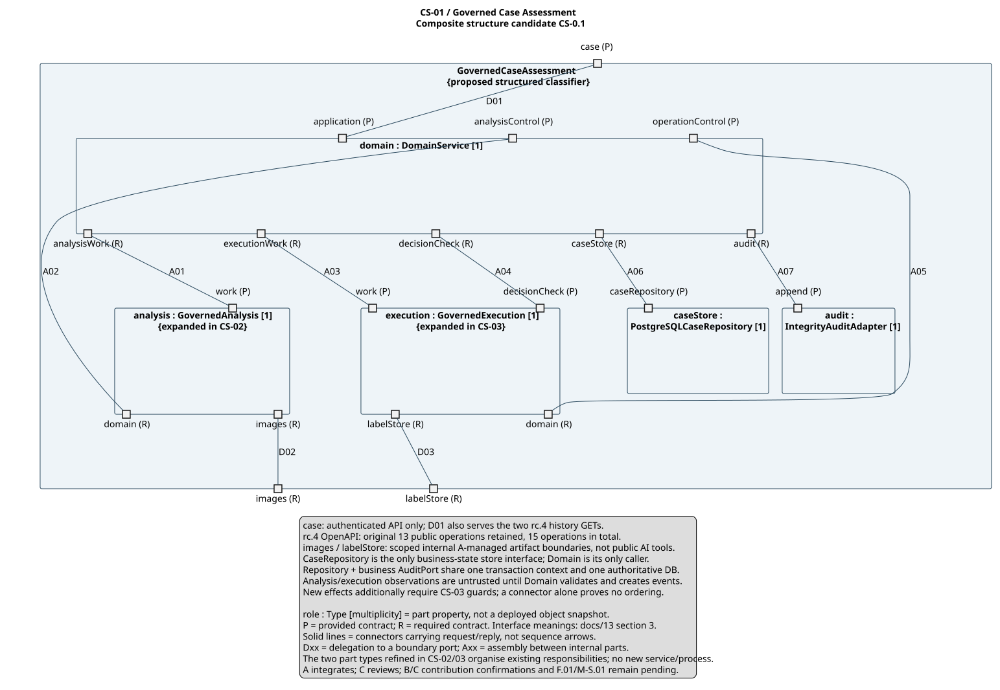
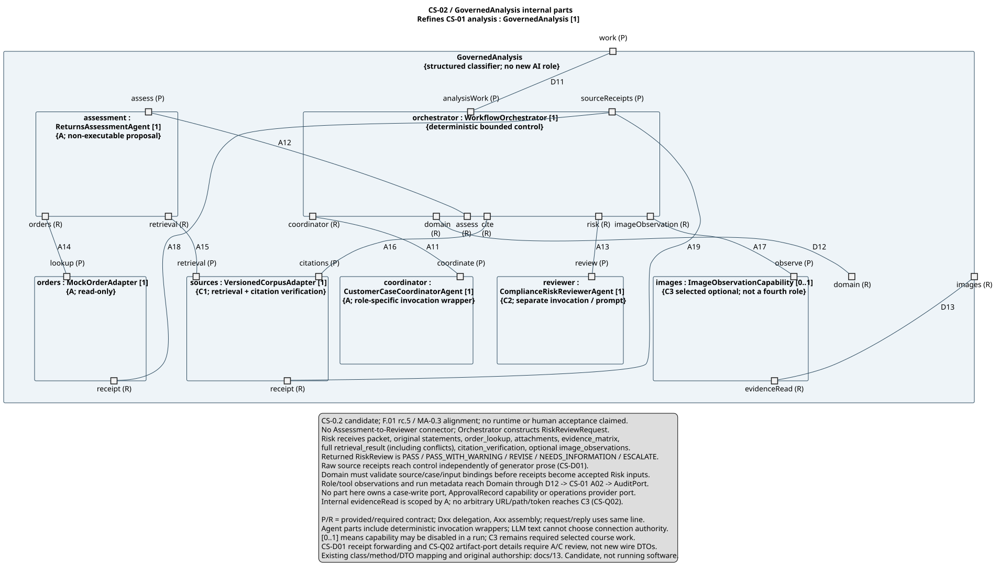
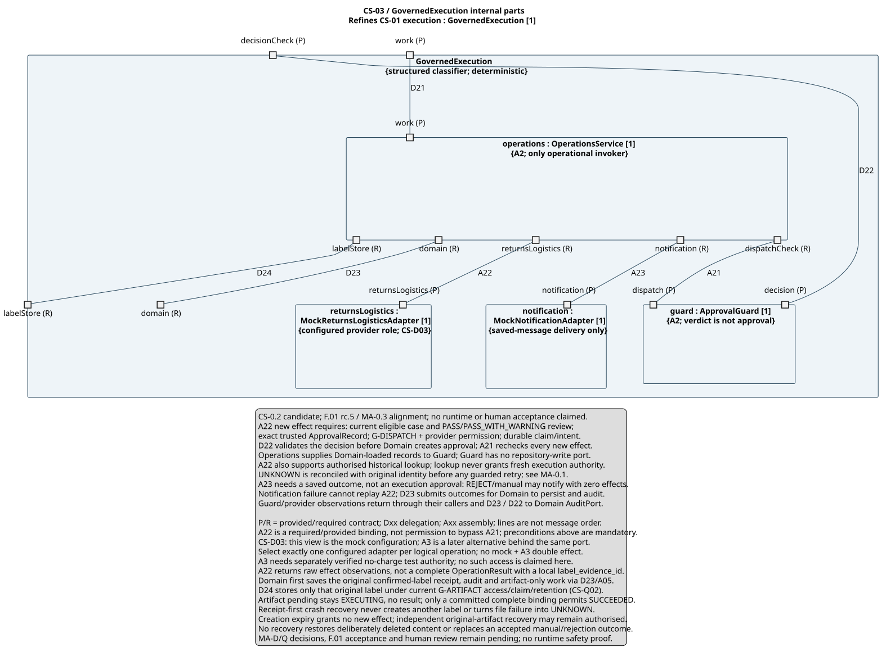

# 共享复合结构：Governed Case Assessment

> **rc.5 发布定位（2026-09-07）：**本版交付至 [PR #11](https://github.com/shuxiachai/returnops-au/pull/11)，由包含本说明的实际提交定位。PR 中记录准确 source SHA、CI run 与评审状态；C 复现使用该准确 SHA，不能使用旧 `57d86fe` 或浮动分支。下文“未发布/本地准备”、旧测试和旧哈希是发布前历史；当前提交以 Git 文件内容及 `docs/reviews/rc5-publication-artifacts-20260907.json` 为准。发布不等于 F.01/F.02 接受、B/C 本人审阅/复现或课程提交，Jira 未由此同步。

> `CS-0.2`，2026-09-07；**评审候选，未完成人审或运行验收**。对应 M-S.02，Owner A、Reviewer C；原开始依赖 M-S.01 保持不变。不把 F.01/M-S.01 标为已接受。
>
> rc.3 提交 `90931562f7e8d038b994d8d3ff3b2f289e462643` 是历史起点；`57d86fe` 发布的 rc.4/MA-0.2/CS-0.1 是本轮修正历史依据；本地候选对齐 rc.5 与 [A 的 MA-0.3 模型链](12-member-a-model-chain.md)。评审入口为 [PR #11](https://github.com/shuxiachai/returnops-au/pull/11)，具体 head、收录文件和评审状态以 PR 为准，不表示模型已接受或 CI 已通过。发布前于 2026-09-07 读取 [KAN-13](https://lucastaooo.atlassian.net/browse/KAN-13)：其范围明确含 M-A.01–06 及 A 负责的 M-S.01/M-S.02，故本稿沿用该交付主卡；该核验不等于已回填本次候选或完成模型验收。KAN-32 仍专用于 F.01。
>
> AI 辅助起草与静态走查；A 负责整合并解释，C 本人评审，B/C 分别确认自己的共享贡献。本文不替代 B/C 的个人模型链、个人署名或 tutor 接受。

当前修正版本与本地检查证据见 [缺陷修正记录](reviews/a-defect-closure-20260907.md)；先前发布与准备记录仅作历史依据。

## 1. 依据与所补缺口

[产品候选 §10.4](00-project-definition-v1.md#104-shared-high-value-models)已选择 **Governed Case Assessment Composite Structure Diagram**，要求显式 ports/connectors、独立 Risk、效果调用前 Approval Guard、Operations 唯一操作入口，以及 material events 经 Audit Port。归属来自[固定分工](07-frozen-work-allocation.md)，依赖和验收来自[原 WBS](08-delivery-work-packages.md)。

现有[系统设计](02-system-design.md)是职责和交互概览，[共享类图](diagrams/01-domain-class-diagram.md)是类、接口及依赖；它们保留原作者来源。本稿在这些类型上建立拟议的内部 part/port/connector 结构，不把类依赖箭头或概念流程图改标题后当作运行时结构。

| 已核验原件 | 本稿采用的要求 |
|---|---|
| `ELEC5620_Project_Stage_1_Marking_Criteria.pdf` 第 1 页 | Complex Structure Modelling 为 3 分；以 classes 为基础建立 runtime models，有效使用 object/collaboration/structured class 等技术。未要求把所有例举图种各画一遍。 |
| 同上第 2 页，第 1、3 条 | 模型来自项目需求；每人参与共享任务，具体贡献需可追踪。 |
| `5 Modeling Structure part 1.pdf` 第 8、11–18 页 | 区分设计时 classes、运行时 instances/links，以及 structured classes 的规格；第 3–4 页有边界端口/连接示例。 |
| `4 Architectural Design and Modeling (part 1).pdf` 第 18、35、47–49 页 | 设计时/运行时视角不同；有控制/功能分离、控制端口和递归结构示例。 |
| Lab 4 / Lab 5，第 1 页 | 明确视点、职责/交互、模式取舍和 FR/NFR，使用正确 UML；没有在这两页规定完整 Composite 语法或特定绘图工具。 |

PDF 仍留课程目录。Canvas 最新通知及未提供后续课件未访问；本地课件不等于 tutor 已接受此图。图描述将来的运行时组织，无需假称已运行数据库才能提供这一设计模型。

## 2. 三幅图如何一起读

| 图 | 结构化整体与范围 | 阅读重点 |
|---|---|---|
| CS-01 | `GovernedCaseAssessment` 的内部结构 | Domain、分析、执行、唯一业务仓储与 Audit；外层 case/images/labelStore 边界 |
| CS-02 | CS-01 中 `analysis : GovernedAnalysis` 的内部结构 | 有界 Orchestrator、三个独立角色、只读 order/retrieval、引用核验及 C3 能力 |
| CS-03 | CS-01 中 `execution : GovernedExecution` 的内部结构 | Guard、Operations、核心模拟 return/logistics 与独立 notification adapter |

`GovernedCaseAssessment / GovernedAnalysis / GovernedExecution` 是本模型组织既有职责的结构化类型名称，不要求增加 Python 类、微服务、消息总线或部署进程。三个视图互相展开同一个结构，不是三份并行系统。

**记法：**内部矩形用 `role : Type [multiplicity]` 表示 part property；没有给名称加下划线，也没有声称是某次真实运行的对象快照。小方口位于整体或 part 边界；`(P)` 表示提供的契约，`(R)` 表示需要的契约，是本图图例，不是 UML 的 multiplicity。精确接口含义在第 3 节，不把端口名称视作 wire DTO。

实线连接两个端口，承载接口约定的请求/响应，不表示消息先后。`Dxx` 为整体边界向内部 part 的 delegation，`Axx` 为内部 parts 的 assembly；普通线可表示这些连接，不必强加时序箭头。P↔P 或 R↔R 的 delegation 保留整体边界向内部的委派语义；assembly 连接需要方 R 与提供方 P。一个端口可支持多个相关操作，不代表调用方拥有任意函数或数据库权限。

记法另核对 [OMG UML 2.5.1 官方规范](https://www.omg.org/spec/UML/2.5.1/PDF)：§9.5.4 印刷 p113（PDF p155）支持 Property 标签；§11.2.3.2–11.2.4 印刷 pp184–186（PDF pp226–228）说明内部 parts 与 assembly/delegation connectors；§11.3.3.1/11.3.4 印刷 p191（PDF p233）说明边界端口及 delegation 的接口面。lollipop/socket 是可选表示。本轮只是按这些规则检查候选，没有运行 UML 元模型/XMI 语义验证器。

部件 `[1]` 表示此配置的一个逻辑角色，不是只允许一个案件或禁止多个 worker。C3 `[0..1]` 表示一次配置可暂未接入/禁用；它仍是既定课程 selected optional，不能因此取消交付。CS-03 展示核心 mock 配置，A3 替代配置单独说明，不能同次操作运行两套 adapter。

### CS-01：整体

[可编辑 PlantUML](diagrams/shared/governed-case-composite.puml) · [完整 SVG](diagrams/shared/governed-case-composite.svg)



`case` 的调用者是经过认证/授权的应用层。Customer Portal、Founder Dashboard 和 Application API 在这个结构化整体之外，其交互仍由 B/A 的既有接口定义；本图不是完整前端或部署图。`images` 和 `labelStore` 需要外部的 A 管理附件能力，二者不是可以由 AI 自选的 HTTP 地址。

### CS-02：分析内部

[可编辑 PlantUML](diagrams/shared/governed-analysis-composite.puml) · [完整 SVG](diagrams/shared/governed-analysis-composite.svg)



Agent part 包含受控的确定性调用包装；原始 LLM 输出不拥有其端口、凭据、可信上下文或任意工具选择权限。三个业务 AI 仍只有 Coordinator、Assessment、Risk；C3 是图片观察能力。Assessment 不直接调用 Risk；Orchestrator 用完整材料独立调用 C2。

### CS-03：执行内部

[可编辑 PlantUML](diagrams/shared/governed-execution-composite.puml) · [完整 SVG](diagrams/shared/governed-execution-composite.svg)



Domain 通过 decisionCheck 验证 Founder 决定，再按合法结果生成并保存批准/工作。Operations 使用当前权威记录，通过 dispatchCheck 在每个新效果前核验，并独立检查 provider 资格及持久化 claim/幂等。Guard 的 Boolean verdict 不是 ApprovalRecord，也不产生工作。

**A21 的守卫是 A22 新调用的前置条件；连接线本身不证明先后或不可绕过。**顺序和失败恢复由 [UC-03/04](05-lab-3-requirement-modelling.md)、[MA-0.3](12-member-a-model-chain.md) 的 G-DISPATCH/G-LOOKUP/G-ARTIFACT 与 Sequence 约束。通知工作可以来自拒绝/人工结果，它要求已保存结果，不要求伪造执行批准。

## 3. 端口契约与连接登记

本节是图中端口的类型/操作说明。已有 wire 类型以 [rc.5 Schema](../contracts/v1/schemas.json)、[OpenAPI](../contracts/v1/openapi.json)和[接口说明](09-interface-contract-v1.md)为准。原 13 个公共操作保留，rc.4 新增两个角色隔离的历史 GET，共 15 个；rc.5 只修订本轮语义，shape 不变；历史读取复用 D01 的 Domain 应用读边界。下面的 `analysisWork / analysisControl / operationControl / sourceReceipts` 等仍是内部能力别名，不另加公共路由、输入 DTO 或可信结果类型。

### 3.1 CS-01

| ID | 两端与契约 | 可传递什么 / 约束 |
|---|---|---|
| D01 | `case (P)` ↔ `domain.application (P)` | 既有 Domain 应用操作及获准只读投影；`FounderDecisionRequest → DecisionReceipt`、case/clarification 与 read models 等。trusted_context 由 API 服务端形成；请求正文不能提交可信 principal 或任意新状态。 |
| D02 | `analysis.images (R)` ↔ `images (R)` | A 管理的 scoped evidence read；仅已有获准 evidence ID 的内容，见 CS-Q02。 |
| D03 | `execution.labelStore (R)` ↔ `labelStore (R)` | A 管理的内部生成标签存储/引用能力；不复用客户上传权限，不让 adapter 直接写 case，见 CS-Q02。 |
| A01 | `domain.analysisWork (R)` ↔ `analysis.work (P)` | `run_bounded_analysis(case_id, work_context)`；仅已保存且当前允许的分析工作；void 不表示成功。 |
| A02 | `analysis.domain (R)` ↔ `domain.analysisControl (P)` | 当前获准快照/工作上下文的读取，以及具体分析/来源结果、真实错误与关联观测的提交。Domain 验证 case/input/proposal/corpus、来源及状态后接受。不是 caller 提交新状态的通用接口。 |
| A03 | `domain.executionWork (R)` ↔ `execution.work (P)` | `execute_approved_plan`、`reconcile_known_attempt`、`send_recorded_outcome` 三种内部能力；工作必须已保存，三者权限和效果范围不同。 |
| A04 | `domain.decisionCheck (R)` ↔ `execution.decisionCheck (P)` | `validate_current_decision`；当前记录、Founder 请求及可信上下文 → 内部 verdict/拒绝依据。Domain 才能提交决定与 ApprovalRecord。 |
| A05 | `execution.domain (R)` ↔ `domain.operationControl (P)` | **同时**提供获准的当前记录读取、逻辑 command claim/意图请求、`record_operation_result`、`record_notification_result` 及关联观测提交。不是仅写结果回调；只有 Domain 校验并提交持久化事实，Ops 不直接写仓储。 |
| A06 | `domain.caseStore (R)` ↔ `caseStore.caseRepository (P)` | 既有 `CaseRepository`：load current records / commit guarded change set；Domain 为唯一 caller，事务含版本/幂等/工作与业务审计。 |
| A07 | `domain.audit (R)` ↔ `audit.append (P)` | 既有 `AuditPort.record_non_personal_event(AuditEvent, transaction_context)`；事件由确定性服务建立并脱敏，append 不授予状态修改权。 |

`analysisControl / operationControl` 的内部读取/提交各有固定方法、权限和参数；把它们画在一个 port 上不表示实现一个 `submit_anything` API。共享类图中的方法是代表性契约，原 F.01 DTO 不能被自由扩展。

### 3.2 CS-02

| ID | 两端与契约 | 输入 → 输出 / 约束 |
|---|---|---|
| D11 | `work (P)` ↔ `orchestrator.analysisWork (P)` | 委派 A01 的已保存工作入口。 |
| D12 | `orchestrator.domain (R)` ↔ `domain (R)` | 委派 A02；提交结果/错误/观测并读取获准的当前材料，所有权威接受仍在外层 Domain。 |
| D13 | `images.evidenceRead (R)` ↔ `images (R)` | 委派 D02 的受限读取；不传 arbitrary URL/path、bearer token 或 provider secret。 |
| A11 | `orchestrator.coordinator (R)` ↔ `coordinator.coordinate (P)` | `structure_request / prepare_clarification(case_input) → CoordinatorResult`；case_input 是内部只读描述，没有 CoordinatorRequest wire DTO。 |
| A12 | `orchestrator.assess (R)` ↔ `assessment.assess (P)` | `assess_case(assessment_input) → DecisionPacket`；原始陈述、获准证据及当前已接受来源；只产生条件建议，无命令或批准。 |
| A13 | `orchestrator.risk (R)` ↔ `reviewer.review (P)` | `RiskReviewRequest → RiskReview`，对应 C2.review / review_independently；独立系统提示词与调用。 |
| A14 | `assessment.orders (R)` ↔ `orders.lookup (P)` | `OrderProviderPort`：`OrderLookupRequest → OrderLookupResult`；只读，CONFLICT/AUTHORITY_DENIED、NOT_FOUND、PROVIDER_FAILURE 各按既有分流。 |
| A15 | `assessment.retrieval (R)` ↔ `sources.retrieval (P)` | `RetrievalPort.retrieve_versioned_passages`：`RetrievalRequest → RetrievalResult`；完整 status/passages/conflicts/corpus_version/retrieved_at 保留。 |
| A16 | `orchestrator.cite (R)` ↔ `sources.citations (P)` | `RetrievalPort.verify_citations`：`CitationVerificationRequest → CitationVerificationResult`；每条引用核对 ID/version/hash/location，可解析性不等于主张得到支持。 |
| A17 | `orchestrator.imageObservation (R)` ↔ `images.observe (P)` | C3.observe_images：`ImageObservationRequest → ImageObservationResult`；可见现象/限制，不输出法律判断或操作 authority。 |
| A18 | `orders.receipt (R)` ↔ `orchestrator.sourceReceipts (P)` | 原始 OrderLookupResult 或实际失败观测，经确定性包装保留并转交 Domain；CS-D01 内部 callback 候选，不新增 receipt DTO。 |
| A19 | `sources.receipt (R)` ↔ `orchestrator.sourceReceipts (P)` | 原始 RetrievalResult / CitationVerificationResult 及失败观测；同 A18。不能由生成器筛选/改写后作为唯一来源。 |

A18/A19 到达 Orchestrator 时仍是 observation，**不是自动接受的权威事实**。先经 D12/A02 的 Domain 校验 case/input/来源绑定并接受，再组装 Risk 的材料；Orchestrator 不以自己的内存副本替代 Domain 的当前版本。源回调与调用返回是同次结果的两个受控接收位置，须用调用/版本关联防止重复提交；不是要求重复 lookup/retrieve。实现方式待 CS-D01 审阅。

Risk 输入必须包含 `packet + statements + evidence_matrix + order_lookup + attachments + retrieval_result + citation_verification`，可选 `image_observations`。完整 retrieval_result 包括没有被 packet 引用的已知 conflicts；生成器的 evidence_matrix 是待审材料，不是独立事实。C2 不拿 Assessment 的隐藏推理。RiskReview 五结果为 PASS、PASS_WITH_WARNING、REVISE、NEEDS_INFORMATION、ESCALATE；技术失败不伪装成第六个业务结果。Domain 将其记录到概念 ProposalReview 生命周期，不新增 ProposalReview wire 响应。

### 3.3 CS-03

| ID | 两端与契约 | 输入 → 输出 / 约束 |
|---|---|---|
| D21 | `work (P)` ↔ `operations.work (P)` | 委派 A03；准确区分新效果、历史 query、保存结果的 notification。 |
| D22 | `decisionCheck (P)` ↔ `guard.decision (P)` | 委派 A04；调用者 Domain 提供当前记录和可信上下文，得到 verdict 而非批准。 |
| D23 | `operations.domain (R)` ↔ `domain (R)` | 委派 A05；获准快照/claim/意图/结果/观测；返回的 OperationAttempt/NotificationRecord 必须是 Domain 已保存结果。 |
| D24 | `operations.labelStore (R)` ↔ `labelStore (R)` | 委派 D03；原效果 receipt 先经 D23/A05 保存，再按 G-ARTIFACT 取回/存储原标签内容。完整 label_evidence_id 绑定提交前保持 EXECUTING、无 result；存储故障不变 FAILED/UNKNOWN，不再创建标签。 |
| A21 | `operations.dispatchCheck (R)` ↔ `guard.dispatch (P)` | `validate_dispatch_scope(CommandSpec, current_records)`；每次新效果重新检查。当前状态仍允许、Risk 当前通过、精确批准/版本/范围/expiry；MA-Q03 的调用时并发保证仍待实现。 |
| A22 | `operations.returnsLogistics (R)` ↔ `returnsLogistics.returnsLogistics (P)` | `ReturnsLogisticsPort`：`check_authority(CommandSpec, provider_context) → Boolean`；`invoke_approved_command(CommandSpec, attempt_context)` / `query_operation(OperationAttempt, provider_context) → provider_observation`。权限 verdict 不等于业务结果；原始 provider 观察不是 OperationResult，标签确认观察尚无本地 label_evidence_id。Domain 验证并保存原效果事实后，经 D24 完成受控附件绑定，才形成完整成功结果；未知效果须查询。 |
| A23 | `operations.notification (R)` ↔ `notification.notification (P)` | `NotificationPort.send_recorded_message(NotificationRecord, delivery_context)` → 内部 delivery_observation。已保存的拒绝/人工结果也可通知；通知恢复不调用 A22。 |

returns/logistics 配置按一个订单、一包裹、CREATE_RETURN→GENERATE_LABEL；第二步使用已保存的 return 结果。A22 的历史查询可在独立读取/恢复授权下进行，不因旧批准过期丢失事实，也不授予新效果。MA-D01/02 与 MA-Q01/02/03 的尝试身份、查询阶段、跨批准映射和并发问题保持待确认。

标签效果确认但尚无受控附件时，Domain 先在同工作单元保存原 attempt/command/parcel/provider 配置与 operation ID、最小确认依据/hash、审计及 artifact-only 工作。公开 OperationAttempt 使用既有 EXECUTING，无 result；可带既有 provider_operation_id 与实际保存错误。receipt/内部工作不成为新 wire DTO，也不把敏感内容放审计。恢复先读 receipt：有确认事实时只能按当前身份/访问、原绑定、claim 和保留规则 query/retrieve/store 原标签，不能重新 invoke 或降为 UNKNOWN；无可靠确认事实才查询原未知效果。创建批准过期不阻止独立授权的制品恢复，也不授予新创建权限。文件保存但完整结果事务未确认时重读并复用原引用/hash；只在完整 OperationResult（含 label_evidence_id）和 audit 已提交后 SUCCEEDED。耗尽恢复可在无已接受人工/拒绝 outcome 时升级案件，仍保留 EXECUTING/已知效果；不得恢复已允许删除内容或改写既有人工 outcome/通知。内部存储方法名仍是 CS-Q02，语义约束已在本候选写明。

## 4. Material events 如何进入 Audit Port

本稿采用共享类图方法细则中的确定性提交路径，对 docs/02 中各组件直连 Audit 的概念箭头作明确解释：

| 事件来源 | 本图路径 | 可信边界 |
|---|---|---|
| API/Founder/Customer 应用请求 | D01 → Domain → A07 | 身份由服务端验证；Domain 生成事件归属及关联，不采用客户端自报角色。 |
| Coordinator / Assessment / Risk 的输出、调用元数据及实际错误 | A11/A12/A13 返回 → Orchestrator → D12/A02 → Domain → A07 | LLM 输出和 ModelRun 字段需要校验；运行错误不能变 PASS。 |
| Order / Retrieval / Citation 来源观测 | A18/A19，或 A16 同次返回 → Orchestrator → D12/A02 → Domain → A07 | 原始结果与完整 conflict 保留；sourceReceipt callback 本身不授予接受状态。 |
| C3 图像结果/受限读取失败 | A17 返回 → Orchestrator → D12/A02 → Domain → A07 | 可见观察与事实/判断区分，权限仍来自 A 的受限读取能力。 |
| Guard 决定/派发拒绝 | D22 返回 → Domain，或 A21 返回 → Ops → D23/A05 → Domain → A07 | verdict 不是 authority；没有可信批准就不伪造 OperationAttempt。 |
| return/logistics / notification 观测 | A22/A23 返回 → Ops → D23/A05 → Domain → A07 | 效果与送达证据先规范化、校验再保存；不接受任意 provider 文本作可信结论。 |
| Domain 的接受、状态变更、业务结果 | Domain → A06 与 A07 | 同一事务上下文提交业务变更、必要审计及工作；并非先分别提交两个互不关联的存储。 |

AuditPort 只接收服务建立的非个人事件，不接收 AI 发来的“把 case 改成 APPROVED”命令。仓储与 AuditAdapter 不是两个业务状态库；它们对应同一个计划 PostgreSQL 权威存储的不同能力。外部 provider 效果不在本地数据库事务里，写入失败仍需恢复原尝试。单独运行诊断日志不构成业务成功或必需审计提交证据；秘密/PII 脱敏与日志持久性在 F.07/A1/A2 实现中验证，本文不虚构独立遥测平台。

## 5. 设计选择、未决项与具体贡献

后续 [AD-0.2](14-member-a-design-decisions.md)细化原始来源 wrapper、业务/审计同工作单元、独立 provider 配置及两种附件内部上下文；[Package/Deployment 候选](15-package-deployment-models.md)补充 CS-Q01 的模块/部署映射。二者没有改动本版三幅 Composite 的连接或宣称 A/C 已接受，CS-Q02 的内部方法仍待确认。

| ID | 本稿如何处理 | 接受前需确认什么 |
|---|---|---|
| CS-D01 原始 source receipts | 用 adapter 的 required callback 接至 Orchestrator，保留生成器之外的原始来源，并经 Domain 校验后才供 Risk。 | A/C 确认 callback 或等价包装实现、同次调用关联/去重、失败传播和版本复核；不把回调形状宣称为新 wire DTO。 |
| CS-D02 业务审计提交 | 采用确定性服务→Domain→AuditPort，业务审计与业务写共享事务上下文。 | A/C 对齐原概念架构箭头、共享类方法及后续实现；B 确认读模型/审计展示，不伪造已发生事件。 |
| CS-D03 单配置 provider | CS-03 是核心 MockReturnsLogisticsAdapter；A3 使用同接口的另一获准测试配置，每个逻辑操作只选其一。 | A 核验独立无收费测试资格及 adapter 对查询/稳定 key 的支持，C 评审恢复证据；切换不能重复旧成功/未知效果。 |
| CS-Q01 结构化类型与已有类的映射 | 三个整体类型是本模型分组；内部 part 复用既有 class/capability。 | A/C 确认最终类/模块归属及 multiplicity；不据逻辑 `[1]` 声称已部署单进程或只有单 worker。 |
| CS-Q02 图片读取与标签存储 | 图明确 required boundary、权限与失败方向。`ImageObservationCapability` 为既有 C3 能力的概念类型；两个附件内部方法尚未命名/冻结。 | A/C 细化只读与写入的不同调用上下文、ID/内容/失败关联；B 确认附件读模型。无任意 URL/path、无 token 交给模型、无客户上传接口冒用。 |

这些选择在候选内已明确，不能因此宣布 F.01 变更被接受；若影响公共字段或消费语义，走原双方审阅与版本处置。Package/Deployment 已另有候选，M-S.01 的完整核验及前置接受仍待完成，不因本图有矩形和接口便已完成。

| 来源 / 责任 | 当前可证明的材料 | 仍待本人完成 |
|---|---|---|
| A：M-S.02 Owner | 本轮组织三图、端口表、走查和与 MA-0.3 的对应；AI 辅助过程明示 | 亲自解释/修订、实际提交与回复 C 意见 |
| B：既有共享设计来源 | docs/02 已记录 PR #8、`cbba595` 的三角色/只读 order/确定性 Ops 来源；本轮保留原 PR 与署名 | 确认当前 UI/API/三目标读模型映射及自己的共享贡献；M-S.03 最终索引仍由 B 整合 |
| C：风险/来源与指定 Reviewer | 固定 C1/C2/C3 边界及本地 rc.5 候选可定位，不代表 C 已审本图 | 核对 CS-D01/02、完整 Risk 输入、来源分类及模型走查，记录实际发现和确认 |

## 6. 十三个静态结构走查

下面是 AI 对候选图的静态检查记录；连接能够表达必要边界，不证明运行代码会强制执行。人审结果由 C 对确定版本另行填写。

| 情境 | 图上路径与检查结论 | 需求 / 行为依据 |
|---|---|---|
| MS-T01 客户提交/伪造 principal | 外部 API → D01 → Domain → A06/A07；没有 UI→repository 连接，trusted context 在服务端形成。公共鉴权仍须实现。 | FR-001；NFR-002/009；UC-01/01E |
| MS-T02 注入客户/附件文本 | D11 → A11/A12 的受控只读输入；角色数据端口不等于自由工具/批准权限，无角色→操作 provider 连接。 | FR-002/007；NFR-009 |
| MS-T03 来源冲突/无效引用 | A15/A19 → D12/A02 接受来源；A16 核验；A13 使用完整 retrieval_result/conflicts。CS-D01 待 A/C 确认。 | FR-006/008；UC-02 |
| MS-T04 独立风险五结果 | 只有 Orchestrator 的 A13 调用 Reviewer；结果经 Domain 接受，有界工作从 A01 继续。无 Assessment→Risk 或 Risk→执行口。 | FR-008；UC-02 |
| MS-T05 无提案阻断/技术故障人工收口 | A14/A18 或实际错误 → A02 → Domain 保存真实 block/failure；D01 人工决定 → A03/D21 → A23 通知，无 A22 新效果。 | FR-003/009/012；UC-03 1a/1b |
| MS-T06 迟到/版本变化结果 | A02/A05 只提交观测及当前记录请求，Domain 按版本接受后 A06；无其他 CaseRepository caller。 | FR-007/009/011 |
| MS-T07 批准缺失或失效 | A04/D22 检查决定；已提交工作才 A03/D21；新效果 A21 + provider permission 先于 A22。结构无 Guard verdict→自动批准。 | FR-009/010；UC-03/04；MA G-DISPATCH |
| MS-T08 并发/部分成功 | D23/A05 读取保存事实并请求 claim/意图，唯一 Domain 写；return 成功不重放，label 用已存结果。并发有效时点仍为 MA-Q03。 | FR-010/011；NFR-004；MA-T07/08 |
| MS-T09 UNKNOWN/保存失败/旧批准过期 | A22 query 复用原 identity，D23/A05 提交观察；历史读取与新 invoke 的权限不同，未保存状态不冒充已保存。 | FR-010/011；MA-T10–14 / MA-Q02/03 |
| MS-T10 通知失败与人工结果 | A23 与 A22 是不同契约；通知回调经 Domain，拒绝/人工可以零操作通知，不能触发 return/label 重放。 | FR-012；UC-03 3d / UC-04 9a |
| MS-T11 伪造 audit actor/业务写失败 | 第 4 节的观测路径经 Domain 建立 AuditEvent，再用 A07；A06/A07 同事务上下文。AI 不直连 AuditAdapter 或业务 DB。 | FR-011；NFR-003/008/009 |
| MS-T12 A3 替代/C3 启用 | 核心配置不双派发；A3 必须维持 A21/A22 守卫。C3 只经 A17/D13 读取受限证据，selected optional 不取消。 | OF-001/004；NFR-002/007/009；CS-D03/Q02 |
| MS-T13 标签确认与制品失败 | A22 原始确认 → D23/A05 → Domain 同事务保存最小 receipt、audit、artifact-only 工作；D24 失败时保留 EXECUTING/no result。恢复先读 receipt，只在当前 G-ARTIFACT 下取回/保存原标签，完整绑定提交才 SUCCEEDED。过期创建批准不授予新效果；已允许删除内容不恢复，人工 outcome 不改写。 | FR-010/011；NFR-004；MA-T20/21；CS-Q02 |

本轮消歧：将 Domain 端口命名为 analysisControl/operationControl，明确结果提交之外的获准读取与 claim/意图请求；sourceReceipt 先是观测，Domain 接受后才可作为 Risk 原始来源；Guard 的调用前置条件与静态连接分开表达；业务审计统一通过确定性写入路径。未给这些场景填写运行测试通过或 C 认可。

本轮后续已加入[仓库内静态检查工具](../tools/model-checks/README.md)：从仓库运行 `python -B tools/model-checks/check.py` 与 `node tools/model-checks/check-mermaid.mjs`；Node 依赖安装与工具回归命令见该说明。该工具按 SVG 内嵌源内容检查同步，不依赖 mtime，自动识别场景数量；不替代实际渲染、视觉检查或人审。

## 7. 复现与接受条件

使用已有本机 Java 与本地 PlantUML 1.2026.8；[官方端口语法](https://plantuml.com/component-diagram)提供方形边界端口的绘制能力，`portin/portout` 在本稿用于排版，P/R 含义以图例和端口表为准。没有发送项目模型到在线渲染服务。JAR/hash 与 Java 路径说明沿用 [MA-0.3 复现说明](12-member-a-model-chain.md#10-复现评审与后续验收)。

```powershell
java '-Djava.awt.headless=true' -jar tmp/uml-tools/plantuml-1.2026.8.jar -charset UTF-8 -failfast2 -tsvg 'docs/diagrams/shared/*.puml'
```

三个 SVG 是完整可缩放产物；PNG 仅为忽略的本地视觉核验缓存。检查渲染、端口边界、连接两端/类型、图例与文字无重叠；语法通过不等于 UML 语义或课程接受。后续报告应分别放置三幅图和必要端口说明，不能缩成不可读的一张全系统长图。

CS-0.1 发布前检查历史（2026-09-07）：3/3 PlantUML 成功渲染，并逐图打开 PNG 检查可读性；57 次端口出现（含外层/展开视图的重复展示）、10 条 delegation 与 19 条 assembly 的端点/作用域及 P/R 对应检查通过，29 条连接全部有契约登记。十二个静态场景可定位；21 份文档、15 个既有 Mermaid 块、178 个本地文件链接检查通过。与 HEAD 比较，89 个 WBS 的 Owner/Reviewer/S/F 不变；新增源文件空白检查及 `git diff --check` 通过。未运行 API/provider/数据库或重复执行无变更的契约测试；静态连接检查不是 UML 元模型或运行权限验证。

- [ ] A 亲自阅读三图及十三场景，修订并解释设计取舍。
- [ ] C 对确定的文件版本核对 ports/connectors、完整来源与审计/授权路径；B 确认消费边界及本人共享贡献。
- [ ] 处置 CS-D01/02/03、CS-Q01/02 及继承的 MA-D/Q，必要时同步 F.01 与共享类；不绕过原 S/F 依赖。
- [ ] M-S.01 的 Class/Package/Deployment 核验完成后再按原条件接受 M-S.02；本稿不声称补齐前者。
- [ ] 按组长授权发布实际模型版本，再核验 M-S.02 Jira 映射与回填证据；不以既有 PR/KAN 替代本次发布。
- [ ] B 按 M-S.03 整合最终全模型索引，三人提供真实贡献与报告/答辩证据；tutor/课程提交按实际规则另行记录。

M-S.01 的 [Package/Deployment 候选](15-package-deployment-models.md)现已补齐两幅源图；接下来核对 Class/Package/Deployment/CS/MA 全链一致性并由原 Reviewer 审阅，不把候选文件齐全当作依赖或人审完成。个人链、外部测试资格与运行实现的未决项继续保留；视频仍由组长后续自行录制。
