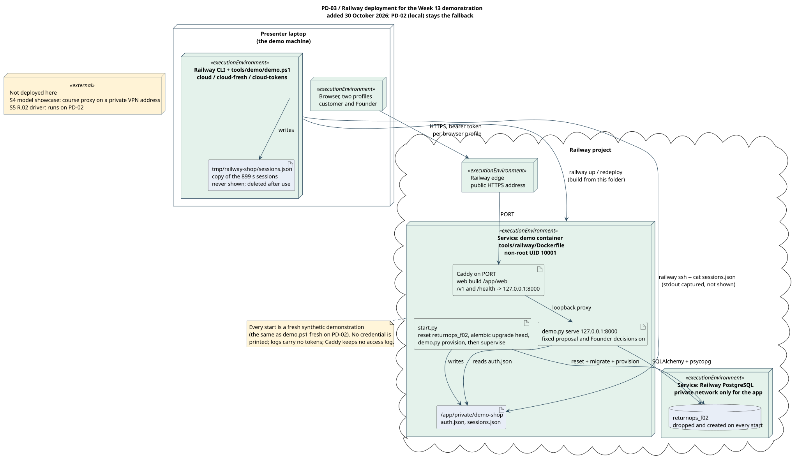

# M-S.01：Package 与 Deployment 模型候选

> **rc.5 发布定位（2026-09-07）：**本版交付至 [PR #11](https://github.com/shuxiachai/returnops-au/pull/11)，由包含本说明的实际提交定位。PR 中记录准确 source SHA、CI run 与评审状态；C 复现使用该准确 SHA，不能使用旧 `57d86fe` 或浮动分支。下文“未发布/本地准备”、旧测试和旧哈希是发布前历史；当前提交以 Git 文件内容及 `docs/reviews/rc5-publication-artifacts-20260907.json` 为准。发布不等于 F.01/F.02 接受、B/C 本人审阅/复现或课程提交，Jira 未由此同步。

> `PD-0.2`，2026-09-07；**本地评审候选，未提交发布，未联合验收**。Owner A、Reviewer C；沿用 M-S.01 的 **S=F.01，F=M-A.01、M-B.01、M-C.01**。候选图准备不代表开始依赖已接受或该工作包完成。
>
> 本稿包含 HEAD 之后的本地修订，基线 HEAD `57d86fe5bf80e2ed8cb445a6bec30c2ef7d8a577`，对齐 F.01 rc.5、MA-0.3、CS-0.2。既有评审入口为 [PR #11](https://github.com/shuxiachai/returnops-au/pull/11)，已核验 PR head 仍为 rc.4；本稿 rc.5 对齐修订尚未收录；不把既有 CI 结果套用到本次新增文件。A/共享模型主卡沿用 [KAN-13](https://lucastaooo.atlassian.net/browse/KAN-13)，F.01 使用 KAN-32；本图编写过程未独立复查 Jira，未向 Jira 写入模型或接受记录。

## 1. 来源、责任与模型边界

产品和技术范围来自 [docs00 §11](00-project-definition-v1.md#11-engineering-strategy)，责任来自 [docs07](07-frozen-work-allocation.md)，验收依赖来自 [docs08](08-delivery-work-packages.md)。本稿细化 [系统设计](02-system-design.md)、[共享 Class](diagrams/01-domain-class-diagram.md)、[MA-0.3](12-member-a-model-chain.md)和 [CS-0.2](13-shared-composite-structure.md)，不替代它们的行为、多重性、端口或人审。

保留 docs02 记录的 B（ChengsiLi）PR #8 / `cbba595` 三角色、只读订单和确定性 Operations 架构来源。本次新增 Package/Deployment 是 A 范围内的 AI 辅助准备；A 须理解、修订并解释，B/C 的贡献和评审由本人留下记录，不能由此稿代签。M-S.03 的全模型索引仍由 B 整合；C 保留来源、Risk、追踪核对责任。

Package 说明逻辑模块及依赖；Deployment 说明执行环境、部署制品、通信与存储位置。三类业务 Agent 是同一应用中的能力边界，不要求三个微服务。CS 三个 structured classifiers 也不自动产生三个进程。Package/Deployment 是项目已经保留的交付，不能因 rubric 中的 Optional 标记自行删除，也不能误报为每人必交的三张行为图。

## 2. 读取实际文件后的状态区分

| 当前可定位材料 | 本图如何表示 | 尚未具备的能力 |
|---|---|---|
| [API main](../apps/api/returnops_api/main.py)、[database](../apps/api/returnops_api/database.py)、[settings](../apps/api/returnops_api/settings.py) | P02 / F.02 绿色环境制品：两条 health GET、配置和连接生命周期 | 十五个 `/v1` 操作、演示身份/RBAC、案件/审批和编排未实现；health 不是 Domain API |
| [domain/models](../packages/domain/models.py)、[enums](../packages/domain/enums.py) | P04 混合状态：已有旧 Pydantic 材料，目标领域服务仍 Planned | 不能把旧字段/枚举当作 rc.5 的已实现映射或守卫 |
| [contracts/v1](../contracts/v1/schemas.json)、[OpenAPI](../contracts/v1/openapi.json) | P03 已有契约制品：约束消费者映射 | Schema 不是运行代码、身份发行方或安全证明 |
| [Dockerfile](../Dockerfile)、[Compose](../compose.yaml)、[0001_environment](../alembic/versions/0001_environment.py) | api / migrate / db、项目网络和命名卷 | 当前镜像仅 COPY API、Alembic 和运行锁；没有 web/domain/agent/provider 业务模块，也没有业务表 |
| [F.02 运行说明](10-f02-environment-readiness.md)及[检查入口](../tools/checks/README.md) | 环境验证的复现入口；本文以源码核对拓扑 | 本轮不重跑容器或 HTTP，不用历史环境通过代替业务或模型接受 |

P05–P12、`apps/web` 和 `packages/agent_core` 的运行能力尚为计划。图中 grounding、execution、persistence/artifacts 的子路径是逻辑分组，不是已经存在的目录，也不要求将每个框变成独立 Python distribution。

## 3. PD-01：Package 依赖与接口映射

[PlantUML 源文件](diagrams/shared/package-dependencies.puml) · [完整 SVG](diagrams/shared/package-dependencies.svg)


虚线箭头从依赖方指向接口/能力提供方，表示 usage/dependency；不是调用时序、运行连接或权限授予。标为 contract conformance / vocabulary mapping 的箭头是规格依赖，不表示 Python 运行时导入 JSON Schema。具体调用顺序由 MA 和共享 Sequence 决定，实际 runtime ports/connectors 由 CS 保持权威。

| 包 ID / 归属 | 类、能力及既有接口 | CS / wire 对照与限制 |
|---|---|---|
| P01 / B | `apps/web` 的 Customer Portal、Founder Dashboard、运营统计 | CS 外部应用；只消费 P02 的授权 API。`CustomerCaseView` 与 `CaseView`、两个角色 history 形状不同；客户端不得生产可信 ApprovalRecord |
| P02 / A | `apps/api`：现在为 health；计划业务 API、验证后的 context、应用组装 | CS D01；F.03 产生可信身份上下文。composition root 可以构造和绑定具体 adapters，handler 不因此获得业务仓储写权限 |
| P03 / A 维护、B/C 联审 | `contracts/v1` rc.5 Schema / OpenAPI / examples | 15 个业务操作及 DTO 的共同定义；不新增端点、字段、角色或另一套 transport schema |
| P04 / A | DomainService、领域对象和逻辑 port contracts | CS A02/A05 接受观测，A06 CaseRepository、A07 AuditPort；application、analysisControl、operationControl 提供读取/提交；analysisWork、executionWork 及 decisionCheck 的实现由组装层绑定 |
| P05 / A | WorkflowOrchestrator；有界控制和共用模型调用包装 | CS A11–A19；Domain 接受的 work/current material 才能使用。通过 typed observation 返回 Domain，不能自己保存权威状态 |
| P06 / A | CustomerCaseCoordinatorAgent、ReturnsAssessmentAgent | `CoordinatorResult`、`DecisionPacket`；Assessment 的 wrapper 只用 OrderProviderPort / RetrievalPort，不获得 effects/notification adapter |
| P07 / C | ComplianceRiskReviewerAgent、C3 ImageObservationCapability | `RiskReviewRequest → RiskReview`；`ImageObservationRequest → ImageObservationResult`。独立调用和系统提示词；C3 受限读取不使 Risk 获得 Domain 写入口 |
| P08 / C | VersionedCorpusAdapter 与小型已审阅 corpus | RetrievalPort：`RetrievalRequest → RetrievalResult`、`CitationVerificationRequest → CitationVerificationResult`；原始来源及完整 conflicts 经 CS sourceReceipts 或等价包装交 Domain 接受 |
| P09 / A | OperationsService 与 ApprovalGuard，最终子路径待定 | CS A03/A04/A05、A21–A23；先验证决定，再由 Domain 生成批准/工作；每次新效果重新检查。实现 work/check ports 与依赖 Domain control ports 不要求循环导入具体服务 |
| P10 / A | MockOrderAdapter | OrderProviderPort：`OrderLookupRequest → OrderLookupResult`；订单五分支只读，不因 provider_adapters 的父包共用而获得 P11 能力 |
| P11 / A | MockReturnsLogisticsAdapter、MockNotificationAdapter；A3 测试配置替代 | ReturnsLogisticsPort / NotificationPort；只让 P09 调用。一次逻辑效果只选一个 provider；A3 不同时向 mock 和 sandbox 双派发 |
| P12 / A | PostgreSQLCaseRepository、IntegrityAuditAdapter、受控附件内容能力 | CaseRepository / AuditPort 由 Domain 调用；labelStore / evidenceRead 仅按 CS-Q02 的独立 scope 访问。受控文件内容不是第二案件状态源，不能顺便写 case |

P04 中 port 定义的最终代码位置仍属于 CS-Q01 的模块映射确认；“放在领域契约边界”是本稿的依赖方向说明，未新冻结 Python 接口。尤其 analysisWork / executionWork / sourceReceipts、transaction_context、provider_observation、delivery_observation 是既有内部概念，不伪装成已冻结 wire DTO。P09 对 P12 的依赖只表示受控 label artifact 能力；实现仍应面向受限接口而非传递完整仓储实例。

图为可读性合并了 Coordinator/Assessment 和 Risk/image 的包分组，并未合并角色调用。C 仍独立编写 Risk/image 模块；A 的共用模型调用包装仅负责配置、允许字段和元数据边界，不能把自己的生成提示词或隐藏推理传给 Reviewer。C 的评测 runner 与各人测试是开发工具和验证制品，不常驻在业务 API 中，仍依原 E 工作包交付。

## 4. PD-02：Deployment、端口与运行制品

[PlantUML 源文件](diagrams/shared/deployment-topology.puml) · [完整 SVG](diagrams/shared/deployment-topology.svg)


节点表示 device / execution environment / storage；节点内 artifact 表示部署制品。绿色为当前 F.02 源码/配置可证明的环境，黄色为计划业务，蓝色为混合状态。实线是现有环境通信或挂载，虚线为计划通信；框内未来制品不是“已经 COPY 到镜像”。是否正在运行仍应通过具体运行记录核对。

| 部署位置 | 包/制品与连接 | 当前与计划边界 |
|---|---|---|
| 同机 Browser / HTTP client | P01 计划 UI；当前可直接访问 health HTTP | 用户请求经 P02 验证身份/资源再进入 P04；浏览器不连 PostgreSQL、LLM 或物流操作端点。UI hosting 的实际进程/端口由 B 与 A 对接时确认 |
| `api` 容器 | Python 3.12、Uvicorn、FastAPI，容器 `0.0.0.0:8000`，UID 10001 | 当前只有 P02 health；未来模块化单体可承载 P04–P12。三个 AI 角色不新增三个服务；可选 worker 没有被此图宣布已实现或必需 |
| `migrate` 容器 | 与 api 同一构建镜像；`python -m alembic upgrade head` | `restart: no`，等待 db healthy，成功退出后 api 才启动；当前 revision 无业务表。后续 A1.02 才增加业务实体迁移 |
| `db` 容器 | PostgreSQL 17，Compose DNS `db:5432` | api/migrate 通过该内部地址连接；当前只建立环境版本表。未来案件、持久化工作及必要 audit 共享唯一 PostgreSQL 权威来源 |
| Docker 项目命名卷 | `postgres-data` → `/var/lib/postgresql/data` | 卷保存 PostgreSQL 数据；不是另一个查询数据库。未实现的原始附件/corpus 存储不可冒充现有 Compose volume |
| 本机诊断入口 | host `127.0.0.1:${DB_PORT:-5433}` → db:5432 | 仅环境工具/测试按专用库规则使用；与已有主机 PG18 的 5432 不同。业务组件不能利用诊断入口绕过 Domain |
| 计划外部依赖 | 配置允许的模型 HTTPS endpoint；A3 获准测试 endpoint | 当前模型 provider、凭据资格和费用限制仍须核验。核心订单、return/label、通知是进程内合成 adapter；没有生产订单、真钱或收费物流调用 |

默认 API 映射为 `127.0.0.1:${API_PORT:-8000}:8000`；docs10 记录本机为避免其他项目的 8000 冲突使用 8001。图同时保留默认参数与该记录，不读取/输出 `.env`。内部监听 `0.0.0.0` 与主机发布 `127.0.0.1` 含义不同：后者限制主机入口，前者供容器端口映射使用，不等于互联网公开部署。

api/migrate 内的 localhost 指该容器自身，不能把主机 5433 当 PostgreSQL 的内部地址；API 的 Docker healthcheck 使用 localhost:8000 则是正确地检查同一容器内进程。远程同学浏览器的 localhost 是同学自己的电脑，不能使用它访问本机。外部访问、TLS、反向代理及跨主机演示若需要，应另行确认；本稿不新增这些组件或端口。

配置通过环境注入，不把 bearer/provider token、密码或完整 DSN 写入模型、普通日志或客户端。LLM 仅收到允许的合成/去标识化字段；C3 通过 evidence ID 的 scoped capability 获得获准内容，不拿客户 token、任意 URL/path。labelStore 是内部生成制品边界，不能借客户上传 API 伪装保存 provider 效果；具体存储后端、保留与删除仍属 F.04/F.07、CS-Q02。

### 4.1 PD-03：Railway 云端演示部署（2026-10-30 新增）

2026-10-30 组长决定 Week 13 演示在 Railway 上运行，PD-02 本地部署保留为备用（[docs/46](46-gate2-roadmap.md) 第 9 节）。上一段“本稿不新增外部访问、TLS、反向代理”的边界只对 PD-02 成立；PD-03 是为演示另加的一个部署视图，不改 PD-01 的包、接口或 Domain 规则。

[PlantUML 源文件](diagrams/shared/deployment-railway.puml) · [完整 SVG](diagrams/shared/deployment-railway.svg)



| 部署位置 | 制品与连接 | 边界 |
|---|---|---|
| 演示电脑 | 两个浏览器 profile；Railway CLI 与 `tools/demo/demo.ps1 cloud / cloud-fresh / cloud-tokens / cloud-s5 / cloud-s5-show / cloud-s5-end` | 会话文件、S5 的 `demo_cups_founder` 访问密钥与回执经 `railway ssh` 读入变量后写到 `tmp/railway-shop`，不显示；演示后删除 |
| Railway edge | 服务的公开 HTTPS 地址 → 容器 `PORT` | TLS 由平台终止；容器内不签证书 |
| 演示服务容器（`tools/railway/Dockerfile`，UID 10001） | `start.py`：重建 `returnops_f02`、`alembic upgrade head`、`demo.py provision`（2026-10-31 起保留上次部署的数据时改为迁移并更新会话）；Caddy 在 `PORT` 提供网页构建，并把 `/v1`、`/health` 代理到 `127.0.0.1:8000`；`demo.py serve --fixed-proposal --founder-decisions`。2026-11-01 起 `start.py s5` 在容器内以演示模式运行 R.02 驱动（镜像带 `tools/r02` 与 `tools/railway/r02-requirements.lock` 补的三个包）；在 Railway 上一次运行要 4–5 分钟，所以在演示开始前运行，PASSED 后处于“就绪”而不切换；`start.py s5-show` 先为 demo-cups 身份续发 899 秒会话（`demo.py renew-sessions`），再让 Caddy 代理到驱动 API 的 loopback 端口（8100 或其后第一个空闲端口），`s5-end`、已显示密钥会话到期或驱动退出时改回 8000 | 演示 API 仍只监听 loopback，浏览器与它同源，不需要 CORS；Caddy 不写访问日志；S5 不停止演示 API；失败的 S5 不改变公开地址；任一进程退出则容器以 1 退出，Railway 按 `railway.json` 重启 |
| PostgreSQL 17 服务（与 `compose.yaml` 同一镜像摘要，挂 Railway 数据卷） | 平台引用变量拼出的 `DATABASE_URL`（`postgresql://`，私网主机名）；应用使用同一服务器上的 `returnops_f02` 库；保留的私有文件在 `returnops_f02_private`；S5 每次运行另建 `returnops_f02_s5` | 2026-10-31 起部署保留数据，`cloud-fresh` 才重建 `returnops_f02`；S5 库每次运行删除并重建，不碰演示数据；只放合成数据；密码只在平台变量里 |
| 不在 PD-03 | 经课程代理的 S4（课程代理在私有 VPN 地址，平台访问不到；Railway 上的 S4 自 2026-10-31 起用阿里云百炼） | 按 docs/45 的备用方案处理；S5 自 2026-11-01 起在 PD-03 上运行，PD-02 的 `s5` 留作备用 |

需求对应：R.05.b 演示；NFR-003（只用合成数据，私有文件不进日志和镜像）；NFR-009（不显示凭据，公开地址只在演示期间运行）。2026-10-30 在本机用 Docker 模拟 Railway（PostgreSQL 容器加本镜像，`PORT=8080`）跑通：启动约 6 秒，`/health/ready`、网页、顾客提交与追问、店主队列和详情都经同一地址工作；在真实 Railway 上的记录见 README 的 Railway 一节。2026-11-01 以同样方式模拟（Railway CLI 换成 `docker exec`）跑通 S5：`start.py s5` 约 70 秒 PASSED，经公开端口用 `demo_cups_founder` 密钥读到 COMPLETED 案件、APPROVE 决定、面单 PDF 与 28 条相连的审计事件，期间演示 API 一直就绪；`s5-end` 后顾客会话重新可用，紧接着的第二次运行换用下一个空闲端口也通过（FR-009 至 FR-012、NFR-001）。

## 5. 需求 → 包/接口 → 部署 → 验证

| 要求与原工作包 | 包/接口与部署位置 | 应检查的证据 |
|---|---|---|
| FR-001/004/005/012；F.03/F.04、A1、B1/B2 | P01 → P02 → P04；API 的可信身份、CaseRepository 和授权附件边界 | 原文与抽取独立、客户归属、版本检查和只读模型；当前 health 不能满足这些验收 |
| FR-002/003/006/007；A1.04/.06/.07、C1 | P05/P06 → P10/P08，经 Domain 接受来源；未来 API 模块及本地审阅 corpus | 五种订单结果、完整来源冲突、引用核验、容量超限拒绝而不截断；保存准确 HistoricalProposalBundle |
| FR-008；NFR-009；C2、A1.08 | P05 → 独立 P07，`RiskReviewRequest → RiskReview`；同一应用的独立 invocation | 不共享隐藏推理、不绕过 Domain；五结果/实际技术失败区分；Gate 1 之前不接可执行 LLM 链 |
| FR-009/010；NFR-002/004；A2、A3 | P04/P09/P11 与 ReturnsLogisticsPort；core mock 在进程内，A3 才配置外部 test endpoint | 精确批准、provider 权限、稳定 key、UNKNOWN 核实；MA-Q03 仍需可执行并发证明 |
| FR-011/012；NFR-003/008；F.05/.06/.07、A2.06 | P04 → P12 的 CaseRepository/AuditPort，共用 db；授权 history/analytics 仍走 P02/P04 | 业务写/必要审计/工作同事务，角色隔离历史和 tombstone；既有人工/拒绝结果不被历史成功覆盖；通知重试无 return 重放 |
| NFR-006/007；F.02、M-S.01 | P02 health、migrate、db、锁及检查工具 | 精确环境版本、失败返回 503、幂等迁移与可复现构建；与业务集成验收分开 |
| NFR-001/005；F.06、E 系列 | 版本/来源/耗时由 Domain 接受；C 的离线 runner 消费明确数据与调用契约 | 图只指出测量边界，不声称 p95/质量目标已达到；按完整输入至 review-ready 定义测量 |
| OF-001/004/006；C3/A3/B3 | P07 图像、P11 sandbox 替代、P01 统计消费 P04 API | 三项 selected optional 的个人增量与依赖不变；不把附件上传、核心 mock 或统计数据接口重复算作对应个人 optional 完成 |

### 权威写入、Audit 与恢复不变量

1. **只有 Domain 接受业务事实并调用 CaseRepository。** API handler、Agent、Orchestrator、Guard、Ops、浏览器均不能直接提交业务状态。图中的逻辑依赖不等于传递整个仓储对象。
2. **业务 audit 与业务变更/必要工作共用事务上下文。** Domain 将已验证来源、actor 和精确 history_refs 形成 AuditEvent，再经 AuditPort/IntegrityAuditAdapter 写入同一计划数据库。P12 的两个 adapter 不是两个独立提交的状态源；CS-D02 的具体实现仍须审阅。
3. **基础设施访问不是业务写权限。** readiness 只执行 SELECT 1 与 revision 查询；Alembic 是受控环境迁移入口。普通诊断日志既不代替业务 audit，也不证明业务变更成功。
4. **本地事务不覆盖 provider 效果。** 调用前持久化 claim/意图，调用后保存失败保留 UNKNOWN 恢复义务；MA-D/Q 仍需处置。模型不把“同一进程”误当成外部原子性。
5. **通知身份由已接受 outcome 决定。** 历史效果查询不能把 MANUAL_HANDLED/REJECTED 改成 RETURN_CREATED，不能重开终态或生成替代通知。NotificationPort 与 ReturnsLogisticsPort 为不同能力。
6. **Risk 材料不由生成器选择性转述。** 原始 statements、order lookup、完整 retrieval/conflicts、citation checks 与获准 evidence 经 Domain 校验和容量检查后保存；P05 的 sourceReceipts 仍是内部候选机制，不新造 HTTP callback。

## 6. 可定位静态走查与未决设计

以下 PD-T01–12 是候选模型的静态检查情境，不是已执行的 API、权限、并发或 provider 测试。

| 情境 | 图/文档应满足的条件 | 原验收落点 |
|---|---|---|
| PD-T01 健康环境 | PD-02 仅绿色 F.02 health/迁移，黄色业务制品标未打包；0001 不造业务表 | F.02；A1.02 尚待 |
| PD-T02 同机与容器地址 | Browser 使用 host loopback；api/migrate 用 db:5432；healthcheck 用容器 localhost:8000 | F.02 |
| PD-T03 客户访问 Founder/他案 | P01 仅到 P02，不能凭前端角色跨过可信 context；两种 history 不互换 | F.03、B1.04、B2.04 |
| PD-T04 原始来源/超容量 | P06 无 effects 依赖；P08/P10 来源经过 P05/P04 原样接受，超限不得截断再形成当前提案 | A1.03/.07、C1.05 |
| PD-T05 独立风险 | P05 独立调用 P07；Review 使用完整 accepted material、无隐藏推理共享 | C2.02/.05、A1.08 |
| PD-T06 批准与新效果 | Domain 才生成批准/工作；P09 重新守卫才调用 P11，Agent 无该边 | A2.01/.02/.03 |
| PD-T07 Audit 原子性 | P04 是唯一业务 repository/audit caller，同 transaction_context；单独日志不当已提交 | F.05、A1.03、A2.07 |
| PD-T08 外部超时/保存失败 | 数据库事务无法回滚 provider；P09 用原身份查询，未确认无效果不得新派发 | A2.04/.05；MA-Q02/03 |
| PD-T09 人工结果后迟到成功 | operation 观测可保存，原 outcome/通知保持，P11 通知能力不变效果调用 | A2.06；MA-T16–18 |
| PD-T10 A3 替代 | 外部 endpoint 必须是已获授权测试配置；每个逻辑操作不双选 mock/test | A3.01–.03；CS-D03 |
| PD-T11 C3 与标签内容 | P07 仅获准 evidenceRead，P09 仅 scoped labelStore；无任意 URL/token/直接 case 写 | F.04/.07、C3；CS-Q02 |
| PD-T12 结构与制品一致 | P04–P12 映射到同一计划业务执行单元；当前 Dockerfile 不包含它们；CS parts 不冒充微服务 | M-S.01/.02、F.02 |

待确认项沿用既有编号，不在此另造接受记录：

- CS-Q01：具体模块/port 文件归属、类与包映射；本稿 P09/P12 等子路径尚未冻结。
- CS-D01/02：原始 receipt 接收方式与关联/去重，以及 repository/audit 同事务实现。
- CS-Q02：受控原始附件、生成标签、corpus 的实际存储/版本/删除能力；不能由现有 PostgreSQL 卷推定全部实现。
- MA-D01/02、MA-Q01/02/03：尝试计数、查询阶段、跨批准身份映射和最后调用并发边界；此图不解除这些待决项。
- UI 实际 serving/process/端口、是否需要可选 worker、模型配置与 A3 测试资格均待各自原工作包验证；不增加技术栈或第四个角色。

## 7. 复现与接受条件

本轮仅新增本文及两对 PUML/SVG；不修改代码、契约、Compose、既有图或外部状态。图源可用本机已有 PlantUML 1.2026.8 渲染；JAR 为开发工具，保存在忽略的 tmp 中，不是业务运行依赖。JAR SHA-256 与 MA/CS 记录一致：`5e1ecfa8ecd32c90b03bbf3b1eb6f020943f98ab0fcf4032be31a0002ee2c462`。

```powershell
java '-Djava.awt.headless=true' -jar tmp/uml-tools/plantuml-1.2026.8.jar -charset UTF-8 -failfast2 -tsvg docs/diagrams/shared/package-dependencies.puml docs/diagrams/shared/deployment-topology.puml
python -B tools/model-checks/check.py
```

需确认 checker 只把 `*-composite.puml` 作为 CS 专用解析输入；通用 SVG 对应检查仍应遍历所有 PUML。不要把新增 Package/Deployment 的节点当作 D/A composite connectors。仓库工具说明见 [model-checks](../tools/model-checks/README.md)。源图变更后重新渲染并查看实际图像，检查字号、箭头、图例及截断；语法通过不证明 UML 语义。

2026-09-07 本地验证：两份 PUML 均由上述 JAR 成功生成 SVG 和忽略目录中的 PNG；已查看完整图像。PD-01 PNG 为 2483 × 1141，PD-02 为 1883 × 1434；部署图移走跨连接的长注释后重渲染，当前图例、节点、端口标签未见截断或遮挡。报告引用应保留 SVG 并按原比例安排版面，不能把宽包图压缩成不可读的小图。

调用仓库 checker 的 `check_svg_pair` 分别核对两份新图，均通过；按其 `markdown_destinations` 规则核对本文 **26 个本地目标**均存在（不验证外部链接或 heading anchors）。另在内存中检查 P01–P12 的源图/表格映射及 PD-T01–12 的连续唯一编号，均通过。全仓检查中已有 **9 对 SVG 源码对应、89 条 WBS 原 ID/Owner/Reviewer/S/F 及无环依赖、MA 和 3 个 CS 视图**通过；完整文档集须在并行材料全部落盘后再由主线程执行最终检查。本次没有重跑业务测试、API、PostgreSQL、Docker 或 CI；上述结果不是语义接受或运行安全证明。

正式接受仍需：A 亲自核对并解释两图；C 按具体版本审阅 PD-T01–12 和上列未决项；B 确认 UI/API 与共享贡献映射；M-S.01 的原 S/F 与非作者 review 成立；Class、Package、Deployment、CS/MA 之间没有名称/接口/权限矛盾；每人贡献可定位。本候选不接受 F.01/F.02、M-S.01/M-S.02，也不增加或取消任何 WBS。
