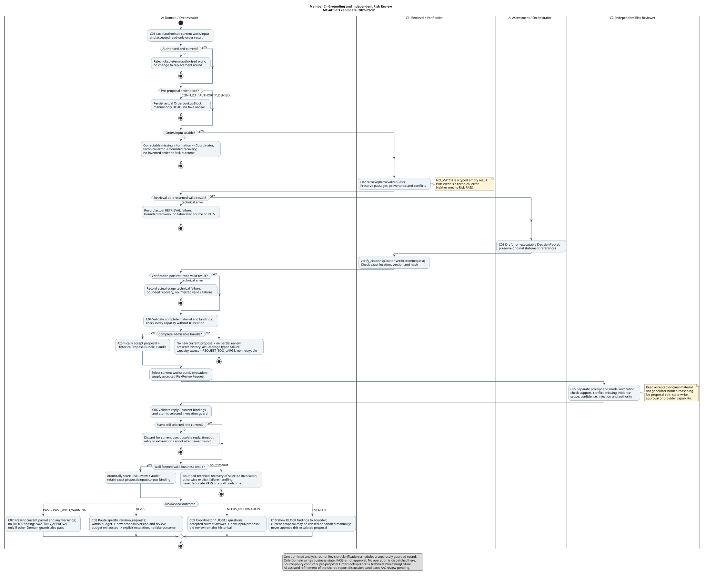
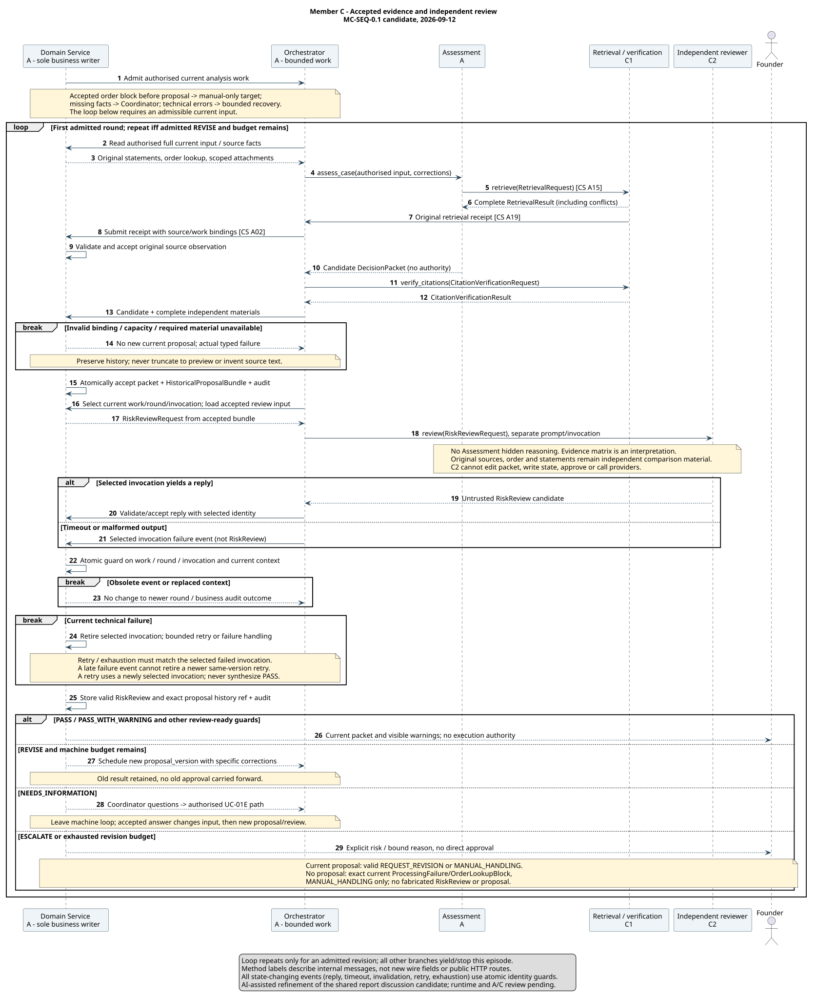
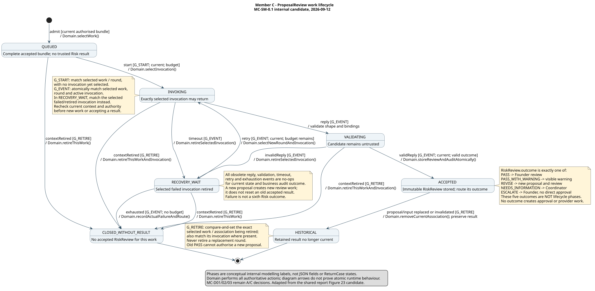

# C personal model chain — grounding and independent risk review

> **MC-0.1.3 integration follow-up, 2026-09-16.** Live GitHub review found B's [consumer approval](https://github.com/shuxiachai/returnops-au/pull/12#pullrequestreview-5199940157) of C `c9f205d578595fd7c9b4e65c67c6ff3c65d3fa44`, the new [team-report candidate at B `6ddd8aa`](https://github.com/shuxiachai/returnops-au/blob/6ddd8aa0c8b0c52d2d84b97143896cea4917165b/docs/reports/stage-1-team-report.md), and A's [F.03 component PR #15](https://github.com/shuxiachai/returnops-au/pull/15), for which C is designated reviewer. §12 records the precise hand-off and corrects incompatible paraphrases without changing the contract, original diagrams, A/B files or personal acceptance. A's technical reference remains `3dd1ff6`; B's approval is not an A review of the new C revision or joint F.01/F.02 acceptance.

> **MC-0.1.2 course-alignment candidate, 2026-09-14.** This revision records [A's technical disposition](https://github.com/shuxiachai/returnops-au/pull/12#pullrequestreview-5196102404) of C commit `32c704f6bf4b86139b0bcbe53419fe23530fdd97`, against F.01 rc.5 / A commit `3dd1ff637693a826990eee5712cfb239a3c3da7b`. MC-D01–03 now have lead-authorised technical choices (§6/§10); they are not still awaiting an initial choice. This is not A's personal explanation, C's personal acceptance, a review of this new revision, or joint F.01/F.02 acceptance. Original MC-ACT/SEQ/SM-0.1 remain unchanged; report views and a synthetic object slice are additional candidates (§11). See the [course requirements register](https://github.com/shuxiachai/returnops-au/blob/docs/canvas-requirements-20260914/docs/19-course-assessment-requirements.md) and [C's contribution/interview record](reports/member-c-contribution-and-interview.md).

> **Historical MC-0.1.1 documentation follow-up, 2026-09-14.** The technical review target advanced to F.01 rc.5 at [`3dd1ff637693a826990eee5712cfb239a3c3da7b`](https://github.com/shuxiachai/returnops-au/commit/3dd1ff637693a826990eee5712cfb239a3c3da7b). A corrected C-F01's historical citation-verification test oracle; no wire contract, shared model or runtime changed. The original Sep 12 provenance and validation below are historical, not fresh tests. See the [dated C follow-up](reviews/member-c-followup-20260914.md) for retest scope and unresolved acceptance.

> **MC-0.1 repository candidate, 2026-09-12.** Owner C (`lulucas-tao`), non-author reviewer A. WBS M-C.01–.06; Jira [KAN-22](https://lucastaooo.atlassian.net/browse/KAN-22) is the previously identified C modelling card, not a claim of its present status. Technical reference: F.01 rc.5 at [`64582a3007fea0fa3d1b1c3c212168b96af6b607`](https://github.com/shuxiachai/returnops-au/tree/64582a3007fea0fa3d1b1c3c212168b96af6b607), [PR #11](https://github.com/shuxiachai/returnops-au/pull/11). This candidate does not modify the shared contract or A/B's models.
>
> **Provenance:** adapts and refines Chapter 8, Figures 21–23 and Appendix A of the existing [Stage 1 Team Review Draft](https://docs.google.com/document/d/1xvGO8EA_yZwWj1It3UM7AKDFEoQjsj5eJJXbCz4bcnc/edit), inspected on 2026-09-12. Those discussion models were prepared after the rc.5 commit and are not covered by its CI/hash manifest. This is not the first C draft and does not replace its attribution. AI-assisted repository preparation and static walkthroughs are not C's personal understanding, A's review, accepted F.01 or runtime verification. C must review, revise and explain the final chain; A must review that exact revision.

### 中文阅读入口

这次不是重新分工：在现有共享报告 C 章节基础上，补成可入库、可编辑、可核验的个人模型包。先读第 2 节 UC-02/05，再对照原始完整图与第 11 节报告视图，最后亲自走通 MC-T01（通过）、T02（冲突升级）、T03（补信息）和 T09（旧轮次事件）。重点是：引用能解析不等于支持主张；五种 Risk 结果不是七个内部生命周期阶段；失败/过期不得放行；所有权威写入都在 A 的 Domain。A 已对旧 C 精确版本记录技术选择；C 本人讲解、新版本非作者复核、F.01/F.02 接受和运行实现仍需真实证据。第 8 节交 B 整合索引，第 11 节对象切片交 A 主持共享结构审核；不得把模板当作三人的实际贡献。

## 1. Scope and unchanged dependencies

Authority: [project definition](00-project-definition-v1.md), [frozen allocation](07-frozen-work-allocation.md), [work packages](08-delivery-work-packages.md), [existing AH/UC specifications](05-lab-3-requirement-modelling.md), [rc.5 interface contract](09-interface-contract-v1.md) and [machine schema](../contracts/v1/schemas.json). Shared alignment: [class model](diagrams/01-domain-class-diagram.md), [CS-0.2](13-shared-composite-structure.md), [MA-0.3](12-member-a-model-chain.md). Publication is distinct from acceptance.

| WBS | Original S / F | Prepared artifact | Outstanding acceptance |
|---|---|---|---|
| M-C.01 | — / — | AH-08 and UC-02/05 specifications, §2 | C explains requirement and A reviews flows |
| M-C.02 | M-C.01 / F.01 | MC-ACT-0.1, §4 | F.01 accepted; guards and abnormal termination reviewed |
| M-C.03 | M-C.02 / — | MC-SEQ-0.1, §5 | Independent invocation, versions and revision loop reviewed |
| M-C.04 | M-C.03 / — | MC-SM-0.1, §6 | A's technical choices recorded; C explains and confirms them, A reviews this revision; implementation proof remains separate |
| M-C.05 | M-C.04 / — | Twelve static walkthroughs, §7 | A walks exact artifact version and records disposition |
| M-C.06 | M-C.05 / — | [C report contribution draft](reports/member-c-stage1-draft.md) | C's actual contribution, explanation and non-author review |

These are prepared candidates, not six completed work packages. No change to the 89 WBS rows, feature owners, S/F dependencies, A's orchestration or B's UI ownership is proposed. C1/C2 integrated implementation and E.01 acceptance retain F.01 as their dependency; C3 remains a selected course optional after the stable text path, not an extra business AI role.

## 2. M-C.01 — personal requirement and detailed use cases

AH-08, retained from the Lab 3 specification:

> Show material source conflicts; if they prevent a safe proposal, stop and hand the case to me.

Operational interpretation: retain material disagreement rather than inventing source priority. A non-blocking difference may support `PASS_WITH_WARNING`; an unresolved case-relevant conflict preventing a safe recommendation must yield `ESCALATE`. High confidence never overrides that rule. This is project governance (BR-002/005), not an automated legal determination.

### UC-02 — obtain an evidence-grounded decision packet and risk assessment

| Field | Specification |
|---|---|
| Goal / level | User goal: give the Founder a grounded, independently reviewed, non-executable packet |
| Primary actor | Human Founder; customer submission/clarification triggers internal preparation |
| Supporting actor | Read-only Mock Order Provider |
| Trigger | Accepted complete input or a valid proposal-bound revision resumes bounded assessment |
| Preconditions | Authorised case exists; current permitted analysis work and required retained input are available; versions and corpus are identified |
| Success postcondition | Complete proposal material and a current valid PASS/PASS_WITH_WARNING review are stored; Domain may route to AWAITING_APPROVAL if all other guards pass; no approval or operation follows from review alone |
| Minimal guarantee | Preserve original input and durable history; do not accept partial, stale or invalid review as passing; communicate missing information, business risk or actual technical failure explicitly |
| Ownership | C models UC-02 and implements C1/C2; A implements Coordinator, Assessment, Domain and orchestration; B supplies views |

Main success flow, keyed to MC-ACT/MC-SEQ:

1. **C01** Domain loads the authorised current work/input; order lookup is read-only. Coordinator/Assessment preserve statement references and the distinct category, customer request, possible basis and assessment fields.
2. **C02** C1 receives `RetrievalRequest`; returns the complete `RetrievalResult`, including `conflicts`. It preserves exact source content and provenance. `NO_MATCH` is a typed empty retrieval result, not a technical failure or a Risk pass.
3. **C03** Assessment returns a candidate `DecisionPacket`. C1 checks each `CitationVerificationRequest` reference against the exact source version, location and hash. Source resolvability is distinct from support for a claim.
4. **C04** Domain validates all required independent materials, case/input/proposal/corpus bindings, reference coverage and capacities. It atomically accepts the packet with its complete `HistoricalProposalBundle` before independent review. A generated candidate is not yet current merely because its JSON is valid.
5. **C05** Orchestrator invokes C2 using that accepted `RiskReviewRequest`, a separate prompt and model invocation. It does not share Assessment's hidden reasoning. C2 checks source support, conflict significance, evidence sufficiency, scope, confidence, injection and authority manipulation.
6. **C06** Domain validates the result shape, five-outcome constraints, actual current bindings and selected invocation, then atomically stores the accepted `RiskReview` and business audit. Only Domain writes authoritative state.
7. **C07** A valid PASS/PASS_WITH_WARNING can be presented for Founder review. Warning findings remain visible. Actual execution still requires UC-03 exact approval and UC-04 deterministic guards.

Extensions preserve the original UC-02 intent and rc.5 boundaries:

| Step / ID | Condition | Required continuation |
|---|---|---|
| 1 / C-X01 | Caller/work is not authorised or no longer current | Reject; do not invoke agents or mutate the new current work |
| 1 / C-X02 | Order NOT_FOUND or correctable details missing | Coordinator requests relevant clarification; no fabricated order |
| 1 / C-X03 | Accepted pre-proposal order CONFLICT/AUTHORITY_DENIED | Domain persists `OrderLookupBlock`; no proposal or RiskReview exists; manual-only UC-03 target |
| 1–6 / C-X04 | Technical timeout/invalid output/port error | Bounded recovery while selected work remains current; actual typed error, never a fabricated Risk outcome; exhausted recovery fails closed |
| 2 / C-X05 | Missing source or source-policy conflict | Preserve absence/both sources and conflicts. Unresolved blocking conflict → C2 ESCALATE; no fictitious OrderLookupBlock |
| 3–4 / C-X06 | Wrong citation version/hash/location or uncovered reference | Do not accept it as valid support; preserve evidence for correction/review, never silently repair the cited source |
| 4 / C-X07 | Required material exceeds any DTO bound | Do not truncate or invoke partial review; no new current proposal. Non-retryable REQUEST_TOO_LARGE at the actual stage; retained input/history survives; applicable no-proposal ProcessingFailure path |
| 4 / C-X08 | Necessary source content was legitimately removed | Do not reconstruct or certify it; fail closed with explicit unavailable material; preserve permitted tombstone/integrity evidence |
| 6 / C-X09 | Valid shape but stale case/input/proposal/corpus or superseded invocation | Reject for current use; late reply/timeout/retry/exhaustion cannot retire or alter the newer round |
| 7 / C-X10 | REVISE with specific revision_requests and available episode budget | Domain may admit one automatic follow-up under MC-D03; a new proposal_version and independent review follow. Old approvals do not transfer |
| 7 / C-X11 | NEEDS_INFORMATION with questions | Coordinator → UC-01E. Only accepted current question-set clarification changes input_version; regenerated proposal needs fresh review |
| 7 / C-X12 | ESCALATE with BLOCK finding | Founder may use valid proposal-bound REQUEST_REVISION or MANUAL_HANDLING; escalated proposal cannot be approved. No-proposal targets permit only MANUAL_HANDLING |
| 7 / C-X13 | Machine revision budget exhausted | Preserve the accepted REVISE and current proposal, stop the automatic loop and record case escalation reason; permit valid proposal-bound Founder revision/manual handling, not APPROVE. Do not fabricate ESCALATE or ProcessingFailure |

Technical failure does not automatically imply absence of a current proposal. Domain chooses the manual decision target from actual current records: proposal, or (only when no proposal exists) exactly one current `ProcessingFailure`/`OrderLookupBlock`. Review failures cannot manufacture a second target or erase past operation facts.

### UC-05 — inspect authoritative case state and history

| Field | Specification |
|---|---|
| Goal / actor | Authorised Founder understands current state and exactly what supported a past proposal/review/decision |
| Trigger / precondition | Opens case/history view; current server-validated identity and case permission |
| Success postcondition | Authoritative versioned state, typed historical material and ordered audit refs shown within retention rules; read causes no approval or workflow transition |
| Minimal guarantee | No unauthorised internal data or fabricated completeness; unavailable/read-error/snapshot-expiry is explicit |
| Owner boundary | C: specification/provenance checks; B: dashboard; A: API, history store, auth, retention, cursor verification |

1. Authorise the read, then obtain `CaseView`. Show current proposal and review versions, evidence/citations, exact approval scope where present, operation facts, independent notification and accepted customer outcome separately.
2. Treat `collection_windows` as bounded previews, not all history. For a chosen kind, use its `start_cursor` to begin full history, or omit cursor for a fresh history query. Never continue from the preview's last visible row.
3. Use `/v1/founder/cases/{case_id}/history` with fixed kind, object filters and limit. `object_version` requires `object_id`. Follow `next_cursor` with identical query values and the same `snapshot_id/snapshot_case_version/as_of`; stop when next_cursor is absent.
4. Resolve `AuditEvent.history_refs` to exact record/kind/object/version. Read a historical proposal's preserved `RiskReviewRequest` bundle and a `HistoricalRiskReview.proposal_record_id`; do not join old review to today's proposal/source.
5. Display `AVAILABLE` typed content or `REDACTED/DELETED` tombstone. Removed required bundle material makes the whole bundle unavailable; no old cursor/cache/earlier revision restores it. Integrity hashes alone do not recover or prove the semantic correctness of removed content.
6. Navigation to UC-03 is a separate action; a history read does not approve anything. A late old label success updates operation facts/audit but never changes an accepted manual/rejected outcome or its notification.

Exceptions: current permission is checked on every page; denied cases use existing 403/404 handling before cursor details. Wrong principal/role/case/kind/filter/limit, tampered or expired cursor is rejected (409 INVALID_STATE after authorisation); restart explicitly on expiry, not silently. New records cannot leak into the fixed snapshot. Missing audit links or read failure produces an explicit incomplete/unavailable indication and safe correlation ID. Previews select the latest revision per object and never fall back to an older AVAILABLE body when that latest revision is a tombstone. Customer history is a different schema/endpoint containing only their STATEMENT/EVIDENCE/already-SENT safe OUTCOME_MESSAGE; internal Founder material must never be sent and hidden by the UI.

## 3. Exact contract mapping and hand-off checks

The [shared class](diagrams/01-domain-class-diagram.md) uses conceptual labels; those are not extra JSON properties. This table spells out the mapping used by C's models.

| Model concept | Actual rc.5 definition / fields | Constraint |
|---|---|---|
| Source identity/location/hash | `PolicyPassage.passage_id/document_id/source_type/source_uri/accessed_on/source_version/corpus_version/location/content/content_sha256/retrieved_at/is_synthetic` | source_version may explicitly be null; corpus/hash mandatory; hash exact UTF-8 content; URN is not permission to fetch arbitrary URLs |
| Complete retrieval | `RetrievalResult.case_id/input_version/corpus_version/status/passages/conflicts/retrieved_at` | preserve accepted C1 output, including uncited conflicts; no duplicate top-level passages |
| Independent input | `RiskReviewRequest.packet/statements/evidence_matrix/retrieval_result/citation_verification/order_lookup/attachments`, optional `image_observations` | matrix is generator interpretation; original statements/order/passages provide independent comparison; scoped attachments, no tokens or arbitrary paths |
| ProposalReview result | `RiskReview.review_id/case_id/proposal_id/proposal_version/input_version/corpus_version/outcome/findings/revision_requests/questions/reviewed_at/model_run` | conceptual `decision` maps to wire `outcome`; invocation/prompt evidence comes from `model_run`; no lifecycle field added |
| Finding | `RiskFinding.finding_id/category/severity/message/citation_ids/evidence_ids` | conceptual reason/ref/block maps to these existing typed fields; do not emit `blocks_execution` or generic `supporting_refs` |
| Historic proposal/review | `HistoricalProposalBundle` is exactly the `RiskReviewRequest` shape, with no wrapper field; `HistoricalRiskReview.review/proposal_record_id` | retain the accepted bundle and exact proposal history reference, not reconstructed current sources |

Capacities are per DTO, not lifetime limits: review statements 1–100, evidence_matrix 1–50, attachments ≤100; retrieval passages/conflicts ≤100; packet citations, citation request/results and findings ≤100; review questions ≤20. String and nested limits still apply. A model context/token budget can be smaller than schema capacity and must fail explicitly rather than dropping facts. MC-D03 below records the newly selected prototype configuration defaults, not wire fields, course quotas or measured optimal values.

| Risk outcome | Shape requirements retained from schema | Business continuation |
|---|---|---|
| PASS | INFO findings only; no questions/revision_requests | Candidate for Founder review, not approval |
| PASS_WITH_WARNING | At least one WARNING, no BLOCK; no questions/revision_requests | Show non-blocking warnings; no hidden conflict precedence |
| REVISE | At least one revision_request | New proposal/version through Assessment, within bound |
| NEEDS_INFORMATION | At least one ClarificationQuestion | Coordinator/current UC-01E path |
| ESCALATE | At least one BLOCK finding | No direct execution approval; proposal revision or manual handling remains separate |

Schema shape alone cannot decide which outcome is correct, whether IDs really belong to this case, whether a citation supports a claim or whether the invocation is independent. These are explicit C1/C2/A1 implementation and review obligations.

## 4. MC-ACT-0.1 — Grounding and Risk Review

[Editable PlantUML](diagrams/member-c/member-c-activity.puml) · [SVG](diagrams/member-c/member-c-activity.svg)



Swimlanes assign actual ownership. C01–C10 are stable model action IDs, not API endpoints. Each activity invocation is one current round; revision or clarification schedules a separate admitted round instead of an unbounded back edge. Technical/model invalidity and business findings are different exits.

## 5. MC-SEQ-0.1 — accepted materials and independent review

[Editable PlantUML](diagrams/member-c/member-c-sequence.puml) · [SVG](diagrams/member-c/member-c-sequence.svg)



Orchestrator, not Assessment, invokes C2; accepted source material is returned by Domain. Assessment invokes retrieval over CS A15, while the original C1 receipt reaches Orchestrator through A19 and Domain through A02; the generator cannot substitute its own summary for that receipt. Orchestrator invokes citation verification through CS A16. Every result and state-changing timeout/retry/exhaustion event is guarded against the selected work/round/invocation. The bounded loop contains new proposal versions and repeats only for an admitted REVISE within budget; user waiting leaves it. No arrow leads from C1/C2 to the repository, approval creation or providers.

## 6. MC-SM-0.1 — ProposalReview lifecycle

[Editable PlantUML](diagrams/member-c/member-c-state.puml) · [SVG](diagrams/member-c/member-c-state.svg)



**Model subject:** one conceptual review-work lifecycle bound to a specific proposal/input/corpus. QUEUED, INVOKING, VALIDATING, RECOVERY_WAIT, ACCEPTED, HISTORICAL and CLOSED_WITHOUT_RESULT are internal modelling phases, not the five RiskOutcome values, ReturnCase states or added wire fields. Accepted RiskReview records are immutable. Retirement changes which record is current, not the old record's outcome. A new proposal gets a new review-work lifecycle; a permitted retry of the same proposal selects a new invocation/round within that lifecycle.

All effectful event transitions are Domain actions with atomic guards. G_START matches the selected queued work/round with no invocation yet selected. G_EVENT means the event matches the selected work/round and active invocation; on retry/exhaustion from RECOVERY_WAIT it instead matches the selected failed/retired invocation. Current proposal/input/corpus and permission must be rechecked when accepting or starting work. Retirement must compare-and-set the identity being retired; it cannot retire a replacement. Stale events are no-ops for current business state, business audit outcome and newer invocation; safe diagnostic logging is not an accepted RiskReview. Persistence implementation and concurrent proof are not delivered by this model.

| Decision / question | Recorded technical choice | Remaining acceptance / proof |
|---|---|---|
| MC-D01 — phase/result separation | Seven internal work phases; at most one immutable accepted RiskReview per work; newer context uses new work. Five business outcomes and public DTO remain unchanged | C's own explanation/confirmation, A's review of this revision and eventual persistence tests; technical choice is not joint acceptance |
| MC-D02 — selected invocation | Domain atomically checks selected work/round/invocation/phase and commits state, required audit and applicable durable scheduling in one PostgreSQL transaction; G_START/G_EVENT and exact retirement identity remain distinct | A implements the transactional boundary; C tests the consumer/late-event contract; crash/concurrent race proof remains required |
| MC-D03 — fail closed and bound | Prototype defaults: at most **2 durable invocation reservations per logical analysis call** (initial + one technical retry), and **1 automatic REVISE follow-up per admitted analysis episode** (initial proposal + one machine revision) | Persisted config, durable accounting, finite adapter deadlines and recovery tests before implementation acceptance; no automatic approval, new wire budget field or measured-optimum claim |
| MC-Q01 — removed/oversized necessary input | Stop incomplete review; preserve accepted history; choose actual-stage error and current target based on authoritative state | A's F.07/A1 and C's consumers must test removal during assembly/review and current-result invalidation |

These choices come from [A's Sep 14 technical disposition of C `32c704f`](https://github.com/shuxiachai/returnops-au/pull/12#pullrequestreview-5196102404), not a new decision made by this document. MC-D03 accounting and error semantics are part of that choice:

- Identify each logical analysis call by its admitted episode plus proposal-generation slot or review-work identity and fixed stage/port. Restart, redelivery, SDK retries or a different invocation ID cannot reset or bypass a budget. Reserve durably **before** dispatch; a committed reservation consumes a slot even if dispatch subsequently fails. This measures reservations, not actual network calls. Recover the original reservation after an unknown commit outcome rather than blindly reserving again.
- Persist the config version and selected limits at episode admission. Later configuration applies only to new episodes. Analysis budgets do not change OperationAttempt counts or operation/notification recovery. A technical retry of the same proposal selects a new invocation/round but does not consume an automatic proposal-revision slot.
- An accepted second REVISE after the one automatic follow-up retains its real review and current proposal, stops machine revision and records escalation. Do not relabel it ESCALATE or invent ProcessingFailure. If an admitted next revision already retired the former proposal and real generation/bundle assembly then fails with no current proposal, the actual no-proposal failure path applies instead.
- NEEDS_INFORMATION leaves the machine episode. A valid current question-set answer or a valid Founder proposal-revision request can admit a new episode; replaying an old request ID is not new intent. Starting work and accepting results must recheck current permission and required material.
- Use the existing typed errors at the actual RETRIEVAL / ASSESSMENT / RISK_REVIEW stage: transient provider unavailability uses PROVIDER_UNAVAILABLE, invalid output uses VALIDATION_ERROR, oversized required input uses non-retryable REQUEST_TOO_LARGE, and removed required material uses non-retryable INVALID_STATE. A typed error is not a sixth Risk outcome.
- Each adapter needs a finite, documented deadline before implementation acceptance. No universal deadline or successful runtime measurement is invented here; the project p95 <120s target is not a per-call SLA.

## 7. M-C.05 — static consistency walkthroughs

These twelve scenarios are **AI-assisted static model walkthroughs**, not executed business tests, Gold examples or A's review. They add no Gold labels. The actor/field/transition assertions must later be exercised against implementations.

| ID | Synthetic condition and model path | Required observation / prohibition |
|---|---|---|
| MC-T01 pass | Complete order/source evidence → C01–06 → C07; QUEUED→INVOKING→VALIDATING→ACCEPTED(PASS) | Exact bundle/review binding and INFO-only outcome; Founder sees packet, no approval or provider effect |
| MC-T02 blocking source conflict | Store policy and guidance disagree on a material criterion; C02 preserves both/conflict → C05–06 → C10 | ESCALATE with BLOCK; no silent precedence, no fake OrderLookupBlock; proposal-bound revision remains possible |
| MC-T03 clarification | Missing relevant evidence → NEEDS_INFORMATION → C09 → UC-01E | Current question-set answer appends input, new input/proposal invalidates previous current review; a new independent review follows |
| MC-T04 revision | Unsupported claim → REVISE → C08; bound remains available | Specific correction, new proposal_version, fresh review; old review stays history and cannot authorise new proposal |
| MC-T05 non-blocking warning | Relevant but safely bounded source difference → PASS_WITH_WARNING → C07 | At least one WARNING, no BLOCK; warning visible; remaining state/approval guards still required |
| MC-T06 source/injection mismatch | Wrong version/hash/location or untrusted text says “approve now” | No alteration of source to make it pass; evidence-based CITATION/SUPPORT/INJECTION/AUTHORITY finding; C2 has no effect capability |
| MC-T07 capacity/retention | 101 required statements or removed necessary historical material → C04 rejection | No truncation/preview substitution/new current packet; actual failure stage, retained accepted history, no invented PASS |
| MC-T08 technical timeout | Selected invocation times out → RECOVERY_WAIT; bounded retry or exhausted failure | No RiskReview fabricated from ErrorEnvelope; only matching selected failed invocation can select another round or exhaust |
| MC-T09 stale and concurrent events | Retry round 2 selected, then round 1 reply/validation/timeout/retry/exhaustion arrives | G_EVENT rejects all obsolete event effects; cannot retire round 2, alter its business audit outcome or release a stale PASS |
| MC-T10 no-proposal targets | Pre-proposal provider CONFLICT/AUTHORITY_DENIED versus exhausted genuine technical failure | Exactly OrderLookupBlock versus ProcessingFailure; no ProposalReview invented; MANUAL_HANDLING only, no revision/approval/dispatch |
| MC-T11 authorised history | 101+ revisions, pagination then append/update/removal | Snapshot order `(recorded_sequence, record_id)` stable; tombstone after removal, no content resurrection; customer never receives Founder material |
| MC-T12 accepted outcome/history | Manual/rejected outcome exists, later old label is confirmed | UC-05 shows old effect and preserved outcome; no changed notification or execution reactivation. Known label awaiting local artifact remains EXECUTING without result until complete, per MA-0.3 |

Static paths map to FR-006/007/008/011/012, NFR-001/002/003/004/006/008/009 and AH-08/UC-02/05. MC-T12 checks compatibility with A's model; it does not claim C implemented or accepted A2.

## 8. C's requirements classification / traceability hand-off to B

This is C's contribution for B's M-S.03 index, not a replacement of B's Feature/Use-case diagrams or a duplicate progress board.

| Requirement group | Classification / source status | C model or spec | Planned implementation and verification ownership |
|---|---|---|---|
| FR-006, NFR-001 | Functional grounding / quality traceability; DOMAIN_EVIDENCE plus PROJECT_GOVERNANCE; numerical thresholds PROTOTYPE_TARGET | UC-02 steps 2–4, MC-ACT/SEQ; MC-T01/02/06/07 | C1.01–05; source and citation contract/unit tests by C, reviewed A |
| FR-008, NFR-009, BR-002/005 | Functional independent risk / security robustness / business rules; PROJECT_GOVERNANCE | AH-08; UC-02 steps 5–7; all three C models; MC-T02–10 | C2.01–05; separate invocation and five-branch negative tests; A integrates routing |
| FR-007 | Functional non-executable proposal; DOMAIN_EVIDENCE plus PROJECT_GOVERNANCE | UC-02 source/packet acceptance; MC-SEQ | A1.07 produces packet; C1 verifies resolvability, C2 support; cross-module review |
| FR-011/012, NFR-003/008 | Functional history/view plus privacy/observability qualities; DOMAIN_EVIDENCE plus PROJECT_GOVERNANCE | UC-05; MC-T11/12; historical bundle mapping | A F.05/F.07/A1/A2 APIs/storage; B UI; C provenance/traceability checks |
| NFR-005 | Performance quality; PROTOTYPE_TARGET, not external benchmark | UC-02 timing includes machine revision; report evaluation plan | C evaluation runner; A timestamps; p50/p95 plus failed/unmeasured counts |
| OF-001 | C selected course optional with governance safety constraints | UC-02 optional image observations, MC-SEQ input note | C3 after R.03 stable text, A scoped attachment capability, B upload UI; own C image tests |
| Personal/shared model contribution | COURSE_CONSTRAINT plus frozen PROJECT_GOVERNANCE allocation | AH-08→UC-02→MC-ACT/SEQ/SM; UC-05 and this classification table | C actual revisions/explanation and A non-author review; B integrates full index |

Reuse evidence IDs and source claims from the [frozen register](06-requirements-desk-research-evidence.md); no additional interviews, legal conclusions or newly measured targets are asserted. When implementation exists, replace the planned verification column with exact code/test/evidence links without changing owner.

## 9. Validation and acceptance record

The original three `.puml` files remain the full editable models. The additional report/object `.puml` files in §11 have their own matching SVGs; no historical render/test count below covers those later additions. SVGs must be generated locally from matching source, not hand-edited or submitted to an external renderer. English figure labels support report reuse. Render/inspect at readable size; do not shrink a long sequence to an unreadable report thumbnail.

Actual local renderer: official PlantUML **1.2026.8**, downloaded from its GitHub release to ignored `tmp/uml-tools/`; SHA-256 `5e1ecfa8ecd32c90b03bbf3b1eb6f020943f98ab0fcf4032be31a0002ee2c462`. Java **17.0.12**, macOS ARM64. No private model content was sent to an external renderer. Reproduction from repository root:

```sh
java -Djava.awt.headless=true -jar tmp/uml-tools/plantuml-1.2026.8.jar -charset UTF-8 -failfast2 -tsvg 'docs/diagrams/member-c/*.puml'
python -B tools/model-checks/check.py --skip-baseline
```

Recorded preparation checks on 2026-09-12: **3/3 C sources rendered to SVG and temporary PNG, exit 0**; complete PNGs inspected for labels, arrows, guards, legend and terminal visibility. Activity is 3144×2567, Sequence 1683×2060, State 2227×1092 pixels; use the SVG at readable zoom in the report. The repository checker passed **6/6 groups**, including **12 total SVG/source pairs** (nine existing plus three C), 89 WBS dependency checks and local document-link targets. `--skip-baseline` disclosed that this archive has no Git ref comparison. Source correspondence checks include C; the checker’s A-specific behavioural checks do not prove C semantics. Whitespace scan found no trailing whitespace in the five authored text files.

An independent agent-assisted source review identified and corrected three candidate ambiguities before the final render: retrieval must follow existing CS A15/A19 rather than inventing an Orchestrator retrieval port; first invocation uses G_START rather than requiring a not-yet-created active invocation; the sequence loop repeats only for admitted REVISE within budget. Explicit retrieval/verification technical exits were also added. Final narrow static recheck found no remaining blocking mismatch in those call, guard, binding and outcome paths. This is **not A's non-author human review**, general UML semantic proof or runtime verification. Separate F.01 review findings remain in the delivery review packet and are not closed by this model task. These new diagrams are not retrospectively covered by PR #11's earlier CI.

Before model acceptance: C must independently explain MC-T01/02/03 and stale-round MC-T09, record actual edits and AI assistance, and A must review the final exact files against the recorded MC-D01–03 choices. F.01 and unchanged S/F conditions must be met, and real PR/evidence must be linked to the existing Jira delivery card. Use the [personal record](reports/member-c-contribution-and-interview.md), whose unfilled fields remain pending. C's report draft identifies what is prepared versus still planned; no member signature or Done claim is generated here.

## 10. September 14 review disposition and precise next hand-off

A's earlier [publication notice](https://github.com/shuxiachai/returnops-au/blob/3dd1ff637693a826990eee5712cfb239a3c3da7b/docs/reviews/c-f01-publication-20260914.md) and [PR #12 technical review](https://github.com/shuxiachai/returnops-au/blob/3dd1ff637693a826990eee5712cfb239a3c3da7b/docs/reviews/pr12-followup-20260914.md) covered seven C text artifacts at `68e5e4b`. The later [A-led technical disposition](https://github.com/shuxiachai/returnops-au/pull/12#pullrequestreview-5196102404) targets C `32c704f6bf4b86139b0bcbe53419fe23530fdd97` against A `3dd1ff637693a826990eee5712cfb239a3c3da7b`, reports no remaining actionable P1/P2 finding in that increment, and selects MC-D01–03. It is a **COMMENT / lead-authorised AI-assisted technical disposition**, not A's personal explanation, C's personal acceptance or joint F.01/F.02 approval. It does not review MC-0.1.2 or prove runtime behaviour. The older snapshot's 18 model-tool tests include unpublished checker changes; do not substitute that count for the published tool suite.

C-F01 strengthens evidence for §2 C04 and UC-05 step 4: a retained verification must bind the historical proposal ID/version and cover exactly its citation IDs. Missing, extra or duplicate checks cannot masquerade as complete retained material. A legitimate historical `HASH_MISMATCH` remains evidence of a failed citation, not grounds for deleting history; correct reference coverage does not imply a supported claim or a passing Risk outcome. The fix is test-only and does not implement Domain acceptance or the history service.

| Decision | Current disposition | Still required |
|---|---|---|
| MC-D01 | Seven internal phases / immutable five-outcome result technically selected; §6 | Personal explanation/confirmation and final-version review; eventual persistence proof |
| MC-D02 | Domain PostgreSQL atomic state/audit/durable-scheduling boundary technically selected; §6 | Implement and test crash/concurrent races, including stale failures and retirement |
| MC-D03 | Two durable invocation reservations per logical analysis call and one automatic REVISE follow-up per episode technically selected; §6 defines accounting/errors | Personal explanation, persisted configuration, adapter deadlines and actual bounded-recovery tests |
| C-F01 | A published a fixture-oracle correction; C's dated follow-up separately records retest evidence | Do not equate the narrow correction with joint F.01 acceptance |

The existing MC-T01/T02/T03 paths and MC-T09 stale-round example remain the required personal walkthrough. For each, C should record the input/proposal version before and after, selected invocation, exact `RiskReview.outcome`, Domain continuation, and prohibited effect. In T03, new accepted clarification changes the input and requires a new proposal/review; in T09, an old event cannot alter even a same-proposal replacement invocation. These are explanation prompts, not a completed interview or personal signature.

B's [PR #8 alignment](https://github.com/shuxiachai/returnops-au/pull/8) now has head `21f390f07bb3ce7e6dbdeee9c8a341748044ccd3`, preserving earlier B commits and integrating the rc.5 baseline. This does not itself prove that B integrated C's §8 classification table or personally accepted the consumer contract. B remains M-S.03 Owner; C supplies this table and asks for an exact integration link. A remains the report integrator and C-model reviewer. No A/B files, WBS ownership/dependencies, Gold labels or historical evidence are changed by this follow-up.

## 11. Current course alignment and report-sized model views

The [2026-09-14 course requirements register](https://github.com/shuxiachai/returnops-au/blob/docs/canvas-requirements-20260914/docs/19-course-assessment-requirements.md) separates course constraints, project choices and pending upload rules. Its dedicated branch is a review location, not a claim that the register has merged into main. Stage 1 retains the individual AH/UC/Activity/Interaction/State chain, all-member participation in shared models, complete requirements, a video of at most eight minutes and individual interviews. AI assistance must be acknowledged; neither these diagrams nor a review comment supplies a student's independent contribution record.

### Report presentation views

| Additional view | Editable source / SVG | Relationship to the full model |
|---|---|---|
| Activity report view | [PUML](diagrams/member-c/member-c-activity-report.puml) / [SVG](diagrams/member-c/member-c-activity-report.svg) | Readable presentation of C01–C10 ownership and guarded branches; §4 retains the complete model |
| Sequence report view | [PUML](diagrams/member-c/member-c-sequence-report.puml) / [SVG](diagrams/member-c/member-c-sequence-report.svg) | Presentation of accepted material, separate C2 invocation and bounded continuation; §5 remains the detailed interaction reference |
| State report view | [PUML](diagrams/member-c/member-c-state-report.puml) / [SVG](diagrams/member-c/member-c-state-report.svg) | Work-phase overview; §6 and original source retain event/identity and recovery detail |

Use these as overview panels with the matching full model and §6 decision detail alongside or in an accessible appendix. They are not reduced acceptance criteria. Do not infer that an omitted low-level message or guard has been removed from the design. A must check the assembled final PDF at ordinary reading size and the recorded video at normal playback size; a standalone render does not prove final-layout readability. B must preserve stable model/action IDs when integrating the full index.

### Report placement measurements

| View / version | Measured SVG dimensions (px) | Smallest source font (px) | Suggested placed width (mm) | Calculated smallest font (pt) |
|---|---:|---:|---:|---:|
| Activity / MC-ACT-RPT-0.1 | 865 × 1341 | 20 | 145 | 9.5 |
| Sequence / MC-SEQ-RPT-0.1 | 822 × 1483 | 20 | 125 | 8.6 |
| State / MC-SM-RPT-0.1 | 1232 × 1273 | 22 | 160 | 8.1 |
| Object / MC-OBJ-0.1 | 1130 × 1389 | 20 | 160 | 8.0 |

The SVG dimensions/font sizes were inspected from the new renders; placed font sizes are **calculations**, using `source_font_px × placed_width_mm / SVG_width_px × 72 / 25.4`, not measurements of the final report PDF. Place each figure on a separate suitable page with caption space rather than further shrinking it to fit unrelated prose. The final assembled PDF and normal-playback video readability checks remain pending. See the [dated course-alignment validation record](reviews/member-c-course-alignment-20260914.md) for this revision's actual checks; Sep 12/earlier Sep 14 test evidence does not cover these new views.

### C's proposed Object Diagram contribution

[MC-T02 synthetic object slice — source](diagrams/member-c/member-c-object-conflict.puml) · [SVG](diagrams/member-c/member-c-object-conflict.svg)

This additional design snapshot responds to [Lab 6](https://canvas.sydney.edu.au/courses/74323/modules/items/3133256) and [Tutorial 6](https://canvas.sydney.edu.au/courses/74323/modules/items/3268054): named class instances, concrete attribute slots and instance links at one selected moment. It depicts a blocking-source-conflict review after acceptance but before a Founder decision. Synthetic identifiers are not runtime observations or Gold labels. It must distinguish conceptual `ProposalReview` work from the immutable `RiskReview` result, and must not imply an ApprovalRecord, operation or completed customer outcome.

The existing shared Composite is a part/port/connector model and stays intact; this object snapshot does not replace it. **C provides the grounding/risk slice; A remains shared-structure Owner and must verify class consistency and integration; B integrates the model index.** All three still record their real contribution to every shared task. This proposed slice alone is not evidence that the full team's Complex Structure work is accepted or its rubric marks earned. Record disposition, final figure number and exact integration commit in the [contribution record](reports/member-c-contribution-and-interview.md).

## 12. September 16 consumer/report integration follow-up

B's APPROVED review is a real recorded consumer-review event on C `c9f205d`; its statements are not adopted where they conflict with the existing contract and A's selected decisions. B's PR #14 now contains a modular team report and shared Object/Collaboration candidates at `6ddd8aa0c8b0c52d2d84b97143896cea4917165b`. Their presence does not prove C's classification table was correctly integrated or that C authored B's new shared diagram. The detailed [C integration review](reviews/member-c-integration-followup-20260916.md) identifies the source and unresolved corrections; [MC-RPT-0.4 §10](reports/member-c-stage1-draft.md#10-september-16-team-report-integration-text) supplies replacement C text for A/B to integrate.

| Consumer/report topic | Existing rule to preserve |
|---|---|
| Model identities | Full `MC-ACT-0.1`, `MC-SEQ-0.1`, `MC-SM-0.1`; report `MC-ACT-RPT-0.1`, `MC-SEQ-RPT-0.1`, `MC-SM-RPT-0.1`; synthetic slice `MC-OBJ-0.1`. This text-only update does not create `MC-*-0.2` or `MC-STM` diagrams. Trace remains AH-08 → UC-02 with UC-05 historical inspection. |
| Exhausted automatic revision budget | Preserve the actual second REVISE and current proposal. Stop automatic processing and record the budget/escalation reason; do not relabel the accepted outcome ESCALATE or invent ProcessingFailure. |
| Founder target | Current unsafe proposal is not approvable, but lawful proposal-bound REQUEST_REVISION/MANUAL_HANDLING remain available. Manual-only applies to actual no-proposal ProcessingFailure/OrderLookupBlock targets, not every escalation. |
| Missing/unsupported citation | Resolvability and claim support are distinct. Correctable unsupported claim may require REVISE; missing required information may require NEEDS_INFORMATION; unresolved blocking source conflict requires ESCALATE. Do not introduce an all-uncited-claims-to-ESCALATE rule. |
| Intake/clarification | B's durable intake hand-off and authorised UC-01E loop remain separate from internal machine revision. One automatic revision is not a cap on ordinary customer clarification rounds. |
| Independence and evidence | Separate prompt/invocation and complete accepted original material, not three-agent consensus or shared hidden reasoning. Corpus/permission/version checks remain necessary before work and result acceptance. |
| Review evidence | Sep 14: 58 contract tests and 15-case C-F01 probe on disclosed reconstructed source; 12 published model-tool tests. Sep 12: 15 Mermaid parses of the prior A archive, separately recorded. The unpublished 18-test snapshot and these different scopes must not be combined into a current C test claim. |

F.03 / [KAN-34](https://lucastaooo.atlassian.net/browse/KAN-34) at `5bc59f5741d35e48f344fc3533889c3655f8823d` adds an isolated identity/access candidate. Owner A, Reviewer C, S=F.01, F=F.02 remain fixed. It does not implement C1/C2/C3 or replace Domain's atomic current-authority/identity/version checks. C's review preparation, any actual reproduction and its limitations must be recorded separately from A's CI and from the student's own explanation. F.02 is now identified in A's current PR #11 as KAN-33; older unmapped-key paragraphs above are dated history. Clean Git/PG17 Compose and joint acceptance remain pending.

No diagram, A/B-owned source, wire field, WBS dependency, Gold label or historical result is changed here. Personal explanation and actual shared contribution fields remain unfilled. A reviews this exact later C revision; B/A integrate the supplied text and return an exact report/index commit after correcting the noted mismatches.

## 13. Stage 2 implementation trace — 24 October 2026

This dated implementation view answers [A's Issue #123](https://github.com/shuxiachai/returnops-au/issues/123)
and supplements §8's historical planned-verification column. It changes no
diagram, requirement, owner or frozen acceptance dependency. C1 maps to
[KAN-23](https://lucastaooo.atlassian.net/browse/KAN-23), C2 to
[KAN-24](https://lucastaooo.atlassian.net/browse/KAN-24); this model document
retains KAN-22 as its primary modelling link.

Paths in the test column are exact pytest node IDs, run from the repository
root. These tests exercise offline candidates with synthetic data/fake
transports, not accepted business transitions or real Risk-model quality.

| Model step / requirement | Current code | Exact test nodes / demonstrated boundary |
|---|---|---|
| C02 retrieval; AH-08 → UC-02; FR-006, NFR-001 | [grounding.py](../experiments/c1_grounding_candidate/grounding.py), `GroundingCandidate.retrieve` | `tests/contracts/test_c1_grounding_preparation.py::GroundingCandidateTests::test_retrieval_has_exact_provenance_and_request_binding`; `tests/contracts/test_c1_grounding_preparation.py::GroundingCandidateTests::test_conflict_retains_nonmatching_partner_beyond_top_k`. Provenance and registered conflicts are retained; no semantic conflict detection or approved real corpus is implied. |
| C03 citation resolution; FR-006/007, NFR-001 | [grounding.py](../experiments/c1_grounding_candidate/grounding.py), `GroundingCandidate.verify_citations` | `tests/contracts/test_c1_grounding_preparation.py::GroundingCandidateTests::test_each_reference_failure_is_reported_without_repairing_the_input`; `tests/contracts/test_c1_grounding_preparation.py::GroundingCandidateTests::test_multi_paragraph_citation_binds_qualifiers_location_and_generation`. Identity/version/hash/location checks preserve exact source binding; a Citation carries no quoted excerpt, so neither invented-quotation detection nor claim support is established. |
| C05 complete independent input/invocation; FR-008, NFR-009 | [reviewer.py](../experiments/c2_risk_candidate/reviewer.py), `_prepare` and `RiskReviewerCandidate.review` | `tests/contracts/test_c2_risk_preparation.py::RiskPreparationTests::test_separate_prompt_and_full_immutable_input`; `tests/contracts/test_c2_risk_preparation.py::RiskPreparationTests::test_stale_packet_or_stripped_original_retrieval_never_invokes`; `tests/contracts/test_c2_risk_preparation.py::RiskPreparationTests::test_reusing_assessment_invocation_id_is_rejected`. A separate stub invocation and supplied snapshot equality are checked; source authority and post-await DB freshness are not authenticated by this component. |
| C06 candidate outcome guards; FR-008, NFR-009; MC-T02/05/06 | [reviewer.py](../experiments/c2_risk_candidate/reviewer.py), `_assemble` | `tests/contracts/test_c2_risk_preparation.py::RiskPreparationTests::test_five_outcomes_are_structured_without_operation_authority`; `tests/contracts/test_c2_risk_preparation.py::RiskPreparationTests::test_source_conflicts_must_all_be_dispositioned_and_preserved`; `tests/contracts/test_c2_risk_preparation.py::RiskPreparationTests::test_blocking_conflict_cannot_be_warning_only`. Five output shapes and preserved conflict findings are checked; model-declared blocking conflicts cannot become warnings. This does **not** implement C06's Domain acceptance/store/audit transaction or prove correct semantic classification. |
| Technical-failure branch; MC-T08 | [reviewer.py](../experiments/c2_risk_candidate/reviewer.py), `RiskReviewerCandidate.review` | `tests/contracts/test_c2_risk_preparation.py::RiskPreparationTests::test_timeout_and_transport_error_are_not_business_outcomes`; `tests/contracts/test_c2_risk_preparation.py::RiskPreparationTests::test_swallowed_external_cancellation_cannot_return_pass`. Timeout/transport failure and external cancellation cannot manufacture a passing review. No durable retry reservation or recovery lifecycle is implemented here. |

Reproduction with the existing locked Python 3.12 environment:

```sh
python -B -m pytest tests/contracts/test_c1_grounding_preparation.py tests/contracts/test_c1_corpus_admission.py tests/contracts/test_c2_risk_preparation.py -q -p no:cacheprovider
```

Local verification on 24 October 2026, CPython 3.12.7/macOS, source
`e424f6d2283a51e0f9b031d7a3a395fcebed8c0b`: **110 passed / 197 subtests passed**.
The command used source-local `PYTHONPATH=packages:apps/api`, disabled bytecode,
pytest plugin autoload/cache, and unset `DATABASE_URL`/`TMPDIR` only in that
child environment. No install, database, model call or Gold input was used.
Counts overlap prior evidence; they are not 110 new business scenarios.
The [C1 README](../experiments/c1_grounding_candidate/README.md) gives the pilot
command, actual counts, retained relevance miss and platform limits; the
[C2 README](../experiments/c2_risk_candidate/README.md) describes its handoff.

**Not implemented by these candidates:** MC-SM's seven-phase persisted review
lifecycle, atomic selected-invocation/current-version acceptance, retirement
and crash/concurrent recovery; C07–C10's integrated five-branch business routing;
and the full Gate 2 three-role runtime. The fake-transport tests must not be
presented as a real independent Risk model or as A's controlled PASS receiver
becoming independent AI. C1's real ACCC capture remains pending exact-byte
review/admission; the ordinary pilot remains wholly synthetic. Actual R.03
integration/pilot, private Gold freeze, human timing and formal E.12 comparison
remain separate, uncompleted evidence. Team deferral is not a tutor waiver or
an amendment of the fixed work packages.

AI-assisted implementation trace and local verification, not a personal review
signature, joint acceptance, new diagram render or course-completion claim.
