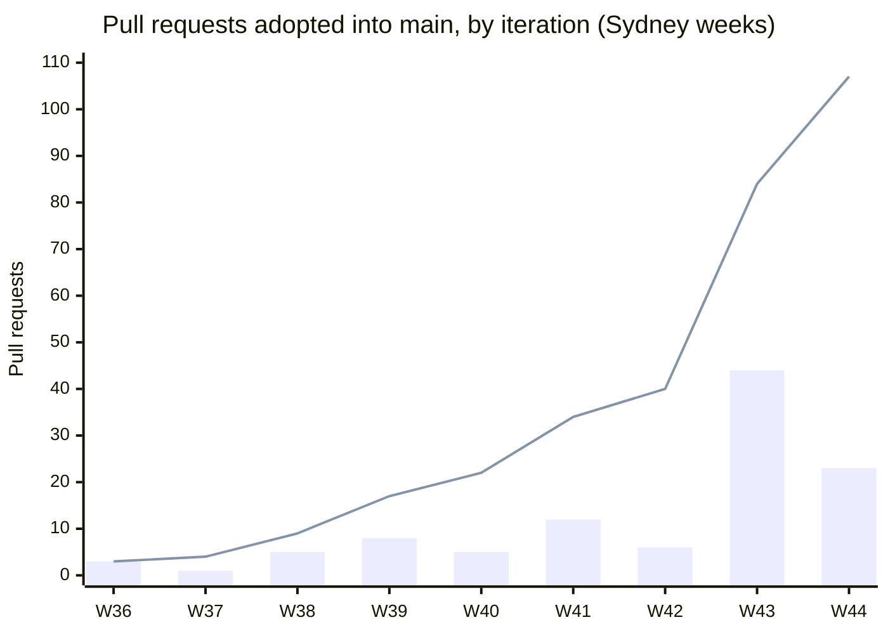
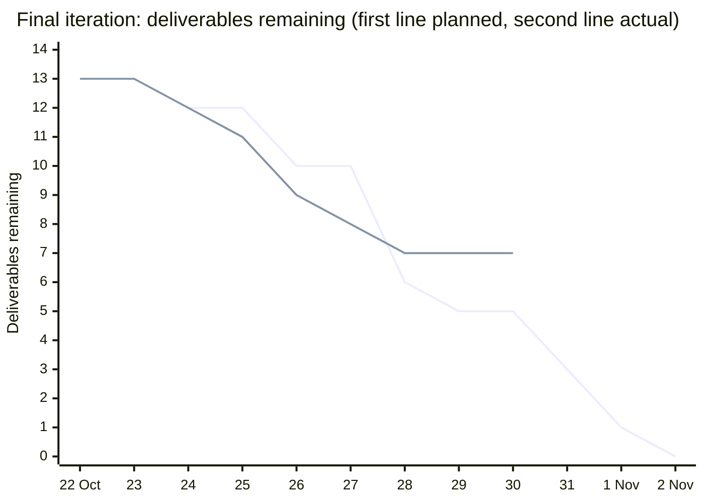

# 48. Agile evidence and technology data for the Stage 2 demonstration

Owner: A Jingbo Chai. Prepared on 23 October 2026 (Sydney) for the Week 13 demonstration and the two rubric rows that are judged from records rather than from the running system: "Agile Development Experience" (4 marks) and "Incorporation of Advanced Technologies" (5 marks) in the Stage 2 marking criteria ([docs/28](28-stage2-submission-checklist.md), [docs/47](47-stage2-submission-runbook.md) section 1). Updated on 30 October 2026 with the iterations to that date, a burn-down chart of the final iteration, two corrected counts and the Railway measurements. Every number below is taken from a record that is named next to it; nothing is estimated. Where a record does not exist, this page says so.

How to use it in the demo: segment S7 of [docs/45](45-stage2-demo-script.md) ("Agile and engineering practice") points here. The presenter shows the two charts in section 3, reads the technology table in section 6 and shows one feedback loop from section 4 live on GitHub.

## 1. What the rubric asks for and where the evidence is

| Rubric wording (Stage 2 criteria) | Evidence in this repository and its systems |
|---|---|
| "detailed documentation of all iterations" | Section 3 (iteration table from merged pull requests), the dated README chapters, [docs/08](08-delivery-work-packages.md) work packages, [docs/11](11-stage1-readiness.md) planning record |
| "burn-down charts" | Section 3: the burn-down of the final iteration's dated plan (22 October to 2 November) and the burn-up of adopted pull requests per iteration; the note there says why Jira resolution dates are not used |
| "user stories" | Section 2: the six Jira epics E1 to E6, the twelve functional requirements FR-001 to FR-012 and the per-member use cases in the Stage 1 report ([docs/00](00-project-definition-v1.md), [docs/12](12-member-a-model-chain.md), [docs/19](19-member-b-model-chain.md), [docs/18](18-member-c-model-chain.md)) |
| "feedback loops" and "iterative improvements" | Section 4: fifteen recorded review-to-change loops with their pull-request and comment links |
| "team collaboration" | Section 5: the frozen allocation ([docs/07](07-frozen-work-allocation.md)), Owner/Reviewer pairs, the delegated review and adoption flow, Jira board |
| "advanced technologies (at least 6) ... supported by data" | Section 6: eleven technologies with the measurement each one is tied to |

## 2. User stories: epics, requirements and work packages

The product definition fixes twelve functional requirements (FR-001 to FR-012) and nine non-functional ones (NFR-001 to NFR-009) in [docs/00](00-project-definition-v1.md). They are grouped into six Jira epics, each with a short user story, and broken down into the work packages of [docs/08](08-delivery-work-packages.md) (89 WBS rows, checked by `tools/model-checks/check.py`).

| Epic | User story (one line) | Requirements | Work packages | Owner |
|---|---|---|---|---|
| E1 Problem discovery and requirements | As the founder of a small Australian shop, I want a clear, bounded promise for returns handling so the team builds the right thing | FR-001 scope, NFR-001 to NFR-003 | M, F.01, R.01 | A (lead), B and C review |
| E2 Domain model and mock environment | As a developer, I want one authoritative case lifecycle with typed contracts and an audit spine so every later feature is governed | FR-002, FR-003, FR-009, FR-010 | F.02, F.03, A1.01 to A1.04 | A |
| E3 Case investigation workflow | As a customer, I want to lodge a return in plain language and be asked only for what is missing | FR-001, FR-002, FR-004, FR-005 | A1.03, A1.05, B1 | A backend, B portal |
| E4 Policy and guidance grounding | As the founder, I want the system's guidance tied to our own policy text with exact citations | FR-006, FR-007 | C1 | C |
| E5 Resolution and human control | As the founder, I want to approve exactly one previewed action, with nothing executed without my decision | FR-008, FR-011, FR-012, NFR-004, NFR-005 | A2.01 to A2.07, B2, C2 | A backend, B console, C risk review |
| E6 Evaluation and evidence | As the team, I want every claim about safety and behaviour backed by a repeatable test or run | NFR-006 to NFR-009 | E.01 to E.12, F.06, R.02, B3 | A, C evaluation, B analytics page |

Jira: project KAN, 37 issues on 30 October 2026 (epics KAN-6 to KAN-11, stories and tasks KAN-12 to KAN-43). The board is a Kanban board without sprints; iterations were weekly, aligned to the course's practical sessions (Monday 13:00 to 15:00), with the practical's planning conversation recorded in the dated README chapters and the handover notes.

## 3. Iterations, burn-down and cumulative delivery

Source: the 107 pull requests merged into `main` by the evening of 30 October 2026, read from GitHub (`gh pr list --state merged --base main`), grouped by the ISO week of the merge time in Sydney. Pull requests merged into another branch are not counted. A pull request is counted when it is adopted into `main`, because adoption is the only event that is independently timestamped and reviewed. Jira resolution dates are deliberately not used for the charts: the lead moved the completed Jira items to Done in one pass on 22 October 2026 when the board was reconciled, so those dates record the reconciliation, not the work.

Correction of 30 October 2026: the first version of this table (23 October) grouped merges by their UTC date, which moved #7 (merged on Monday 19 October, 10:42 Sydney) into week 42. All weeks are now Sydney weeks; weeks 36 to 41 are unchanged.

| Iteration (ISO week, Sydney) | A | B | C | Merged | Cumulative | What landed |
|---|---|---|---|---|---|---|
| Week 36, 31 Aug to 6 Sep | 3 | 0 | 0 | 3 | 3 | Lab 3 requirements model, desk-research evidence, Baseline v1.0 candidate (#2, #4, #6) |
| Week 37, 7 to 13 Sep | 1 | 0 | 0 | 1 | 4 | v1 alignment and interface contract rc.2 for B and C review (#9) |
| Week 38, 14 to 20 Sep | 1 | 2 | 2 | 5 | 9 | B and C personal models aligned with contract rc.5; C review of rc.5; Stage 1 report material (#8, #11, #12 and others) |
| Week 39, 21 to 27 Sep | 8 | 0 | 0 | 8 | 17 | F.03 isolated identity and access; Stage 2 entry; customer notification fixtures (#15, #18, #19 and others) |
| Week 40, 28 Sep to 4 Oct | 5 | 0 | 0 | 5 | 22 | Authoritative lifecycle: Founder case views, persisted guards, denial audit (#30, #32, #34 and others) |
| Week 41, 5 to 11 Oct | 10 | 0 | 2 | 12 | 34 | Stage 1 consolidation; A1.03 acceptance; A1.05 fixed proposal; C1 offline grounding candidate (#40, #41, #43 and others) |
| Week 42, 12 to 18 Oct | 6 | 0 | 0 | 6 | 40 | A2.01 PASS proposal handling; approval admission; prepared and executed core return (#63, #65, #72, #74, #76, #80) |
| Week 43, 19 to 25 Oct | 28 | 2 | 14 | 44 | 84 | Jira delivery guide (#7); C's corpus admission, risk-reviewer stub and evaluation candidates (#68, #69, #70); label and PDF, notification, decision boundary (#82, #87, #78); R.02 end-to-end evidence (#89); F.06 analytics (#90); B frontend scaffold and live connection (#60, #100, #107); Coordinator showcase (#94, #98, #99); demo script, roadmap and runbook (#96, #97, #110); review fixes (#108, #112, #114, #116, #119); rehearsal pass 0 (#120); web wording and session expiry (#128, #130) |
| Week 44, 26 Oct to 1 Nov (to 30 Oct) | 14 | 2 | 7 | 23 | 107 | Live manual takeover in the demo (#132); Decision & Outcome tab (#133, #138); driver child-stop fix (#136); tutor's answer and demo slot (#139); B's frontend review items (#144, #147); token masking and queue filters (#148); Windows demo script and double-click start (#146, #154); demo script fitted to 12 minutes (#151); C's evaluation definitions and their freeze (#142, #150, #152); Railway deployment (#156, #157) |

Per-member totals of the 107 adopted pull requests: A 76, C 25, B 6. #107 is counted under A because the lead opened it to bring B's reviewed #101 and #102 onto `main`. These are counts of adoptions, not of effort or value; the contribution statement handed to the course is prepared separately and agreed by all three members ([docs/47](47-stage2-submission-runbook.md) section 6).

### Burn-up of adopted pull requests

Bars: pull requests adopted in the iteration; line: cumulative total.

### Burn-down of the final iteration (22 October to 2 November)

On 22 October 2026 the lead fixed a dated plan for the last iteration ([docs/47](47-stage2-submission-runbook.md) section 2). Its thirteen deliverables are the scope below. The planned line counts an item as done at the end of its planned day (the last day of a range); the actual line counts it on the day the named record shows it done. Items with no record stay open. Actual values stop at 30 October, the day of this update.

| # | Deliverable (plan of 22 October) | Planned | Done | Record |
|---|---|---|---|---|
| 1 | Rehearsal pass 0 from a zip of `main` | 24 Oct | 24 Oct | docs/47 section 5, pass 0 (#120) |
| 2 | Ask the tutor how the contribution statement is handed in, and record it | 26 Oct | 26 Oct | docs/47 section 2 (#139) |
| 3 | Demo script final | 26 Oct | 28 Oct | fitted to the new 12-minute limit (#151) |
| 4 | Contribution statement draft sent to the three | 27-28 Oct | 26 Oct | Issues #134 and #135 |
| 5 | A3 tutor disposition requested and recorded | 27-28 Oct | open | docs/47 section 7, item 3 says "to record" |
| 6 | First full rehearsal on A's machine | 27-28 Oct | 27 Oct | docs/47 section 7, item 15 (zip of `main` at `5d67231c`) |
| 7 | B's Issue #111 items 1-6 merged | 27-28 Oct | 25 Oct | #128 and #130 |
| 8 | Clean-machine rehearsal, pass 1 | 29 Oct | open | not held on 29 October; pass 2 is the remaining full rehearsal |
| 9 | Contribution statement final, signed by all three | 30-31 Oct | open | B's and C's confirmations outstanding on 30 October |
| 10 | Tag and package | 30-31 Oct | open | docs/47 section 3 |
| 11 | Canvas upload and download-and-reopen check | 1 Nov | open | docs/47 section 4 |
| 12 | Rehearsal pass 2 from the Canvas download | 1 Nov | open | docs/47 section 5 |
| 13 | Week 13 demonstration | 2 Nov | open | docs/47 section 9 |

| End of day | 22 Oct | 23 | 24 | 25 | 26 | 27 | 28 | 29 | 30 | 31 | 1 Nov | 2 Nov |
|---|---|---|---|---|---|---|---|---|---|---|---|---|
| Planned remaining | 13 | 13 | 12 | 12 | 10 | 10 | 6 | 5 | 5 | 3 | 1 | 0 |
| Actual remaining | 13 | 13 | 12 | 11 | 9 | 8 | 7 | 7 | 7 | | | |

Reading the shapes honestly: delivery accelerated into the last two iterations, and B's frontend adoption started late (first merge 22 October; the live connection, the facts card and the pending-submission fix were adopted on 23 October through #100 and the integration pull request #107). In the final iteration the early items finished ahead of plan, but the A3 tutor disposition and the clean-machine pass 1 slipped, so on 30 October the actual line sits two items above the plan. The retrospective in section 7 records why and what the team changed.

## 4. Feedback loops: review comment to change

Each loop names the reviewer, the comment or review, and the change it produced. All are visible on GitHub.

1. **Contract review before implementation (Week 37 to 38).** A published interface contract rc.2 (#9) for B and C to review; C's review of rc.5 (#11) and B's model alignment (#8) fed the frozen v1 contract in `contracts/v1`. Change: field names, status set and examples were fixed before any endpoint was coded, and the contract has been frozen since ([docs/09](09-interface-contract-v1.md)).
2. **Independent review of the Coordinator showcase design (22 October).** A's design v1 for the advisory model extraction was sent to a read-only independent review, which rejected it on eleven points (a new migration would break the schema gate; a privacy leak through retention; the wrong input key; lock-holding during a model call; and others). Change: design v2 moved the store in process, keyed by an input digest, split the worker into three phases with no database connection held during the model call, and documented the Gate boundary ([docs/44](44-coordinator-showcase.md), "Fail-closed paths" and "Gate position"). The review record is kept with the lead's evidence and summarised in docs/44.
3. **Review of B's frontend scaffold (#60, 20 to 22 October).** The lead's review asked for the live-mode gates and the mock fallback to be made explicit and for the docs/35 test counts to match the suite. Change: #60 was merged with the documented gates, and B's follow-up pull requests #100 (freeze the draft while a request is pending), #101 (advisory facts card) and #102 (live analytics and decisions) each answer one issue the review opened (#88, #95, #91).
4. **Review of C's receipts (#17 and #61, 18 to 23 October).** The lead's comments asked for placement of C's README sections among the dated notices, correction of a cancelled CI run cited as successful, and removal of a merge SHA that was not on `main`. Change: C re-merged `main` three times as it moved and corrected the wording; #17 was adopted on 22 October and #61 on 23 October after a targeted re-review of each exact head.
5. **CI guard caught a workflow change (22 October).** Adding the `end-to-end-no-llm` job to the workflow tripped the offline guard test in `tools/checks/test_run.py`, whose job-name pattern and job list are asserted. Change: the job was renamed to fit the pattern, the guard test was extended to the new job and, in #93, to B's `web-frontend` job, so the gate still requires exactly the intended set of jobs.
6. **Flaky concurrency test triaged rather than silenced (23 October).** The same-key competition test `test_R04_independent_process_competition[same]` failed in CI on two branches that change no backend code (lock timeout on the global fence under runner load). Change: issue #103 and Jira KAN-43 record the evidence; reading the code showed the server already answers that case with a retryable 503 and no denial audit, so the probe now records every attempt and re-sends the same key once, as the client contract says, and the API's statement timeout was raised to outlast the lock timeout (#108). The receipt assertion itself was not relaxed.
7. **A full technical review before the final week (23 October).** Three independent read-only reviews of `main` produced the fixes in #108 (line endings on Windows clones, the demo tool's error reasons, the interrupted driver receipt, strict query integers, new tests) and the backlog in issue #106, recorded in [docs/46](46-gate2-roadmap.md) section 8 and [docs/47](47-stage2-submission-runbook.md) section 7 rather than hidden.
8. **A's reviews of C's code (#68 and #70, 18 to 19 October).** On #68 (reviewed-corpus admission) A's Windows capability review showed that the secure descriptor-based reads cannot work on native Windows. Change: the admission tests now check the same `O_DIRECTORY`, `O_NOFOLLOW` and `O_NONBLOCK` capabilities as the loader and expect an explicit unsupported-filesystem refusal ([ACCC candidate README](../experiments/c1_grounding_candidate/candidates/accc-20261012/README.md#19-october-platform-aware-admission-tests)). On #70 (evaluation) A's review found that known-cost addition could round or raise under a caller's `Decimal` context. Change: integer coefficients and scale, with four regression tests ([evaluation candidate README](../experiments/evaluation_candidate/README.md#review-correction--18-october-2026)).
9. **Rehearsal pass 0 (24 October).** The early rehearsal on the demonstration machine found that `MANUAL_HANDLING` on a demo case was refused with 403, because `demo.py provision` granted no decision capability, so S3 could not show a live Founder decision. Change: #132 (26 October) added the opt-in `--founder-manual` grant, and the S3 takeover of the escalated case was accepted against PostgreSQL ([docs/47](47-stage2-submission-runbook.md) section 5).
10. **Reviews of B's frontend (Issues #111 and #122, 23 and 24 October).** The lead's read-only reviews found, among others, that 20 of the 25 Mock Mode queue rows could not be opened, that a 409 `STALE_CASE_VERSION` did not reload the case, that mock text contradicted the demo's safety wording, that the console showed nothing after a decision, and that the token field was plain text. Change: #128 and #130 (25 October) fixed the wording, the session-expiry banner, the 409 reload and the mock rows; #138 (26 October) added the Decision & Outcome tab; B closed the remaining #122 items in #144 and #147 (27 October), including a Mock Mode that follows the server; #148 (28 October) masked the token field and listed every status in the queue filter.
11. **C's review of the double-click start (#146 on 27 October, again on #154 on 29 October).** C found that the stop step reported a window as closed after `taskkill` without checking that its processes had ended, so `fresh` could go on to remove the database while the API still ran. Change: the second commit of #154 records each window's process tree, deletes the record and continues only when the whole tree has ended within 15 s, and otherwise stops with exit code 1 before any cleanup; four cases were tested on Windows.
12. **First Railway trial (30 October).** Deploying the demonstration to Railway exposed three problems the local runs could not: `railway up` ignored the Dockerfile path in `railway.json`, Railway's PostgreSQL 18 template stopped migration 0010, and the first `railway ssh` reached the database container because the folder was linked to it. Change: the three commits of #157 set `RAILWAY_DOCKERFILE_PATH`, add PostgreSQL 17 from the `compose.yaml` image, and make every Railway command in `demo.ps1` name the app service.
13. **Rubric review of 30 October.** Four independent read-only reviews of `main` at `ea227f48` (web frontend; HTTP layer and deployment tools; customer and preparation domain; Founder decision and execution domain) reported 30 findings, none of them an authorization, approval or duplicate-effect defect, and a check of this page against the Stage 2 rubric found two wrong counts and the UTC week grouping. Change, in the pull request that carries this update, each with a regression test:
    - a case no longer stays in UNDER_INVESTIGATION after a passing database delay during the order lookup, or when a photo is lodged without an order reference; a reference that matches nothing is asked again with a reason ([docs/23](23-order-investigation.md));
    - database sessions run in UTC, and the R.02 driver refuses a database clock more than 2 s away from the API host before it writes anything; its private folder is removed on Windows too;
    - order references in lower case or with several segments, and card numbers, are redacted before the model call; a summary of only invisible characters is refused; a blank Founder rationale is refused;
    - the Founder queue keeps the Inspect column on narrow screens, the customer form starts each new case from "Not sure", and nine smaller web fixes (an accepted decision reported as accepted, paging after a reload, network errors without "undefined", the answer confirmation, keyboard access to dialogs and files, one read per lookup, Cancel in Auth Tokens, the long case ID, "Not yet classified" for the Gate 1 placeholder category);
    - `.railwayignore`, and `demo.ps1` reads the public address and waits until it accepts the copied sessions; `start.py` stops cleanly during start-up and never prints a database URL;
    - the corrections in sections 3 and 6 of this page.

    Five findings are not fixed: two were already in the backlog of 23 October (the global audit scan behind each customer read, and history snapshots that are never pruned), two are newly deferred with reasons in [docs/46](46-gate2-roadmap.md) section 8, and one (a setting changed in another tab of the same browser profile shows only after a reload) is left because the only simple fix, reloading the page, could discard a rationale being typed.

14. **Edge-case and frontend review of 31 October.** The lead asked for a second pass after #158 with the emphasis on edge cases and the screens. About 300 requests against a live API found no 500, no leaked secret and no authorization gap; headless Chrome took about 350 screenshots of every screen at 375, 768, 1024, 1280, 1366 and 1920 px against a live API; and the COMPLETED case from the R.02 driver was checked by hand. Change, in the pull request that follows #158, each with a test:
    - on a phone or tablet the header pushed the page sideways and the case window hid its close button, three tabs and Manual Takeover; both now fit, and long words, IDs and right-to-left text wrap inside their cards;
    - the customer form refuses an eleventh file, a wrong type or a file over 10 MB when it is chosen, limits the order reference to 120 characters, shows a refusal next to Submit, and Enter in the case ID box runs the lookup; lookup errors are plain sentences;
    - the Founder queue fills its Risk Outcome column from the server (the field was never sent), its search matches the shown words, and an empty store says so;
    - text made only of invisible characters is refused as blank (statement, answer, order reference, Founder rationale), and a blank order reference is refused instead of being looked up;
    - `demo.ps1` no longer reuses identities whose provision failed (every sign-in gave 401), and Caddy lets the browser keep the content-named bundle files.

15. **Product review of 31 October.** Watching the demonstration run locally, the lead asked why the header could switch to the Founder page when the token alone decides the role, and then for the frontend to look like a product rather than half a product and half a demonstration. Change, in the pull request that follows #160, each with a test:
    - the app opens on a sign-in page that checks the access key with the server before saving it; the role the server reports opens the matching page, and the page switch stays only in the sample data;
    - the header shows the signed-in account, a test-environment label and Sign out, in place of the course badge, the Mock Mode switch and the Auth Tokens dialog; an ended session says so in one sentence and leads back to the sign-in page;
    - [docs/45](45-stage2-demo-script.md), the README, `tools/r02/README.md` and `demo.ps1` describe the new sign-in.
    - a review of the Founder screens for daily use: the cases that wait for the Founder first, statuses in words, filtering tiles, a summary at the top of each case and approvals explained in one paragraph above the exact scope (apps/web README section 9);
    - the lead then asked for customer registration in place of access keys: a follow-up pull request adds password sign-in for the provisioned people and customer self-registration (customers only, never a Founder), with the passwords hashed in the private demo folder so the frozen schema stays unchanged; the access key remains the fallback.
    - before that pull request was merged, an independent read-only review of the new account code found two high-severity defects (a sign-in racing a refused registration could take over an existing account; failed sign-ins with huge usernames grew memory without bound) and seven smaller ones; all nine were fixed in the same pull request, each with a regression test, and the reviewer's own reproductions no longer succeed.
    - the advisory model showcase moved to Railway with Alibaba Cloud Bailian, capped at 50 calls per deployment; measured on the deployed service, `qwen3.5-122b-a10b` thinks by default (14.1 s and 1517 output tokens per case against 1.8 s and 77 without thinking), so the deadline was raised to 50 s; the first Railway result and a twelve-case test set (all twelve accepted, none breaking an acceptance rule, injection and prompt-extraction attempts not followed, no personal data in the summaries) are in [docs/44](44-coordinator-showcase.md).
    - testing the product as a customer, the lead asked why past requests could not be seen: a follow-up pull request adds **My Requests** on Track & Clarify, the signed-in customer's own cases newest first (at most 20), served with password sign-in only and outside contract v1, each listed case authorised again as a single-case read ([docs/09](09-interface-contract-v1.md) section 15).
    - asked what else AI could do, the lead chose the advisory help that only the Founder sees: a follow-up pull request adds the Founder AI assistant (a reply draft in the customer's language with an English version, a triage of the open queue with groups of similar cases, and a seven-day summary from counts only), each one model call on request, accepted only in a strict shape and never sent, stored or acted on ([docs/44](44-coordinator-showcase.md)); photo checks were left for the roadmap.

A sixteenth loop is external: the tutor's Stage 1 interview feedback and the 13 October Canvas clarification ("deploy on site from the Canvas download") produced the "Deploy from zero" README chapter and the clean-machine rehearsal checklist in [docs/47](47-stage2-submission-runbook.md) section 5.

## 5. Team collaboration and the delivery rules

- **Frozen allocation.** [docs/07](07-frozen-work-allocation.md) fixes nine functions to three owners (A: lifecycle, approval and execution; B: customer portal, Founder console, analytics page; C: grounding, risk review, evaluation) and [docs/08](08-delivery-work-packages.md) gives each work package an Owner, a Reviewer and start/finish dependencies.
- **Review and adoption flow.** Every change reaches `main` by pull request with the CI run on its exact head. Teammates' pull requests are reviewed by the lead (or the lead's delegate, marked as such in the review text) and adopted by squash merge with a lead-written message; A's own pull requests are merged on green CI after the lead's own verification, a decision recorded on 22 October 2026. Approvals are tied to an exact head and do not transfer to later bytes; C's pull requests record this rule in their own text.
- **Jira.** 37 issues; the lead holds the board and reconciled it with the repository on 22 October 2026 (items Done with evidence comments, B's items moved back to In Progress where the scaffold was merged but the live connection was not). Each pull request names its KAN key.
- **Handover notes.** A dated handover summary is kept by the lead outside the repository and the dated README chapters record each adoption; the Stage 1 handover is in [docs/11](11-stage1-readiness.md).
- **Attribution rule.** Commit messages, squash messages and pull-request text carry no AI tool signatures; AI assistance is stated in one fixed sentence and the human author is named.

## 6. Technologies and the data behind each

Each row names the technology, where it is used, and the measurement or record that shows its effect. "Observed" means a value read from a run; "counted" means a value read from the repository (on 30 October 2026 unless another date is given).

Correction of 30 October 2026: row 1 said "25 operations" and "85 schema definitions with `additionalProperties: false`". The contract has 15 operations (the frozen fifteen routes) and 85 schema definitions, and `additionalProperties: false` appears 78 times in them.

| # | Technology | Where | Data |
|---|---|---|---|
| 1 | FastAPI with Pydantic v2 on CPython 3.12 | `apps/api` | Counted: 15 operations in `contracts/v1/openapi.json`; 85 schema definitions in `contracts/v1/schemas.json`, with `additionalProperties: false` in 78 places; every route fails closed with a typed error envelope. Observed on the demonstration machine (rehearsal pass 0, 24 October 2026, client on the same machine, 100 calls each, 0 non-2xx): `POST /v1/cases` p50 192.7 ms and p95 238.3 ms; `GET /v1/cases/{case_id}` p50 180.8 ms and p95 218.9 ms. Each request re-checks the session and the case scope before and after its work, which is where most of that time goes. |
| 2 | PostgreSQL 17 with transactional advisory locks | authoritative lifecycle, global fence | Counted: 14 Alembic migrations (`0001` to `0014`), 8 CI matrix parts. Observed: the fence's 5 s `lock_timeout` is the production value; its behaviour under load is the subject of issue #103 (two timeouts in CI on 22 October, 10/10 local passes). |
| 3 | SQLAlchemy 2.0 and Alembic | schema, migrations, schema gate | Counted: `lifecycle_schema.version()` accepts exactly the listed table set, so a drifted database is refused at readiness (HTTP 503) instead of silently used. |
| 4 | Docker Compose with health-gated start order | `compose.yaml` | Observed (22 October, demo machine): `db` healthy, `migrate` exited 0, `api` healthy within the 180 s wait; a stale volume with a different password was detected by the failing `migrate` step, not by a silent fallback. On 29 October the double-click start brought up the database, the API and the web page in 25 s ([README](../README.md#demo-machine-script-windows)). |
| 5 | GitHub Actions with a planned matrix | `.github/workflows/ci.yml`, `tools/checks/run.py` | Counted: 13 jobs, among them an 8-part PostgreSQL matrix; the gate requires exactly offline, plan and all eight parts. Observed on the green `main` run 41035242231 (commit `ea227f48`, 30 October 2026): the eight PostgreSQL parts used 300.6 minutes of runner time but finished in 76.3 minutes, about **3.9 times faster** than running them one after another; the whole run took 77.1 minutes for 306.1 minutes of job time. The same measurement on run 39893879577 (23 October) gave 4.4 times. On 31 October 2026 the slowest groups were split by measured file time (main run 41178656128: `label_artifact` 74 minutes, `label_execution_bridge` 62, `notification` 47, `founder_revision` 38, `execution` 31, where the slowest single file takes about 25), so the matrix has 15 parts and the run 20 jobs; the gate still requires every planned part. |
| 6 | pytest suite with process-level concurrency probes | `tests/` | Counted: 1,453 test functions in 136 files under `tests/`, and 100 more in `tools/` and `experiments/`; the R04 probes start two independent operating-system processes against one database to prove same-key idempotency and different-key denial. |
| 7 | React 18, TypeScript, Vite and Vitest | `apps/web` | Observed (30 October, `main` at `ea227f48`): 198 tests in 20 files pass and the type-check is clean; the `web-frontend` CI job also builds the production bundle and runs outside the PostgreSQL gate, so frontend changes are checked in minutes (0.7 minutes on run 41035242231). |
| 8 | Chat-completions model gateway with fail-closed acceptance | `packages/returnops_domain/model_transport.py`, `coordinator_showcase.py` | Observed (22 October, course proxy, model `campus-qwen`): two live calls, 1 attempt each, 441 and 444 input tokens, 599 output tokens each, 6,437 and 6,625 ms; a statement carrying an injected instruction produced `OUT_OF_SCOPE` and no line items ([docs/44](44-coordinator-showcase.md), "First live result"). |
| 9 | Idempotency keys end to end | customer and Founder POST routes, web client | Counted: every write route requires `Idempotency-Key`; the R.02 driver exercises same-key retry and recovery paths (`UNKNOWN` gets exactly one same-key recover call). Observed: the R.02 CI job passed on `main` for every adoption since 22 October (2.7 minutes on run 41035242231). |
| 10 | Deterministic keyword retrieval (category-filtered, ranked by the number of distinct matching word tokens, with register-triggered conflict expansion; no BM25 weighting, stemming or semantic search) with exact citation verification | `experiments/c1_grounding_candidate` | Counted: an offline candidate with its own tests, adopted in Week 41 (#59) and reviewed in #61; it does not yet run inside the API (Gate 2, [docs/46](46-gate2-roadmap.md)). Synthetic pilot (`run_pilot()`, top 2): ranked recall 16/22, returned-set recall 20/22, 2 of 2 no-match queries correct; citation checks 8 of 8 outcomes as expected, 6 of 6 invalid citations rejected, 0 accepted. C's 279 unit tests (132 for C1, C2 and the handoff; 147 for evaluation; counted on 23 October) run in the CI offline job; 56 of them need POSIX file handling and skip on Windows. No live retrieval latency is recorded. |
| 11 | Railway platform with one digest-pinned Docker image and Caddy | `railway.json`, `tools/railway/` | Observed (30 October 2026, project `returnops-demo`): the service was ready 39 s after a redeploy, and `cloud-fresh` redeployed and copied new sessions in 29 to 30 s. Caddy serves the web build and proxies `/v1` and `/health` on one origin with gzip: measured with `curl` on the public address, the main JavaScript bundle shrinks from 303,933 to 87,354 bytes (71 % fewer) and the stylesheet from 30,952 to 6,164 bytes (80 % fewer). Requests from the lead's location took about 0.42 s each on a reused connection, for a static file as well as for `/health/ready`, so that time is network distance to the service region, not server work. Since 31 October Caddy also marks the content-named files under `/assets` as cacheable for a year (`Cache-Control: public, max-age=31536000, immutable`) and the page itself as `no-cache`, so a page reload (Save & Apply in Auth Tokens reloads the page) asks the server only for the page and takes the bundle from the browser cache; checked on a local build of the image, where a missing asset now answers 404 instead of the page, and (since a correction later on 31 October) without the long cache header, so a 404 met while a deployment switches is not kept by the browser. Deployed from the run folder with `demo.ps1 cloud` on 31 October 2026 (main `5be358ee`): the upload snapshot was 15 MB, because `.railwayignore` keeps the local `.venv` (124 MB) and `node_modules` (159 MB) out; build and deployment took 243 s in all; the script read the address from `railway status` and confirmed that the address accepted the copied sessions; S2 and S3 then passed over the public address. The same image, run locally against PostgreSQL 17 on 31 October, was ready 4 s after start and stopped in 1 s with exit code 0; a stop request during start-up ended it in 4 s with exit code 0 instead of waiting for the platform's forced kill. |

What is not claimed: no load test, no production traffic, and no comparison against an alternative stack were run. The "performance improvement" the rubric mentions is shown where it was measured: the parallel CI matrix against serial execution (3.9 times faster, row 5), gzip on the deployed web build (71 % and 80 % fewer bytes, row 11), the fail-closed schema and health gates against silent drift, and the model call's bounded latency and token cost. The API response times in row 1 are a demonstration-machine observation from rehearsal pass 0, not a load test.

## 7. Retrospective (truthful)

What worked:

- Freezing the contract and the allocation early (Weeks 37 to 38) let A build the backend to the contract while B and C modelled against the same text; no contract change was needed after the freeze.
- Gate 1 before any model: the whole no-model path was proven by the R.02 driver and its CI job before the advisory model extraction was added, and the model was then added in a place where it cannot execute anything.
- Reviews that produced changes rather than approvals: the showcase design was rejected once and rebuilt; C's receipts were corrected three times; the flaky test was triaged rather than retried blindly; C's review of the double-click start stopped a cleanup that could have run under a live API.
- Rehearsing early on the real machine: pass 0 on 24 October found the missing decision grant for S3 a week before the demonstration.

What did not work and what the team changed:

- The frontend's live connection came late. The scaffold merged on 22 October and the live analytics, decisions and facts card arrived as three stacked pull requests on 23 October. Adopting them in order exposed a process error: the two upper pull requests targeted the branch below them, not `main`, so their squash merges landed on B's branches and had to be brought onto `main` by an integration pull request (#107). The team's rule since then: check the base branch before every merge, and rehearse the whole path on a clean machine.
- Jira was reconciled in one pass on 22 October rather than continuously, which is why the charts use adoption dates. The team changed to naming the KAN key in every pull request and moving the item when the pull request is adopted.
- The clean-machine pass 1 planned for 29 October was not held as planned, and the A3 tutor disposition was not recorded; the lead's runs on 27 and 29 October and the Railway trial of 30 October cover part of it, and pass 2 from the Canvas download on 1 November is the remaining full rehearsal (section 3, burn-down).
- The decision to demonstrate on Railway came on 30 October, two days before the demonstration; three deployment problems were found and fixed the same day (section 4, loop 12), and the remaining checks are in pass 2.
- The full LLM three-role orchestration (Gate 2) was deferred past 1 November by the lead's decision of 22 October; the roadmap is in [docs/46](46-gate2-roadmap.md), and the demonstration says so in S8 rather than implying otherwise.

Each member's own contribution is stated in the course's contribution form, not here.

AI-assisted implementation and metadata preparation; author shuxiachai.
