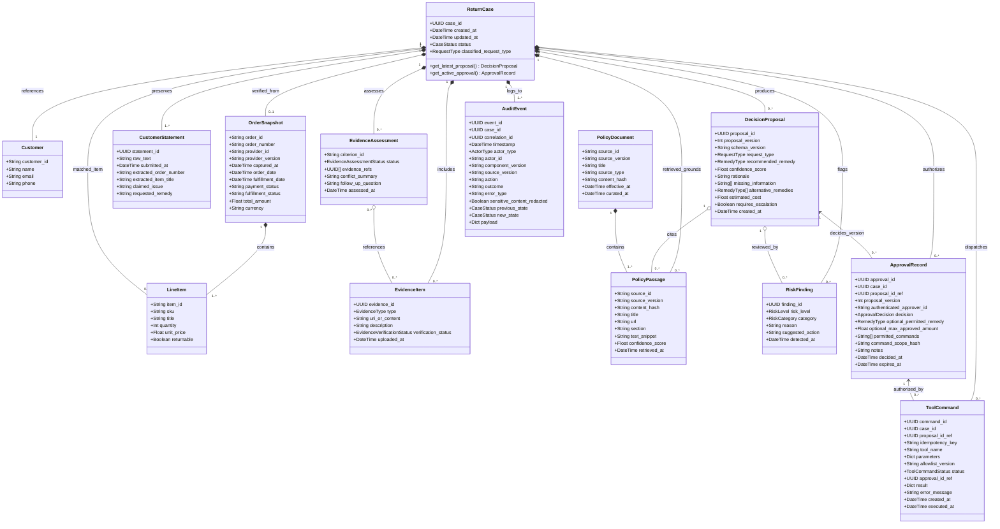

# Domain Class Diagram

> **MBSE Model Type**: Structural Class Diagram  
> **Course Requirement**: System structure, domain entities, collaborations, interdependencies  
> **Traceability**: [FR-001 to FR-012 and NFR-001 to NFR-009](../04-requirements-and-backlog.md)

---

## 1. Mermaid UML Class Diagram

---

## 2. Multiplicity and Invariants

1. **Proposal Version Binding**: An `ApprovalRecord` refers to exactly one current `DecisionProposal` ID and version for the same `ReturnCase`.
2. **Decision Does Not Always Grant Authority**: Reject, revision, and escalation decisions have an empty command set. Only an approved decision may contain remedy, amount, command, and expiry scope.
3. **Complete Dispatch Guard**: Every high-impact `ToolCommand` must match an unexpired approved record for the same case and current proposal, authenticated actor, command set, parameters/amount, and allowlist version.
4. **Idempotent Effect**: `idempotency_key` is unique per logical command effect. A prior successful command is returned rather than executed again.
5. **Audit Immutability and Reproducibility**: `AuditEvent` entries are append-only and retain correlation, component/source version, outcome, typed error, and redaction status.
6. **Guidance Conflict Safety**: `PolicyDocument.source_type` distinguishes store policy from reviewed guidance; neither source type authorises the AI to make a final legal determination. Conflicting store-policy and approved-guidance passages remain visible, create a `RiskFinding`, and route the proposal to human review.
7. **Untrusted Content Boundary**: Customer, evidence, and retrieved text is data only. It cannot populate trusted approver identity, permitted commands, allowlist version, or workflow policy.
