# Domain Class Diagram

> **MBSE Model Type**: Structural Class Diagram  
> **Course Requirement**: System structure, domain entities, collaborations, interdependencies  
> **Traceability**: [FR-001 ~ FR-012](file:///d:/AAA树下/硕士/26S2/5620/assignment/returnops-au/docs/04-requirements-and-backlog.md)

---

## 1. Mermaid UML Class Diagram

```mermaid
classDiagram
    direction TB

    class ReturnCase {
        +UUID case_id
        +DateTime created_at
        +DateTime updated_at
        +CaseStatus status
        +RequestType classified_request_type
        +get_latest_proposal() DecisionProposal
        +get_active_approval() ApprovalRecord
    }

    class Customer {
        +String customer_id
        +String name
        +String email
        +String phone
    }

    class OrderSnapshot {
        +String order_id
        +String order_number
        +DateTime order_date
        +DateTime fulfillment_date
        +String payment_status
        +String fulfillment_status
        +Float total_amount
        +String currency
    }

    class LineItem {
        +String item_id
        +String sku
        +String title
        +Int quantity
        +Float unit_price
        +Boolean returnable
    }

    class CustomerStatement {
        +UUID statement_id
        +String raw_text
        +DateTime submitted_at
        +String extracted_order_number
        +String extracted_item_title
        +String claimed_issue
        +String requested_remedy
    }

    class EvidenceItem {
        +UUID evidence_id
        +EvidenceType type
        +String uri_or_content
        +String description
        +EvidenceVerificationStatus verification_status
        +DateTime uploaded_at
    }

    class PolicyPassage {
        +String source_id
        +String title
        +String url
        +String section
        +String text_snippet
        +Boolean is_statutory
        +Float confidence_score
    }

    class DecisionProposal {
        +UUID proposal_id
        +RequestType request_type
        +RemedyType recommended_remedy
        +Float confidence_score
        +String rationale
        +String[] missing_information
        +RemedyType[] alternative_remedies
        +Float estimated_cost
        +Boolean requires_escalation
        +DateTime created_at
    }

    class RiskFinding {
        +UUID finding_id
        +RiskLevel risk_level
        +RiskCategory category
        +String reason
        +String suggested_action
        +DateTime detected_at
    }

    class ApprovalRecord {
        +UUID approval_id
        +UUID case_id
        +String approver
        +ApprovalDecision decision
        +RemedyType permitted_remedy
        +Float max_approved_amount
        +String permitted_command
        +String notes
        +DateTime decided_at
        +DateTime expires_at
    }

    class ToolCommand {
        +UUID command_id
        +String idempotency_key
        +String tool_name
        +Dict parameters
        +ToolCommandStatus status
        +UUID approval_id_ref
        +Dict result
        +String error_message
        +DateTime executed_at
    }

    class AuditEvent {
        +UUID event_id
        +UUID case_id
        +DateTime timestamp
        +ActorType actor_type
        +String actor_id
        +String action
        +CaseStatus previous_state
        +CaseStatus new_state
        +Dict payload
    }

    %% Relationships
    ReturnCase "1" *-- "1" Customer : references
    ReturnCase "1" *-- "0..1" OrderSnapshot : verified_from
    OrderSnapshot "1" *-- "1..*" LineItem : contains
    ReturnCase "1" o-- "0..1" LineItem : matched_item
    ReturnCase "1" *-- "1..*" CustomerStatement : preserves
    ReturnCase "1" *-- "0..*" EvidenceItem : includes
    ReturnCase "1" *-- "0..*" PolicyPassage : retrieved_grounds
    ReturnCase "1" *-- "0..*" DecisionProposal : produces
    ReturnCase "1" *-- "0..*" RiskFinding : flags
    ReturnCase "1" *-- "0..*" ApprovalRecord : authorizes
    ReturnCase "1" *-- "0..*" ToolCommand : dispatches
    ReturnCase "1" *-- "1..*" AuditEvent : logs_to
    
    DecisionProposal "1" o-- "0..*" PolicyPassage : cites
    ApprovalRecord "1" <-- "0..1" ToolCommand : scoped_by
```

---

## 2. Multiplicity and Invariants

1. **Mandatory Human Approval Link**: Every high-impact `ToolCommand` (refund, return label generation) must reference a valid `ApprovalRecord.approval_id`.
2. **Audit Immutability**: `AuditEvent` entries are append-only and cannot be modified or deleted.
3. **Statutory Precedence**: `PolicyPassage` marked `is_statutory: true` (ACCC/ACL) overrides conflicting store policy clauses for quality defects (`RequestType.FAULTY_PRODUCT`).
