# Class Model - Domain Entities and Service Boundaries

> **Status:** Shared design candidate synchronised to [docs/00](../00-project-definition-v1.md)
> and the [frozen allocation](../07-frozen-work-allocation.md). Implementation and
> team/tutor acceptance remain separate evidence.
> **Revision:** `1.0.0-rc.5` review candidate for [KAN-32](https://lucastaooo.atlassian.net/browse/KAN-32), not accepted. [PR #11](https://github.com/shuxiachai/returnops-au/pull/11) is the review entry; check its actual head and reviews. `57d86fe` published rc.4 is the prior review snapshot; rc.3 is an earlier candidate; [PR #9](https://github.com/shuxiachai/returnops-au/pull/9) preserves the rc.2 publication history.
> **Traceability:** FR-001–FR-012; NFR-001–NFR-009; UC-01/01E–UC-05;
> M-S.01 and the three personal chains in [docs/08](../08-delivery-work-packages.md).

This update preserves the original Lab 3 domain work and adapts Member B
`@ChengsiLi`'s domain/design split, concrete command types, provider interfaces,
and three lifecycle subjects from [PR #8](https://github.com/shuxiachai/returnops-au/pull/8)
(`origin/docs/6-baseline-uml-rebaseline`, locally inspected). This attribution
is not a claim that PR #8 was merged or that any personal diagrams are complete.
All three members still contribute to and review the shared model.

These are conceptual classes, not a claim that the old Pydantic models or the
F.01 wire-contract candidate implement them. Outstanding F.01 review issues must
be resolved against docs/00 and docs/07; this model does not adopt unreviewed DTO
semantics by implication. Business records and service dependencies are separated
for readability; neither diagram substitutes for the runtime composite structure.

## 1. Domain records

```mermaid
classDiagram
    direction TB
    class ReturnCase {
        +String case_id
        +Int case_version
        +Int input_version
        +CaseStatus status
        +DateTime created_at
    }
    class Customer {
        +String customer_id
        +String identity_content_ref
    }
    class CustomerStatement {
        +String statement_id
        +String original_text
        +CustomerRequestedOutcome requested_outcome
        +DateTime submitted_at
    }
    class ExtractedFacts {
        +Int input_version
        +IssueCategory issue_category
        +CustomerRequestedOutcome customer_requested_outcome
        +PossibleBasis possible_basis
        +AssessmentStatus assessment_status
        +String[] statement_refs
    }
    class IntakeSession {
        +String intake_session_id
        +Int clarification_round
        +String lifecycle_state
        +String[] outstanding_questions
    }
    class OrderSnapshot {
        +String snapshot_id
        +String order_id
        +String provider_id
        +String provider_version
        +DateTime captured_at
        +Int total_amount_cents
        +String currency
    }
    class LineItem {
        +String line_item_id
        +String sku
        +Int ordered_quantity
        +Int unit_price_cents
    }
    class CaseLineItem {
        +String line_item_id_ref
        +Int requested_quantity
    }
    class ReturnParcel {
        +String parcel_id
        +String case_id_ref
    }
    class ParcelLabel {
        +String label_id
        +String provider_id
        +String provider_label_id
        +String authorised_content_ref
    }
    class EvidenceItem {
        +String evidence_id
        +EvidenceType type
        +String authorised_content_ref
        +String original_description
        +DateTime retention_until
    }
    class EvidenceAssessment {
        +String criterion_id
        +EvidenceAssessmentStatus status
        +String[] evidence_refs
        +String[] statement_refs
        +String conflict_summary
        +String follow_up_question
    }
    class PolicyDocument {
        +String source_id
        +String source_type
        +String optional_published_version
        +Date accessed_on
        +String corpus_version
        +Boolean is_synthetic
    }
    class PolicyPassage {
        +String passage_id
        +String source_id_ref
        +String source_location
        +String content_hash
        +String content
        +DateTime retrieved_at
    }
    class DecisionPacket {
        +String proposal_id
        +Int proposal_version
        +Int input_version
        +String[] statement_refs
        +RecommendedAction recommended_action
        +String[] alternatives
        +String conditional_rationale
        +String[] open_questions
        +String responsibility_and_cost_facts
        +Float confidence
        +String model_prompt_version
    }
    class Citation {
        +String citation_id
        +String claim_ref
        +String passage_id_ref
        +String cited_location
        +String cited_content_hash
    }
    class ProposalReview {
        +String review_id
        +String proposal_id_ref
        +Int proposal_version
        +Int input_version
        +String corpus_version
        +RiskDecision decision
        +String reviewer_invocation_id
        +String reviewer_prompt_version
        +String[] revision_requests
        +String[] questions
    }
    class RiskFinding {
        +String finding_id
        +RiskCategory category
        +String reason
        +String[] supporting_refs
        +Boolean blocks_execution
    }
    class FounderDecision {
        +String decision_id
        +String case_id_ref
        +String optional_proposal_id_ref
        +Int optional_proposal_version
        +String optional_processing_failure_id_ref
        +String optional_order_lookup_block_id_ref
        +String authenticated_founder_id
        +ApprovalDecision decision
        +String reason_or_manual_outcome
        +DateTime decided_at
    }
    class ProcessingFailure {
        +String failure_id
        +String case_id
        +Int input_version
        +ProcessingStage stage
        +ErrorEnvelope error
        +DateTime occurred_at
    }
    class OrderLookupBlock {
        +String block_id
        +String case_id
        +Int input_version
        +OrderBlockStatus status
        +String message
        +DateTime occurred_at
    }
    class ApprovalRecord {
        +String approval_id
        +String decision_id_ref
        +String case_id_ref
        +String proposal_id_ref
        +Int proposal_version
        +Int input_version
        +String valid_review_id_ref
        +String authenticated_founder_id
        +String command_scope_fingerprint
        +Int amount_ceiling_cents
        +String currency
        +DateTime expires_at
    }
    class ToolCommand {
        <<abstract>>
        +String command_id
        +String logical_operation_key
        +String case_id_ref
        +String proposal_id_ref
        +Int proposal_version
        +String provider_id
        +String idempotency_key
        +String parameter_fingerprint
        +String allowlist_version
    }
    class CreateReturnCommand {
        +String order_snapshot_id_ref
        +String parcel_id_ref
        +String[] case_line_item_refs
    }
    class GenerateLabelCommand {
        +String parcel_id_ref
        +String create_return_command_id_ref
        +Boolean chargeable
    }
    class OperationAttempt {
        +String attempt_id
        +String command_id_ref
        +String approval_id_ref
        +Int attempt_number
        +String idempotency_key
        +String provider_id
        +String optional_provider_operation_id
        +String operation_fingerprint
        +OperationStatus status
        +OperationResult optional_result
        +String typed_error
        +DateTime started_at
        +DateTime resolved_at
    }
    class NotificationRecord {
        +String notification_id
        +String decision_or_operation_ref
        +NotificationStatus status
        +String outcome_kind
        +String outcome_and_next_step_ref
        +Int retry_count
        +String typed_error
    }
    class AuditEvent {
        +String event_id
        +String case_id_ref
        +String correlation_id
        +String component_version
        +String model_corpus_version_refs
        +ActorProvenance actor
        +HistoryReference[] history_refs
        +String[] correlation_object_ids
        +String outcome
        +String typed_error
        +String non_personal_integrity_hash
        +String optional_previous_event_hash
        +DateTime timestamp
    }

    class HistoryRecord {
        +String record_id
        +String case_id_ref
        +HistoryKind kind
        +String object_id
        +Int object_version
        +Int case_version
        +Int recorded_sequence
        +RetentionState retention_state
        +String content_sha256
        +TypedContent optional_content
    }
    class ActorProvenance {
        +ActorKind kind
        +String principal_or_run_or_component_ref
    }
    class HistoryReference {
        +String record_id_ref
        +HistoryKind kind
        +String object_id
        +Int object_version
    }
    ReturnCase "1" *-- "0..*" HistoryRecord : immutable_revisions
    AuditEvent "0..*" --> "1" ActorProvenance : causal_actor
    AuditEvent "1" *-- "0..*" HistoryReference : resolves_history
    HistoryReference "0..*" --> "1" HistoryRecord : exact_revision

    Customer "1" <-- "0..*" ReturnCase : belongs_to
    ReturnCase "1" *-- "1..*" CustomerStatement : preserves
    ReturnCase "1" *-- "0..*" ExtractedFacts : versions
    ReturnCase "1" *-- "1" IntakeSession : tracks_intake
    IntakeSession "1" o-- "1..*" CustomerStatement : gathers
    ReturnCase "1" *-- "0..*" OrderSnapshot : preserves_snapshots
    OrderSnapshot "1" *-- "1..*" LineItem : contains
    ReturnCase "1" *-- "0..*" CaseLineItem : selects
    CaseLineItem "0..*" --> "1" LineItem : from_same_order
    ReturnCase "1" *-- "0..1" ReturnParcel : uses
    ReturnParcel "0..1" --> "1..*" CaseLineItem : contains_selected_items
    ReturnParcel "1" *-- "0..1" ParcelLabel : has_single_result
    ReturnCase "1" *-- "0..*" EvidenceItem : authorises
    ReturnCase "1" *-- "0..*" EvidenceAssessment : assesses
    EvidenceAssessment "0..*" --> "0..*" EvidenceItem : references
    PolicyDocument "1" *-- "1..*" PolicyPassage : contains
    ReturnCase "1" *-- "0..*" DecisionPacket : versions
    DecisionPacket "1" *-- "0..*" Citation : cites
    Citation "0..*" --> "1" PolicyPassage : resolves_to
    DecisionPacket "0..*" --> "1..*" CustomerStatement : references_original
    ReturnCase "1" *-- "0..*" ProposalReview : records_reviews
    ProposalReview "0..*" --> "1" DecisionPacket : reviews_exact_version
    ProposalReview "1" *-- "0..*" RiskFinding : records_findings
    ReturnCase "1" *-- "0..*" FounderDecision : records_decisions
    ReturnCase "1" *-- "0..*" ProcessingFailure : preserves_technical_failures
    ReturnCase "1" *-- "0..*" OrderLookupBlock : preserves_lookup_blocks
    FounderDecision "0..*" --> "0..1" DecisionPacket : references_when_available
    FounderDecision "0..*" --> "0..1" ProcessingFailure : manual_target_when_no_proposal
    FounderDecision "0..*" --> "0..1" OrderLookupBlock : manual_target_when_no_proposal
    FounderDecision "1" *-- "0..1" ApprovalRecord : grants_only_on_approve
    ApprovalRecord "0..*" --> "1" ProposalReview : requires_current_pass
    ApprovalRecord "0..*" --> "2" ToolCommand : authorises_exact_scope_snapshot
    ToolCommand <|-- CreateReturnCommand
    ToolCommand <|-- GenerateLabelCommand
    GenerateLabelCommand "1" --> "1" CreateReturnCommand : depends_on_saved_result
    ToolCommand "1" *-- "0..*" OperationAttempt : retains_attempts
    ReturnCase "1" *-- "0..*" NotificationRecord : tracks_separately
    ReturnCase "1" *-- "1..*" AuditEvent : records_history
```

The diagram retains snapshots over time, not orders from different purchases:
all accepted snapshots in one case refer to the same order. The selected item
set is empty before matching; before any operation each positive quantity must
refer to that order's accepted snapshot and not exceed its ordered quantity.
There is at most one parcel and one label result; multiple items do not create
split shipments. A customer may have several cases and is not owned by one case.

A source without a published version explicitly records its absence; corpus
version, access date, location and hash remain available. Source type separates
store policy from reviewed consumer guidance, without granting either document
type execution powers. Passages are referenced across cases, not owned by each
case. Monetary values use an exact representation (integer AUD cents here);
confidence may remain floating point and never grants authority.

`FounderDecision` is a conceptual record of the four human decisions. Its three
optional associations form an exclusive choice: exactly one proposal ID/version,
processing failure ID, or order-lookup block ID. Approval, rejection or revision
requires a current proposal; only `MANUAL_HANDLING` can target either no-proposal
record. `ProcessingFailure` records a technical error. `OrderLookupBlock.status`
is only `CONFLICT` or `AUTHORITY_DENIED`, copied with case/input/message from an
accepted pre-proposal `OrderLookupResult`; its message is sanitised at the port
boundary. Policy-source conflicts stay with packet/Risk evidence and cannot
create an order block or a fabricated review.

The associations preserve history, not multiple current manual targets. The
Founder `CaseView` exposes at most one processing failure/order block; an
`ESCALATED` case without a current proposal exposes exactly one. A current order
block cannot coexist with a current proposal, review or preview. The resolved
target may remain visible during notification and manual terminal-state reads,
but cannot authorise another decision. Earlier targets stay in audit history;
historical approvals, successful operations and unknown effects remain intact.
The [F.01 rc.5 candidate](../09-interface-contract-v1.md) defines these bindings,
pending joint review; runtime current-state and authority checks remain required.

### Historical read boundary and completion constraints (rc.5 candidate)

`HistoryRecord/ActorProvenance/HistoryReference` represent the typed history
contracts, not a generic arbitrary-object store. Founder history resolves old
proposal input/source bundles and their reviews; Customer history has a
separate, restricted union. CaseRepository preserves immutable revisions and
serves as-of snapshots through Domain's authorised read boundary. A bounded
preview is not the complete history or an execution guard input. Tombstones
retain permitted integrity references; after deletion a preview cannot fall
back to older content/status. Required source-content deletion also suppresses
all dependent bundle/current-view copies. Read docs/09 §10.4 for exact fields,
cursor/retention rules and the still-required runtime checks.

NotificationRecord.outcome is the accepted result: RETURN_CREATED, REJECTED or
MANUAL_HANDLED. Historical attempt queries update evidence/audit only; they
cannot overwrite manual/reject outcomes, reopen terminal cases or create new
execution notifications. New customer evidence binds only during creation or
current valid clarification. Other material changes are controlled internal
version updates subject to state/in-flight-effect guards, not a new customer
append API. These constraints align the MA-0.3 candidate and shared state/sequence
models; they do not implement the corresponding runtime service.

## 2. Services and replaceable interfaces

```mermaid
classDiagram
    direction LR
    class Agent {
        <<abstract>>
        +String invocation_id
        +String model_version
        +String system_prompt_version
    }
    class CustomerCaseCoordinatorAgent {
        +structure_request(case_input) CoordinatorResult
        +prepare_clarification(case_input) CoordinatorResult
    }
    class ReturnsAssessmentAgent {
        +assess_case(assessment_input) DecisionPacket
    }
    class ComplianceRiskReviewerAgent {
        +review_independently(request: RiskReviewRequest) RiskReview
    }
    class WorkflowOrchestrator {
        +run_bounded_analysis(case_id, work_context) void
    }
    class DomainService {
        +accept_statement(request, trusted_context) ReturnCase
        +validate_and_store_analysis(result, work_context) ReturnCase
        +record_founder_decision(request: FounderDecisionRequest, trusted_context) DecisionReceipt
        +record_operation_result(operation_id, observation, work_context) OperationAttempt
        +record_notification_result(notification_id, observation, work_context) NotificationRecord
        +transition_if_valid(event, expected_case_version) ReturnCase
    }
    class ApprovalGuard {
        +validate_current_decision(request, current_records, trusted_context) Boolean
        +validate_dispatch_scope(command: CommandSpec, current_records) Boolean
    }
    class OperationsService {
        +execute_approved_plan(approval_id, work_context) void
        +reconcile_known_attempt(operation_id, work_context) OperationAttempt
        +send_recorded_outcome(notification_id, work_context) NotificationRecord
    }
    class OrderProviderPort {
        <<interface>>
        +lookup_read_only(request: OrderLookupRequest) OrderLookupResult
    }
    class RetrievalPort {
        <<interface>>
        +retrieve_versioned_passages(request: RetrievalRequest) RetrievalResult
        +verify_citations(request: CitationVerificationRequest) CitationVerificationResult
    }
    class ReturnsLogisticsPort {
        <<interface>>
        +check_authority(command: CommandSpec, provider_context) Boolean
        +invoke_approved_command(command: CommandSpec, attempt_context) provider_observation
        +query_operation(attempt: OperationAttempt, provider_context) provider_observation
    }
    class NotificationPort {
        <<interface>>
        +send_recorded_message(record: NotificationRecord, delivery_context) delivery_observation
    }
    class AuditPort {
        <<interface>>
        +record_non_personal_event(event: AuditEvent, transaction_context) void
    }
    class CaseRepository {
        <<interface>>
        +load_current_records(case_id) ReturnCase
        +commit_guarded_changes(change_set, transaction_context) void
    }
    class MockOrderAdapter
    class VersionedCorpusAdapter
    class MockReturnsLogisticsAdapter
    class MockNotificationAdapter
    class IntegrityAuditAdapter
    class PostgreSQLCaseRepository

    Agent <|-- CustomerCaseCoordinatorAgent
    Agent <|-- ReturnsAssessmentAgent
    Agent <|-- ComplianceRiskReviewerAgent
    OrderProviderPort <|.. MockOrderAdapter
    RetrievalPort <|.. VersionedCorpusAdapter
    ReturnsLogisticsPort <|.. MockReturnsLogisticsAdapter
    NotificationPort <|.. MockNotificationAdapter
    AuditPort <|.. IntegrityAuditAdapter
    CaseRepository <|.. PostgreSQLCaseRepository

    WorkflowOrchestrator ..> CustomerCaseCoordinatorAgent : invokes_typed_role
    WorkflowOrchestrator ..> ReturnsAssessmentAgent : invokes_typed_role
    WorkflowOrchestrator ..> ComplianceRiskReviewerAgent : invokes_separate_review
    WorkflowOrchestrator ..> DomainService : submits_results_for_validation
    ReturnsAssessmentAgent ..> OrderProviderPort : read_only
    ReturnsAssessmentAgent ..> RetrievalPort : reads_and_checks_sources
    DomainService ..> ApprovalGuard : validates_decision
    DomainService ..> CaseRepository : sole_business_write_entry
    DomainService ..> AuditPort : persists_guarded_events
    DomainService ..> OperationsService : dispatches_committed_work
    OperationsService ..> DomainService : reads_scope_and_records_results
    OperationsService ..> ApprovalGuard : revalidates_every_effect
    OperationsService ..> ReturnsLogisticsPort : sole_operational_invoker
    OperationsService ..> NotificationPort : sends_recorded_outcome
```

The repository realisation is the planned PostgreSQL adapter; no running service
is implied. The abstract Agent shares invocation metadata, not a falsely
universal input/output DTO: each role returns its own typed result. Risk receives
the complete `RiskReviewRequest`, including original evidence, order facts,
the original accepted `retrieval_result` with all conflicts, and citation checks
through the controlled orchestration boundary, never the generator's hidden
reasoning. Its result is the rc.5 `RiskReview` DTO. Domain Service validates and
records that DTO in the conceptual `ProposalReview` lifecycle shown above;
`ProposalReview` is not a second return schema. A3 may add an
independently verified test adapter behind ReturnsLogisticsPort without changing
these authority rules.

Material components submit correlated events through the deterministic service
and its Audit Port. This class view specifies dependencies, not runtime ports,
instances and connectors: the [CS-0.2 Composite Structure](../13-shared-composite-structure.md)
is a separate M-S.02 candidate and still requires human review. The API and both UIs consume Domain Service and its
authorised read models; none is another writer of workflow state.

### 2.1 Method contracts and trusted context

The signatures above are design-time operation contracts, not implemented Python
methods or additional HTTP routes. Named DTOs below use the existing
[rc.5 definitions](../../contracts/v1/schemas.json). Lower-case parameters such
as `case_input`, `trusted_context`, `work_context`, `current_records`,
`transaction_context`, `provider_observation` and `delivery_observation` are
descriptions of internal arguments/results; they are **not new wire DTOs**.
`ReturnCase` remains the conceptual aggregate and is projected into the existing
customer/Founder read models, rather than exposed directly as an API payload.

`trusted_context` is assembled after server authentication and resource access
checks. It contains the verified principal, addressed resource, correlation and
request/idempotency context; a request body's role or `Principal` shape cannot
create it. `work_context` identifies permitted persisted work and the expected
case/input/proposal versions. Neither context bypasses fresh state and scope
checks. Credentials, unrestricted repository access and these authority contexts
are not passed to an LLM. The model-input contexts below contain only the
permitted evidence fields and version references.

| Method boundary | Inputs and successful return | Trusted context, failure and state boundary |
|---|---|---|
| Coordinator `structure_request` / `prepare_clarification` | Read-only current case/input references, original `CustomerStatement` objects and permitted evidence; returns `CoordinatorResult` with facts, criterion matrix, questions and `ModelRun`. | A assembles the allowlisted input; model output remains untrusted. Malformed/stale output or invocation failure yields a typed error/recovery decision, never accepted facts or a direct state transition. Both methods share the role-specific result shape, not a new request DTO. |
| Assessment `assess_case` | Read-only statements/evidence, accepted order lookup, criterion material and complete accepted `RetrievalResult`; returns `DecisionPacket`. | A validates current case/input/source bindings; original retrieval remains available independently of the generator. No approval/command is returned. Invalid output is rejected with bounded recovery; a technical failure is not a fabricated business Risk outcome. |
| Reviewer `review_independently` | `RiskReviewRequest → RiskReview`, exactly as C2 in F.01. | Separate C-owned invocation; the original retrieval conflicts, citation checks and independent evidence must survive the hand-off. `PASS/PASS_WITH_WARNING/REVISE/NEEDS_INFORMATION/ESCALATE` are business outcomes, not exception fallbacks. Domain Service checks current bindings before updating the `ProposalReview` lifecycle. |
| Orchestrator `run_bounded_analysis` | Case ID plus current permitted work context; returns after submitting typed results/errors to Domain Service. | A enforces a machine-round budget and only invokes the three agreed roles/ports. `void` means no returned wire payload, not that work succeeded. It cannot persist case transitions, create trusted approvals or reach operational providers; stale work is rejected or safely stopped. |
| Domain `accept_statement` | Validated `CreateCaseRequest` or addressed `ClarificationRequest` plus trusted request context; returns the accepted `ReturnCase`. The API projects the existing `CustomerCaseView` response. | Verify customer/resource and evidence ownership; preserve the original, append clarification, enforce expected version and request replay. The same accepted request reuses acceptance: return its original receipt only while readable; after permitted deletion return 409 INVALID_STATE/retryable=false, without new writes/work or automatic new key. B reads current/history views. Mismatched content or invalid references create no duplicate case/work. Persistence failure cannot be reported as acceptance. |
| Domain `validate_and_store_analysis` / `transition_if_valid` | One concrete typed result (`CoordinatorResult`, `OrderLookupResult`, `DecisionPacket` or `RiskReview`) or an actual typed processing error, with expected versions; returns the guarded aggregate. | These are internal overloads, not a public generic result/state endpoint. Validate role/source, shape and bindings; distinguish an accepted pre-proposal lookup block from technical `ProcessingFailure`; preserve old effects when input changes. Reject illegal transitions or stale results. No caller supplies the new authoritative state. |
| Domain `record_founder_decision` | `FounderDecisionRequest` and trusted Founder/request context for the addressed case; returns `DecisionReceipt`. | Reload current records and require exactly one proposal/failure/block target. Only a current eligible proposal may create an `ApprovalRecord`; failure/block targets permit only `MANUAL_HANDLING`. Persist decision, business audit and appropriate work atomically. A receipt acknowledges acceptance, not delivery/effect success; no-proposal handling creates notification work only. |
| Approval Guard `validate_current_decision` / `validate_dispatch_scope` | Current persisted records, request or `CommandSpec`, and applicable trusted context; returns an internal Boolean validation verdict. | The verdict grants no authority itself and is not a transport response. A denial carries an internal reason mapped to the existing `ErrorEnvelope`; invalid actor, version, target, risk, expiry, fingerprint or command scope blocks before dispatch. Operations separately checks provider permission and durable idempotency before each new effect. |
| Domain `record_operation_result` / `record_notification_result` | Persisted operation/notification ID plus an adapter observation and current work context; returns the saved `OperationAttempt` or `NotificationRecord`. | Verify record ownership, provider/command identity and applicable version/result structure. Only Domain Service writes outcomes/transitions. Persist a validated original label-effect receipt, correlated audit and artifact-only work before storing content; retain EXECUTING without result until the full label_evidence_id binding and complete OperationResult commit. If saving fails, reread durable receipts before querying any uncertain original effect; known effects cannot become retry-safe failures or UNKNOWN because file storage failed. Notification updates never replay return/label work. |
| Operations `execute_approved_plan` / `reconcile_known_attempt` / `send_recorded_outcome` | A committed approval/work, operation or notification ID; execution returns no new public payload, while recovery/delivery returns the Domain-saved `OperationAttempt`/`NotificationRecord`. | IDs are references, not authority. Reload current scope and saved effects; claim only unfinished authorised work and preserve stable keys. A durable confirmed-label receipt selects G-ARTIFACT original-label recovery; only absent such a fact may an unresolved effect use UNKNOWN/query before considering retry. Historical lookup may remain permitted after approval expiry but cannot authorise a new effect. A delivery task uses only the saved message/outcome; it cannot become a return command. |
| Order and retrieval ports | `OrderLookupRequest → OrderLookupResult`; `RetrievalRequest → RetrievalResult`; `CitationVerificationRequest → CitationVerificationResult`. | Provider/corpus access is configured outside model text. Only MATCHED order results carry snapshots; CONFLICT/AUTHORITY_DENIED can become an exact `OrderLookupBlock`, NOT_FOUND can request correction and PROVIDER_FAILURE remains a technical branch. Retrieval NO_MATCH is a valid empty result. Technical port failures use `ErrorEnvelope`, and C2 independently judges claim support. |
| Returns/logistics and notification ports | Approved `CommandSpec` plus persisted attempt context, or an `OperationAttempt` for lookup; a saved `NotificationRecord` for delivery. | `provider_observation` contains original confirmed-effect facts, definite no-effect failure or unresolved-effect evidence; it is not an `OperationResult`. In particular a provider label observation has no local `label_evidence_id`: Domain saves its receipt and later validates the scoped artifact reference before committing a complete success result; `delivery_observation` describes delivery/error evidence. These provider-specific internal results are normalised and submitted to Domain Service. HTTP 200 is insufficient; ambiguous effects remain UNKNOWN. No additional `ProviderResult`/`NotificationResult` wire schema or public dispatch endpoint is implied. |
| Repository and Audit Port | `load_current_records(case_id) → ReturnCase`; commit a validated internal change set; append a service-created `AuditEvent`. | Only Domain Service may commit business changes. Expected-version/idempotency checks and business audit/work persistence share the transaction boundary. Audit append grants no state authority; reject malformed/untrusted attribution and exclude secrets/PII. A database transaction does not include the provider's external effect. |

Errors at an API boundary use the existing rc.5 `ErrorEnvelope` and endpoint
status rules. Examples include stale case version, invalid current target/state,
unauthorised access and unavailable provider; this table adds no error enum.
Transport-schema validation cannot establish that a context, hash, review or
provider response came from the required trusted boundary.

The internal receipt binds the original attempt, command, parcel, provider configuration
and operation ID to minimal confirmed-effect evidence/hash. Domain commits it with
audit and artifact-only work; sensitive bytes/credentials stay out of audit. It uses
existing EXECUTING/provider_operation_id and optional actual ErrorEnvelope in public
views, adding no wire receipt type or state. G-ARTIFACT requires current recovery
access, original bindings, read/store authority, retention permission and a durable
claim. Creation-approval expiry is separate from that read/store authority. Recovery
may retrieve/store only the original label; it cannot restore deliberately deleted
content or rewrite a manual/rejection outcome. If a file exists but result commit is
unknown, reread and verify/reuse that reference/hash rather than create another label.
Only a committed full result including label_evidence_id makes the attempt SUCCEEDED.

### 2.2 Lab 5 review evidence

Under existing M-S.01, A leads the shared class/method design, C reviews source,
risk and authority mappings, and B contributes the application/UI interaction
mapping. Record each person's actual contribution to the shared work; this does
not change the frozen owners or replace any personal behavioural model.
Review the [selected architecture patterns](../02-system-design.md#101-lab-5-selected-patterns-and-their-concrete-application)
against these interfaces and the existing sequence diagram. For each major
method, trace one success and one relevant rejection/stale/unknown outcome,
check the corresponding attributes and association multiplicities, and show
where interface realisation substitutes a provider without changing authority.
Keep the accepted data-contract version and the model revision visible together.
No extra CRUD methods are required merely to make a data record look active.
Syntax/link checks support review; implementation, B/C acceptance and tutor
feedback remain separate evidence.

## 3. Invariants and review checks

1. **Original evidence remains identifiable.** Extraction and new proposals
   cannot overwrite statements. Category, requested outcome, possible basis,
   assessment status and recommendation remain separate. Refund/repair may be
   requests or suggestions, never executable core commands.
2. **Review is independent and version-bound.** ProposalReview is the conceptual
   lifecycle subject (the F.01 draft calls its result DTO RiskReview). Its only
   outcomes are PASS, PASS_WITH_WARNING, REVISE, NEEDS_INFORMATION and ESCALATE.
   Failed, malformed or stale results never become PASS. The first two may reach
   Founder review only after other guards pass; the rest revise, clarify or
   escalate. A warning cannot conceal a blocking finding.
3. **Only APPROVE grants exact authority.** The four Founder decisions are
   APPROVE, REJECT, REQUEST_REVISION and MANUAL_HANDLING. Only APPROVE has an
   ApprovalRecord. Trusted actor, case/input/proposal/review versions, exact
   commands, item quantities, parcel, parameters/fingerprint, applicable amount
   ceiling and expiry are checked before dispatch. Provider authority is an
   independent prerequisite. Changed material input/proposal invalidates old
   authority. ESCALATE needs a new proposal and passing review before approval.
4. **Commands and attempts differ.** The core plan contains CREATE_RETURN then
   GENERATE_LABEL for the same parcel; the latter uses the stored return result.
   Retries use the same logical command/key/fingerprint. Prior successful effects
   are reused, never repeated. Concurrent execution requires durable claiming;
   drawing an association does not implement that guarantee.
   An approval refers to an immutable snapshot of the exact command scope;
   it does not own or recreate the logical operation. Renewal or reapproval
   records a new authorisation against that operation and preserves prior
   attempts/results. Each attempt records the approval used. A changed approval
   ID or proposal version alone must never reset the logical operation key or
   recreate a successful return; genuinely changed intent needs explicit
   validation against existing effects and its own exact scope.
5. **Effect status and complete result differ.** OperationAttempt uses the seven
   rc.5 statuses PENDING/EXECUTING/SUCCEEDED/FAILED/UNKNOWN/RECONCILING/BLOCKED.
   OperationResult is the complete success payload, never a status enum. A durable
   confirmed-label receipt with missing artifact remains EXECUTING without result;
   only original-artifact recovery is allowed, not another invoke or UNKNOWN.
   Unknown effect requires original-provider lookup; FAILED requires confirmed
   no effect. Expiry or new input never erases historical provider facts.
6. **Notification is separate.** NotificationRecord uses PENDING/SENT/FAILED.
   The case uses NOTIFICATION_PENDING/NOTIFICATION_FAILED with an outcome kind;
   notification retry never invokes return or label again. Once delivery is
   confirmed, the respective case outcome is COMPLETED, REJECTED or
   MANUAL_HANDLED. Only COMPLETED represents successful simulated return/label
   and notification; the other outcomes do not count as successful execution.
7. **Privacy and integrity coexist.** Identifiable content follows controlled
   storage and retention. Permitted deletion/de-identification must preserve
   non-personal integrity events and their chain. Append-only does not mean
   retaining personal content forever.

Composition (`*--`) represents case-local ownership, ordinary association (`-->`)
references shared identities and passages, and aggregation (`o--`) lets intake
gather statements owned by the case. Generalisation (`<|--`) distinguishes AI
roles and concrete commands; interface realisation (`<|..`) makes adapters replaceable.

## 4. Personal lifecycle subjects and remaining evidence

| Shared subject | Personal chain / owner | Separate evidence still required |
|---|---|---|
| IntakeSession | AH-01 → UC-01 / B | Personal activity, interaction and intake state machine, including clarification and failure/retry behaviour |
| ProposalReview | AH-08 → UC-02 / C | Personal grounding/risk activity, revision-loop interaction and review state machine |
| OperationAttempt | AH-10 → UC-04 / A | [MA-0.3 candidate](../12-member-a-model-chain.md) now supplies activity, interaction and attempt state views; A's personal revision and C review remain pending |

These names support the individual models; they do not certify completion or
fix every private lifecycle state in advance. A owns domain, Coordinator,
Assessment and integration; C owns retrieval and Risk; B owns both interfaces.
All three review the shared diagrams under the 45%/27%/28% planning allocation,
with actual authorship retained.
