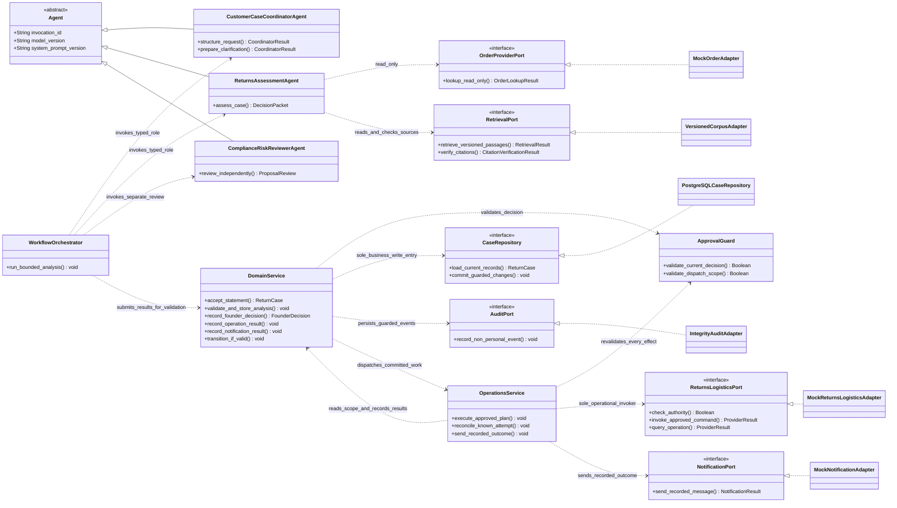

# Class Model - Domain Entities and Service Boundaries

> **Status:** Shared design candidate synchronised to [docs/00](../00-project-definition-v1.md)
> and the [frozen allocation](../07-frozen-work-allocation.md). Implementation and
> team/tutor acceptance remain separate evidence.
> **Review publication:** 2026-09-07, [PR #9](https://github.com/shuxiachai/returnops-au/pull/9); not merged or adopted.
> **Traceability:** FR-001–FR-012; NFR-001–NFR-009; UC-01/01E–UC-05;
> M-S.01 and the three personal chains in [docs/08](../08-delivery-work-packages.md).

This update preserves the original Lab 3 domain work and adapts Member B
`@ChengsiLi`'s domain/design split, concrete command types, provider interfaces,
and three lifecycle subjects from [PR #8](https://github.com/shuxiachai/returnops-au/pull/8)
(`origin/docs/6-baseline-uml-rebaseline`, locally inspected). This attribution
is not a claim that PR #8 was merged or that any personal diagrams are complete.
All three members still contribute to and review the shared model.

These are conceptual classes, not a claim that the old Pydantic models or the
F.01 wire-contract candidate implement them. Outstanding F.01 review issues must
be resolved against docs/00 and docs/07; this model does not adopt unreviewed DTO
semantics by implication. Business records and service dependencies are separated
for readability; neither diagram substitutes for the runtime composite structure.

## 1. Domain records

```mermaid
classDiagram
    direction TB
    class ReturnCase {
        +String case_id
        +Int case_version
        +Int input_version
        +CaseStatus status
        +DateTime created_at
    }
    class Customer {
        +String customer_id
        +String identity_content_ref
    }
    class CustomerStatement {
        +String statement_id
        +String original_text
        +CustomerRequestedOutcome requested_outcome
        +DateTime submitted_at
    }
    class ExtractedFacts {
        +Int input_version
        +IssueCategory issue_category
        +CustomerRequestedOutcome customer_requested_outcome
        +PossibleBasis possible_basis
        +AssessmentStatus assessment_status
        +String[] statement_refs
    }
    class IntakeSession {
        +String intake_session_id
        +Int clarification_round
        +String lifecycle_state
        +String[] outstanding_questions
    }
    class OrderSnapshot {
        +String snapshot_id
        +String order_id
        +String provider_id
        +String provider_version
        +DateTime captured_at
        +Int total_amount_cents
        +String currency
    }
    class LineItem {
        +String line_item_id
        +String sku
        +Int ordered_quantity
        +Int unit_price_cents
    }
    class CaseLineItem {
        +String line_item_id_ref
        +Int requested_quantity
    }
    class ReturnParcel {
        +String parcel_id
        +String case_id_ref
    }
    class ParcelLabel {
        +String label_id
        +String provider_id
        +String provider_label_id
        +String authorised_content_ref
    }
    class EvidenceItem {
        +String evidence_id
        +EvidenceType type
        +String authorised_content_ref
        +String original_description
        +DateTime retention_until
    }
    class EvidenceAssessment {
        +String criterion_id
        +EvidenceAssessmentStatus status
        +String[] evidence_refs
        +String[] statement_refs
        +String conflict_summary
        +String follow_up_question
    }
    class PolicyDocument {
        +String source_id
        +String source_type
        +String optional_published_version
        +Date accessed_on
        +String corpus_version
        +Boolean is_synthetic
    }
    class PolicyPassage {
        +String passage_id
        +String source_id_ref
        +String source_location
        +String content_hash
        +String content
        +DateTime retrieved_at
    }
    class DecisionPacket {
        +String proposal_id
        +Int proposal_version
        +Int input_version
        +String[] statement_refs
        +RecommendedAction recommended_action
        +String[] alternatives
        +String conditional_rationale
        +String[] open_questions
        +String responsibility_and_cost_facts
        +Float confidence
        +String model_prompt_version
    }
    class Citation {
        +String citation_id
        +String claim_ref
        +String passage_id_ref
        +String cited_location
        +String cited_content_hash
    }
    class ProposalReview {
        +String review_id
        +String proposal_id_ref
        +Int proposal_version
        +Int input_version
        +String corpus_version
        +RiskDecision decision
        +String reviewer_invocation_id
        +String reviewer_prompt_version
        +String[] revision_requests
        +String[] questions
    }
    class RiskFinding {
        +String finding_id
        +RiskCategory category
        +String reason
        +String[] supporting_refs
        +Boolean blocks_execution
    }
    class FounderDecision {
        +String decision_id
        +String case_id_ref
        +String optional_proposal_id_ref
        +Int optional_proposal_version
        +String authenticated_founder_id
        +ApprovalDecision decision
        +String reason_or_manual_outcome
        +DateTime decided_at
    }
    class ApprovalRecord {
        +String approval_id
        +String decision_id_ref
        +String case_id_ref
        +String proposal_id_ref
        +Int proposal_version
        +Int input_version
        +String valid_review_id_ref
        +String authenticated_founder_id
        +String command_scope_fingerprint
        +Int amount_ceiling_cents
        +String currency
        +DateTime expires_at
    }
    class ToolCommand {
        <<abstract>>
        +String command_id
        +String logical_operation_key
        +String case_id_ref
        +String proposal_id_ref
        +Int proposal_version
        +String provider_id
        +String idempotency_key
        +String parameter_fingerprint
        +String allowlist_version
    }
    class CreateReturnCommand {
        +String order_snapshot_id_ref
        +String parcel_id_ref
        +String[] case_line_item_refs
    }
    class GenerateLabelCommand {
        +String parcel_id_ref
        +String create_return_command_id_ref
        +Boolean chargeable
    }
    class OperationAttempt {
        +String attempt_id
        +String command_id_ref
        +String approval_id_ref
        +Int attempt_number
        +String idempotency_key
        +String provider_id
        +String optional_provider_operation_id
        +String operation_fingerprint
        +OperationResult optional_result
        +String typed_error
        +DateTime started_at
        +DateTime resolved_at
    }
    class NotificationRecord {
        +String notification_id
        +String decision_or_operation_ref
        +NotificationStatus status
        +String outcome_kind
        +String outcome_and_next_step_ref
        +Int retry_count
        +String typed_error
    }
    class AuditEvent {
        +String event_id
        +String case_id_ref
        +String correlation_id
        +String component_version
        +String model_corpus_version_refs
        +String[] object_refs
        +String outcome
        +String typed_error
        +String non_personal_integrity_hash
        +String optional_previous_event_hash
        +DateTime timestamp
    }

    Customer "1" <-- "0..*" ReturnCase : belongs_to
    ReturnCase "1" *-- "1..*" CustomerStatement : preserves
    ReturnCase "1" *-- "0..*" ExtractedFacts : versions
    ReturnCase "1" *-- "1" IntakeSession : tracks_intake
    IntakeSession "1" o-- "1..*" CustomerStatement : gathers
    ReturnCase "1" *-- "0..*" OrderSnapshot : preserves_snapshots
    OrderSnapshot "1" *-- "1..*" LineItem : contains
    ReturnCase "1" *-- "0..*" CaseLineItem : selects
    CaseLineItem "0..*" --> "1" LineItem : from_same_order
    ReturnCase "1" *-- "0..1" ReturnParcel : uses
    ReturnParcel "0..1" --> "1..*" CaseLineItem : contains_selected_items
    ReturnParcel "1" *-- "0..1" ParcelLabel : has_single_result
    ReturnCase "1" *-- "0..*" EvidenceItem : authorises
    ReturnCase "1" *-- "0..*" EvidenceAssessment : assesses
    EvidenceAssessment "0..*" --> "0..*" EvidenceItem : references
    PolicyDocument "1" *-- "1..*" PolicyPassage : contains
    ReturnCase "1" *-- "0..*" DecisionPacket : versions
    DecisionPacket "1" *-- "0..*" Citation : cites
    Citation "0..*" --> "1" PolicyPassage : resolves_to
    DecisionPacket "0..*" --> "1..*" CustomerStatement : references_original
    ReturnCase "1" *-- "0..*" ProposalReview : records_reviews
    ProposalReview "0..*" --> "1" DecisionPacket : reviews_exact_version
    ProposalReview "1" *-- "0..*" RiskFinding : records_findings
    ReturnCase "1" *-- "0..*" FounderDecision : records_decisions
    FounderDecision "0..*" --> "0..1" DecisionPacket : references_when_available
    FounderDecision "1" *-- "0..1" ApprovalRecord : grants_only_on_approve
    ApprovalRecord "0..*" --> "1" ProposalReview : requires_current_pass
    ApprovalRecord "0..*" --> "2" ToolCommand : authorises_exact_scope_snapshot
    ToolCommand <|-- CreateReturnCommand
    ToolCommand <|-- GenerateLabelCommand
    GenerateLabelCommand "1" --> "1" CreateReturnCommand : depends_on_saved_result
    ToolCommand "1" *-- "0..*" OperationAttempt : retains_attempts
    ReturnCase "1" *-- "0..*" NotificationRecord : tracks_separately
    ReturnCase "1" *-- "1..*" AuditEvent : records_history
```

The diagram retains snapshots over time, not orders from different purchases:
all accepted snapshots in one case refer to the same order. The selected item
set is empty before matching; before any operation each positive quantity must
refer to that order's accepted snapshot and not exceed its ordered quantity.
There is at most one parcel and one label result; multiple items do not create
split shipments. A customer may have several cases and is not owned by one case.

A source without a published version explicitly records its absence; corpus
version, access date, location and hash remain available. Source type separates
store policy from reviewed consumer guidance, without granting either document
type execution powers. Passages are referenced across cases, not owned by each
case. Monetary values use an exact representation (integer AUD cents here);
confidence may remain floating point and never grants authority.

`FounderDecision` is a conceptual record of the four human decisions. Approval,
rejection or revision of a proposal requires that exact proposal reference.
Manual handling after an earlier failure may have no valid proposal; it records
facts and the human outcome without inventing a packet or approval. Its public
request shape now references a persisted ProcessingFailure in the
[F.01 rc.2 candidate](../09-interface-contract-v1.md), pending joint review;
this is not an implemented endpoint or a new source of execution authority.

## 2. Services and replaceable interfaces

The repository realisation is the planned PostgreSQL adapter; no running service
is implied. The abstract Agent shares invocation metadata, not a falsely
universal input/output DTO: each role returns its own typed result. Risk receives
original evidence, order facts and cited passages through the controlled
orchestration boundary, never the generator's hidden reasoning. A3 may add an
independently verified test adapter behind ReturnsLogisticsPort without changing
these authority rules.

Material components submit correlated events through the deterministic service
and its Audit Port. This class view specifies dependencies, not runtime ports,
instances and connectors: the shared Composite Structure Diagram remains a
separate M-S.02 deliverable. The API and both UIs consume Domain Service and its
authorised read models; none is another writer of workflow state.

## 3. Invariants and review checks

1. **Original evidence remains identifiable.** Extraction and new proposals
   cannot overwrite statements. Category, requested outcome, possible basis,
   assessment status and recommendation remain separate. Refund/repair may be
   requests or suggestions, never executable core commands.
2. **Review is independent and version-bound.** ProposalReview is the conceptual
   lifecycle subject (the F.01 draft calls its result DTO RiskReview). Its only
   outcomes are PASS, PASS_WITH_WARNING, REVISE, NEEDS_INFORMATION and ESCALATE.
   Failed, malformed or stale results never become PASS. The first two may reach
   Founder review only after other guards pass; the rest revise, clarify or
   escalate. A warning cannot conceal a blocking finding.
3. **Only APPROVE grants exact authority.** The four Founder decisions are
   APPROVE, REJECT, REQUEST_REVISION and MANUAL_HANDLING. Only APPROVE has an
   ApprovalRecord. Trusted actor, case/input/proposal/review versions, exact
   commands, item quantities, parcel, parameters/fingerprint, applicable amount
   ceiling and expiry are checked before dispatch. Provider authority is an
   independent prerequisite. Changed material input/proposal invalidates old
   authority. ESCALATE needs a new proposal and passing review before approval.
4. **Commands and attempts differ.** The core plan contains CREATE_RETURN then
   GENERATE_LABEL for the same parcel; the latter uses the stored return result.
   Retries use the same logical command/key/fingerprint. Prior successful effects
   are reused, never repeated. Concurrent execution requires durable claiming;
   drawing an association does not implement that guarantee.
   An approval refers to an immutable snapshot of the exact command scope;
   it does not own or recreate the logical operation. Renewal or reapproval
   records a new authorisation against that operation and preserves prior
   attempts/results. Each attempt records the approval used. A changed approval
   ID or proposal version alone must never reset the logical operation key or
   recreate a successful return; genuinely changed intent needs explicit
   validation against existing effects and its own exact scope.
5. **Unknown is not failure.** Once an attempt has a result, its values include
   SUCCEEDED, FAILED, UNKNOWN or RECONCILING. Ambiguous timeout requires provider
   lookup before retry; unresolved effects remain visible for manual handling.
   Expiry or new input never erases historical provider facts.
6. **Notification is separate.** NotificationRecord uses PENDING/SENT/FAILED.
   The case uses NOTIFICATION_PENDING/NOTIFICATION_FAILED with an outcome kind;
   notification retry never invokes return or label again. Once delivery is
   confirmed, the respective case outcome is COMPLETED, REJECTED or
   MANUAL_HANDLED. Only COMPLETED represents successful simulated return/label
   and notification; the other outcomes do not count as successful execution.
7. **Privacy and integrity coexist.** Identifiable content follows controlled
   storage and retention. Permitted deletion/de-identification must preserve
   non-personal integrity events and their chain. Append-only does not mean
   retaining personal content forever.

Composition (`*--`) represents case-local ownership, ordinary association (`-->`)
references shared identities and passages, and aggregation (`o--`) lets intake
gather statements owned by the case. Generalisation (`<|--`) distinguishes AI
roles and concrete commands; interface realisation (`<|..`) makes adapters replaceable.

## 4. Personal lifecycle subjects and remaining evidence

| Shared subject | Personal chain / owner | Separate evidence still required |
|---|---|---|
| IntakeSession | AH-01 → UC-01 / B | Personal activity, interaction and intake state machine, including clarification and failure/retry behaviour |
| ProposalReview | AH-08 → UC-02 / C | Personal grounding/risk activity, revision-loop interaction and review state machine |
| OperationAttempt | AH-10 → UC-04 / A | Personal execution activity, exact-scope interaction and attempt state machine |

These names support the individual models; they do not certify completion or
fix every private lifecycle state in advance. A owns domain, Coordinator,
Assessment and integration; C owns retrieval and Risk; B owns both interfaces.
All three review the shared diagrams under the 45%/27%/28% planning allocation,
with actual authorship retained.
