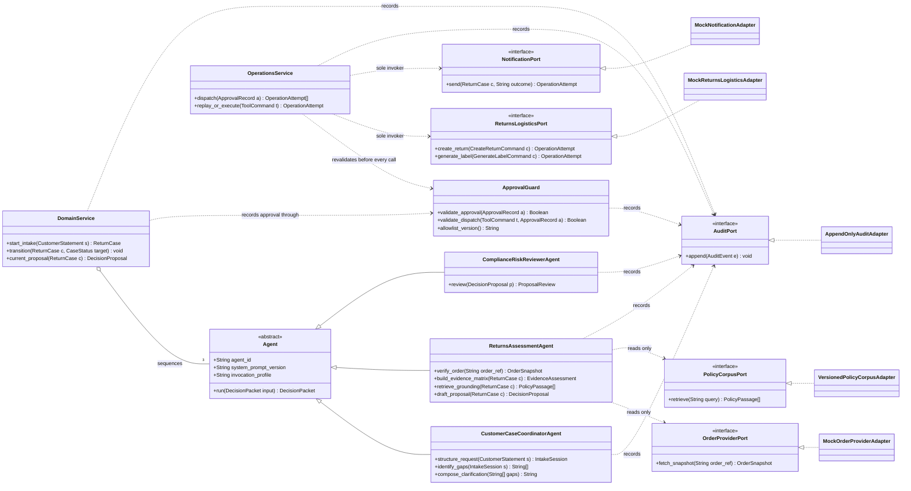

# Class Model - Domain Entities and Design-Time Structure

> **MBSE Model Type**: Structural Class Diagram  
> **Course Requirement**: System structure, domain entities, collaborations, interdependencies  
> **Baseline**: Three AI agents plus one deterministic Operations Service (`D-04`,
> [project definition](../00-project-definition-v1.md) sections 4.1 to 4.5 and 10.4)  
> **Traceability**: [FR-001 to FR-012 and NFR-001 to NFR-009](../04-requirements-and-backlog.md)

The model is in two parts. Section 1 is the **domain model**: the things the business talks about
and the system persists. Section 2 is the **design-time structure**: the components that act on
them, the interfaces they act through, and the authority boundaries between them. Generalization,
composition, aggregation and multiplicity appear in both parts; **interface realisation appears
only in section 2**, because the ports are a design-time concern and the domain entities have no
interfaces to realise.

---

## 1. Mermaid UML Class Diagram - domain entities

```mermaid
classDiagram
    direction TB

    class ReturnCase {
        +UUID case_id
        +DateTime created_at
        +DateTime updated_at
        +CaseStatus status
        +RequestType classified_request_type
        +get_latest_proposal() DecisionProposal
        +get_active_approval() ApprovalRecord
    }

    class Customer {
        +String customer_id
        +String name
        +String email
        +String phone
    }

    class OrderSnapshot {
        +String order_id
        +String order_number
        +String provider_id
        +String provider_version
        +DateTime captured_at
        +DateTime order_date
        +DateTime fulfillment_date
        +String payment_status
        +String fulfillment_status
        +Float total_amount
        +String currency
    }

    class LineItem {
        +String item_id
        +String sku
        +String title
        +Int quantity
        +Float unit_price
        +Boolean returnable
    }

    class CustomerStatement {
        +UUID statement_id
        +String raw_text
        +DateTime submitted_at
        +String extracted_order_number
        +String extracted_item_title
        +String claimed_issue
        +String requested_remedy
    }

    class IntakeSession {
        +UUID intake_session_id
        +UUID case_id_ref
        +IntakeStatus status
        +DateTime started_at
        +DateTime submitted_at
        +DateTime last_updated_at
        +Int clarification_round
        +String[] open_questions
        +Boolean minimum_information_present
        +record_statement(CustomerStatement s) void
        +outstanding_questions() String[]
    }

    class IntakeStatus {
        <<enumeration>>
        SUBMITTED
        AWAITING_CLARIFICATION
        COMPLETE
    }

    class EvidenceItem {
        +UUID evidence_id
        +EvidenceType type
        +String uri_or_content
        +String description
        +EvidenceVerificationStatus verification_status
        +DateTime uploaded_at
    }

    class EvidenceAssessment {
        +String criterion_id
        +EvidenceAssessmentStatus status
        +UUID[] evidence_refs
        +String conflict_summary
        +String follow_up_question
        +DateTime assessed_at
    }

    class PolicyDocument {
        <<abstract>>
        +String source_id
        +String source_version
        +String title
        +String content_hash
        +DateTime effective_at
        +DateTime curated_at
    }

    class StorePolicyDocument {
        +String store_id
    }

    class ApprovedGuidanceDocument {
        +String issuing_body
        +DateTime reviewed_at
    }

    class PolicyPassage {
        +String source_id
        +String source_version
        +String content_hash
        +String title
        +String url
        +String section
        +String text_snippet
        +Float confidence_score
        +DateTime retrieved_at
    }

    class DecisionProposal {
        +UUID proposal_id
        +Int proposal_version
        +String schema_version
        +RequestType request_type
        +RemedyType recommended_remedy
        +Float confidence_score
        +String rationale
        +String[] missing_information
        +RemedyType[] alternative_remedies
        +Float estimated_cost
        +Boolean requires_escalation
        +DateTime created_at
    }

    class RiskFinding {
        +UUID finding_id
        +RiskLevel risk_level
        +RiskCategory category
        +String reason
        +String suggested_action
        +DateTime detected_at
    }

    class ProposalReview {
        +UUID review_id
        +UUID proposal_id_ref
        +Int proposal_version
        +RiskDecision decision
        +String reviewer_prompt_version
        +Boolean consumed_generator_reasoning
        +DateTime reviewed_at
        +is_independent() Boolean
    }

    class ApprovalRecord {
        +UUID approval_id
        +UUID case_id
        +UUID proposal_id_ref
        +Int proposal_version
        +String authenticated_approver_id
        +ApprovalDecision decision
        +RemedyType optional_permitted_remedy
        +Float optional_max_approved_amount
        +String[] permitted_commands
        +String command_scope_hash
        +String notes
        +DateTime decided_at
        +DateTime expires_at
    }

    class ToolCommand {
        <<abstract>>
        +UUID command_id
        +UUID case_id
        +UUID proposal_id_ref
        +String idempotency_key
        +String tool_name
        +Dict parameters
        +String allowlist_version
        +ToolCommandStatus status
        +UUID approval_id_ref
        +Dict result
        +String error_message
        +DateTime created_at
        +DateTime executed_at
        +parameter_fingerprint() String
    }

    class CreateReturnCommand {
        +String[] line_item_ids
    }

    class GenerateLabelCommand {
        +String shipment_id
    }

    class OperationAttempt {
        +UUID attempt_id
        +UUID command_id_ref
        +Int attempt_number
        +String idempotency_key
        +OperationResult result
        +String typed_error
        +DateTime started_at
        +DateTime completed_at
    }

    class AuditEvent {
        +UUID event_id
        +UUID case_id
        +UUID correlation_id
        +DateTime timestamp
        +ActorType actor_type
        +String actor_id
        +String component_version
        +String source_version
        +String action
        +String outcome
        +String error_type
        +Boolean sensitive_content_redacted
        +CaseStatus previous_state
        +CaseStatus new_state
        +Dict payload
    }

    %% Relationships
    ReturnCase "1" *-- "1" Customer : references
    ReturnCase "1" *-- "0..1" OrderSnapshot : verified_from
    OrderSnapshot "1" *-- "1..*" LineItem : contains
    ReturnCase "1" o-- "0..1" LineItem : matched_item
    ReturnCase "1" *-- "1..*" CustomerStatement : preserves
    ReturnCase "1" *-- "0..*" EvidenceItem : includes
    ReturnCase "1" *-- "0..*" EvidenceAssessment : assesses
    ReturnCase "1" *-- "0..*" PolicyPassage : retrieved_grounds
    ReturnCase "1" *-- "0..*" DecisionProposal : produces
    ReturnCase "1" *-- "0..*" RiskFinding : flags
    ReturnCase "1" *-- "0..*" ApprovalRecord : authorizes
    ReturnCase "1" *-- "0..*" ToolCommand : dispatches
    ReturnCase "1" *-- "1..*" AuditEvent : logs_to
    
    DecisionProposal "1" o-- "0..*" PolicyPassage : cites
    PolicyDocument "1" *-- "1..*" PolicyPassage : contains
    EvidenceAssessment "0..*" o-- "0..*" EvidenceItem : references
    DecisionProposal "1" <-- "0..*" ApprovalRecord : decides_version
    ApprovalRecord "1" <-- "0..*" ToolCommand : authorised_by

    %% Lifecycle subjects of the three individual behaviour models
    ReturnCase "1" *-- "1" IntakeSession : originates_from
    ReturnCase "1" *-- "0..*" ProposalReview : reviews
    IntakeSession "1" o-- "1..*" CustomerStatement : gathers
    IntakeSession ..> IntakeStatus : status
    DecisionProposal "1" <-- "0..*" ProposalReview : reviews_version
    ProposalReview "1" o-- "0..*" RiskFinding : raises
    ToolCommand "1" *-- "0..*" OperationAttempt : attempted_by

    %% Generalization
    PolicyDocument <|-- StorePolicyDocument
    PolicyDocument <|-- ApprovedGuidanceDocument
    ToolCommand <|-- CreateReturnCommand
    ToolCommand <|-- GenerateLabelCommand
```

---

## 2. Design-Time Structure

The components that act on the domain model, the interfaces they act through, and the authority
boundaries between them. Every name comes from
[project definition](../00-project-definition-v1.md) sections 4.1 to 4.5, 9, 10.4 and 11.1.

### What this diagram is asserting, and where each claim comes from

| Claim | Source |
|---|---|
| Exactly three concrete agents specialise one abstract `Agent` | `D-04`; definition sections 4.1 to 4.3 |
| What the three actually share, and so what the generalization carries: a versioned system prompt, a separate invocation, and one typed packet in and out. `run` is that contract; the methods listed on each subclass are the work it does inside it | Section 4.3 - *"uses a separate model invocation and system prompt"* |
| `OperationsService` is not an `Agent` and inherits nothing from it | Section 4.5 - *"not a free-deciding AI agent"* |
| No agent reaches `ReturnsLogisticsPort` or `NotificationPort` | Section 10.4 invariants 1 and 2 |
| `ReturnsAssessmentAgent` may reach `OrderProviderPort` - a read is not an operation | Section 4.2; section 9 `UC-02` supporting actor |
| `ApprovalGuard` sits between `DomainService` and `OperationsService`, and is revalidated at dispatch | Section 10.4 invariant 3 |
| Every material component depends on `AuditPort` | Section 10.4 invariant 5 |
| Providers sit behind interfaces so they can be replaced | [System design](../02-system-design.md) section 1, driver 5 |

---

## 3. Association Types Used

The criteria mark this model on *"proper use of associations such as generalization, composition,
aggregation, interfaces, multiplicity"*. Each is used where it is the correct relationship, not
for the sake of appearing:

| Type | Notation | Where, and why that relationship |
|---|---|---|
| **Generalization** | `<\|--` | `PolicyDocument` into store policy and approved guidance, because invariant 6 gives them different authority; `ToolCommand` into `CreateReturnCommand` and `GenerateLabelCommand`, because they carry different parameters and the sequence model already branches on them; one abstract `Agent` into the three roles of `D-04` |
| **Interface realisation** | `<\|..` with `<<interface>>` | Five ports. Each has exactly one mock adapter for the course prototype, which is the point: the port is what the design depends on and the adapter is replaceable |
| **Composition** | `*--` | Whole-part where the part cannot outlive the whole - a `ReturnCase` and its `IntakeSession`, a `ToolCommand` and its `OperationAttempt` records |
| **Aggregation** | `o--` | Reference without ownership - an `IntakeSession` gathers `CustomerStatement`s that the `ReturnCase` owns; `DomainService` sequences agents it does not own |
| **Multiplicity** | `"1"`, `"0..*"`, `"1..*"`, `"3"` | On every domain association, and on `DomainService o-- "3" Agent`, where the number is the decision `D-04` made |

---

## 4. Multiplicity and Invariants

1. **Proposal Version Binding**: An `ApprovalRecord` refers to exactly one current `DecisionProposal` ID and version for the same `ReturnCase`.
2. **Decision Does Not Always Grant Authority**: Reject, revision, and escalation decisions have an empty command set. Only an approved decision may contain remedy, amount, command, and expiry scope.
3. **Complete Dispatch Guard**: Every high-impact `ToolCommand` must match an unexpired approved record for the same case and current proposal, authenticated actor, command set, parameters/amount, and allowlist version.
4. **Idempotent Effect**: `idempotency_key` is unique per logical command effect. A prior successful command is returned rather than executed again.
5. **Audit Immutability and Reproducibility**: `AuditEvent` entries are append-only and retain correlation, component/source version, outcome, typed error, and redaction status.
6. **Guidance Conflict Safety**: `StorePolicyDocument` and `ApprovedGuidanceDocument` are distinct subtypes of `PolicyDocument`; neither authorises the AI to make a final legal determination. Conflicting store-policy and approved-guidance passages remain visible, create a `RiskFinding`, and route the proposal to human review. *(This replaces the earlier `source_type` string. A type code that changes what a document is allowed to do is a subclass, and modelling it as one lets the constraint be stated on the type rather than in a comment.)*
7. **Untrusted Content Boundary**: Customer, evidence, and retrieved text is data only. It cannot populate trusted approver identity, permitted commands, allowlist version, or workflow policy.
8. **One Intake Session Per Case**: A `ReturnCase` originates from exactly one `IntakeSession`, which owns the clarification loop. `minimum_information_present` is the only condition that lets the case leave intake, and every clarification round appends a `CustomerStatement` rather than overwriting the original.
9. **Review Independence**: A `ProposalReview` binds one `DecisionProposal` ID and version, uses a separate `reviewer_prompt_version` from the proposal generator, and `consumed_generator_reasoning` is always false. A review of a superseded proposal version does not authorise approval.
10. **Attempts Are Recorded, Not Overwritten**: Each `ToolCommand` owns an ordered list of `OperationAttempt` records sharing one `idempotency_key`. A prior `SUCCEEDED` attempt is replayed rather than repeated, and a failed attempt is never deleted to make the plan look complete.

### The three lifecycle subjects, and who models each

`IntakeSession`, `ProposalReview` and `OperationAttempt` exist here because section 10.3 assigns
one state machine per member and each names one of them as its subject. The entities are shared
model, so they belong in this diagram; **each member draws their own lifecycle**:

| Subject | State machine | Member |
|---|---|---|
| `IntakeSession` | IntakeSession Lifecycle | B - `AH-01` to `UC-01` |
| `ProposalReview` | ProposalReview Lifecycle | C - `AH-08` to `UC-02` |
| `OperationAttempt` | OperationAttempt / Execution Lifecycle | A - `AH-10` to `UC-04` |

The attribute sets above are a starting point that makes each lifecycle drawable, not a finished
design. Whoever owns the state machine should expect to add to their own entity.

**`IntakeStatus` is narrower than `CaseStatus`, and deliberately not spelled the same.** It has
three values: `SUBMITTED` where a lodged request begins, `AWAITING_CLARIFICATION` for the
clarification loop section 4.1 gives the Coordinator, and `COMPLETE` for the
`minimum_information_present` condition that the [sequence diagram](03-sequence-diagram.md) uses
to leave intake. The reason it is not simply `CaseStatus` is scope: the committed
[ReturnCase state machine](02-state-machine-diagram.md) reaches `AWAITING_INFORMATION` from
**two** places — after `SUBMITTED`, and again after `POLICY_ASSESSMENT` when diagnostic evidence
is missing — and only the first of those is inside an intake session. Sharing the spelling would
have implied the two move together, which they do not.

**Anything beyond those three values — a draft before submission, a timeout when the customer
never replies, an abandoned session — is a design decision for whoever draws the lifecycle**, and
is not pre-empted here. `IntakeStatus` is also the only enumeration drawn as its own box in either
section; the other eleven are left as attribute types because they are already defined in
`packages/domain/enums.py` or in section 5's vocabulary table, whereas this one is new to the
model and is the subject of an individually assessed state machine.

Two relationships were **changed** rather than added, and both are open to challenge:

- `RiskFinding` was reachable from `DecisionProposal` directly. It is now raised by a
  `ProposalReview`, because a finding is the output of a review and not a property of the
  proposal. `ReturnCase` still owns findings; the review references them.
- `CustomerStatement` keeps its composition to `ReturnCase` **and** gains an aggregation from
  `IntakeSession`. That is deliberate, not redundant: the case owns every statement it ever
  receives, including clarifications requested later at the evidence stage, while the session
  aggregates only the ones it gathered during intake.
