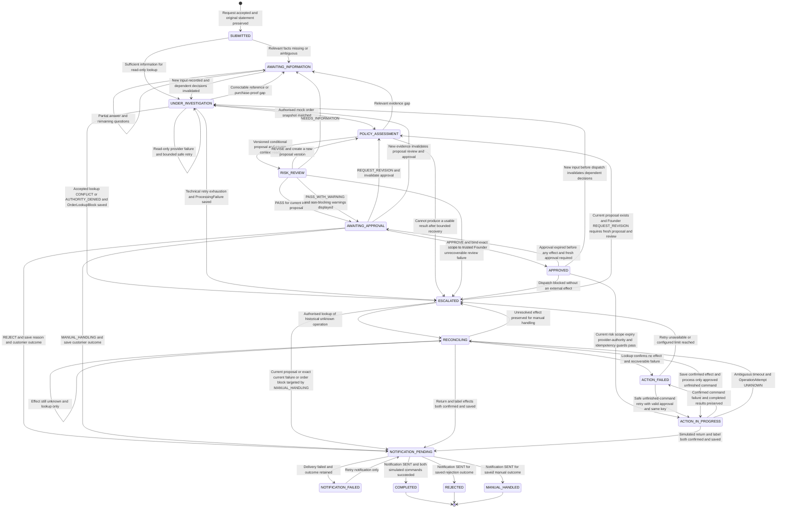

# State Machine Diagram (ReturnCase Lifecycle)

> **Status — 2026-09-07:** v1 alignment draft; Member B/C review remains pending.
> Local `1.0.0-rc.3` candidate for [KAN-32](https://lucastaooo.atlassian.net/browse/KAN-32), not accepted. [PR #9](https://github.com/shuxiachai/returnops-au/pull/9) is the rc.2 historical publication.
> Earlier modelling contributions and their Git history are retained. This
> revision does not claim product-baseline adoption, F.01 acceptance, or a
> running implementation.
>
> **MBSE model type:** Shared behavioural state machine for `ReturnCase`.
> **Traceability:** [v1.0 candidate, FR-001–FR-012 and NFR-002/004/009](../00-project-definition-v1.md).
> **Ownership:** [Frozen allocation and individual model chains](../07-frozen-work-allocation.md).

## 1. Shared lifecycle model

**Domain Service alone commits authoritative case transitions.** AI roles return
typed analysis; API, orchestration, and the deterministic Operations Service
submit results/events for Domain Service to validate and persist. Arrows below
describe guarded business transitions, not permission for an AI or provider
adapter to write case state directly.

This shared overview does not replace the three individual state-machine
subjects: A's `OperationAttempt`, B's `IntakeSession`, and C's `ProposalReview`.

`UNKNOWN` belongs to an individual `OperationAttempt`; it is not a case state.
The case's `RECONCILING` state reflects lookup of that attempt while its result
is unknown. A historical-status lookup may remain authorised after execution
approval expires; it does not authorise a new command, a replay, or continuation
under an expired approval.

## 2. Guard conditions and invariants

| Boundary | Required guard or rule |
|---|---|
| Intake and clarification — FR-001/002 | Preserve the original customer statement. An order number and desired remedy are not universally mandatory at initial submission. Ask targeted questions and allow relevant alternative purchase proof; do not invent an arbitrary ten-character gate. |
| Order lookup — FR-003 | Distinguish match, correctable missing information, confirmed conflict, authority denial, and provider failure. A timeout never becomes an invented matched order. Retry only read-only lookup within a configured bound. |
| Assessment — FR-005/006/007 | Keep customer claims, verified facts, evidence gaps, citations, and uncertainty distinct. A versioned conditional packet can report missing or conflicting grounding; packet creation alone is not approval eligibility. |
| Risk gate — FR-008 | Only a current-input/current-proposal `PASS` or `PASS_WITH_WARNING` supports approval. The other results are `REVISE`, `NEEDS_INFORMATION`, and `ESCALATE`. A single confidence threshold is not a substitute for these decisions and findings. |
| Escalation recovery — FR-003/008/009 | Founder cannot approve an escalated proposal directly. REQUEST_REVISION requires a current proposal and creates a new version needing a fresh passing review. Without a current proposal, exactly one current ProcessingFailure or OrderLookupBlock is required; only MANUAL_HANDLING can target it. No no-proposal revision/restart endpoint is added. |
| Founder approval — FR-009 | Bind authenticated Founder identity, case/input/proposal/review versions, exact commands and parameter fingerprint, applicable amount ceiling, reason, and expiry. Record `APPROVE`, `REJECT`, `REQUEST_REVISION`, or `MANUAL_HANDLING` distinctly. |
| Dispatch — FR-010, NFR-002/009 | Recheck current passing review, valid approval, parameter scope, provider authority, allowlist, and stable command idempotency before each new effect. Course commands are simulated `CREATE_RETURN` and `GENERATE_LABEL`, not refunds, charges, or inventory changes. |
| Provider result — FR-010/011 | HTTP 200 alone is not business success. Validate the typed business result, operation identity, and scope, then ask Domain Service to save the result before advancing the workflow. |
| Partial failure and unknown effect — NFR-004 | Preserve completed commands. Query an `UNKNOWN`/`RECONCILING` attempt before considering retry; retry only a confirmed-safe unfinished command with the same idempotency key and valid approval. Never replay a successful return because its label or notification failed. |
| New information — FR-002/009 | New decision-relevant input invalidates dependent proposal/review/approval before further effects. It never erases an already produced result or an unresolved effect; in-flight effects must be reconciled rather than treated as not executed. |
| Notifications and terminal states — FR-009/010/011 | Keep notification status separate from command status. Return completion requires saved successful return and label results plus `SENT` notification. A rejection/manual outcome is likewise terminal only after its own successful notification; notification retry causes no operational replay. |
| Manual closure — FR-009/011 | Persist the actual outcome and any unresolved operation uncertainty. `MANUAL_HANDLED` must not assert that an unknown provider effect did not happen or permit automatic resubmission of that operation. |
| No-proposal manual target — FR-003/009/011 | Domain Service checks trusted Founder identity, expected case version, ESCALATED state, no current proposal and exact case/input/current failure or block ID. OrderLookupBlock can represent only an accepted pre-proposal lookup CONFLICT/AUTHORITY_DENIED; it cannot replace a technical error or source-policy conflict. Create only audited outcome/notification work; do not create approval/commands or erase historical effects. A retained resolved target after notification processing is readable, not newly actionable. |

## 3. Verification and implementation boundary

A implements and self-tests lifecycle, approval, and operation guards; B
self-tests the corresponding UI behaviours; C self-tests retrieval/risk and
coordinates cross-system evaluation. The [work packages](../08-delivery-work-packages.md)
define the individual deliverables and cross-review responsibilities.

This is a modelling draft, not proof that runtime guards exist. In particular,
the Founder manual path **before any current proposal exists** distinguishes
actual technical `ProcessingFailure` from an accepted order `CONFLICT` or
`AUTHORITY_DENIED` stored as `OrderLookupBlock`. Neither needs a fabricated
proposal, review or technical error. The [F.01 rc.3 candidate](../09-interface-contract-v1.md)
defines both manual-only targets; runtime state checks and joint contract/model
acceptance remain outstanding. Source-policy conflicts continue through a
conditional packet and independent Risk, not through an order-block shortcut.
