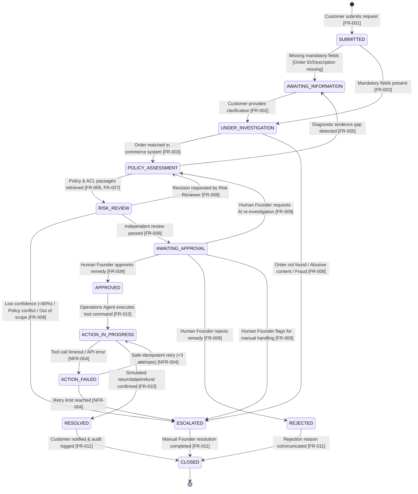

# State Machine Diagram (ReturnCase Lifecycle)

> **MBSE Model Type**: Dynamic Behavioral State Machine  
> **Course Requirement**: System lifecycle processes, component states, exceptions, guard conditions  
> **Traceability**: [FR-001 ~ FR-012](file:///d:/AAA树下/硕士/26S2/5620/assignment/returnops-au/docs/04-requirements-and-backlog.md), [NFR-002, NFR-004](file:///d:/AAA树下/硕士/26S2/5620/assignment/returnops-au/docs/04-requirements-and-backlog.md)

---

## 1. Mermaid State Machine Model

---

## 2. Transition Guard Conditions & Invariants Table

| Source State | Target State | Trigger Event | Guard Condition / Rule |
| :--- | :--- | :--- | :--- |
| `SUBMITTED` | `UNDER_INVESTIGATION` | `IntakeCompleted` | `order_number != None` and `raw_text.length >= 10` |
| `SUBMITTED` | `AWAITING_INFORMATION` | `IntakeIncomplete` | `order_number == None` or ambiguous product name |
| `UNDER_INVESTIGATION` | `POLICY_ASSESSMENT` | `OrderLookupSuccess` | Order exists in Shopify, customer identity verified |
| `POLICY_ASSESSMENT` | `RISK_REVIEW` | `ProposalGenerated` | Proposal has $\ge 1$ cited policy/ACL passage |
| `RISK_REVIEW` | `AWAITING_APPROVAL` | `RiskReviewPassed` | No unverified claims, confidence $\ge 0.80$, no abuse flag |
| `AWAITING_APPROVAL` | `APPROVED` | `FounderApprove` | `ApprovalRecord` created with approver ID & scoped command |
| `APPROVED` | `ACTION_IN_PROGRESS` | `DispatchCommand` | `ToolCommand.approval_id_ref == active_approval.approval_id` |
| `ACTION_IN_PROGRESS` | `RESOLVED` | `ToolExecutionSuccess` | External API returns HTTP 200 / success payload |
