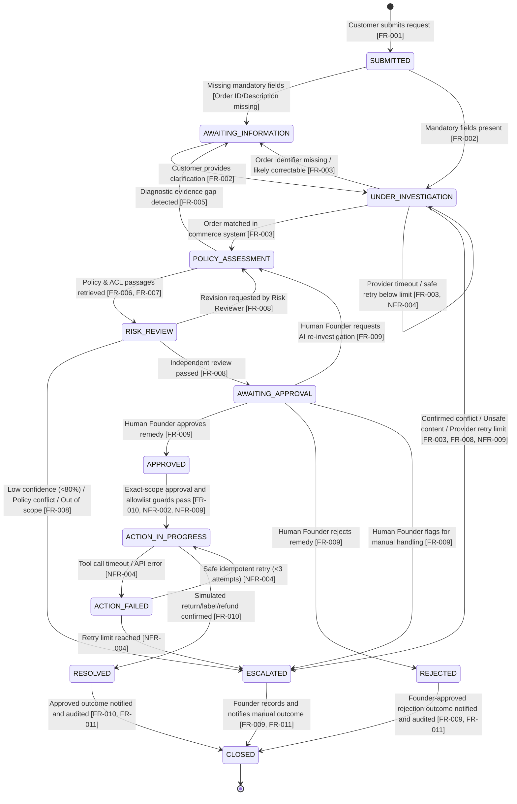

# State Machine Diagram (ReturnCase Lifecycle)

> **MBSE Model Type**: Dynamic Behavioral State Machine  
> **Course Requirement**: System lifecycle processes, component states, exceptions, guard conditions  
> **Traceability**: [FR-001 to FR-012; NFR-002, NFR-004, and NFR-009](../04-requirements-and-backlog.md)

---

## 1. Mermaid State Machine Model

---

## 2. Transition Guard Conditions & Invariants Table

| Source State | Target State | Trigger Event | Guard Condition / Rule |
| :--- | :--- | :--- | :--- |
| `SUBMITTED` | `UNDER_INVESTIGATION` | `IntakeCompleted` | `order_number != None` and `raw_text.length >= 10` |
| `SUBMITTED` | `AWAITING_INFORMATION` | `IntakeIncomplete` | `order_number == None` or ambiguous product name |
| `UNDER_INVESTIGATION` | `POLICY_ASSESSMENT` | `OrderLookupSuccess` | Order exists in Shopify, customer identity verified |
| `UNDER_INVESTIGATION` | `AWAITING_INFORMATION` | `OrderLookupNeedsCorrection` | Order identifier is missing, malformed, or plausibly mistyped; no confirmed mismatch |
| `UNDER_INVESTIGATION` | `ESCALATED` | `OrderConflictConfirmed` | A conflict, suspected abuse, or unsafe content remains after clarification |
| `UNDER_INVESTIGATION` | `UNDER_INVESTIGATION` | `OrderProviderRetry` | Provider failure is auditable, no snapshot is invented, and retry count remains below the configured limit |
| `UNDER_INVESTIGATION` | `ESCALATED` | `OrderProviderRetryLimitReached` | Provider failure remains after the configured retry limit |
| `POLICY_ASSESSMENT` | `RISK_REVIEW` | `ProposalGenerated` | Proposal has $\ge 1$ cited policy/ACL passage |
| `RISK_REVIEW` | `AWAITING_APPROVAL` | `RiskReviewPassed` | No unsupported claim, citation/source conflict, prompt injection, out-of-scope result, or unresolved high-risk finding; confidence $\ge 0.80$ |
| `AWAITING_APPROVAL` | `APPROVED` | `FounderApprove` | Trusted actor is authorised; case and proposal version are current; exact command set, amount limit, reason, and expiry are complete |
| `APPROVED` | `ACTION_IN_PROGRESS` | `DispatchCommand` | Approval decision is approved, unexpired, and bound to this case and current proposal; every typed command and amount exactly matches scope, is allowlisted, and has a stable idempotency key |
| `ACTION_IN_PROGRESS` | `RESOLVED` | `ToolExecutionSuccess` | External API returns HTTP 200 / success payload |
