# Sequence Diagram - Multi-Agent Governed Execution

> **MBSE model type**: Dynamic behavioural sequence diagram
>
> **Course requirement**: Agent collaboration, normal and failure paths,
> human-in-the-loop authority, and typed tool invocation
>
> **Traceability**:
> [FR-001 to FR-012; NFR-001 to NFR-009](../04-requirements-and-backlog.md)

## 1. Mermaid sequence model

```mermaid
sequenceDiagram
    autonumber
    actor Customer
    actor Founder as Authorised Founder
    participant Portal as Customer Portal
    participant API as ReturnOps API
    participant Orch as Workflow Orchestrator
    participant Intake as Intake Agent
    participant Order as Order Agent
    participant Evidence as Evidence Assessor
    participant Policy as Policy Agent
    participant Remedy as Remedy Planner
    participant Risk as Risk Reviewer
    participant Rules as Approval and Tool Rules
    participant Ops as Operations Agent
    participant Commerce as Mock Commerce Adapter
    participant Logistics as Mock Logistics Adapter
    participant Notify as Simulated Notification Adapter
    participant DB as Case and Audit Store

    Customer->>Portal: Submit return/remedy request
    Portal->>API: Create case with message, order ID, and evidence metadata
    API->>DB: Persist original statement and SUBMITTED case
    API->>Orch: Start intake for case ID
    Orch->>Intake: Extract typed facts and missing fields
    Intake-->>Orch: Facts, confidence, and open questions

    alt Mandatory information missing
        Orch->>DB: Set AWAITING_INFORMATION and append audit event
        Orch->>Notify: Send targeted information request
        Notify-->>Customer: Request only missing facts/evidence
    else Minimum information present
        Orch->>DB: Set UNDER_INVESTIGATION
        Orch->>Order: Verify order through provider interface
        Order->>Commerce: Query read-only order snapshot

        alt Provider failure below retry limit
            Commerce-->>Order: Typed timeout/provider failure
            Order-->>Orch: No snapshot, safe retry requested
            Orch->>DB: Keep authoritative state, audit retry count
        else Provider retry limit reached
            Commerce-->>Order: Repeated typed provider failure
            Order-->>Orch: Retry limit reached, no snapshot invented
            Orch->>DB: Set ESCALATED with provider-failure reason
            Orch-->>Founder: Manual handling packet with failure history
        else Order identifier missing or plausibly mistyped
            Commerce-->>Order: Not found with no confirmed mismatch
            Order-->>Orch: Clarification required
            Orch->>DB: Set AWAITING_INFORMATION
            Orch->>Notify: Send order-correction question
            Notify-->>Customer: Request corrected order detail
        else Confirmed order/customer conflict
            Commerce-->>Order: Conflicting verified facts
            Order-->>Orch: Confirmed conflict risk
            Orch->>DB: Set ESCALATED with both fact sources
            Orch-->>Founder: Manual handling packet
        else Order matched
            Commerce-->>Order: Versioned read-only OrderSnapshot
            Order-->>Orch: Verified order and affected line item
            Orch->>DB: Set POLICY_ASSESSMENT and append order-match event
            Orch->>Evidence: Assess required, present, missing, and conflicting evidence
            Evidence-->>Orch: Versioned EvidenceAssessment matrix with source references

            alt Required diagnostic evidence is missing
                Orch->>DB: Set AWAITING_INFORMATION with explicit evidence gaps
                Orch->>Notify: Send targeted diagnostic-evidence questions
                Notify-->>Customer: Request only the missing diagnostic evidence
            else Evidence assessment is ready
                Orch->>Policy: Retrieve approved grounding
                Policy->>DB: Query versioned store-policy and guidance corpus
                DB-->>Policy: Passages with source, version, and location
                Policy-->>Orch: Cited passages and source-conflict flags
                Orch->>Remedy: Draft non-executable typed proposal
                Remedy-->>Orch: Proposal version, alternatives, confidence, and questions
                Orch->>Risk: Verify evidence, citations, conflicts, and untrusted content

                alt Source conflict, unsupported claim, injection, or unresolved high risk
                    Risk-->>Orch: Escalate with findings and preserved sources
                    Orch->>DB: Set ESCALATED and append review evidence
                    Orch-->>Founder: Manual handling packet, no approval request
                else Independent review passes
                    Risk-->>Orch: Pass for current proposal version
                    Orch->>DB: Set AWAITING_APPROVAL
                    Orch-->>Founder: Present current proposal, evidence, citations, and risks
                    Founder->>Portal: Approve exact action plan for current proposal
                    Portal->>API: Submit trusted session, proposal version, commands, amount, reason, expiry
                    API->>Rules: Validate actor, role, state, case, proposal, scope, amount, expiry
                    Rules->>DB: Load authoritative proposal, approval state, and allowlist
                    DB-->>Rules: Current records
                    Rules-->>API: Exact-scope approval is valid
                    API->>DB: Append immutable ApprovalRecord, set APPROVED, append audit event
                    API->>Orch: Resume with trusted approval reference
                    Orch->>Ops: Dispatch approved plan with trusted approval reference
                    Ops->>Rules: Revalidate case, proposal, command set, amount, expiry, and allowlist

                    alt Dispatch guard is invalid or stale
                        Rules-->>Ops: Block before every provider call
                        Ops->>DB: Keep APPROVED and append BLOCKED_NO_APPROVAL security event
                        Ops-->>Founder: Show exact blocking reason
                    else Complete dispatch guard passes
                        Rules-->>Ops: Exact approved plan may enter execution
                        Ops->>DB: Set ACTION_IN_PROGRESS and append dispatch audit event

                        loop Each approved command in dependency order while ACTION_IN_PROGRESS
                            Ops->>DB: Load prior result for command and stable idempotency key
                            DB-->>Ops: Prior success or unfinished status

                            alt Prior successful result exists
                                Ops->>DB: Reuse stored result and audit skipped duplicate call
                            else Command remains unfinished
                                Ops->>Rules: Validate exact command, parameters, approval, and key
                                Rules-->>Ops: Command remains allowlisted and exactly approved

                                alt Command is CREATE_RETURN
                                    Ops->>Commerce: Invoke CREATE_RETURN with stable key
                                    Commerce-->>Ops: Success result or typed provider failure
                                else Command is GENERATE_LABEL
                                    Ops->>Logistics: Invoke GENERATE_LABEL with stable key
                                    Logistics-->>Ops: Success result or typed provider failure
                                end

                                alt Provider reports success
                                    Ops->>DB: Persist successful result before next command
                                else Provider timeout or typed failure
                                    Ops->>DB: Set ACTION_FAILED with command, key, and failure
                                    loop Safe retry remains and case is not escalated
                                        Ops->>Rules: Revalidate same approval, command, and key
                                        Rules-->>Ops: Retry remains exact-scope and allowlisted
                                        alt Failed command is CREATE_RETURN
                                            Ops->>Commerce: Retry only CREATE_RETURN with the same key
                                            Commerce-->>Ops: Typed retry result
                                        else Failed command is GENERATE_LABEL
                                            Ops->>Logistics: Retry only GENERATE_LABEL with the same key
                                            Logistics-->>Ops: Typed retry result
                                        end
                                        Ops->>DB: Persist each retry result without repeating prior success
                                    end
                                    alt Retry eventually succeeds
                                        Ops->>DB: Persist success and restore ACTION_IN_PROGRESS
                                    else Retry limit reached
                                        Ops-->>Orch: Escalate with completed and failed command results
                                        Orch->>DB: Set ESCALATED, preserve all prior successful results
                                        Orch-->>Founder: Manual recovery packet
                                    end
                                end
                            end
                        end

                        Ops->>DB: Check every approved command has one successful result
                        DB-->>Ops: Complete or incomplete plan status
                        opt All approved commands are complete and case is not escalated
                            Ops-->>Orch: Approved action plan complete once
                            Orch->>DB: Set RESOLVED
                            Orch->>Notify: Send approved outcome and return instructions

                            alt Notification delivered
                                Notify-->>Customer: Approved next step and simulated label
                                Notify-->>Orch: Delivery result
                                Orch->>DB: Append delivery event and set CLOSED
                            else Notification failure
                                Notify-->>Orch: Typed delivery failure
                                Orch->>DB: Keep RESOLVED and schedule notification-only retry
                            end
                        end
                    end
                end
            end
        end
    end
```

## 2. Architectural checks demonstrated

1. **Uncertainty is a normal branch**: missing facts, order/provider failure,
   source conflict, unsupported claims, and prompt injection do not fall through
   to approval.
2. **Human authority is exact**: the trusted founder approves the current
   proposal and explicit command set with applicable amount and expiry.
3. **Dispatch revalidates authority**: every typed command is checked against
   case, proposal, approval, allowlist, scope, and idempotency key before use.
4. **Partial and repeated work is safe**: results persist per command, retries
   reuse the same key, and a prior success is never executed again.
5. **Notification is independent**: message retry cannot repeat a remedy, and a
   delivery failure leaves the completed operation visible in `RESOLVED`.
