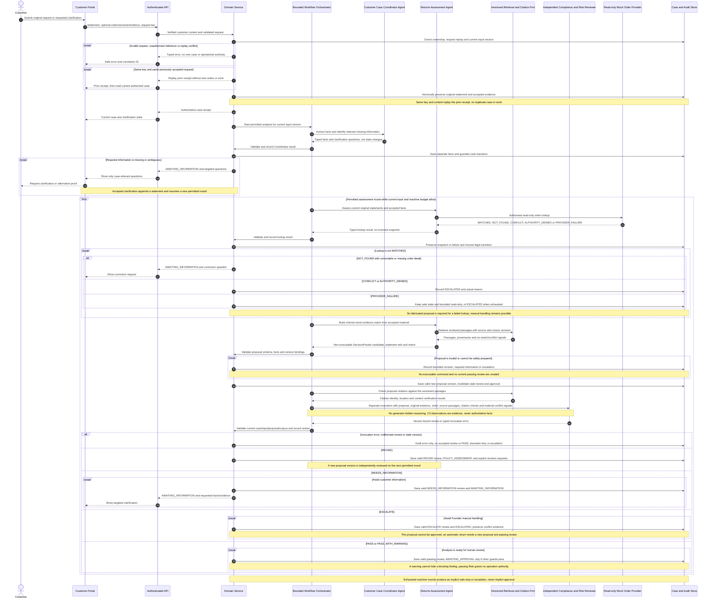
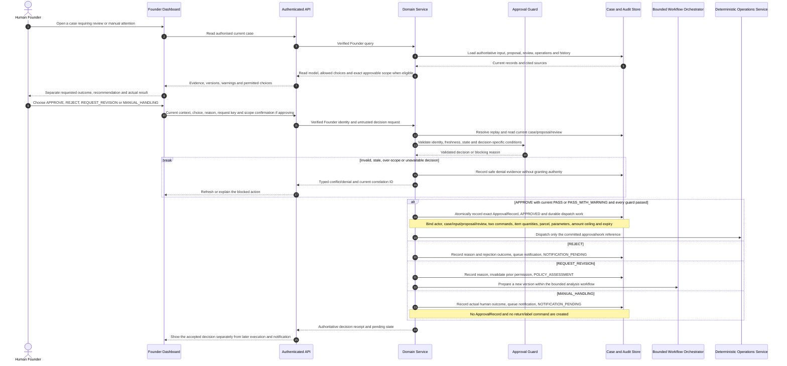
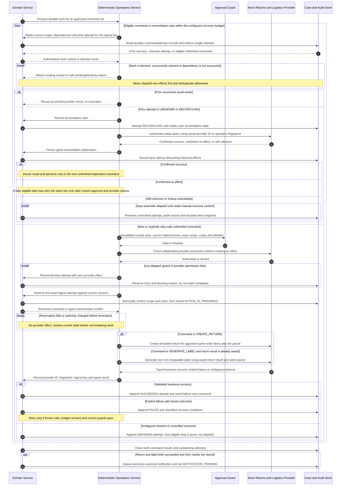
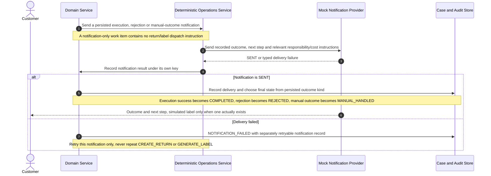

# Shared Interactions - Assessment, Decisions and Governed Execution

> **Status:** Shared design candidate aligned to [docs/00](../00-project-definition-v1.md)
> and [docs/07](../07-frozen-work-allocation.md); not runtime or individual-model
> completion evidence.
> **Local synchronisation:** 2026-09-07, pending review rather than an adoption date.
> **Traceability:** FR-001–FR-012; NFR-001–NFR-009; UC-01/01E–UC-05;
> shared model review plus M-A/M-B/M-C in [docs/08](../08-delivery-work-packages.md).

The original Lab 3 interactions are retained and corrected using Member B
`@ChengsiLi`'s three-role naming, separate Founder Dashboard, Domain Service and
deterministic Operations Service from [PR #8](https://github.com/shuxiachai/returnops-au/pull/8)
(`origin/docs/6-baseline-uml-rebaseline`, locally inspected). Reuse does not
claim that PR #8 was merged, transfer its authorship, or complete the three
members' separately authored activity/sequence/state-machine chains.

The former single long diagram is divided at persisted hand-offs so each
branch can be reviewed. All business writes shown below go through Domain
Service; the orchestrator chooses bounded AI work and submits results for
validation. Messages are conceptual operations, not promises that F.01 already
implements each route. The separately revised rc.2 contract still needs joint
review and cannot replace docs/00 or docs/07 as the product/allocation baseline.

## 1. Intake, grounding and the five risk outcomes

The order lookup is a read. Only Operations Service may invoke return or label
operations. `CaseLineItem` selections refer to one order and a single planned
parcel; selecting multiple items does not create multiple shipments. Original
customer requests, extracted fields and the recommendation remain independently
stored. The UI reads server-confirmed state and never accepts an agent's text
as an authoritative transition.

## 2. Founder review and four decisions

An ESCALATED proposal cannot take the APPROVE branch. REQUEST_REVISION may
start a new assessment; the revised proposal must pass independent Risk again.
A failure before any valid proposal can still require recorded manual handling.
That no-proposal request shape is defined in the
[F.01 rc.2 candidate](../09-interface-contract-v1.md), pending joint review:
this conceptual interaction is not evidence of a working endpoint and must not
be implemented by manufacturing an approvable proposal. Exact approval and provider permissions
are separate requirements; the browser cannot create a trusted ApprovalRecord.

## 3. Execution, idempotency and unknown-result reconciliation

UNKNOWN and RECONCILING describe `OperationAttempt` results; the case may expose
RECONCILING while those attempts are checked. HTTP success alone is not proof
of a successful business effect. An expired or superseded approval cannot permit
a new effect, but authorised lookup may still establish what an earlier attempt
actually did. Unresolved partial execution preserves successful steps and never
restarts the whole plan. Recovery budget exhaustion stays visible and requires
manual attention instead of pretending the case succeeded.

Durable claiming, approval freshness at invocation, crash recovery and provider
idempotency are implementation obligations of A1/A2, not guarantees supplied by
Mermaid. A3 may replace the mock adapter only with verified no-charge test access
and the same rules. Its independent integration remains a selected optional
course feature, not another claim for the core mock/retry implementation.

## 4. Independent outcome notification

COMPLETED requires saved return and label success plus notification delivery.
REJECTED and MANUAL_HANDLED do not count as successful simulated operations.
A generic request for more information is not a final outcome notification and
does not close the case. Founder and customer views obtain their authorised
read models through the API; an accepted decision or HTTP 202 is not completion.

## 5. Review checklist and contribution boundary

- Trace one complete case, one clarification, each of the five Risk outcomes,
  and each of the four Founder decisions through persisted hand-offs.
- For stale/expired/wrong-scope decisions and denied provider authority, verify
  that the first business-effect call is never reached.
- For duplicate, partial and unknown results, identify the durable key, claim,
  provider fingerprint, saved result and query-before-retry step.
- For notification failure, show that only notification work repeats and the
  case remains pending rather than entering a false completed state.
- Verify all state writes originate at Domain Service and all operational
  provider calls originate at Operations Service. AI results remain untrusted
  typed input to deterministic validation.
- Attach actual reviews and eventual model-to-code traces. These shared diagrams
  do not replace A's AH-10, B's AH-01 or C's AH-08 personal three-diagram chains,
  and they do not supply the runtime Composite Structure Diagram.
