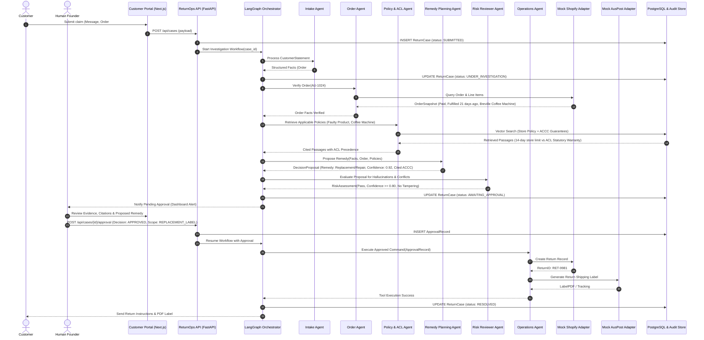

# Sequence Diagram (Multi-Agent Governed Execution)

> **MBSE Model Type**: Dynamic Behavioral Sequence Diagram  
> **Course Requirement**: Agent-to-agent collaboration, human-in-the-loop gate, tool invocation  
> **Traceability**: [FR-001 ~ FR-012](file:///d:/AAA树下/硕士/26S2/5620/assignment/returnops-au/docs/04-requirements-and-backlog.md)

---

## 1. Mermaid Sequence Diagram

---

## 2. Key Architectural Highlights in the Sequence

1. **Deterministic State Synchronization**: Every agent step synchronizes its output to PostgreSQL via typed Pydantic contracts.
2. **Explicit Human Intervention**: The Orchestrator halts between Step 17 and Step 19, transitioning the case to `AWAITING_APPROVAL`. It only resumes upon receipt of a validated `ApprovalRecord`.
3. **Idempotent Tool Execution**: Step 21 and 23 attach a unique `idempotency_key` ensuring duplicate clicks by the founder do not issue double refunds or redundant shipping labels.
