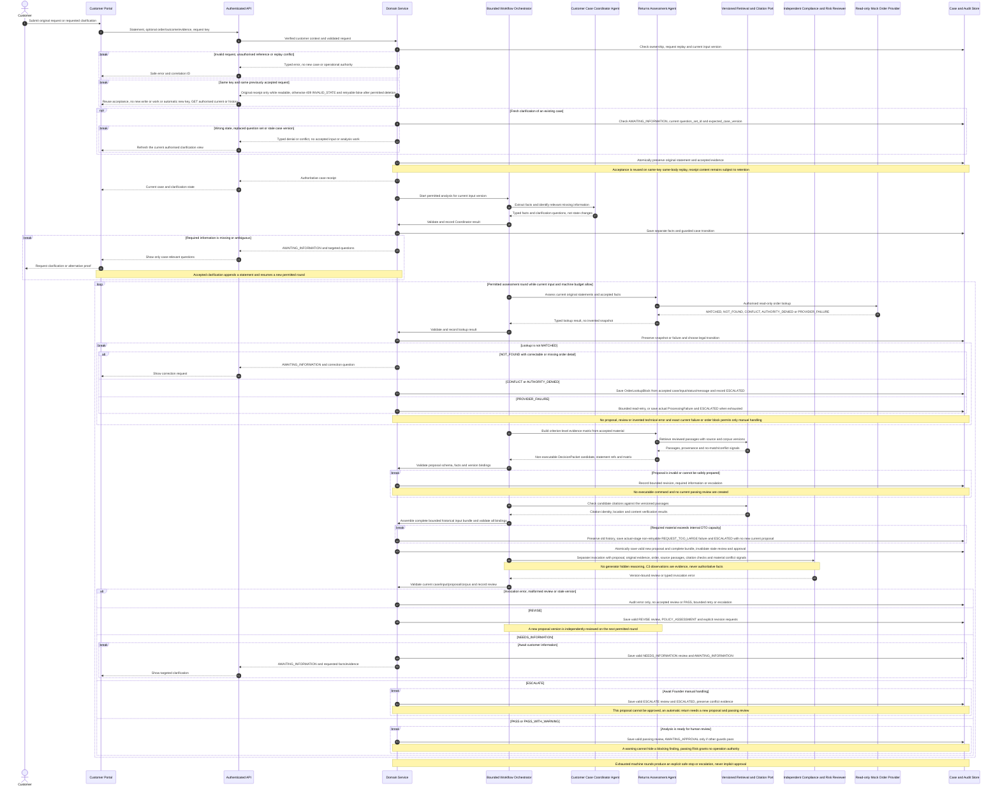
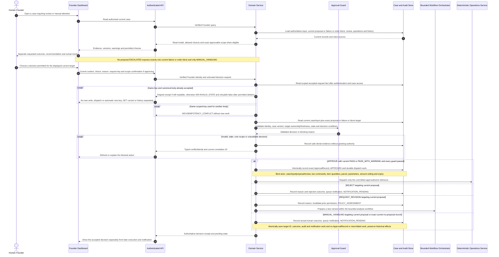
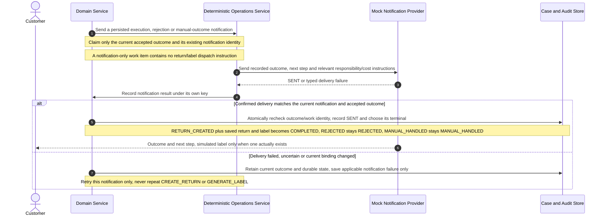

# Shared Interactions - Assessment, Decisions and Governed Execution

> **Status:** Shared design candidate aligned to [docs/00](../00-project-definition-v1.md)
> and [docs/07](../07-frozen-work-allocation.md); not runtime or individual-model
> completion evidence.
> **Revision:** `1.0.0-rc.5` review candidate for [KAN-32](https://lucastaooo.atlassian.net/browse/KAN-32), not accepted. [PR #11](https://github.com/shuxiachai/returnops-au/pull/11) is the review entry; check its actual head and reviews. `57d86fe` published rc.4 is the prior snapshot; rc.3 is an earlier candidate; [PR #9](https://github.com/shuxiachai/returnops-au/pull/9) records the earlier rc.2 publication.
> **Traceability:** FR-001–FR-012; NFR-001–NFR-009; UC-01/01E–UC-05;
> shared model review plus M-A/M-B/M-C in [docs/08](../08-delivery-work-packages.md).

The original Lab 3 interactions are retained and corrected using Member B
`@ChengsiLi`'s three-role naming, separate Founder Dashboard, Domain Service and
deterministic Operations Service from [PR #8](https://github.com/shuxiachai/returnops-au/pull/8)
(`origin/docs/6-baseline-uml-rebaseline`, locally inspected). Reuse does not
claim that PR #8 was merged, transfer its authorship, or complete the three
members' separately authored activity/sequence/state-machine chains.

The former single long diagram is divided at persisted hand-offs so each
branch can be reviewed. All business writes shown below go through Domain
Service; the orchestrator chooses bounded AI work and submits results for
validation. Messages are conceptual operations, not promises that F.01 already
implements each route. The rc.5 contract review candidate still needs joint
review and cannot replace docs/00 or docs/07 as the product/allocation baseline.

## 1. Intake, grounding and the five risk outcomes

The order lookup is a read. Only Operations Service may invoke return or label
operations. `CaseLineItem` selections refer to one order and a single planned
parcel; selecting multiple items does not create multiple shipments. Original
customer requests, extracted fields and the recommendation remain independently
stored. The UI reads server-confirmed state and never accepts an agent's text
as an authoritative transition.

At the accepted new-input/revision boundary, previous material loses current
validity but remains immutable history. A returned Assessment candidate becomes
the current proposal only after its complete bounded material bundle passes
Domain preflight; capacity failure cannot resurrect the older packet or delete
its history.

After intake, customer evidence is accepted only through the current requested
clarification with its question set and expected case version. No unrequested
upload or general case-edit endpoint is implied. A controlled internal material
update (for example a refreshed authorised order snapshot) must pass provenance,
authority and version checks in Domain Service, then invalidate dependent
proposal/review/approval before further effects. The shared case-machine input
arrows outside `AWAITING_INFORMATION` describe this internal boundary.

## 2. Founder review and four decisions

An ESCALATED proposal cannot take the APPROVE branch. REQUEST_REVISION requires
a current proposal; the revised version must pass independent Risk again. An
ESCALATED case without a current proposal instead requires exactly one current
`ProcessingFailure` or `OrderLookupBlock`. Only `MANUAL_HANDLING` may target its
`processing_failure_id` or `order_lookup_block_id`; both exclude proposal,
preview, scope and approval fields. Domain Service must match the persisted
record to the current case/input and, for an order block, the accepted lookup.
`OrderLookupBlock` is only a pre-proposal `CONFLICT/AUTHORITY_DENIED` result;
source-policy conflict remains packet/Risk material. There is no no-proposal
revision/restart endpoint and no fabricated proposal or technical failure.

The [F.01 rc.5 review candidate](../09-interface-contract-v1.md) still needs joint
review. These interactions do not prove a working endpoint. A resolved target
may remain visible while notification is pending/failed or after manual closure;
state checks still reject a new decision. Authenticated same-key/same-body replay
reuses acceptance: original receipt only while readable, otherwise after permitted
deletion 409 INVALID_STATE/retryable=false, no write/work or automatic new key.
B reads current/history views. Notification retry does not replay operations or erase
unknown effects. Exact approval and provider permissions remain separate;
the browser cannot create a trusted ApprovalRecord.

## 3. Execution, idempotency and unknown-result reconciliation

```mermaid
sequenceDiagram
    autonumber
    participant Domain as Domain Service
    participant Ops as Deterministic Operations Service
    participant Guard as Approval Guard
    participant Provider as Mock Returns and Logistics Provider
    participant Artifacts as Scoped Label Artifact Store
    participant Store as Case and Audit Store

    Domain->>Ops: Process committed command or original-recovery work
    loop Eligible command or recovery step within configured budget
        Ops->>Domain: Read current scope, dependencies, original attempts and effect receipts
        Domain->>Store: Read durable records and enforce the appropriate single claimant
        Store-->>Domain: Saved result, confirmed receipt, unresolved effect or eligible new command
        Domain-->>Ops: Authoritative work context or rejection
        break Work blocked, concurrent claimant active or required dependency absent
            Ops-->>Domain: Retain durable facts and safe pending reason, no invocation
        end
        alt Complete prior successful result exists
            Ops-->>Domain: Reuse saved result, no invocation
        else Durable confirmed-label receipt exists but artifact is incomplete
            Note over Domain,Ops: Keep attempt EXECUTING without result, use artifact recovery below, never new create or UNKNOWN
        else UNKNOWN or orphaned intent without reliable confirmed-effect receipt
            Ops->>Domain: Claim original-effect query and record RECONCILING
            Domain->>Store: Preserve original identity and any accepted rejection or manual outcome and case state
            Ops->>Provider: Authorised query using original provider ID or fingerprint
            Provider-->>Ops: Confirmed original effect, confirmed no effect or still unknown
            Ops->>Domain: Submit validated original observation
            alt Confirmed label effect with incomplete artifact binding
                Domain->>Store: Atomically persist original receipt, audit and artifact-only work in EXECUTING
            else Complete confirmed return result
                Domain->>Store: Persist complete OperationResult, SUCCEEDED and audit
            else Confirmed no effect
                Domain->>Store: Persist FAILED and no-effect evidence
                Note over Domain,Ops: Only a later separately guarded retry may use the stable original logical key
            else Still unknown or lookup unavailable
                break Stop automatic dispatch
                    Domain->>Store: Preserve uncertainty and audit, escalate only without accepted rejection or manual outcome
                end
            end
        else New or explicitly retry-safe unfinished command without confirmed effect
            Ops->>Guard: G-DISPATCH current state, passing Risk, trusted authority, exact scope, expiry and allowlist
            Guard-->>Ops: Valid or blocked
            Ops->>Provider: Check configured provider permission without an effect
            Provider-->>Ops: Authorised or denied
            break Any dispatch guard or provider permission fails
                Ops->>Domain: Record actual denial, no effect and no fabricated approval or attempt
            end
            Ops->>Domain: Request claim with expected bindings
            Domain->>Store: Atomically recheck scope and dependencies, claim and persist EXECUTING intent plus audit
            Domain-->>Ops: Claimed command or rejection
            break Claim lost or intent commit unconfirmed
                Note over Domain,Ops: No invocation, losing worker does not change winner
            end
            Ops->>Guard: Final invocation guard with own uninvoked reservation
            Guard-->>Ops: Allowed or blocked
            break Final guard fails
                Ops->>Domain: Persist actual BLOCKED fact without invocation
            end
            Ops->>Provider: Invoke one approved command with stable key, label uses saved return and same parcel
            Provider-->>Ops: Raw effect observation, definite no-effect failure or uncertainty
            Ops->>Domain: Submit original provider observation with operation and command bindings
            alt Confirmed label effect
                Domain->>Store: Atomically save original receipt, audit and artifact-only work, EXECUTING without result
            else Complete confirmed return result
                Domain->>Store: Atomically save full OperationResult, SUCCEEDED and audit
            else Confirmed no-effect failure
                Domain->>Store: Save FAILED and classified no-effect evidence
            else Uncertain effect without a confirmed receipt
                Domain->>Store: Save UNKNOWN if writable, original identity query required
            end
        end
        Note over Domain,Store: Any unconfirmed commit requires rereading last durable receipt or intent before recovery, never another create
        opt Durable confirmed-label receipt exists and full result is still missing
            Ops->>Domain: Request G-ARTIFACT claim under current recovery identity and access
            Domain->>Store: Validate original binding, provider read permission, retention and work generation
            Domain-->>Ops: Original-artifact recovery allowed or denied
            alt Allowed and claim held
                opt Original content needed and retention permits retrieval
                    Ops->>Provider: Query or retrieve original label only, no creation
                    Provider-->>Ops: Original content or retrieval error
                end
                opt Valid original content available and current access allows storage
                    Ops->>Artifacts: Validate and store original label PDF and hash
                    Artifacts-->>Ops: Scoped evidence reference or actual storage failure
                end
                Ops->>Domain: Submit original binding, saved reference or recovery failure
                alt Full label reference validated
                    Domain->>Store: Atomically commit full OperationResult with label_evidence_id, SUCCEEDED and audit
                    Note over Domain,Store: If commit unconfirmed, reread and reuse original receipt or saved artifact, no new invocation
                else Artifact remains missing
                    Domain->>Store: Retain EXECUTING, receipt and artifact-only work with actual error
                end
            else Current recovery authority or retention unavailable
                Note over Domain,Store: Preserve known effect, no retrieve or store and never restore deliberately deleted content
            end
        end
    end
    Domain->>Store: Read current accepted outcome, notification and saved full command results
    alt Accepted rejection or manual outcome exists
        Domain->>Store: Preserve its outcome, notification identity and pending or terminal case state
        Note over Domain,Store: Historical effect or artifact recovery never substitutes RETURN_CREATED or COMPLETED
    else Execution eligible and both full results committed without contradictory uncertainty
        Domain->>Store: Atomically recheck case and outcome version, persist or reuse RETURN_CREATED notification work
    else No deliverable outcome
        Note over Domain,Store: Retain facts and pending work, budget exhaustion escalates only without accepted rejection or manual outcome
    end
```

UNKNOWN and RECONCILING describe `OperationAttempt.status`; the case may expose
RECONCILING while those attempts are checked. HTTP success alone is not proof
of a successful business effect. An expired or superseded approval cannot permit
a new effect, but authorised lookup may still establish what an earlier attempt
actually did. Unresolved partial execution preserves successful steps and never
restarts the whole plan. Recovery budget exhaustion stays visible and requires
manual attention instead of pretending the case succeeded.

Confirmed label effect with missing artifact uses the existing EXECUTING status
with no result. Domain first commits a minimal original receipt, audit and
artifact-only work. Recovery checks that receipt before considering UNKNOWN;
G-ARTIFACT permits only original-label query/retrieval/storage under current
recovery access and retention. Creation-approval expiry is independent of this
read/store permission. File failure does not mean no effect or uncertain effect;
SUCCEEDED requires a committed full result including label_evidence_id.
The internal receipt/work is not a new wire DTO or state.

An already accepted manual/rejection outcome remains authoritative during a
late lookup, whether its notification is pending, failed or sent. Lookup may
confirm old success or preserve uncertainty without reopening or escalating
that case. This historical observation grants no new dispatch permission and
is separate from the unresolved cross-approval design choice MA-Q02.

Durable claiming, approval freshness at invocation, crash recovery and provider
idempotency are implementation obligations of A1/A2, not guarantees supplied by
Mermaid. A3 may replace the mock adapter only with verified no-charge test access
and the same rules. Its independent integration remains a selected optional
course feature, not another claim for the core mock/retry implementation.

## 4. Independent outcome notification

COMPLETED requires saved `RETURN_CREATED`, valid return and label success, and
matching notification delivery. An accepted rejection/manual outcome cannot be
overridden by old operations later proving successful; sent work is not resent.
REJECTED and MANUAL_HANDLED do not count as successful simulated operations.
A generic request for more information is not a final outcome notification and
does not close the case. Founder and customer views obtain their authorised
read models through the API; an accepted decision or HTTP 202 is not completion.

## 5. Review checklist and contribution boundary

- Trace one complete case, one clarification, each of the five Risk outcomes,
  and each of the four Founder decisions through persisted hand-offs.
- For stale/expired/wrong-scope decisions and denied provider authority, verify
  that the first business-effect call is never reached.
- For duplicate, partial and unknown results, identify the durable key, claim,
  provider fingerprint, saved result and query-before-retry step.
- For notification failure, show that only notification work repeats and the
  case remains pending rather than entering a false completed state.
- Trace return SUCCEEDED, label UNKNOWN, escalation, then accepted manual outcome:
  a late label-success lookup must retain its pending/sent manual notification
  and select MANUAL_HANDLED, never COMPLETED. Repeat with an inconclusive lookup.
- Reject fresh customer evidence without a current clarification question set;
  distinguish a valid clarification from a controlled internal material update.
- Verify all state writes originate at Domain Service and all operational
  provider calls originate at Operations Service. AI results remain untrusted
  typed input to deterministic validation.
- Attach actual reviews and eventual model-to-code traces. These shared diagrams
  do not replace A's AH-10, B's AH-01 or C's AH-08 personal three-diagram chains,
  and they do not supply the runtime Composite Structure Diagram.
