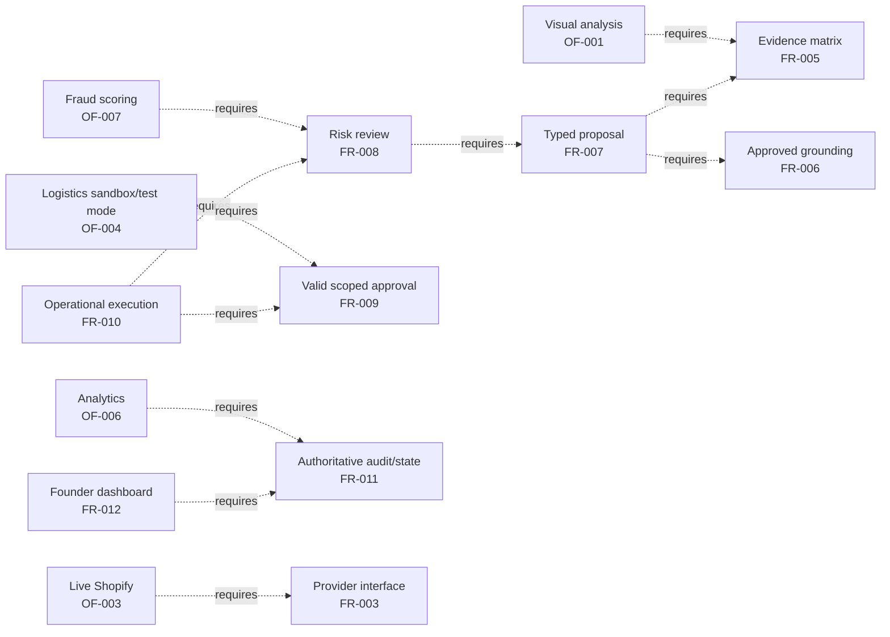

# Feature Diagram and Decomposition Model

> **MBSE model type**: Feature-Oriented Domain Analysis (FODA)
>
> **Laboratory 3 role**: Refines stakeholder needs into product capabilities,
> variability, attributes, and constraints
>
> **Status — 2026-09-07:** v1 alignment draft, pending Member B/C review.
> Earlier modelling contributions and their Git history are retained. This
> revision does not claim product-baseline adoption or F.01 acceptance.
>
> **Alignment baseline:** [Lead-approved v1.0 candidate](../00-project-definition-v1.md)
> and [frozen nine-feature allocation](../07-frozen-work-allocation.md).

## 1. Scope and notation

A feature is a stakeholder-visible capability, quality, or characteristic. The
model uses these annotations because Mermaid does not provide native FODA edge
symbols:

| Annotation | Meaning |
|---|---|
| `[M]` | Mandatory in every ReturnOps AU MVP configuration. |
| `[O]` | Optional in the product family; a selected option is a required course deliverable for this team. |
| `[XOR 1..1]` | Exactly one alternative is active for a deployment or evaluation run. |
| `[0..*]` | Zero or more members of the option group may be selected. |
| `[C]` | Mandatory cross-cutting quality constraint, not a selectable feature. |

Functional leaves retain their canonical `FR` or `OF` identifier. Quality
constraints are attached as feature attributes in Section 4.

The team has selected **OF-004 (A), OF-006 (B), and OF-001 (C)**. Their FODA
optional symbols remain valid, but none is optional for this team's course
submission. Other `OF` nodes are an unselected product-family catalogue, not
new course commitments. This shared model does not replace any member's
individual activity, sequence, or state-machine model chain.

## 2. Capability decomposition

```mermaid
flowchart TB
    ROOT["ReturnOps AU"]

    ROOT -->|mandatory| INTAKE["Case Intake [M]"]
    ROOT -->|mandatory| INVEST["Case Investigation [M]"]
    ROOT -->|mandatory| DECIDE["Grounded Decision [M]"]
    ROOT -->|mandatory| GOVERN["Governed Operations [M]"]
    ROOT -->|mandatory| OVERSIGHT["Audit and Oversight [M]"]
    ROOT -.->|option group 0..*| EXT["Product-family Extensions [0..*]<br/>Team selection fixed below"]

    INTAKE --> I1["Submit return/remedy request<br/>FR-001"]
    INTAKE --> I2["Extract facts and missing fields<br/>FR-002"]

    INVEST --> V1["Verify order<br/>FR-003"]
    INVEST --> V2["Separate issue, requested outcome,<br/>possible basis and assessment status - FR-004"]
    INVEST --> V3["Build evidence matrix<br/>FR-005"]
    INVEST --> CP["Commerce adapter [XOR 1..1 per deployment]"]
    CP -->|MVP selected| CPM["Mock commerce adapter"]
    CP -.->|not selected for course| CPL["Live Shopify adapter [O]<br/>OF-003"]

    DECIDE --> D1["Retrieve approved grounding<br/>FR-006"]
    DECIDE --> D2["Generate versioned non-executable packet<br/>FR-007"]
    DECIDE --> D3["Perform independent risk review<br/>FR-008"]
    D1 --> RS["Retrieval strategy [XOR 1..1 per evaluation run]"]
    RS -->|course selected| RSK["Keyword/BM25 retrieval"]
    RS -.->|portfolio only| RSS["Semantic retrieval"]
    RS -.->|portfolio only| RSH["Hybrid retrieval"]

    GOVERN --> G1["Record founder decision and outcome<br/>FR-009"]
    GOVERN --> G2["Execute approved simulated return and label<br/>then notify outcome - FR-010"]
    GOVERN --> LP["Logistics adapter [XOR 1..1 per deployment]"]
    LP -->|MVP selected| LPM["Mock logistics adapter"]
    LP -.->|selected A - access prerequisite| LPL["Independent logistics sandbox/test adapter [O]<br/>OF-004"]

    OVERSIGHT --> A1["Tamper-evident audit and retention rules<br/>FR-011"]
    OVERSIGHT --> A2["Founder case dashboard<br/>FR-012"]

    EXT -.->|selected C| O1["Visual evidence observations [O]<br/>OF-001"]
    EXT -.->|not selected| O2["Additional languages [O]<br/>OF-002"]
    EXT -.->|not selected| O5["Inventory restocking workflow [O]<br/>OF-005"]
    EXT -.->|selected B| O6["Return analytics dashboard [O]<br/>OF-006"]
    EXT -.->|not selected| O7["Anomaly/fraud risk scoring [O]<br/>OF-007"]
```

The commerce, logistics, and retrieval XOR groups describe the single adapter
or strategy active at runtime. Multiple implementations may coexist in the
codebase behind a typed interface.

The deployed course workflow has three AI roles: Customer Case Coordinator,
Returns Assessment Agent, and Compliance & Risk Reviewer. Operations Service
is deterministic; Domain Service alone commits authoritative case transitions.
The `B1` evaluation baseline is an offline single-LLM comparator without
retrieval or operational authority, not a deployable product configuration
that removes mandatory safety features. `B1` versus `B4` is the course
comparison; `B2`/`B3` comparisons remain portfolio work.

## 3. Cross-tree constraints

| Constraint | Rationale and verification |
|---|---|
| `FR-007 requires FR-005 and FR-006` | Assessment receives the evidence matrix and retrieval result, including gaps and conflicts. A conditional packet can report missing grounding and escalate; its mere existence does not make it approvable or executable. |
| `FR-008 requires FR-007` | Risk review examines a versioned proposal rather than informal agent text. |
| `FR-010 requires FR-008 and FR-009` | Only a current-input/current-proposal `PASS` or `PASS_WITH_WARNING` risk review can support exact-scope Founder approval. `REVISE`, `NEEDS_INFORMATION`, and `ESCALATE` cannot. An escalated case needs a new proposal and a new passing review before approval. Verification must cover missing, expired, stale, and wrong-scope approval. |
| `FR-012 requires FR-011` | The dashboard reads authoritative state and audit data rather than maintaining a divergent copy. |
| `OF-001 requires FR-005` | Visual analysis contributes evidence; it cannot independently decide a remedy. |
| `OF-003 requires FR-003, NFR-007, and NFR-009` | A live commerce provider must remain replaceable and cannot expose credentials or broaden tool authority. |
| `OF-004 requires FR-009, FR-010, NFR-004, and NFR-009` | This selected option is an independent provider sandbox/test adapter, with legitimate test access, approval, idempotency, allowlisting, and proof of no real shipment or charge. Access failure is a dependency blocker to resolve with the lead/tutor; core mock execution cannot be renamed and counted again as the optional feature. Production fulfilment is outside the course prototype. |
| `OF-005 requires a reviewed state-model extension` | Receipt and inspection states are not part of the current MVP lifecycle. |
| `OF-006 requires FR-011 and NFR-008` | Analytics is valid only after complete, structured audit data exists. |
| `OF-007 requires FR-008, labelled cases, and BR-005` | Risk scoring can flag or escalate but cannot deny a customer or bypass human review. |

`Faulty product`, `wrong item`, and `change of mind` are runtime request values,
not product-configuration alternatives. Likewise, `refund`, `replacement`, and
`repair` are proposal outcomes rather than FODA XOR features or executable
course commands. Core execution is limited to simulated `CREATE_RETURN` and
`GENERATE_LABEL`, followed by notification; it does not execute a refund or
inventory change. Unknown provider effects require reconciliation before any
safe retry. Saved return/label results and a successful notification are both
required for completion; notification retry never replays either command.

## 4. Quality attributes attached to features

| Quality constraint | Principal constrained features | Measurable interpretation |
|---|---|---|
| NFR-001 Traceability `[C]` | FR-005 to FR-008, FR-011, FR-012 | Citation coverage 100%; correctness at least 90%. |
| NFR-002 Safety `[C]` | FR-008 to FR-010 | Every invalid or absent approval blocks a new operational effect; separately authorised read-only reconciliation is not a new execution approval. |
| NFR-003 Privacy `[C]` | FR-001, FR-002, FR-005, FR-009 to FR-012 | Synthetic/de-identified data only; secrets excluded, sensitive content minimised, and retention/deletion rules distinguish audit metadata from removable content. |
| NFR-004 Reliability `[C]` | FR-003, FR-010, FR-011 | Zero duplicate effects and zero illegal state transitions in the defined replay/failure tests; preserve partial success, reconcile unknown effects, and retry notification independently. |
| NFR-005 Performance `[C]` | FR-001 to FR-008 | Target p95 below 120 seconds from acceptance of complete input to a stored, review-ready proposal; include machine revisions/risk loops and exclude human/physical waits. |
| NFR-006 Testability `[C]` | All mandatory features and adapters | Normal path, principal failure path, guards, and contracts are automated. |
| NFR-007 Maintainability `[C]` | FR-003, FR-006, FR-010, OF-003, OF-004 | Providers and models sit behind documented typed interfaces. |
| NFR-008 Observability `[C]` | Entire workflow, especially FR-003 and FR-008 to FR-011 | Correlated structured events expose input/proposal/model/corpus versions, outcome, typed failure, elapsed time, and cost. |
| NFR-009 Security and AI robustness `[C]` | Intake, retrieval, approval, all tools, and live adapters | Untrusted content cannot change policy, grant authority, leak secrets, or invoke non-allowlisted tools. |

Course assessment additionally targets classification **macro-F1 >= 0.85**
(0.90 stretch), citation correctness >= 90%, risk recall >= 95%, and specificity
>= 80%. The frozen protocol uses 30 double-reviewed Gold cases, a separate
10–20-case development/pilot set, and `B1` versus `B4`; report raw counts and
denominators alongside ratios. These are project acceptance targets, not
measured results or a claim of production/legal correctness.

## 5. Implementation and verification ownership

Testing assets are not presented as product features. The frozen effort
allocation is **A 45% / B 27% / C 28%**. Every owner implements and self-tests
their own work; C coordinates system evaluation rather than absorbing all
team testing. Reviews do not transfer implementation or individual-model credit.

| Feature area | Implementation owner | Verification/review owner |
|---|---|---|
| A1 — Case lifecycle, order interface, Coordinator/Assessment orchestration | A, including own tests | C; B reviews user-facing contract compatibility |
| A2 — Exact-scope approval, deterministic operations, audit services | A, including own tests | C; B reviews dashboard integration |
| B1 — Customer intake and clarification UI | B, including UI/component tests | A |
| B2 — Founder review, decision, and audit UI | B, including UI/component tests | A |
| C1 — Versioned retrieval and citation verification | C, including own tests | A |
| C2 — Independent risk review and evaluation evidence | C, including own tests and system-evaluation coordination | A |
| A3 — Selected OF-004 independent logistics sandbox/test adapter | A; access check and own adapter tests | C |
| B3 — Selected OF-006 analytics dashboard | B; depends on A's authoritative read API; own tests | A |
| C3 — Selected OF-001 visual evidence observations | C; after the text path is stable, but still a course deliverable; own tests | A |

Detailed dependencies and acceptance checks remain in the
[delivery work packages](../08-delivery-work-packages.md). Each member records
real progress in Jira and links technical evidence in GitHub; this diagram
does not claim Jira synchronisation or completion of any package.
