# Feature Diagram & Decomposition Model

> **MBSE Model Type**: Product Feature Diagram (FODA / Feature-Oriented Domain Analysis)  
> **Course Requirement**: Classification of agreement, mandatory capabilities, optional features, and constraints  
> **Traceability**: [FR-001 ~ FR-012, NFR-001 ~ NFR-008, OF-001 ~ OF-007](file:///d:/AAA树下/硕士/26S2/5620/assignment/returnops-au/docs/04-requirements-and-backlog.md)

---

## 1. Mermaid Feature Hierarchy

```mermaid
flowchart TD
    Root["ReturnOps AU Platform"]
    
    %% Core Mandatory Subtrees
    Mandatory["[Mandatory] Core Multi-Agent Capabilities"]
    Optional["[Optional] Stage 2 Expansion Features"]
    Constraints["[Constraint] System Governance & Boundaries"]

    Root --> Mandatory
    Root --> Optional
    Root --> Constraints

    %% Mandatory Capabilities
    Mandatory --> M1["FR-001/002: Customer Request Intake & Extraction"]
    Mandatory --> M2["FR-003: Order Query & Verification"]
    Mandatory --> M3["FR-004: 3-Way Request Classification (Faulty/Wrong/ChangeOfMind)"]
    Mandatory --> M4["FR-005: Evidence Matrix & Diagnostic Gap Detection"]
    Mandatory --> M5["FR-006: Policy & ACCC Grounding (RAG)"]
    Mandatory --> M6["FR-007: Typed Remedy Proposal Generation"]
    Mandatory --> M7["FR-008: Independent Risk Review & Escalation Engine"]
    Mandatory --> M8["FR-009: Human Founder Approval Gate"]
    Mandatory --> M9["FR-010: Simulated Operational Tool Execution"]
    Mandatory --> M10["FR-011/012: Audit Trail & Founder Operations Dashboard"]

    %% Optional Features
    Optional --> O1["OF-001: Image & Video Fault Verification (Multimodal Vision)"]
    Optional --> O2["OF-002: Multilingual Support (Chinese / English)"]
    Optional --> O3["OF-003: Live Shopify Development Store GraphQL Adapter"]
    Optional --> O4["OF-004: Australia Post eParcel Live Shipping Label API"]
    Optional --> O5["OF-005: Automated Inventory Restocking & Inspection Workflow"]
    Optional --> O6["OF-006: Return Analytics & Root-Cause Trends Dashboard"]
    Optional --> O7["OF-007: Anomaly & Fraud Risk Scoring Engine"]

    %% Constraints
    Constraints --> C1["NFR-001: 100% Citation Grounding (Zero Unsupported Claims)"]
    Constraints --> C2["NFR-002: 0 Unapproved High-Impact Financial Actions"]
    Constraints --> C3["NFR-003: Privacy Preservation (De-identified synthetic data)"]
    Constraints --> C4["NFR-004: Idempotent Command Execution (Retry-safe)"]
    Constraints --> C5["NFR-005: Proposal Latency < 120 Seconds"]
```

---

## 2. Lab 2 Feature Ownership Mapping

| Student / Role | Core Mandatory Feature 1 | Core Mandatory Feature 2 | Optional Feature |
| :--- | :--- | :--- | :--- |
| **Member A (Lead / Architect)** | **M1/M2/M6**: Domain API, State Machine & Multi-Agent Orchestrator | **M8/M9**: Scoped Approval & Simulated Tool Execution | **O3**: Live/Mock Shopify GraphQL Adapter & Docker Environment |
| **Member B (Frontend / UX)** | **M1**: Customer Return & Evidence Intake Portal | **M10**: Founder Operations & Approval Dashboard | **O6**: Return Analytics & Root-Cause Trends Dashboard |
| **Member C (QA / Evaluation)** | **M3/M4/M5**: 100-Case Synthetic Benchmark Dataset | **M7**: Automated 4-Configuration AI Evaluation Pipeline | **O7/C1**: Prompt Injection / Safety Guardrail Test Suite |
