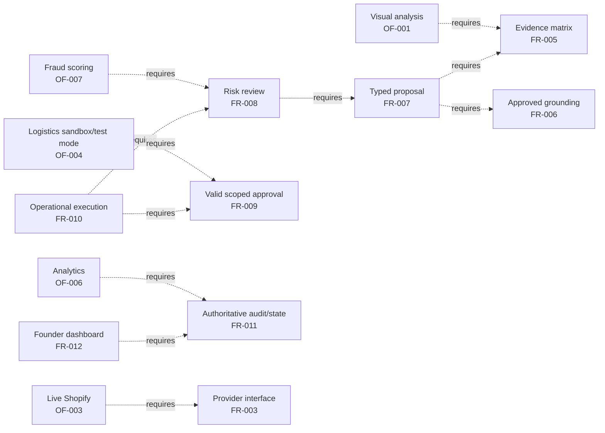

# Feature Diagram and Decomposition Model

> **MBSE model type**: Feature-Oriented Domain Analysis (FODA)
>
> **Laboratory 3 role**: Refines stakeholder needs into product capabilities,
> variability, attributes, and constraints
>
> **Canonical baseline**:
> [FR-001 to FR-012, NFR-001 to NFR-009, OF-001 to OF-007](../04-requirements-and-backlog.md)

## 1. Scope and notation

A feature is a stakeholder-visible capability, quality, or characteristic. The
model uses these annotations because Mermaid does not provide native FODA edge
symbols:

| Annotation | Meaning |
|---|---|
| `[M]` | Mandatory in every ReturnOps AU MVP configuration. |
| `[O]` | Optional Stage 2 extension. |
| `[XOR 1..1]` | Exactly one alternative is active for a deployment or evaluation run. |
| `[0..*]` | Zero or more members of the option group may be selected. |
| `[C]` | Mandatory cross-cutting quality constraint, not a selectable feature. |

Functional leaves retain their canonical `FR` or `OF` identifier. Quality
constraints are attached as feature attributes in Section 4.

## 2. Capability decomposition

```mermaid
flowchart TB
    ROOT["ReturnOps AU"]

    ROOT -->|mandatory| INTAKE["Case Intake [M]"]
    ROOT -->|mandatory| INVEST["Case Investigation [M]"]
    ROOT -->|mandatory| DECIDE["Grounded Decision [M]"]
    ROOT -->|mandatory| GOVERN["Governed Operations [M]"]
    ROOT -->|mandatory| OVERSIGHT["Audit and Oversight [M]"]
    ROOT -.->|option group 0..*| EXT["Stage 2 Extensions [0..*]"]

    INTAKE --> I1["Submit return/remedy request<br/>FR-001"]
    INTAKE --> I2["Extract facts and missing fields<br/>FR-002"]

    INVEST --> V1["Verify order<br/>FR-003"]
    INVEST --> V2["Classify request<br/>FR-004"]
    INVEST --> V3["Build evidence matrix<br/>FR-005"]
    INVEST --> CP["Commerce adapter [XOR 1..1 per deployment]"]
    CP -->|MVP selected| CPM["Mock commerce adapter"]
    CP -.->|optional| CPL["Live Shopify adapter [O]<br/>OF-003"]

    DECIDE --> D1["Retrieve approved grounding<br/>FR-006"]
    DECIDE --> D2["Generate typed proposal<br/>FR-007"]
    DECIDE --> D3["Perform independent risk review<br/>FR-008"]
    D1 --> RS["Retrieval strategy [XOR 1..1 per evaluation run]"]
    RS --> RSK["Keyword baseline"]
    RS --> RSS["Semantic retrieval"]
    RS --> RSH["Hybrid retrieval"]

    GOVERN --> G1["Record founder decision and outcome<br/>FR-009"]
    GOVERN --> G2["Execute approved simulated action<br/>and send outcome - FR-010"]
    GOVERN --> LP["Logistics adapter [XOR 1..1 per deployment]"]
    LP -->|MVP selected| LPM["Mock logistics adapter"]
    LP -.->|optional| LPL["Logistics sandbox/test adapter [O]<br/>OF-004"]

    OVERSIGHT --> A1["Append-only audit trail<br/>FR-011"]
    OVERSIGHT --> A2["Founder case dashboard<br/>FR-012"]

    EXT -.-> O1["Visual evidence analysis [O]<br/>OF-001"]
    EXT -.-> O2["Additional languages [O]<br/>OF-002"]
    EXT -.-> O5["Inventory restocking workflow [O]<br/>OF-005"]
    EXT -.-> O6["Return analytics dashboard [O]<br/>OF-006"]
    EXT -.-> O7["Anomaly/fraud risk scoring [O]<br/>OF-007"]
```

The commerce, logistics, and retrieval XOR groups describe the single adapter
or strategy active at runtime. Multiple implementations may coexist in the
codebase behind a typed interface.

## 3. Cross-tree constraints

| Constraint | Rationale and verification |
|---|---|
| `FR-007 requires FR-005 and FR-006` | No remedy proposal is decision-ready without explicit evidence gaps and approved-source grounding. Schema and integration tests reject an ungrounded proposal. |
| `FR-008 requires FR-007` | Risk review examines a versioned proposal rather than informal agent text. |
| `FR-010 requires FR-008 and FR-009` | A command runs only after risk review passes and the exact current proposal has valid human approval. Negative-path tests cover missing, expired, stale, and wrong-scope approval. |
| `FR-012 requires FR-011` | The dashboard reads authoritative state and audit data rather than maintaining a divergent copy. |
| `OF-001 requires FR-005` | Visual analysis contributes evidence; it cannot independently decide a remedy. |
| `OF-003 requires FR-003, NFR-007, and NFR-009` | A live commerce provider must remain replaceable and cannot expose credentials or broaden tool authority. |
| `OF-004 requires FR-009, FR-010, NFR-004, and NFR-009` | A logistics test-mode call needs approval, idempotency, allowlisting, protected credentials, and proof that it creates no real shipment or charge. Production fulfilment is outside the course prototype. |
| `OF-005 requires a reviewed state-model extension` | Receipt and inspection states are not part of the current MVP lifecycle. |
| `OF-006 requires FR-011 and NFR-008` | Analytics is valid only after complete, structured audit data exists. |
| `OF-007 requires FR-008, labelled cases, and BR-005` | Risk scoring can flag or escalate but cannot deny a customer or bypass human review. |

`Faulty product`, `wrong item`, and `change of mind` are runtime request values,
not product-configuration alternatives. Likewise, `refund`, `replacement`, and
`repair` are proposal outcomes rather than FODA XOR features.

## 4. Quality attributes attached to features

| Quality constraint | Principal constrained features | Measurable interpretation |
|---|---|---|
| NFR-001 Traceability `[C]` | FR-005 to FR-008, FR-011, FR-012 | Citation coverage 100%; correctness at least 90%. |
| NFR-002 Safety `[C]` | FR-008 to FR-010 | Every invalid or absent approval blocks the provider call. |
| NFR-003 Privacy `[C]` | FR-001, FR-002, FR-005, FR-009 to FR-012 | Synthetic/de-identified data only; secrets excluded and sensitive content minimised, including customer-facing outcomes and notification payloads. |
| NFR-004 Reliability `[C]` | FR-003, FR-010, FR-011 | At-most-once effect for an idempotency key, legal state after failure, and at least 95% mock tool success on the standard benchmark. |
| NFR-005 Performance `[C]` | FR-001 to FR-008 | Median complete-case submission-to-proposal latency below 120 seconds. |
| NFR-006 Testability `[C]` | All mandatory features and adapters | Normal path, principal failure path, guards, and contracts are automated. |
| NFR-007 Maintainability `[C]` | FR-003, FR-006, FR-010, OF-003, OF-004 | Providers and models sit behind documented typed interfaces. |
| NFR-008 Observability `[C]` | Entire workflow, especially FR-003 and FR-008 to FR-011 | Correlated structured events expose version, outcome, and typed failure. |
| NFR-009 Security and AI robustness `[C]` | Intake, retrieval, approval, all tools, and live adapters | Untrusted content cannot change policy, grant authority, leak secrets, or invoke non-allowlisted tools. |

## 5. Implementation and verification ownership

Testing assets are not presented as product features. Implementation and
verification ownership are separated to preserve the planned 48/25/27 workload.

| Feature area | Implementation owner | Verification/review owner |
|---|---|---|
| Case intake, domain API, and orchestration | Member A; Member B owns the customer UI | Member C validates extraction and failure cases |
| Order, evidence, policy, proposal, and risk workflow | Member A | Member C owns benchmark labels and evaluation; Member B reviews user-facing states |
| Approval and simulated operations | Member A; Member B owns approval interactions | Member C validates negative approval and safety paths |
| Audit service and founder oversight | Member A owns audit/state services; Member B owns dashboard UI | Member C validates trace reconstruction and metrics |
| Optional features | Enter only after the core acceptance gate | Assigned through a separate issue with its own owner and reviewer |
