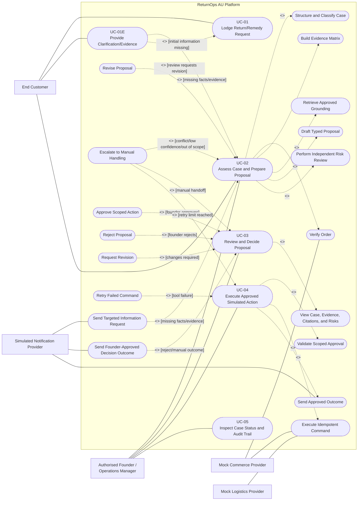

# Use-Case Diagram and Actor Boundary Model

> **MBSE model type**: UML-style use-case model
>
> **Laboratory 3 role**: Operational view of stakeholder goals, external
> interactions, failure branches, authority, and human checkpoints
>
> **Canonical baseline**:
> [FR-001 to FR-012 and NFR-001 to NFR-009](../04-requirements-and-backlog.md)
>
> **Detailed specifications**:
> [Laboratory 3 requirements model](../05-lab-3-requirement-modelling.md)

## 1. System boundary and actors

The diagram uses oval nodes and a system boundary to provide a GitHub-renderable
UML-style summary. The textual use-case specifications are authoritative.

Relationship direction follows the course convention:

- `include`: the base use case points to required reusable behaviour;
- `extend`: the conditional extension points to the base use case;
- no sequence edge is drawn between UC-03 and UC-04. A valid approval produced
  by UC-03 is stated as a UC-04 precondition instead of misusing `include` or
  `extend` to express time order.

## 2. Actor and authority boundaries

| Actor or boundary | Permitted interaction | Explicitly prohibited |
|---|---|---|
| End Customer | Create a case and add statements or evidence to that case | Approve a remedy, change workflow policy, or invoke an operational tool |
| Authorised Founder / Operations Manager | Read the decision evidence and record a scoped approve, reject, revision, or escalation decision | Grant blanket authority, approve a stale proposal, or bypass a failed risk review |
| Mock Commerce Provider | Return an order snapshot and execute an allowlisted simulated command | Decide a remedy or accept an unapproved command |
| Mock Logistics Provider | Execute an approved, idempotent simulated logistics command | Create a real shipment or broaden command scope |
| Simulated Notification Provider | Deliver targeted information requests and approved outcome messages | Decide or alter a remedy, grant approval, or cause an operational command to repeat |
| AI agents and orchestrator | Read authorised case/order/corpus data and write typed analysis, proposal, risk, and audit records | Act as external actors, self-authorise, move real money, or make a final legal determination |

The approved guidance corpus is versioned inside the system boundary; the ACCC
website is a source used during offline corpus curation, not a runtime actor.
`System Administrator` remains a stakeholder but is not an MVP actor because
the current baseline contains no administration UI or corpus-management use
case.

## 3. Use-case coverage summary

| Use case | Primary actor or trigger | FR coverage | Principal NFR coverage |
|---|---|---|---|
| UC-01 Lodge Return/Remedy Request | End Customer | FR-001, FR-002, FR-011 | NFR-003, NFR-008, NFR-009 |
| UC-01E Provide Clarification/Evidence | End Customer | FR-002, FR-005, FR-011 | NFR-003, NFR-008, NFR-009 |
| UC-02 Assess Case and Prepare Proposal | End Customer initiates through UC-01; Founder receives the decision packet | FR-002, FR-003, FR-004, FR-005, FR-006, FR-007, FR-008, FR-011 | NFR-001, NFR-003, NFR-005, NFR-006, NFR-007, NFR-008, NFR-009 |
| UC-03 Review and Decide Proposal | Authorised Founder | FR-009, FR-011, FR-012 | NFR-001, NFR-002, NFR-003, NFR-004, NFR-008, NFR-009 |
| UC-04 Execute Approved Simulated Action | Founder approve action from UC-03; Commerce/Logistics/Notification Providers support | FR-010, FR-011 | NFR-002, NFR-004, NFR-006, NFR-007, NFR-008, NFR-009 |
| UC-05 Inspect Case Status and Audit Trail | Authorised Founder | FR-011, FR-012 | NFR-001, NFR-003, NFR-008, NFR-009 |

`NFR-006 Testability` is demonstrated by automated main-success and principal
failure scenarios across use cases; it is not modelled as a separate business
use case.
