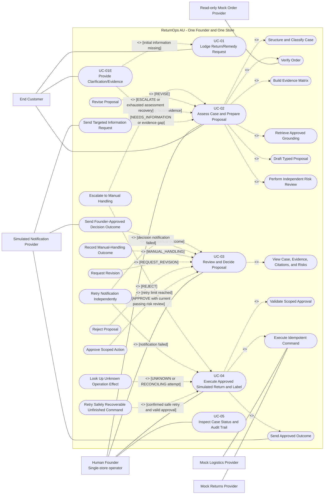

# Use-Case Diagram and Actor Boundary Model

> **MBSE model type**: UML-style use-case model
>
> **Laboratory 3 role**: Operational view of stakeholder goals, external
> interactions, failure branches, authority, and human checkpoints
>
> **Status — 2026-09-07:** v1 alignment draft, pending Member B/C review.
> Published for review in [PR #9](https://github.com/shuxiachai/returnops-au/pull/9); consult its merge record separately from acceptance.
> Earlier modelling contributions and their Git history are retained. This
> revision does not claim product-baseline adoption or F.01 acceptance.
>
> **Alignment baseline:** [Lead-approved v1.0 candidate](../00-project-definition-v1.md)
> and [frozen allocation](../07-frozen-work-allocation.md).
>
> **Detailed specifications**:
> [Laboratory 3 requirements model](../05-lab-3-requirement-modelling.md)

## 1. System boundary and actors

The diagram uses oval nodes and a system boundary to provide a GitHub-renderable
UML-style summary. Read it with the detailed use-case specifications under the
v1 candidate's scope; the diagram and specifications require review together.
This shared model does not replace individual behavioural model chains.

Relationship direction follows the course convention:

- `include`: the base use case points to required reusable behaviour;
- `extend`: the conditional extension points to the base use case;
- no sequence edge is drawn between UC-03 and UC-04. A valid approval produced
  by UC-03 is stated as a UC-04 precondition instead of misusing `include` or
  `extend` to express time order.

## 2. Actor and authority boundaries

| Actor or boundary | Permitted interaction | Explicitly prohibited |
|---|---|---|
| End Customer | Create a case and add statements or evidence to that case | Approve a remedy, change workflow policy, or invoke an operational tool |
| Human Founder | Read decision evidence and record `APPROVE`, `REJECT`, `REQUEST_REVISION`, or `MANUAL_HANDLING` | Grant blanket authority, approve a stale/escalated proposal, or bypass a failed risk review |
| Read-only Mock Order Provider | Return an authorised order snapshot or typed lookup failure | Mutate orders, decide a remedy, or invent a successful match after a timeout |
| Mock Returns Provider | Execute an approved, idempotent simulated return command | Move real money, refund, change inventory, decide a remedy, or accept an unapproved command |
| Mock Logistics Provider | Execute an approved, idempotent simulated logistics command | Create a real shipment or broaden command scope |
| Simulated Notification Provider | Deliver targeted information requests and approved outcome messages | Decide or alter a remedy, grant approval, or cause an operational command to repeat |
| Three internal AI roles | Coordinator, Assessment Agent, and Risk Reviewer read authorised data and return typed facts/questions, proposals, and independent risk findings | Write authoritative case state, act as external actors, self-authorise, dispatch operations, move money, or make a final legal determination |
| Domain Service and orchestration | Domain Service alone validates and commits authoritative state/audit changes; orchestration routes bounded calls and their results | Let an AI result or UI directly bypass state/version guards |
| Deterministic Operations Service | Validate approval and provider authority, dispatch allowlisted commands, and return typed results for Domain Service to persist | Act as a fourth AI, select a remedy, broaden approval, or write authoritative case state directly |

The approved guidance corpus is versioned inside the system boundary; the ACCC
website is a source used during offline corpus curation, not a runtime actor.
`System Administrator` remains a stakeholder but is not an MVP actor because
the current baseline contains no administration UI or corpus-management use
case.

Risk outcomes are `PASS`, `PASS_WITH_WARNING`, `REVISE`, `NEEDS_INFORMATION`,
and `ESCALATE`; they are distinct from the Founder's four decisions. Approval
requires a passing review for the current input/proposal version. An escalated
proposal cannot be approved directly: renewed assessment must produce a new
proposal and obtain a new passing review. Exact-scope dispatch also rechecks
expiry, trusted actor, parameters, provider authority, and idempotency.

UC-04 executes only simulated `CREATE_RETURN` and `GENERATE_LABEL`, not a
refund. An unknown effect is looked up before retry; completed commands are
never replayed to recover a later failure. Notification has an independent
status/retry path. `COMPLETED` requires saved return and label success and a
`SENT` outcome; `REJECTED` and `MANUAL_HANDLED` similarly require their saved
decision and successful notification. Manual handling must remain possible
after an AI failure before a proposal exists. The
[F.01 rc.2 candidate](../09-interface-contract-v1.md) now expresses the
failure-target manual request; its runtime guards and joint model/contract
review remain outstanding.

## 3. Use-case coverage summary

| Use case | Primary actor or trigger | FR coverage | Principal NFR coverage |
|---|---|---|---|
| UC-01 Lodge Return/Remedy Request | End Customer | FR-001, FR-002, FR-011 | NFR-003, NFR-008, NFR-009 |
| UC-01E Provide Clarification/Evidence | End Customer | FR-002, FR-005, FR-011 | NFR-003, NFR-008, NFR-009 |
| UC-02 Assess Case and Prepare Proposal | Human Founder is the primary beneficiary/operator; customer input from UC-01 triggers the assessment workflow | FR-002, FR-003, FR-004, FR-005, FR-006, FR-007, FR-008, FR-011 | NFR-001, NFR-003, NFR-005, NFR-006, NFR-007, NFR-008, NFR-009 |
| UC-03 Review and Decide Proposal | Authorised Founder | FR-009, FR-011, FR-012 | NFR-001, NFR-002, NFR-003, NFR-004, NFR-008, NFR-009 |
| UC-04 Execute Approved Simulated Return and Label | Founder approval from UC-03; Mock Returns/Logistics/Notification Providers support | FR-010, FR-011 | NFR-002, NFR-004, NFR-006, NFR-007, NFR-008, NFR-009 |
| UC-05 Inspect Case Status and Audit Trail | Authorised Founder | FR-011, FR-012 | NFR-001, NFR-003, NFR-008, NFR-009 |

`NFR-006 Testability` is demonstrated by automated main-success and principal
failure scenarios across use cases; it is not modelled as a separate business
use case.

## 4. Ownership and scope guard

The six detailed specifications remain UC-01, UC-01E, UC-02, UC-03, UC-04, and
UC-05. Their modelling owners are B (UC-01/01E), A (UC-03/04), and C (UC-02/05).
Internal included/extended behaviours are not additional top-level course use
cases, and this model adds no customer status portal.

Implementation follows A/B/C **45%/27%/28%**: A owns the authoritative lifecycle,
Coordinator/Assessment orchestration, approval and deterministic execution; B
owns customer and Founder UI; C owns retrieval/citation verification,
independent Risk Reviewer, and evaluation coordination. Each owner self-tests
their own deliverables. The selected options OF-004 (A), OF-006 (B), and OF-001
(C) remain required course work as specified in the
[delivery work packages](../08-delivery-work-packages.md); they do not change
this six-use-case boundary or substitute for personal core features/models.
