# Use-Case Diagram and Actor Boundary Model

> **MBSE model type**: UML-style use-case model
>
> **Laboratory 3 role**: Operational view of stakeholder goals, external
> interactions, failure branches, authority, and human checkpoints
>
> **Status — 2026-09-15:** Task T5 completed: Migrated from informal Mermaid flowchart to standard PlantUML UML 2.5 use case model (`shared/use-case-diagram.puml` and `shared/use-case-diagram.svg`), securing Criterion C3 (1 mark) and Hard Rule H3.
>
> **Contribution Split (Hard Rules H5 & H11):**
> - Member B (`@ChengsiLi`): **40% (Primary Author)** — Customer intake boundary, clarification loops, PlantUML model migration and extension semantics.
> - Member A (`@shuxiachai`): **35% (Secondary Reviewer)** — Operations execution authority, governance gate preconditions, and provider integration.
> - Member C (`@lulucas-tao`): **25% (Secondary Reviewer)** — Multi-agent risk assessment review, grounding retrieval, and audit trail inspection.
>
> Earlier modelling contributions and their Git history are retained.
> The `1.0.0-rc.3` clarification under
> [KAN-32](https://lucastaooo.atlassian.net/browse/KAN-32) remains aligned with the lead-approved v1.0 baseline.
>
> **Alignment baseline:** [Lead-approved v1.0 candidate](../00-project-definition-v1.md)
> and [frozen allocation](../07-frozen-work-allocation.md).
>
> **Detailed specifications**:
> [Laboratory 3 requirements model](../05-lab-3-requirement-modelling.md)

## 1. System boundary and actors

[Editable PlantUML source file](shared/use-case-diagram.puml) · [Full SVG](shared/use-case-diagram.svg)

The diagram specifies the complete system boundary, human stakeholders, external secondary provider systems, and the five top-level use cases alongside their included and extended sub-behaviours in standard UML 2.5 notation (`UCD-1`). Read it with the detailed use-case specifications under the v1 candidate's scope ([docs/05-lab-3-requirement-modelling.md](../05-lab-3-requirement-modelling.md)); the diagram and specifications require review together. This shared model provides the operational view across all actors and does not replace individual behavioural model chains.

```plantuml
@startuml
title UCD-1 / ReturnOps AU System Use-Case Model\nCriterion C3 Candidate — System Boundary, Stakeholders, External Providers, and Dependency Semantics

left to right direction
skinparam defaultFontName SansSerif
skinparam defaultFontSize 12
skinparam shadowing false
skinparam packageStyle rectangle
skinparam packageBorderColor #27465B
skinparam ArrowColor #27465B
skinparam actorBorderColor #27465B
skinparam actorBackgroundColor #E8EEF7
skinparam usecaseBorderColor #27465B
skinparam usecaseBackgroundColor #FFF8E7
skinparam noteBackgroundColor #FFF5D9
skinparam nodesep 26
skinparam ranksep 38

' Primary Human Stakeholders
actor "End Customer\n<<Stakeholder / Requester>>" as actCust
actor "Human Founder\n<<Stakeholder / Operator>>" as actFnd

' External Secondary Providers
actor "Read-only Mock\nOrder Provider\n<<Secondary System>>" as actOrder
actor "Mock Returns\nProvider\n<<Secondary System>>" as actReturns
actor "Mock Logistics\nProvider\n<<Secondary System>>" as actLogistics
actor "Simulated Notification\nProvider\n<<Secondary System>>" as actNotify

rectangle "ReturnOps AU — Single-Store Returns Management System" as SystemBoundary {

  rectangle "Customer Intake & Clarification (Member B)" as PkgIntake {
    usecase "UC-01\nLodge Return/Remedy Request" as UC01 #E8EEF7
    usecase "UC-01E\nProvide Clarification/Evidence" as UC01E #E8EEF7
  }

  rectangle "Autonomous Multi-Agent Assessment & Risk Review (Member C/A)" as PkgAssess {
    usecase "UC-02\nAssess Case and Prepare Proposal" as UC02 #E8EEF7
    usecase "Structure and Classify Case" as UC02_Classify
    usecase "Verify Order" as UC02_Verify
    usecase "Build Evidence Matrix" as UC02_Evidence
    usecase "Retrieve Approved Grounding" as UC02_Ground
    usecase "Draft Typed Proposal" as UC02_Draft
    usecase "Perform Independent Risk Review" as UC02_Risk
    usecase "Send Targeted Information Request" as UC02_ReqInfo
    usecase "Revise Proposal" as UC02_Revise
    usecase "Escalate to Manual Handling" as UC02_Escalate
  }

  rectangle "Human Governance & Override Gate (Member A/B)" as PkgReview {
    usecase "UC-03\nReview Proposal or Record Manual Outcome" as UC03 #E8EEF7
    usecase "View Case, Evidence, Citations, and Risks" as UC03_View
    usecase "Approve Scoped Action" as UC03_Approve
    usecase "Reject Proposal" as UC03_Reject
    usecase "Request Revision" as UC03_ReqRev
    usecase "Record Manual-Handling Outcome" as UC03_Manual
    usecase "Send Founder-Approved Decision Outcome" as UC03_DecOutcome
  }

  rectangle "Governed Operations Execution (Member A)" as PkgExec {
    usecase "UC-04\nExecute Approved Simulated Return and Label" as UC04 #E8EEF7
    usecase "Validate Scoped Approval" as UC04_Val
    usecase "Execute Idempotent Command" as UC04_Cmd
    usecase "Send Approved Outcome" as UC04_Outcome
    usecase "Retry Safely Recoverable Unfinished Command" as UC04_Retry
    usecase "Look Up Unknown Operation Effect" as UC04_Reconcile
    usecase "Retry Notification Independently" as UC04_NotifRetry
    usecase "Escalate Execution Failure" as UC04_ExecEscalate
  }

  rectangle "Audit & Operational Transparency (Member C/B)" as PkgAudit {
    usecase "UC-05\nInspect Case Status and Audit Trail" as UC05 #E8EEF7
  }
}

' Human Actor Associations
actCust --- UC01
actCust --- UC01E

actFnd --- UC02
actFnd --- UC03
actFnd --- UC04
actFnd --- UC05

' Provider Associations
actOrder --- UC02_Verify
actReturns --- UC04_Cmd
actLogistics --- UC04_Cmd

actNotify --- UC02_ReqInfo
actNotify --- UC03_DecOutcome
actNotify --- UC04_Outcome

' UC-01 & UC-01E Relationships
UC01E .> UC01 : <<extend>>\n[initial information missing]
UC01E .> UC02 : <<extend>>\n[NEEDS_INFORMATION or evidence gap]

' UC-02 Included & Extended Behaviours
UC02 .> UC02_Classify : <<include>>
UC02 .> UC02_Verify : <<include>>
UC02 .> UC02_Evidence : <<include>>
UC02 .> UC02_Ground : <<include>>
UC02 .> UC02_Draft : <<include>>
UC02 .> UC02_Risk : <<include>>

UC02_ReqInfo .> UC02 : <<extend>>\n[missing facts/evidence]
UC02_Revise .> UC02 : <<extend>>\n[REVISE]
UC02_Escalate .> UC02 : <<extend>>\n[lookup block, ESCALATE or exhausted recovery]

' UC-03 Included & Extended Behaviours
UC03 .> UC03_View : <<include>>
UC03_Approve .> UC03 : <<extend>>\n[APPROVE with current passing risk review]
UC03_Reject .> UC03 : <<extend>>\n[REJECT current proposal]
UC03_ReqRev .> UC03 : <<extend>>\n[REQUEST_REVISION current proposal]
UC03_Manual .> UC03 : <<extend>>\n[MANUAL_HANDLING current target]
UC03_DecOutcome .> UC03 : <<extend>>\n[reject/manual outcome]

' UC-04 Included & Extended Behaviours
UC04 .> UC04_Val : <<include>>
UC04 .> UC04_Cmd : <<include>>
UC04 .> UC04_Outcome : <<include>>

UC04_Retry .> UC04 : <<extend>>\n[confirmed safe retry and valid approval]
UC04_Reconcile .> UC04 : <<extend>>\n[UNKNOWN or RECONCILING attempt]
UC04_NotifRetry .> UC04 : <<extend>>\n[notification failed]
UC04_NotifRetry .> UC03 : <<extend>>\n[decision notification failed]
UC04_ExecEscalate .> UC04 : <<extend>>\n[retry limit reached]

note right of UC04
  <b>Precondition:</b> Valid approval produced by UC-03.
  (Precondition is not modelled as an <<include>>
  to avoid misrepresenting temporal order as functional decomposition.)
end note

@enduml
```

Relationship direction follows the course convention:

- `include`: the base use case points to required reusable behaviour;
- `extend`: the conditional extension points to the base use case;
- no sequence edge is drawn between UC-03 and UC-04. A valid approval produced
  by UC-03 is stated as a UC-04 precondition instead of misusing `include` or
  `extend` to express time order.

## 2. Actor and authority boundaries

| Actor or boundary | Permitted interaction | Explicitly prohibited |
|---|---|---|
| End Customer | Create a case and add statements or evidence to that case | Approve a remedy, change workflow policy, or invoke an operational tool |
| Human Founder | Read evidence and record four proposal-target decisions, or only MANUAL_HANDLING for the current no-proposal ProcessingFailure/OrderLookupBlock | Grant blanket authority, approve a stale/escalated proposal, bypass a failed risk review, or APPROVE/REJECT/REQUEST_REVISION a no-proposal target |
| Read-only Mock Order Provider | Return an authorised order snapshot or typed lookup failure | Mutate orders, decide a remedy, or invent a successful match after a timeout |
| Mock Returns Provider | Execute an approved, idempotent simulated return command | Move real money, refund, change inventory, decide a remedy, or accept an unapproved command |
| Mock Logistics Provider | Execute an approved, idempotent simulated logistics command | Create a real shipment or broaden command scope |
| Simulated Notification Provider | Deliver targeted information requests and approved outcome messages | Decide or alter a remedy, grant approval, or cause an operational command to repeat |
| Three internal AI roles | Coordinator, Assessment Agent, and Risk Reviewer read authorised data and return typed facts/questions, proposals, and independent risk findings | Write authoritative case state, act as external actors, self-authorise, dispatch operations, move money, or make a final legal determination |
| Domain Service and orchestration | Domain Service alone validates and commits authoritative state/audit changes; orchestration routes bounded calls and their results | Let an AI result or UI directly bypass state/version guards |
| Deterministic Operations Service | Validate approval and provider authority, dispatch allowlisted commands, and return typed results for Domain Service to persist | Act as a fourth AI, select a remedy, broaden approval, or write authoritative case state directly |

The approved guidance corpus is versioned inside the system boundary; the ACCC
website is a source used during offline corpus curation, not a runtime actor.
`System Administrator` remains a stakeholder but is not an MVP actor because
the current baseline contains no administration UI or corpus-management use
case.

Risk outcomes are `PASS`, `PASS_WITH_WARNING`, `REVISE`, `NEEDS_INFORMATION`,
and `ESCALATE`; they are distinct from the Founder's four decisions. Approval
requires a passing review for the current input/proposal version. An escalated
proposal cannot be approved directly: renewed assessment must produce a new
proposal and obtain a new passing review. Exact-scope dispatch also rechecks
expiry, trusted actor, parameters, provider authority, and idempotency.

UC-04 executes only simulated `CREATE_RETURN` and `GENERATE_LABEL`, not a
refund. An unknown effect is looked up before retry; completed commands are
never replayed to recover a later failure. Notification has an independent
status/retry path. `COMPLETED` requires saved return and label success and a
`SENT` outcome; `REJECTED` and `MANUAL_HANDLED` similarly require their saved
decision and successful notification. The local
[F.01 rc.3 candidate](../09-interface-contract-v1.md) distinguishes three
mutually exclusive decision targets: the current proposal, a current technical
`ProcessingFailure`, or an accepted pre-proposal `OrderLookupBlock` with status
`CONFLICT/AUTHORITY_DENIED`. Without a proposal, an `ESCALATED` case exposes
exactly one of the latter records and permits only `MANUAL_HANDLING`, not
`APPROVE`, `REJECT` or `REQUEST_REVISION`. The server must validate current
case/input/record binding; the result is an audited manual outcome and
independent notification, never a fabricated proposal, passing review,
approval or return/label command. Source-policy conflicts stay in the
conditional packet and independent Risk path and cannot be relabelled as an
order block. Runtime guards and joint model/contract acceptance remain
outstanding; PR #9 records rc.2 rather than this rc.3 revision.

## 3. Use-case coverage summary

| Use case | Primary actor or trigger | FR coverage | Principal NFR coverage |
|---|---|---|---|
| UC-01 Lodge Return/Remedy Request | End Customer | FR-001, FR-002, FR-011 | NFR-003, NFR-008, NFR-009 |
| UC-01E Provide Clarification/Evidence | End Customer | FR-002, FR-005, FR-011 | NFR-003, NFR-008, NFR-009 |
| UC-02 Assess Case and Prepare Proposal | Human Founder is the primary beneficiary/operator; customer input from UC-01 triggers the assessment workflow | FR-002, FR-003, FR-004, FR-005, FR-006, FR-007, FR-008, FR-011 | NFR-001, NFR-003, NFR-005, NFR-006, NFR-007, NFR-008, NFR-009 |
| UC-03 Review a Proposal or Record a No-Proposal Manual Outcome | Authorised Founder | FR-009, FR-011, FR-012 | NFR-001, NFR-002, NFR-003, NFR-004, NFR-008, NFR-009 |
| UC-04 Execute Approved Simulated Return and Label | Founder approval from UC-03; Mock Returns/Logistics/Notification Providers support | FR-010, FR-011 | NFR-002, NFR-004, NFR-006, NFR-007, NFR-008, NFR-009 |
| UC-05 Inspect Case Status and Audit Trail | Authorised Founder | FR-011, FR-012 | NFR-001, NFR-003, NFR-008, NFR-009 |

`NFR-006 Testability` is demonstrated by automated main-success and principal
failure scenarios across use cases; it is not modelled as a separate business
use case.

## 4. Ownership and scope guard

The six detailed specifications remain UC-01, UC-01E, UC-02, UC-03, UC-04, and
UC-05. Their modelling owners are B (UC-01/01E), A (UC-03/04), and C (UC-02/05).
Internal included/extended behaviours are not additional top-level course use
cases, and this model adds no customer status portal.

Implementation follows A/B/C **45%/27%/28%**: A owns the authoritative lifecycle,
Coordinator/Assessment orchestration, approval and deterministic execution; B
owns customer and Founder UI; C owns retrieval/citation verification,
independent Risk Reviewer, and evaluation coordination. Each owner self-tests
their own deliverables. The selected options OF-004 (A), OF-006 (B), and OF-001
(C) remain required course work as specified in the
[delivery work packages](../08-delivery-work-packages.md); they do not change
this six-use-case boundary or substitute for personal core features/models.
