# Object Diagram — Synthetic Decision Gate Snapshot

> **OBJ-1; updated 2026-09-17.** B introduced this shared diagram in PR #14 at `6ddd8aa`; this follow-up is A/AI-assisted correction. It illustrates named instances for Lab 6 / Criterion C7a; it does not establish awarded marks, measured runtime behaviour, C authorship or completed three-person participation. Per-diagram contribution percentages are unverified and removed.
>
> Sources: [Class Model](01-domain-class-diagram.md), [rc.5 contract](../09-interface-contract-v1.md), [frozen allocation](../07-frozen-work-allocation.md), and [follow-up disposition](../reviews/b-shared-model-followup-20260917.md).

## 1. Selected synthetic moment

[PlantUML source](shared/object-diagram.puml) · [SVG](shared/object-diagram.svg) · [team report](../reports/stage-1-team-report.md)

This is a deliberately constructed `AWAITING_APPROVAL` snapshot, not a production record or Gold result. All identities, dates, policy text, abbreviated hashes, content references, judgments and model values are illustrative fixtures. No quoted guidance or legal entitlement is verified here. The fixture assumes a claim within the synthetic store window; the distinct source scopes remain visible as a non-blocking warning. An unresolved conflict that prevents a safe conditional proposal would require ESCALATE instead.

The selected version history is: initial statement at input v1; accepted new order snapshot at v2; accepted answer to the current question set (`STMT-002`, clarification round 1) at v3. Current `ReturnCase`, `ExtractedFacts`, `DecisionPacket` and `ProposalReview` all bind input v3; proposal v2 has a fresh independent review. `case_version=8` is a separate illustrative revision after accepted business changes, not a synonym for input or proposal version. Omitted historical objects remain historical, not deleted. This snapshot does not impose a limit on customer clarification rounds.

```plantuml
@startuml
title OBJ-1 / ReturnOps AU Concrete Named-Instance Object Diagram\nCriterion C7a Candidate — Synthetic Instance Snapshot at Governance Decision Gate (AWAITING_APPROVAL)

skinparam defaultFontName SansSerif
skinparam defaultFontSize 11
skinparam shadowing false
skinparam roundCorner 8
skinparam objectBorderColor #27465B
skinparam objectBackgroundColor #F8FAFC
skinparam ArrowColor #27465B
skinparam noteBackgroundColor #FFF8E7
skinparam noteBorderColor #B27B10
skinparam nodesep 30
skinparam ranksep 35

' --- Root & Intake Cluster ---
object "cust101 : Customer" as cust101 {
  customer_id = "CUST-8812"
  identity_content_ref = "blob://identity/c8812.json"
}

object "case101 : ReturnCase" as case101 {
  case_id = "CASE-2026-0881"
  case_version = 8
  input_version = 3
  status = AWAITING_APPROVAL
  created_at = "2026-09-14T08:30:00Z"
}

object "intake101 : IntakeSession" as intake101 {
  intake_session_id = "SESS-4412"
  clarification_round = 1
  lifecycle_state = "COMPLETE"
  outstanding_questions = []
}

object "stmt101 : CustomerStatement" as stmt101 {
  statement_id = "STMT-001"
  original_text = "Screen cracked upon unboxing; requesting replacement"
  requested_outcome = REPLACEMENT
  submitted_at = "2026-09-14T08:30:00Z"
}

object "stmt102 : CustomerStatement" as stmt102 {
  statement_id = "STMT-002"
  original_text = "Outer shipping box undamaged; seal broken today"
  requested_outcome = REPLACEMENT
  submitted_at = "2026-09-14T11:45:00Z"
}

object "facts101 : ExtractedFacts" as facts101 {
  input_version = 3
  issue_category = FAULTY_OR_QUALITY_ISSUE
  customer_requested_outcome = REPLACEMENT
  possible_basis = CONSUMER_GUIDANCE
  assessment_status = SUPPORTED
  statement_refs = ["STMT-001", "STMT-002"]
}

' --- Order & Evidence Cluster ---
object "snap101 : OrderSnapshot" as snap101 {
  snapshot_id = "SNAP-9921"
  order_id = "ORD-9921"
  provider_id = "mock_shopify"
  provider_version = "v2.1"
  captured_at = "2026-09-14T08:32:00Z"
  total_amount_cents = 89900
  currency = "AUD"
}

object "li101 : LineItem" as li101 {
  line_item_id = "ITEM-01"
  sku = "MON-4K-27-IPS"
  ordered_quantity = 1
  unit_price_cents = 89900
}

object "cli101 : CaseLineItem" as cli101 {
  line_item_id_ref = "ITEM-01"
  requested_quantity = 1
}

object "ev101 : EvidenceItem" as ev101 {
  evidence_id = "EVD-301"
  type = PHOTO
  authorised_content_ref = "blob://cases/CASE-0881/photo1.jpg"
  original_description = "Close-up photograph of cracked display panel"
  retention_until = "2026-10-14T08:30:00Z"
}

object "ea101 : EvidenceAssessment" as ea101 {
  criterion_id = "PHYSICAL_DAMAGE"
  status = SUPPORTED
  evidence_refs = ["EVD-301"]
  statement_refs = ["STMT-001"]
  conflict_summary = "Visual damage consistent with customer statement"
  follow_up_question = ""
}

' --- Policy & Corpus Cluster ---
object "doc1 : PolicyDocument" as doc1 {
  source_id = "DOC-STORE-POL-01"
  source_type = "STORE_POLICY"
  optional_published_version = "2025.4"
  accessed_on = "2026-09-01"
  corpus_version = "2026.1"
  is_synthetic = true
}

object "p1 : PolicyPassage" as p1 {
  passage_id = "PAS-STORE-14D"
  source_id_ref = "DOC-STORE-POL-01"
  source_location = "Section 3.2 (Damaged Goods)"
  content_hash = "sha256:d8a4f1..."
  content = "Claims for transit damage must be lodged within 14 calendar days of delivery"
  retrieved_at = "2026-09-14T08:35:00Z"
}

object "doc2 : PolicyDocument" as doc2 {
  source_id = "DOC-ACL-GUIDE-02"
  source_type = "CONSUMER_GUIDANCE"
  optional_published_version = "2024.1"
  accessed_on = "2026-09-01"
  corpus_version = "2026.1"
  is_synthetic = true
}

object "p2 : PolicyPassage" as p2 {
  passage_id = "PAS-ACL-MAJOR"
  source_id_ref = "DOC-ACL-GUIDE-02"
  source_location = "Synthetic guidance fixture / section G1"
  content_hash = "sha256:47b2c9..."
  content = "Synthetic guidance: assess applicable remedies separately from a store time window"
  retrieved_at = "2026-09-14T08:35:00Z"
}

' --- Decision & Review Cluster ---
object "prop101 : DecisionPacket" as prop101 {
  proposal_id = "PROP-8812"
  proposal_version = 2
  input_version = 3
  statement_refs = ["STMT-001", "STMT-002"]
  recommended_action = REPLACE_ITEM
  alternatives = ["REFUND_TO_ORIGINAL_PAYMENT", "REPAIR"]
  conditional_rationale = "Synthetic scenario assumes claim within store window; consider replacement subject to Founder review"
  open_questions = []
  responsibility_and_cost_facts = "Synthetic candidate: merchant-funded return proposed; no supplier claim or effect executed"
  confidence = 0.88
  model_prompt_version = "prompt-assmt-v2.1"
}

object "cit1 : Citation" as cit1 {
  citation_id = "CIT-01"
  claim_ref = "CLAIM-MERCHANT-WINDOW"
  passage_id_ref = "PAS-STORE-14D"
  cited_location = "Section 3.2"
  cited_content_hash = "sha256:d8a4f1..."
}

object "cit2 : Citation" as cit2 {
  citation_id = "CIT-02"
  claim_ref = "CLAIM-ACL-NONEXCLUDABLE"
  passage_id_ref = "PAS-ACL-MAJOR"
  cited_location = "Synthetic section G1"
  cited_content_hash = "sha256:47b2c9..."
}

object "rev101 : ProposalReview" as rev101 {
  review_id = "REV-9901"
  proposal_id_ref = "PROP-8812"
  proposal_version = 2
  input_version = 3
  corpus_version = "2026.1"
  decision = PASS_WITH_WARNING
  reviewer_invocation_id = "INV-771"
  reviewer_prompt_version = "prompt-risk-v1.4"
  revision_requests = []
  questions = []
}

object "rf101 : RiskFinding" as rf101 {
  finding_id = "RF-01"
  category = POLICY_CONFLICT
  reason = "Different source scopes retained; within-window fixture permits a conditional proposal, no unresolved blocking conflict"
  supporting_refs = ["PAS-STORE-14D", "PAS-ACL-MAJOR"]
  blocks_execution = false
}

' --- Links Corresponding to CLS-1 Associations ---
cust101 <-- case101 : belongs_to
case101 *-- stmt101 : preserves
case101 *-- stmt102 : preserves
case101 *-- facts101 : versions
case101 *-- intake101 : tracks_intake
intake101 o-- stmt101 : gathers
intake101 o-- stmt102 : gathers

case101 *-- snap101 : preserves_snapshots
snap101 *-- li101 : contains
case101 *-- cli101 : selects
cli101 --> li101 : from_same_order

case101 *-- ev101 : authorises
case101 *-- ea101 : assesses
ea101 --> ev101 : references

doc1 *-- p1 : contains
doc2 *-- p2 : contains

case101 *-- prop101 : versions
prop101 *-- cit1 : cites
prop101 *-- cit2 : cites
cit1 --> p1 : resolves_to
cit2 --> p2 : resolves_to
prop101 --> stmt101 : references_original
prop101 --> stmt102 : references_original

case101 *-- rev101 : records_reviews
rev101 --> prop101 : reviews_exact_version
rev101 *-- rf101 : records_findings

' --- Illustrative governance boundary, not execution evidence ---
note as N_GOV
  <b>MBSE Governance Boundary Condition (Decision Gate Snapshot):</b>
  At this precise logical moment (case101.status = AWAITING_APPROVAL):
  -- <b>ApprovalRecord</b> does NOT exist (requires Human Founder approval)
  -- <b>ToolCommand</b> (CreateReturnCommand / GenerateLabelCommand) do NOT exist
  -- <b>OperationAttempt</b> does NOT exist (no external dispatch has occurred)
  -- <b>ReturnParcel / ParcelLabel</b> do NOT exist
  All values, passages, hashes and content references are synthetic fixtures.
  input v1: initial statement; v2: accepted order snapshot; v3: clarification.
  case v8 is a separate illustrative business revision; old records are omitted.
  Object absence illustrates this chosen snapshot, not an authority proof.
  Runtime authorisation, current-state guards and negative tests remain required.
end note

case101 .. N_GOV
rev101 .. N_GOV

@enduml
```

## 2. Named-instance inventory

The diagram has 20 objects across 19 classifier types. Attribute slots are illustrative, not complete wire DTOs.

| Instance Name | Classifier (`CLS-1`) | Key Attribute Values | Governance & Structural Role |
|---|---|---|---|
| `case101` | `ReturnCase` | `case_id = "CASE-2026-0881"`, `case_version = 8`, `input_version = 3`, `status = AWAITING_APPROVAL` | Aggregate root holding case lifecycle; paused at decision gate. |
| `cust101` | `Customer` | `customer_id = "CUST-8812"`, `identity_content_ref = "blob://identity/c8812.json"` | Registered customer entity; external to case aggregate root. |
| `intake101` | `IntakeSession` | `intake_session_id = "SESS-4412"`, `clarification_round = 1`, `lifecycle_state = "COMPLETE"` | Intake micro-lifecycle; finished gathering statements after round 1. |
| `stmt101` | `CustomerStatement` | `statement_id = "STMT-001"`, `original_text = "Screen cracked upon unboxing..."`, `requested_outcome = REPLACEMENT` | Original customer lodgement statement (preserved immutably). |
| `stmt102` | `CustomerStatement` | `statement_id = "STMT-002"`, `original_text = "Outer shipping box undamaged..."`, `requested_outcome = REPLACEMENT` | Supplemental clarification reply submitted under round 1. |
| `facts101` | `ExtractedFacts` | `input_version = 3`, `issue_category = FAULTY_OR_QUALITY_ISSUE`, `assessment_status = SUPPORTED` | Normalised factual summary synthesised across both statements. |
| `snap101` | `OrderSnapshot` | `snapshot_id = "SNAP-9921"`, `order_id = "ORD-9921"`, `total_amount_cents = 89900`, `currency = "AUD"` | Illustrative Domain-accepted mock order snapshot. |
| `li101` | `LineItem` | `line_item_id = "ITEM-01"`, `sku = "MON-4K-27-IPS"`, `ordered_quantity = 1` | Purchased monitor line item from accepted order snapshot. |
| `cli101` | `CaseLineItem` | `line_item_id_ref = "ITEM-01"`, `requested_quantity = 1` | Bounded return claim referencing the verified order line item. |
| `ev101` | `EvidenceItem` | `evidence_id = "EVD-301"`, `type = PHOTO`, `authorised_content_ref = "blob://..."` | Synthetic evidence reference; no actual image is supplied. |
| `ea101` | `EvidenceAssessment` | `criterion_id = "PHYSICAL_DAMAGE"`, `status = SUPPORTED` | Illustrative assessment, not a measured image result. |
| `doc1` | `PolicyDocument` | `source_id = "DOC-STORE-POL-01"`, `source_type = "STORE_POLICY"`, `corpus_version = "2026.1"` | Synthetic merchant-policy fixture. |
| `p1` | `PolicyPassage` | `passage_id = "PAS-STORE-14D"`, `content = "Claims must be lodged within 14 calendar days..."` | 14-day limit passage extracted from merchant store policy. |
| `doc2` | `PolicyDocument` | `source_id = "DOC-ACL-GUIDE-02"`, `source_type = "CONSUMER_GUIDANCE"` | Synthetic consumer-guidance fixture; not an official quotation. |
| `p2` | `PolicyPassage` | `passage_id = "PAS-ACL-MAJOR"`, `content = "Synthetic guidance: assess applicable remedies..."` | Synthetic guidance showing a separate source scope. |
| `prop101` | `DecisionPacket` | `proposal_id = "PROP-8812"`, `proposal_version = 2`, `recommended_action = REPLACE_ITEM`, `confidence = 0.88` | Revised proposal generated by Returns Assessment Agent citing citations. |
| `cit1`, `cit2` | `Citation` | `claim_ref = "CLAIM-..."`, `passage_id_ref = "PAS-..."` | Grounded citations resolving proposal claims to retrieved policy passages. |
| `rev101` | `ProposalReview` | `review_id = "REV-9901"`, `decision = PASS_WITH_WARNING`, `reviewer_invocation_id = "INV-771"` | Independent risk review decision validating proposal against policy corpus. |
| `rf101` | `RiskFinding` | `finding_id = "RF-01"`, `category = POLICY_CONFLICT`, `blocks_execution = false` | Non-blocking source-scope warning in this synthetic within-window case. |

## 3. Governance and evidence limits

In this selected pre-approval snapshot there is no `ApprovalRecord`, instantiated execution `ToolCommand`, `OperationAttempt`, `ReturnParcel` or `ParcelLabel`. A non-executable action preview can still exist outside this selected slice. Absence from an object diagram illustrates the intended moment; it cannot prove that a running system denies unauthorised effects. Authoritative Domain state checks, authenticated roles, exact approval, provider authority, durable claims/idempotency and runtime negative/concurrency tests remain necessary.

Links follow the shared class associations: case-to-statement/proposal composition; review-to-exact-proposal association; review-to-finding composition. Both preserved statements are linked by `references_original`. Composition does not prescribe a blanket database cascade or retention purge: rc.5 retains permitted non-personal integrity, minimal deduplication records and unavailable-material tombstones.

C's `MC-OBJ-0.1` is a different synthetic blocking-conflict slice in PR #12, not authorship evidence for this B-published `OBJ-1`. Model inspection and AI assistance do not replace B/C personal explanation or shared acceptance.
