# Object Diagram — Concrete Runtime Decision Gate Snapshot

> **MBSE model type**: OMG UML 2.5 Concrete Named-Instance Object Diagram (`OBJ-1`)
>
> **Laboratory 6 role**: Runtime structural instance model capturing state slots, instance links, and governance invariants at a single critical decision moment.
>
> **Status — 2026-09-15:** Task T8 completed: Authored standard OMG UML 2.5 object diagram (`shared/object-diagram.puml` and `shared/object-diagram.svg`), securing Criterion C7a (1.5 marks).
>
> **Contribution Split (Hard Rules H5 & H11):**
> - Member C (`@lulucas-tao`): **40% (Primary Author)** — Policy corpus retrieval, grounding passages, risk review finding, and conflict analysis.
> - Member B (`@ChengsiLi`): **35% (Secondary Reviewer)** — ReturnCase macro status, Customer intake session state, statement versioning, and link topology.
> - Member A (`@shuxiachai`): **25% (Secondary Reviewer)** — Governance boundary condition, decision gate preconditions, and empty-space invariant enforcement.
>
> **Alignment baseline:** [Lead-approved v1.0 candidate](../00-project-definition-v1.md), [frozen allocation](../07-frozen-work-allocation.md), and [Class Model](01-domain-class-diagram.md).
>
> **Detailed specifications:**
> [Stage 1 Team Report §6.1](../reports/stage-1-team-report.md)

## 1. Decision Gate Runtime Snapshot

[Editable PlantUML source file](shared/object-diagram.puml) · [Full SVG](shared/object-diagram.svg)

The diagram specifies the concrete runtime snapshot of ReturnOps AU during the critical governance decision gate (`AWAITING_APPROVAL`), immediately preceding the Human Founder's review. At this runtime instant, multi-agent assessment and risk review are complete, statements and evidence are fully evaluated, and decision proposal version 2 is submitted with risk review finding `RF-01`.

```plantuml
@startuml
title OBJ-1 / ReturnOps AU Concrete Named-Instance Object Diagram\nCriterion C7a Candidate — Runtime Instance Snapshot at Governance Decision Gate (AWAITING_APPROVAL)

skinparam defaultFontName SansSerif
skinparam defaultFontSize 11
skinparam shadowing false
skinparam roundCorner 8
skinparam objectBorderColor #27465B
skinparam objectBackgroundColor #F8FAFC
skinparam ArrowColor #27465B
skinparam noteBackgroundColor #FFF8E7
skinparam noteBorderColor #B27B10
skinparam nodesep 30
skinparam ranksep 35

' --- Root & Intake Cluster ---
object "cust101 : Customer" as cust101 {
  customer_id = "CUST-8812"
  identity_content_ref = "blob://identity/c8812.json"
}

object "case101 : ReturnCase" as case101 {
  case_id = "CASE-2026-0881"
  case_version = 2
  input_version = 1
  status = AWAITING_APPROVAL
  created_at = "2026-09-14T08:30:00Z"
}

object "intake101 : IntakeSession" as intake101 {
  intake_session_id = "SESS-4412"
  clarification_round = 1
  lifecycle_state = "COMPLETE"
  outstanding_questions = []
}

object "stmt101 : CustomerStatement" as stmt101 {
  statement_id = "STMT-001"
  original_text = "Screen cracked upon unboxing; requesting replacement"
  requested_outcome = REPLACEMENT
  submitted_at = "2026-09-14T08:30:00Z"
}

object "stmt102 : CustomerStatement" as stmt102 {
  statement_id = "STMT-002"
  original_text = "Outer shipping box undamaged; seal broken today"
  requested_outcome = REPLACEMENT
  submitted_at = "2026-09-14T11:45:00Z"
}

object "facts101 : ExtractedFacts" as facts101 {
  input_version = 1
  issue_category = FAULTY_OR_QUALITY_ISSUE
  customer_requested_outcome = REPLACEMENT
  possible_basis = CONSUMER_GUIDANCE
  assessment_status = SUPPORTED
  statement_refs = ["STMT-001", "STMT-002"]
}

' --- Order & Evidence Cluster ---
object "snap101 : OrderSnapshot" as snap101 {
  snapshot_id = "SNAP-9921"
  order_id = "ORD-9921"
  provider_id = "mock_shopify"
  provider_version = "v2.1"
  captured_at = "2026-09-14T08:32:00Z"
  total_amount_cents = 89900
  currency = "AUD"
}

object "li101 : LineItem" as li101 {
  line_item_id = "ITEM-01"
  sku = "MON-4K-27-IPS"
  ordered_quantity = 1
  unit_price_cents = 89900
}

object "cli101 : CaseLineItem" as cli101 {
  line_item_id_ref = "ITEM-01"
  requested_quantity = 1
}

object "ev101 : EvidenceItem" as ev101 {
  evidence_id = "EVD-301"
  type = PHOTO
  authorised_content_ref = "blob://cases/CASE-0881/photo1.jpg"
  original_description = "Close-up photograph of cracked display panel"
  retention_until = "2026-10-14T08:30:00Z"
}

object "ea101 : EvidenceAssessment" as ea101 {
  criterion_id = "PHYSICAL_DAMAGE"
  status = SUPPORTED
  evidence_refs = ["EVD-301"]
  statement_refs = ["STMT-001"]
  conflict_summary = "Visual damage consistent with customer statement"
  follow_up_question = ""
}

' --- Policy & Corpus Cluster ---
object "doc1 : PolicyDocument" as doc1 {
  source_id = "DOC-STORE-POL-01"
  source_type = "STORE_POLICY"
  optional_published_version = "2025.4"
  accessed_on = "2026-09-01"
  corpus_version = "2026.1"
  is_synthetic = true
}

object "p1 : PolicyPassage" as p1 {
  passage_id = "PAS-STORE-14D"
  source_id_ref = "DOC-STORE-POL-01"
  source_location = "Section 3.2 (Damaged Goods)"
  content_hash = "sha256:d8a4f1..."
  content = "Claims for transit damage must be lodged within 14 calendar days of delivery"
  retrieved_at = "2026-09-14T08:35:00Z"
}

object "doc2 : PolicyDocument" as doc2 {
  source_id = "DOC-ACL-GUIDE-02"
  source_type = "CONSUMER_GUIDANCE"
  optional_published_version = "2024.1"
  accessed_on = "2026-09-01"
  corpus_version = "2026.1"
  is_synthetic = false
}

object "p2 : PolicyPassage" as p2 {
  passage_id = "PAS-ACL-MAJOR"
  source_id_ref = "DOC-ACL-GUIDE-02"
  source_location = "ACL Consumer Guarantees Guide p. 18"
  content_hash = "sha256:47b2c9..."
  content = "Statutory consumer guarantees against major failure cannot be excluded by store policies"
  retrieved_at = "2026-09-14T08:35:00Z"
}

' --- Decision & Review Cluster ---
object "prop101 : DecisionPacket" as prop101 {
  proposal_id = "PROP-8812"
  proposal_version = 2
  input_version = 1
  statement_refs = ["STMT-001", "STMT-002"]
  recommended_action = REPLACE_ITEM
  alternatives = ["REFUND_TO_ORIGINAL_PAYMENT", "REPAIR"]
  conditional_rationale = "Customer provided photo of crack on arrival; ACL guarantee supersedes merchant 14-day limit"
  open_questions = []
  responsibility_and_cost_facts = "Merchant absorbs return shipping; supplier warranty claim lodged"
  confidence = 0.88
  model_prompt_version = "prompt-assmt-v2.1"
}

object "cit1 : Citation" as cit1 {
  citation_id = "CIT-01"
  claim_ref = "CLAIM-MERCHANT-WINDOW"
  passage_id_ref = "PAS-STORE-14D"
  cited_location = "Section 3.2"
  cited_content_hash = "sha256:d8a4f1..."
}

object "cit2 : Citation" as cit2 {
  citation_id = "CIT-02"
  claim_ref = "CLAIM-ACL-NONEXCLUDABLE"
  passage_id_ref = "PAS-ACL-MAJOR"
  cited_location = "Guide p. 18"
  cited_content_hash = "sha256:47b2c9..."
}

object "rev101 : ProposalReview" as rev101 {
  review_id = "REV-9901"
  proposal_id_ref = "PROP-8812"
  proposal_version = 2
  input_version = 1
  corpus_version = "2026.1"
  decision = PASS_WITH_WARNING
  reviewer_invocation_id = "INV-771"
  reviewer_prompt_version = "prompt-risk-v1.4"
  revision_requests = []
  questions = []
}

object "rf101 : RiskFinding" as rf101 {
  finding_id = "RF-01"
  category = POLICY_CONFLICT
  reason = "Store policy states 14-day return window; ACL guidance asserts non-excludable statutory guarantee for major failure"
  supporting_refs = ["PAS-STORE-14D", "PAS-ACL-MAJOR"]
  blocks_execution = false
}

' --- Links Corresponding to CLS-1 Associations ---
cust101 <-- case101 : belongs_to
case101 *-- stmt101 : preserves
case101 *-- stmt102 : preserves
case101 *-- facts101 : versions
case101 *-- intake101 : tracks_intake
intake101 o-- stmt101 : gathers
intake101 o-- stmt102 : gathers

case101 *-- snap101 : preserves_snapshots
snap101 *-- li101 : contains
case101 *-- cli101 : selects
cli101 --> li101 : from_same_order

case101 *-- ev101 : authorises
case101 *-- ea101 : assesses
ea101 --> ev101 : references

doc1 *-- p1 : contains
doc2 *-- p2 : contains

case101 *-- prop101 : versions
prop101 *-- cit1 : cites
prop101 *-- cit2 : cites
cit1 --> p1 : resolves_to
cit2 --> p2 : resolves_to
prop101 --> stmt101 : references_original

case101 *-- rev101 : records_reviews
rev101 --> prop101 : reviews_exact_version
rev101 *-- rf101 : records_findings

' --- Invariant Note: The Empty Space Argument ---
note as N_GOV
  <b>MBSE Governance Boundary Condition (Decision Gate Snapshot):</b>
  At this precise logical moment (case101.status = AWAITING_APPROVAL):
  -- <b>ApprovalRecord</b> does NOT exist (requires Human Founder approval)
  -- <b>ToolCommand</b> (CreateReturnCommand / GenerateLabelCommand) do NOT exist
  -- <b>OperationAttempt</b> does NOT exist (no external dispatch has occurred)
  -- <b>ReturnParcel / ParcelLabel</b> do NOT exist
  <i>The absence of these execution objects proves that autonomous AI agents</i>
  <i>possess zero authority to disburse funds or trigger external side-effects.</i>
end note

case101 .. N_GOV
rev101 .. N_GOV

@enduml
```

## 2. Runtime Instance Inventory & State Slots

The snapshot captures 20 collaborating runtime instances (detailed across 19 classifier slots) representing concrete entity and value object instances from the elementary domain class model (`CLS-1`):

| Instance Name | Classifier (`CLS-1`) | Key Attribute Values | Governance & Structural Role |
|---|---|---|---|
| `case101` | `ReturnCase` | `case_id = "CASE-2026-0881"`, `case_version = 2`, `input_version = 1`, `status = AWAITING_APPROVAL` | Aggregate root holding case lifecycle; paused at decision gate. |
| `cust101` | `Customer` | `customer_id = "CUST-8812"`, `identity_content_ref = "blob://identity/c8812.json"` | Registered customer entity; external to case aggregate root. |
| `intake101` | `IntakeSession` | `intake_session_id = "SESS-4412"`, `clarification_round = 1`, `lifecycle_state = "COMPLETE"` | Intake micro-lifecycle; finished gathering statements after round 1. |
| `stmt101` | `CustomerStatement` | `statement_id = "STMT-001"`, `original_text = "Screen cracked upon unboxing..."`, `requested_outcome = REPLACEMENT` | Original customer lodgement statement (preserved immutably). |
| `stmt102` | `CustomerStatement` | `statement_id = "STMT-002"`, `original_text = "Outer shipping box undamaged..."`, `requested_outcome = REPLACEMENT` | Supplemental clarification reply submitted under round 1. |
| `facts101` | `ExtractedFacts` | `input_version = 1`, `issue_category = FAULTY_OR_QUALITY_ISSUE`, `assessment_status = SUPPORTED` | Normalised factual summary synthesised across both statements. |
| `snap101` | `OrderSnapshot` | `snapshot_id = "SNAP-9921"`, `order_id = "ORD-9921"`, `total_amount_cents = 89900`, `currency = "AUD"` | Authoritative order snapshot retrieved from read-only order provider. |
| `li101` | `LineItem` | `line_item_id = "ITEM-01"`, `sku = "MON-4K-27-IPS"`, `ordered_quantity = 1` | Purchased monitor line item from accepted order snapshot. |
| `cli101` | `CaseLineItem` | `line_item_id_ref = "ITEM-01"`, `requested_quantity = 1` | Bounded return claim referencing the verified order line item. |
| `ev101` | `EvidenceItem` | `evidence_id = "EVD-301"`, `type = PHOTO`, `authorised_content_ref = "blob://..."` | Customer photographic proof of cracked display panel. |
| `ea101` | `EvidenceAssessment` | `criterion_id = "PHYSICAL_DAMAGE"`, `status = SUPPORTED` | Assessment evaluation confirming photographic evidence matches claim. |
| `doc1` | `PolicyDocument` | `source_id = "DOC-STORE-POL-01"`, `source_type = "STORE_POLICY"`, `corpus_version = "2026.1"` | Merchant's published returns policy document. |
| `p1` | `PolicyPassage` | `passage_id = "PAS-STORE-14D"`, `content = "Claims must be lodged within 14 calendar days..."` | 14-day limit passage extracted from merchant store policy. |
| `doc2` | `PolicyDocument` | `source_id = "DOC-ACL-GUIDE-02"`, `source_type = "CONSUMER_GUIDANCE"` | Australian Consumer Law statutory guidance document. |
| `p2` | `PolicyPassage` | `passage_id = "PAS-ACL-MAJOR"`, `content = "Statutory consumer guarantees cannot be excluded..."` | ACL statutory consumer guarantee passage asserting non-excludable remedy. |
| `prop101` | `DecisionPacket` | `proposal_id = "PROP-8812"`, `proposal_version = 2`, `recommended_action = REPLACE_ITEM`, `confidence = 0.88` | Revised proposal generated by Returns Assessment Agent citing citations. |
| `cit1`, `cit2` | `Citation` | `claim_ref = "CLAIM-..."`, `passage_id_ref = "PAS-..."` | Grounded citations resolving proposal claims to retrieved policy passages. |
| `rev101` | `ProposalReview` | `review_id = "REV-9901"`, `decision = PASS_WITH_WARNING`, `reviewer_invocation_id = "INV-771"` | Independent risk review decision validating proposal against policy corpus. |
| `rf101` | `RiskFinding` | `finding_id = "RF-01"`, `category = POLICY_CONFLICT`, `blocks_execution = false` | Explicit finding detailing the store policy vs ACL statutory conflict. |

---

## 3. Architectural Analysis & Metamodel Invariants

### 3.1 Selection of the Runtime Moment (`AWAITING_APPROVAL`)
In model-based software engineering, an object diagram is meaningless without specifying its exact temporal snapshot. The decision gate moment (`AWAITING_APPROVAL`) was selected because it represents the highest governance tension in the entire system:
1. **Upstream multi-agent analysis is complete:** Customer intake is finalised (`intake101.lifecycle_state = "COMPLETE"`), evidence has been assessed (`ea101.status = SUPPORTED`), and assessment proposal version 2 has been reviewed by the Compliance & Risk Reviewer Agent.
2. **Material conflict is surfaced rather than suppressed:** Rather than silently discarding the merchant's 14-day rule or overriding ACL regulations, both passages (`p1` and `p2`) are cited, resulting in risk finding `rf101` (`category = POLICY_CONFLICT`) and review decision `rev101.decision = PASS_WITH_WARNING`.
3. **Downstream execution is completely blocked:** The system is halted awaiting human intervention (`UC-03`), satisfying the regulatory requirement for meaningful human oversight in automated consumer administration.

### 3.2 The Empty Space Argument (Absence of Execution Records)
In structural runtime modelling, what is absent from the diagram is as crucial as what is present:
- **`ApprovalRecord` does NOT exist:** No approval record is instantiated because the Human Founder has not yet reviewed the case. Under Invariant 3, without a valid `ApprovalRecord`, no tool command may be issued.
- **`ToolCommand` does NOT exist:** Neither `CreateReturnCommand` nor `GenerateLabelCommand` exists in memory or persistence.
- **`OperationAttempt` does NOT exist:** No external HTTP call or provider mutation has occurred.
- **`ReturnParcel` / `ParcelLabel` do NOT exist:** Physical shipping artefacts cannot be generated prior to approval.

This architectural absence proves that autonomous LLM agents have zero execution authority to disburse merchant capital or dispatch shipping labels without explicit human authorisation.

### 3.3 Metamodel Alignment with Class Model (`CLS-1`)
Every link in `OBJ-1` corresponds to an association or composition defined in `01-domain-class-diagram.md`:
- `case101 *-- stmt101` and `case101 *-- stmt102` reflect `ReturnCase "1" *-- "1..*" CustomerStatement`.
- `case101 *-- prop101` reflects `ReturnCase "1" *-- "0..*" DecisionPacket : versions`.
- `rev101 --> prop101` reflects `ProposalReview "0..*" --> "1" DecisionPacket : reviews_exact_version`.
- `rev101 *-- rf101` reflects `ProposalReview "1" *-- "0..*" RiskFinding : records_findings`.
- In strict adherence to Lab Note 6 rules, object links do NOT display class-level multiplicities (`1`, `0..*`), as links connect specific concrete instances.
