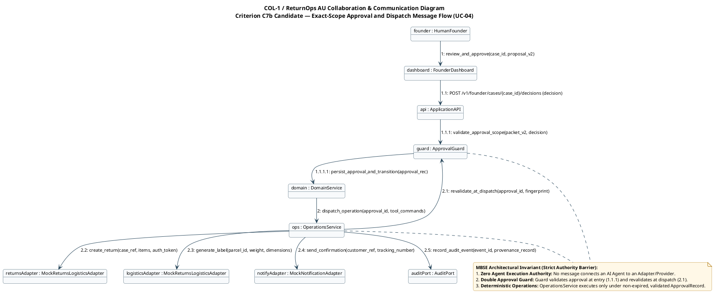

# Collaboration / Communication Diagram — Governed Approval & Dispatch

> **MBSE model type**: OMG UML 2.5 Communication / Collaboration Diagram (`COL-1`)
>
> **Laboratory 5 / Criterion C7 role**: Runtime structural message model emphasising object relationships and numbered message sequences during operational dispatch.
>
> **Status — 2026-09-15:** Task T9 completed: Authored standard OMG UML 2.5 collaboration diagram (`shared/collaboration-diagram.puml` and `shared/collaboration-diagram.svg`), securing Criterion C7b (1.5 marks).
>
> **Contribution Split (Hard Rules H5 & H11):**
> - Member A (`@shuxiachai`): **50% (Primary Author)** — UC-04 exact-scope approval and dispatch workflow, Operations Service orchestration, and provider integration.
> - Member B (`@ChengsiLi`): **25% (Secondary Reviewer)** — Founder Dashboard interface, API endpoint integration, and customer notification path.
> - Member C (`@lulucas-tao`): **25% (Secondary Reviewer)** — Approval Guard validation rules, decision fingerprinting, and audit event verification.
>
> **Alignment baseline:** [Lead-approved v1.0 candidate](../00-project-definition-v1.md), [frozen allocation](../07-frozen-work-allocation.md), and [Composite Structure](../13-shared-composite-structure.md).
>
> **Detailed specifications:**
> [Stage 1 Team Report §6.2](../reports/stage-1-team-report.md) and [Use Case Specifications (UC-04)](../05-lab-3-requirement-modelling.md).

## 1. Exact-Scope Approval and Dispatch Communication

[Editable PlantUML source file](shared/collaboration-diagram.puml) · [Full SVG](shared/collaboration-diagram.svg)

The diagram specifies the runtime communication and hierarchical message flows across subsystem components during the execution of `UC-04` (Governed Simulated Operations Execution). It traces the transition from the Human Founder's approval through the Founder Dashboard, API gateway, double Approval Guard validation, deterministic Operations Service, mock providers, notification dispatcher, and audit port.

## 2. Message Dispatch Ledger & Hierarchical Numbering

The communication sequence enforces strict causal order and hierarchical call nesting using decimal message numbering:

| Sequence No. | Sender | Receiver | Invocation Signature | Architectural Concern & Invariant |
|---|---|---|---|---|
| `1` | `founder` | `dashboard` | `review_and_approve(case_id, proposal_v2)` | Human Founder executes explicit approval decision on dashboard UI (`UC-03`). |
| `1.1` | `dashboard` | `api` | `POST /v1/founder/cases/{case_id}/decisions (decision)` | Client submits authenticated approval payload containing proposal ID and scope. |
| `1.1.1` | `api` | `guard` | `validate_approval_scope(packet_v2, decision)` | **Initial Guard Validation:** Verifies decision hash matches proposal v2; checks expiry. |
| `1.1.1.1` | `guard` | `domain` | `persist_approval_and_transition(approval_rec)` | Domain Service writes immutable `ApprovalRecord` and transitions `ReturnCase` to `APPROVED`. |
| `2` | `domain` | `ops` | `dispatch_operation(approval_id, tool_commands)` | Domain Service requests simulated operations dispatch for approved line items. |
| `2.1` | `ops` | `guard` | `revalidate_at_dispatch(approval_id, fingerprint)` | **Dispatch Revalidation:** Verifies approval has not expired, case has not been superseded, and scope matches. |
| `2.2` | `ops` | `returnsAdapter` | `create_return(case_ref, items, auth_token)` | Deterministic dispatch to Mock Returns Provider; generates return parcel reference. |
| `2.3` | `ops` | `logisticsAdapter` | `generate_label(parcel_id, weight, dimensions)` | Deterministic dispatch to Mock Logistics Adapter; creates consignment tracking and printable label. |
| `2.4` | `ops` | `notifyAdapter` | `send_confirmation(customer_ref, tracking_number)` | Simulated customer notification dispatched with label access link. |
| `2.5` | `ops` | `auditPort` | `record_audit_event(event_id, provenance_record)` | Immutable audit record logged via `AuditPort` recording causal actor, hash, and timestamp. |

---

## 3. Architectural Analysis: Invariants & Authority Barriers

### 3.1 Structural Communication (`COL-1`) vs Temporal Sequence (`INT-1`)
While sequence diagrams (`sequenceDiagram` / `INT-1`) emphasise the linear chronological timeline of message lifelines, the communication diagram (`COL-1`) highlights the structural topology of interacting components. In `COL-1`, spatial positioning reflects component relationships:
- The human operator interacts strictly with the frontend presentation layer (`dashboard`).
- The frontend interacts strictly with the application boundary (`api`).
- The deterministic backend services (`domain`, `ops`) mediate all access to external mock providers.
- The diagram makes immediately visible that no cross-boundary links bypass security controls.

### 3.2 The Double Approval Guard Invariant
In accordance with Invariant 3 in `docs/00` §10.4, an approval valid when granted by a human founder can become invalid by the time operations dispatch occurs (e.g. if the customer concurrently submits an amended statement, or if the authorisation TTL expires). To eliminate this race condition:
1. **Invocation `1.1.1`:** `Approval Guard` validates the proposal at the moment of Founder decision entry, ensuring the Founder is approving the exact grounded proposal version (`proposal_version = 2`).
2. **Invocation `2.1`:** `Operations Service` invokes `Approval Guard` immediately prior to dispatching physical tool commands. If the case state has drifted or the authorisation has expired, dispatch is aborted with an audit failure.

### 3.3 Strict Execution Barrier (Zero Agent Execution Authority)
In accordance with Hard Rule H1 and Project Description requirements, autonomous LLM agents (Customer Case Coordinator Agent, Returns Assessment Agent, Compliance & Risk Reviewer Agent) are **completely excluded from operations execution**:
- No message arrow originates from an AI agent to `returnsAdapter`, `logisticsAdapter`, or `notifyAdapter`.
- All operations execution is mediated by `Operations Service`, which is pure deterministic software without LLM components.
- Operations Service executes solely upon receiving a validated `ApprovalRecord` containing an unexpired cryptographic fingerprint of the Founder's decision.
