# Collaboration / Communication Diagram — Governed Approval and Dispatch

> **COL-1; updated 2026-09-17.** B introduced this shared diagram in PR #14 at `6ddd8aa`; this follow-up is A/AI-assisted correction against [CS-0.2](../13-shared-composite-structure.md) and [AD-0.2](../14-member-a-design-decisions.md). It is a design candidate for Criterion C7b, not runtime proof, awarded marks or verified per-member percentages. Actual shared contributions and personal acceptance remain pending.

## 1. Communication model

[PlantUML source](shared/collaboration-diagram.puml) · [SVG](shared/collaboration-diagram.svg) · [team report](../reports/stage-1-team-report.md)

This condensed success-path view spans UC-03 decision admission and UC-04 execution. Numbers identify logical messages, including callbacks; multi-message edges compress repeated exchanges, not a new public API. It complements the [A sequence panels](../12-member-a-model-chain.md), which retain detailed rejection, partial-effect and recovery branches.

```plantuml
@startuml
title COL-1 / ReturnOps AU Communication Diagram\nDesign candidate — exact approval, Domain acceptance and audit (UC-03/04)
left to right direction
skinparam defaultFontName SansSerif
skinparam defaultFontSize 12
skinparam shadowing false
skinparam roundCorner 8
skinparam objectBorderColor #27465B
skinparam objectBackgroundColor #F8FAFC
skinparam ArrowColor #27465B
skinparam noteBackgroundColor #FFF8E7
skinparam noteBorderColor #B27B10
skinparam nodesep 55
skinparam ranksep 75

object "founder : HumanFounder" as founder
object "dashboard : FounderDashboard" as dashboard
object "api : ApplicationAPI" as api
object "domain : DomainService" as domain
object "guard : ApprovalGuard" as guard
object "ops : OperationsService" as ops
object "provider : MockReturnsLogisticsAdapter" as provider
object "notify : MockNotificationAdapter" as notify
object "store : CaseRepository" as store
object "audit : AuditPort" as audit

founder --> dashboard : 1: review exact current proposal
dashboard --> api : 1.1: POST founder decision
api --> domain : 1.2: decision + trusted context
domain <--> guard : 1.3: current decision check\n1.4: verdict (not approval)
domain --> ops : 2: dispatch saved work\n3: eligible notification work
ops <--> domain : 2.1: current records / claim / intent (Tx B)\n2.4: operation observation -> saved result (Tx C)\n3.2: notification observation -> saved result (Tx D)
ops <--> guard : 2.2: final dispatch scope check\nverdict for each new effect
ops <--> provider : 2.3: authority check; guarded invoke\nraw effect observation (return, then label)
ops <--> notify : 3.1: send persisted outcome\ndelivery observation
domain --> store : 1.5 / 2.1 / 2.4 / 3.2:\nguarded business writes (Tx A/B/C/D)
domain --> audit : same Tx A/B/C/D:\nrecord_non_personal_event(event, tx)

note bottom of domain
  <b>One authority and transaction boundary</b>
  Tx A: accepted decision, exact approval and work.
  Tx B: durable claim/intent before a new effect.
  Tx C/D: accepted operation/notification facts and state.
  Each change includes required audit and applicable work
  in the same transaction context; failure is not success.
  Domain alone calls CaseRepository and AuditPort.
end note

note bottom of ops
  <b>Condensed success path; guards are still required</b>
  Each effect requires current authority, scope, expiry,
  provider permission, allowlist and durable idempotency.
  Final checks coordinate with Domain at the call boundary.
  Save return before label; complete label reference before
  SUCCEEDED; save both effects before outcome notification.
  Unknown effect: reconcile original attempt, never blind retry.
  Known label: recover original artifact, never create again.
  Notification retry does not repeat return or label.
end note

note top of audit
  Provider calls are outside local database transactions.
  Ops and Guard submit observations, not trusted audit events.
  No AI-to-provider/DB path is authorised by this design.
  This model is not runtime or concurrency proof.
end note
@enduml
```

## 2. Message and transaction ledger

| Step | Sender → receiver | Required meaning |
|---|---|---|
| 1 / 1.1 / 1.2 | Founder → dashboard → API → Domain | Authenticated exact-target decision with server-formed trusted context; the UI cannot create authority. |
| 1.3 / 1.4 | Domain ↔ Guard | Current-state decision check returns an internal verdict. Guard neither creates nor persists approval. |
| 1.5 (Tx A) | Domain → CaseRepository and AuditPort | Persist accepted decision, exact ApprovalRecord, required audit and applicable work together. |
| 2 / 2.1 (Tx B) | Domain → Operations; Operations ↔ Domain | Dispatch saved work, reload permitted current records and obtain durable claim/intent before a new effect. |
| 2.2 / 2.3 | Operations ↔ Guard / provider | Check final current scope/expiry/authority at each effect boundary, plus provider permission, allowlist and durable idempotency. Invoke return then label under their dependencies. |
| 2.4 (Tx C) | Operations → Domain → CaseRepository/AuditPort | Raw observations become trusted facts only after Domain validation and atomic state/audit/work acceptance. Save return before label; a label requires its controlled artifact reference before SUCCEEDED. |
| 3 / 3.1 | Domain → Operations → notification adapter | Only the accepted persisted outcome selects notification. Core success requires both saved effects first; reject/manual paths can notify without effects. |
| 3.2 (Tx D) | Operations → Domain → CaseRepository/AuditPort | Accept delivery result, state, required audit and any retry work together. Failed notification never replays return/label. |

## 3. Authority and recovery boundaries

Domain alone calls `CaseRepository` and `AuditPort`. Business writes, required non-personal audit and applicable work share the same transaction context; a separate audit append cannot turn a failed state transaction into success. Operations/provider/Guard observations return to Domain for validation; none can directly write trusted business audit.

External effects are outside the local database transaction. Before every new effect, final checks must coordinate with current Domain state, authority generation and durable claims at the actual call boundary. Merely checking twice does not prove freedom from races; AD-0.2 and later concurrency/fault tests govern that unproven implementation boundary. A permitted version change is an internal guarded action, not an arbitrary post-review customer append route.

Unknown effects reconcile the original attempt before any justified retry. A known label effect with incomplete local artifact retains EXECUTING and recovers that same artifact without reinvocation; only complete saved result/reference permits SUCCEEDED. Notification recovery remains independent. Late results do not overwrite an accepted manual/rejected case outcome. The diagram omits AI-to-provider/DB paths as a design restriction; runtime enforcement still needs implementation and negative tests.

See [follow-up disposition](../reviews/b-shared-model-followup-20260917.md) for exact sources and validation scope. No B personal model, public DTO, route, feature owner or WBS dependency changes here.
