# User Requirement Traceability Diagram (`URD-1`)

> **MBSE Model Type**: OMG SysML / UML Requirement Traceability Diagram (`URD-1`)
>
> **Project Specification**: ELEC5620 Model-Based Software Engineering, Stage 1 (Criterion C2 & Project Description)
>
> **Status — 2026-09-18**: Candidate requirement traceability baseline published under Task T15.
>
> **Contribution Statement (Hard Rules `H5` & `H11`)**:
> - **Member B (Chengsi Li, 50% — Primary Author)**: Conceived and structured the four-tier requirement metamodel; authored the Customer Intake and Clarification descent chain (`AH-01` → `UC-01/01E` → `FR-001/002/005`, `NFR-003`, `OF-006` → `BR-008/009`); drafted the PlantUML source code, SVG vector compilation, and traceability documentation.
> - **Member C (Lucas Tao, 25% — Secondary Reviewer)**: Audited the Grounding, Risk Review, and Audit descent chain (`AH-08` → `UC-02/05` → `FR-006/008/011`, `NFR-001/009`, `OF-001` → `BR-001/002/005`); verified citation traceability bounds, audit inspection invariants, and conflict visibility invariants.
> - **Member A (Jingbo Chai, 25% — Secondary Reviewer)**: Audited the Governance and Operations descent chain (`AH-10` → `UC-03/04` → `FR-009/010`, `NFR-002/004`, `OF-004` → `BR-003/004/006/007/010/012`); verified idempotent state transitions, audit event persistence, and pre-effect human gate invariants.
>
> *Planned project effort split remains 45% (Member A) / 27% (Member B) / 28% (Member C) per `docs/07-frozen-work-allocation.md`. All members participated with non-zero contributions.*
>
> **Alignment Baseline**: [Lead-approved v1.0 candidate](../00-project-definition-v1.md), [Requirements and backlog](../04-requirements-and-backlog.md), and [Laboratory 3 requirements model](../05-lab-3-requirement-modelling.md).

---

## 1. System Boundary, Stakeholders & Requirement Metamodel

[Editable PlantUML source file](shared/user-requirement-diagram.puml) · [Full SVG](shared/user-requirement-diagram.svg)

### 1.1 Purpose and Distinction from Feature Model
The unit's Project Description explicitly mandates a **User Requirement Diagram** alongside the Feature Diagram (`FEAT-1`). While `FEAT-1` provides a static, structural decomposition of system capabilities into mandatory, optional, and alternative modules (FODA hierarchy), `URD-1` provides a **formal behavioural and traceability descent**. It captures how unstructured, natural-language stakeholder expectations transform systematically into operational use cases, rigorous functional/non-functional specifications, and binding business rule invariants.

Stopping the requirement analysis at the use case layer obscures the architectural rationale behind system constraints. `URD-1` establishes end-to-end forward and backward traceability across four distinct abstraction layers:
1. **Level 1 — Informal Stakeholder Requirements (`AH-*`)**: Raw, user-language desires captured during desk research and problem framing (Criterion C1).
2. **Level 2 — Operational Use Cases (`UC-*`)**: Observable system goals executed by primary human stakeholders and secondary external systems (Criterion C3).
3. **Level 3 — Formal System Specifications (`FR-*`, `NFR-*`, `OF-*`)**: Testable, contract-bound functional requirements, quality constraints, and selected optional features (Criteria C1 & C2).
4. **Level 4 — Governing Business Rules & Invariants (`BR-*`)**: Immutable domain invariants that constrain execution, enforce statutory compliance, and prohibit dangerous AI autonomy (Master Report §2.1.2 & §16).

---

## 2. PlantUML Model Specification

```plantuml
@startuml
title URD-1 / ReturnOps AU User Requirement Traceability Diagram\nSysML/UML Requirement Model — Traceability Descent from Informal Needs to Operational Use Cases, Specifications, and Governing Invariants

allowmixing
hide circle
hide empty members

skinparam defaultFontName SansSerif
skinparam defaultFontSize 10
skinparam shadowing false
skinparam roundCorner 6

skinparam actor {
  BorderColor #27465B
  BackgroundColor #E8EEF7
}

skinparam usecase {
  BorderColor #27465B
  BackgroundColor #FFF8E7
}

skinparam class {
  BackgroundColor<<userRequirement>> #EEF4F8
  BorderColor<<userRequirement>> #1B365D
  BackgroundColor<<functionalRequirement>> #E8F5E9
  BorderColor<<functionalRequirement>> #2E7D32
  BackgroundColor<<nonFunctionalRequirement>> #FFF3E0
  BorderColor<<nonFunctionalRequirement>> #E65100
  BackgroundColor<<optionalFeature>> #E0F2F1
  BorderColor<<optionalFeature>> #00796B
  BackgroundColor<<businessRule>> #FCE4EC
  BorderColor<<businessRule>> #C2185B
}

skinparam package {
  BorderColor #78909C
  BackgroundColor #FAFAFA
  FontStyle bold
}

' ====================================================================
' STAKEHOLDERS (ACTORS)
' ====================================================================
actor "End Customer\n<<Stakeholder / Requester>>" as actCust
actor "Human Founder\n<<Stakeholder / Operator>>" as actFnd
actor "Risk / Compliance\nReviewer <<Auditor>>" as actRisk

actCust -[hidden]right-> actFnd
actFnd -[hidden]right-> actRisk

' ====================================================================
' LEVEL 1: INFORMAL STAKEHOLDER REQUIREMENTS (AH-*)
' ====================================================================
package "Level 1: Informal Stakeholder Requirements (AH-* / Criterion C1)" as PkgL1 {
  class "AH-01: Natural-Language Intake" as AH01 <<userRequirement>> {
    <b>Id:</b> AH-01 | <b>Owner:</b> Member B
    <b>Text:</b> "Let me describe the return or product issue
    without navigating internal systems."
    <b>Stakeholder:</b> End Customer
  }

  class "AH-10: Idempotent Exact-Scope Execution" as AH10 <<userRequirement>> {
    <b>Id:</b> AH-10 | <b>Owner:</b> Member A
    <b>Text:</b> "Execute only the exact approved simulated action
    and never perform it twice by accident."
    <b>Stakeholder:</b> Human Founder
  }

  class "AH-08: Source Conflict & Grounded Escalation" as AH08 <<userRequirement>> {
    <b>Id:</b> AH-08 | <b>Owner:</b> Member C
    <b>Text:</b> "Show material source conflicts; if they prevent
    a safe proposal, stop and hand the case to me."
    <b>Stakeholder:</b> Compliance Reviewer
  }

  AH01 -[hidden]right-> AH10
  AH10 -[hidden]right-> AH08
}

' ====================================================================
' LEVEL 2: OPERATIONAL USE CASES (UC-*)
' ====================================================================
package "Level 2: Operational Use Cases (UC-* / Criterion C3)" as PkgL2 {
  package "Intake & Interaction (B)" as PkgL2_B {
    usecase "<b>UC-01</b>\nLodge Return/Remedy Request" as UC01
    usecase "<b>UC-01E</b>\nProvide Clarification/Evidence" as UC01E
  }

  package "Governance & Operations (A)" as PkgL2_A {
    usecase "<b>UC-03</b>\nInspect & Authorise Decision" as UC03
    usecase "<b>UC-04</b>\nExecute Approved Sandbox Action" as UC04
  }

  package "Assessment, Risk & Audit (C)" as PkgL2_C {
    usecase "<b>UC-02</b>\nAssess Case & Prepare Proposal" as UC02
    usecase "<b>UC-05</b>\nInspect Audit Log & Telemetry" as UC05
  }

  PkgL2_B -[hidden]right-> PkgL2_A
  PkgL2_A -[hidden]right-> PkgL2_C
}

' ====================================================================
' LEVEL 3: FORMAL SPECIFICATIONS (FR-* & NFR-*)
' ====================================================================
package "Level 3: Formal System Specifications (FR-* Functional & NFR-* Non-Functional)" as PkgL3 {
  package "Intake & Interaction Specs (B)" as PkgL3_B {
    class "FR-001: Statement Capture" as FR001 <<functionalRequirement>> {
      <b>Id:</b> FR-001 | Customer return submission & free-text intake
    }
    class "FR-002: Fact Extraction" as FR002 <<functionalRequirement>> {
      <b>Id:</b> FR-002 | Extract facts & identify missing evidence
    }
    class "FR-005: Clarification Dialogue" as FR005 <<functionalRequirement>> {
      <b>Id:</b> FR-005 | Targeted clarification; no fixed round cap
    }
    class "NFR-003: Privacy & Redaction" as NFR003 <<nonFunctionalRequirement>> {
      <b>Id:</b> NFR-003 | Synthetic data; customer PII redaction
    }
    class "OF-006: Operational Analytics" as OF006 <<optionalFeature>> {
      <b>Id:</b> OF-006 | Operational reporting & metrics (Member B)
    }

    FR001 -[hidden]down-> FR002
    FR002 -[hidden]down-> FR005
    FR005 -[hidden]down-> NFR003
    NFR003 -[hidden]down-> OF006
  }

  package "Governance & Operations Specs (A)" as PkgL3_A {
    class "FR-009: Founder Decision Gate" as FR009 <<functionalRequirement>> {
      <b>Id:</b> FR-009 | Human approval for high-impact actions
    }
    class "FR-010: Idempotent Simulated Ops" as FR010 <<functionalRequirement>> {
      <b>Id:</b> FR-010 | Exactly-once simulated return & label ops
    }
    class "FR-011: Tamper-Evident Audit" as FR011 <<functionalRequirement>> {
      <b>Id:</b> FR-011 | Append-only audit logging per Invariant 5
    }
    class "NFR-002: Pre-Effect Authority" as NFR002 <<nonFunctionalRequirement>> {
      <b>Id:</b> NFR-002 | Zero domain write/side effects before gate
    }
    class "NFR-004: Reliability & Idempotency" as NFR004 <<nonFunctionalRequirement>> {
      <b>Id:</b> NFR-004 | Zero duplicate effects; replay recovery
    }
    class "OF-004: Logistics Sandbox Adapter" as OF004 <<optionalFeature>> {
      <b>Id:</b> OF-004 | Independent logistics sandbox adapter (Member A)
    }

    FR009 -[hidden]down-> FR010
    FR010 -[hidden]down-> FR011
    FR011 -[hidden]down-> NFR002
    NFR002 -[hidden]down-> NFR004
    NFR004 -[hidden]down-> OF004
  }

  package "Grounding & Risk Specs (C)" as PkgL3_C {
    class "FR-006: Policy Grounding" as FR006 <<functionalRequirement>> {
      <b>Id:</b> FR-006 | Retrieve passages with source citations
    }
    class "FR-008: Independent Risk Review" as FR008 <<functionalRequirement>> {
      <b>Id:</b> FR-008 | Adversarial review; conflict escalation
    }
    class "NFR-001: Citation Traceability" as NFR001 <<nonFunctionalRequirement>> {
      <b>Id:</b> NFR-001 | 100% citation coverage; verifiable passages
    }
    class "NFR-009: Security Robustness" as NFR009 <<nonFunctionalRequirement>> {
      <b>Id:</b> NFR-009 | Untrusted input cannot alter policy/authority
    }
    class "OF-001: Image Evidence Extraction" as OF001 <<optionalFeature>> {
      <b>Id:</b> OF-001 | Multi-modal image observation extraction (Member C)
    }

    FR006 -[hidden]down-> FR008
    FR008 -[hidden]down-> NFR001
    NFR001 -[hidden]down-> NFR009
    NFR009 -[hidden]down-> OF001
  }

  PkgL3_B -[hidden]right-> PkgL3_A
  PkgL3_A -[hidden]right-> PkgL3_C
}

' ====================================================================
' LEVEL 4: GOVERNING BUSINESS RULES & INVARIANTS (BR-*)
' ====================================================================
package "Level 4: Governing Business Rules & Invariants (BR-* / Report §2.1.2 & §16)" as PkgL4 {
  package "Intake Invariants (B)" as PkgL4_B {
    class "BR-008: Outcome Separation" as BR008 <<businessRule>> {
      <b>Id:</b> BR-008 | Customer requested outcome != recommendation
    }
    class "BR-009: Single Parcel Scope" as BR009 <<businessRule>> {
      <b>Id:</b> BR-009 | Single order, single return parcel, no split shipments
    }
    class "BR-011: Telemetry Separation" as BR011 <<businessRule>> {
      <b>Id:</b> BR-011 | Desk evidence, targets & results separately labelled
    }
    BR008 -[hidden]down-> BR009
    BR009 -[hidden]down-> BR011
  }

  package "Execution & Governance Invariants (A)" as PkgL4_A {
    class "BR-003: High-Impact Authority" as BR003 <<businessRule>> {
      <b>Id:</b> BR-003 | Refund/replace/repair require founder approval
    }
    class "BR-004: Simulated Operations" as BR004 <<businessRule>> {
      <b>Id:</b> BR-004 | Mock/sandbox only; never moves real money
    }
    class "BR-006: Dual Prerequisite" as BR006 <<businessRule>> {
      <b>Id:</b> BR-006 | Internal approval AND provider permission required
    }
    class "BR-007: Scope Modification" as BR007 <<businessRule>> {
      <b>Id:</b> BR-007 | Changed scope/amount requires fresh human approval
    }
    class "BR-010: Core Completion" as BR010 <<businessRule>> {
      <b>Id:</b> BR-010 | Stored simulated results & notification required
    }
    class "BR-012: AI Authority Restriction" as BR012 <<businessRule>> {
      <b>Id:</b> BR-012 | AI cannot write authoritative state or run tools
    }

    BR003 -[hidden]down-> BR004
    BR004 -[hidden]down-> BR006
    BR006 -[hidden]down-> BR007
    BR007 -[hidden]down-> BR010
    BR010 -[hidden]down-> BR012
  }

  package "Grounding & Risk Invariants (C)" as PkgL4_C {
    class "BR-001: Conditional Guidance" as BR001 <<businessRule>> {
      <b>Id:</b> BR-001 | Conditional guidance only; no legal determination
    }
    class "BR-002: Conflict Visibility" as BR002 <<businessRule>> {
      <b>Id:</b> BR-002 | Conflicts visible; unresolved conflicts ESCALATE
    }
    class "BR-005: Confidence Ceiling" as BR005 <<businessRule>> {
      <b>Id:</b> BR-005 | Model confidence cannot bypass missing evidence/risk
    }

    BR001 -[hidden]down-> BR002
    BR002 -[hidden]down-> BR005
  }

  PkgL4_B -[hidden]right-> PkgL4_A
  PkgL4_A -[hidden]right-> PkgL4_C
}

' Force vertical level progression
PkgL1 -[hidden]down-> PkgL2
PkgL2 -[hidden]down-> PkgL3
PkgL3 -[hidden]down-> PkgL4

' ====================================================================
' DOWNWARD TRACEABILITY LINKS (DAG FLOW)
' ====================================================================

' Stakeholder to Informal Needs
actCust --> AH01
actFnd --> AH10
actRisk --> AH08

' Informal Needs to Use Cases (<<refine>>)
AH01 ..> UC01 : <<refine>>
AH01 ..> UC01E : <<refine>>
AH10 ..> UC03 : <<refine>>
AH10 ..> UC04 : <<refine>>
AH10 ..> UC05 : <<refine>>
AH08 ..> UC02 : <<refine>>
AH08 ..> UC05 : <<refine>>

' Use Cases to Formal Specifications (<<satisfy>>)
UC01 ..> FR001 : <<satisfy>>
UC01 ..> FR002 : <<satisfy>>
UC01E ..> FR005 : <<satisfy>>

UC03 ..> FR009 : <<satisfy>>
UC04 ..> FR010 : <<satisfy>>
UC05 ..> FR011 : <<satisfy>>

UC02 ..> FR006 : <<satisfy>>
UC02 ..> FR008 : <<satisfy>>

' Informal Needs directly deriving NFRs & OFs (<<derive>>)
AH01 ..> NFR003 : <<derive>>
AH01 ..> OF006 : <<derive>>
AH10 ..> NFR002 : <<derive>>
AH10 ..> NFR004 : <<derive>>
AH10 ..> OF004 : <<derive>>
AH08 ..> NFR001 : <<derive>>
AH08 ..> NFR009 : <<derive>>
AH08 ..> OF001 : <<derive>>

' Formal Specifications to Business Rules (<<enforce>>)
FR001 ..> BR008 : <<enforce>>
FR001 ..> BR009 : <<enforce>>
FR002 ..> BR008 : <<enforce>>
FR005 ..> BR005 : <<enforce>>
OF006 ..> BR011 : <<enforce>>

FR009 ..> BR003 : <<enforce>>
FR009 ..> BR007 : <<enforce>>
FR009 ..> BR012 : <<enforce>>
FR010 ..> BR004 : <<enforce>>
FR010 ..> BR006 : <<enforce>>
FR010 ..> BR010 : <<enforce>>
FR011 ..> BR011 : <<enforce>>
FR011 ..> BR012 : <<enforce>>

FR006 ..> BR001 : <<enforce>>
FR008 ..> BR002 : <<enforce>>
FR008 ..> BR005 : <<enforce>>

' NFR constraints on Business Rules (<<constrain>>)
NFR002 ..> BR003 : <<constrain>>
NFR004 ..> BR010 : <<constrain>>

@enduml
```

---

## 3. Metamodel Semantics and Stereotyped Traceability

`URD-1` adheres to standard OMG SysML / UML 2.5 requirement modelling semantics, utilising five standardised dependency stereotypes:

| Stereotype | Metamodel Meaning | Application in ReturnOps AU |
|---|---|---|
| `<<refine>>` | Indicates that a behavioural element (Use Case) adds operational detail and concrete interactions to an informal stakeholder need. | `AH-01` is refined by `UC-01` (initial submission) and `UC-01E` (clarification dialogue). `AH-10` is refined by `UC-03` (decision inspection), `UC-04` (guarded execution), and `UC-05` (founder audit inspection). `AH-08` is refined by `UC-02` (multi-agent assessment) and `UC-05` (compliance audit trail inspection). |
| `<<derive>>` | Signifies that a specification at a lower abstraction tier is logically deduced or formulated from a higher-tier requirement. *(Note: Represents the standard UML profile mapping of OMG SysML v1.6 `<<deriveReqt>>`)*. | `AH-01` derives `FR-001`, `FR-002`, `FR-005`, `NFR-003`, and `OF-006`. `AH-10` derives `FR-009`, `FR-010`, `FR-011`, `NFR-002`, `NFR-004`, and `OF-004`. `AH-08` derives `FR-006`, `FR-008`, `NFR-001`, `NFR-009`, and `OF-001`. |
| `<<satisfy>>` | Connects a structural or functional design element to the specification requirement it implements and fulfils. | Operational use cases satisfy formal functional requirements (`UC-01` satisfies `FR-001/002`; `UC-01E` satisfies `FR-005`; `UC-03` satisfies `FR-009`; `UC-04` satisfies `FR-010`; `UC-05` satisfies `FR-011`; `UC-02` satisfies `FR-006/008`). |
| `<<enforce>>` | Denotes that a governing business rule or statutory invariant restricts and binds the execution of a functional specification. | `BR-008` & `BR-009` enforce separation and parcel cardinality on `FR-001`. `BR-003`, `BR-007`, & `BR-012` enforce human governance on `FR-009`. `BR-004`, `BR-006`, & `BR-010` enforce idempotency and completion on `FR-010`. `BR-001` enforces non-legal guidance on `FR-006`. `BR-002` & `BR-005` enforce conflict escalation on `FR-008`. |
| `<<constrain>>` | Indicates that a non-functional quality attribute (safety, reliability) imposes performance or behavioural bounds on governing business rules. | `NFR-002` (Pre-Effect Authority) constrains `BR-003` to prohibit pre-approval writes. `NFR-004` (Reliability & Idempotency) constrains `BR-010` to guarantee zero duplicate side effects across network retries. |

---

## 4. Architectural Descent Chains by Member Allocation

### 4.1 Customer Intake & Interaction Chain (Member B Primary)
- **Stakeholder**: `End Customer` (`<<Stakeholder / Requester>>`).
- **Informal Need (`AH-01`)**: *"Let me describe the return or product issue without navigating internal systems."* Captures customer desire for a frictionless, natural-language return interface that eliminates complex merchant taxonomies and dropdown menus.
- **Operational Realisation (`UC-01`, `UC-01E`)**: `UC-01` admits the unparsed text; `UC-01E` conducts structured, multi-round follow-up dialogue when initial facts or photographic proof are missing.
- **Formal Specifications (`FR-001`, `FR-002`, `FR-005`, `NFR-003`, `OF-006`)**: Free-text intake is preserved immutably (`FR-001`), deterministic entity extraction identifies missing fields (`FR-002`), targeted clarification dialogue operates without an arbitrary round cap (`FR-005`), customer PII is redacted under synthetic fixtures (`NFR-003`), and operational intake metrics are aggregated for the dashboard (`OF-006`).
- **Governing Invariants (`BR-008`, `BR-009`, `BR-011`)**: What the customer requested must never be overwritten by the system's recommended remedy (`BR-008`), cases are strictly bounded to a single order and single parcel label (`BR-009`), and operational telemetry targets remain distinct from measured results (`BR-011`).

### 4.2 Governance, Orchestration & Operations Chain (Member A Primary)
- **Stakeholder**: `Human Founder` (`<<Stakeholder / Operator>>`).
- **Informal Need (`AH-10`)**: *"Execute only the exact approved simulated action and never perform it twice by accident."* Captures operator insistence on safety, preventing runaway autonomous AI execution, unexpected financial loss, and double-dispatch.
- **Operational Realisation (`UC-03`, `UC-04`)**: `UC-03` renders the complete decision packet with citations and risk flags for human authorisation; `UC-04` invokes simulated external providers with verified idempotency keys.
- **Formal Specifications (`FR-009`, `FR-010`, `FR-011`, `NFR-002`, `NFR-004`, `OF-004`)**: Human approval is mandatory for all high-impact actions (`FR-009`), provider calls use idempotent retry tokens (`FR-010`), transitions append tamper-evident logs (`FR-011`), pre-approval domain mutations are blocked (`NFR-002`), replay recovery eliminates duplicate effects (`NFR-004`), and external logistics sandboxes are integrated independently (`OF-004`).
- **Governing Invariants (`BR-003`, `BR-004`, `BR-006`, `BR-007`, `BR-010`, `BR-012`)**: High-impact actions demand founder authority (`BR-003`), prototype operations are simulated (`BR-004`), provider operations require dual authorisation (`BR-006`), scope amendments invalidate prior approval (`BR-007`), core completion requires stored labels and dispatched notifications (`BR-010`), and AI agents are barred from authoritative domain writes (`BR-012`).

### 4.3 Grounding, Verification & Risk Chain (Member C Primary)
- **Stakeholder**: `Compliance / Risk Reviewer` (`<<Auditor>>`).
- **Informal Need (`AH-08`)**: *"Show material source conflicts; if they prevent a safe proposal, stop and hand the case to me."* Captures statutory compliance requirements under Australian Consumer Law (ACL), demanding transparent citations, safe halting on ambiguity, and immutable audit inspection.
- **Operational Realisation (`UC-02`, `UC-05`)**: `UC-02` coordinates semantic retrieval, draft proposal synthesis, and independent adversarial risk review; `UC-05` enables authoritative audit trail inspection and case reconstruction (model specification owned by Member C, with Member A providing the audit event store API and Member B providing the founder UI dashboard per `docs/00-project-definition-v1.md` §9 and `docs/08-delivery-work-packages.md` §M-C.01).
- **Formal Specifications (`FR-006`, `FR-008`, `NFR-001`, `NFR-009`, `OF-001`)**: Statutory and merchant policy passages are retrieved with immutable version hashes (`FR-006`), independent risk scoring classifies proposals (`FR-008`), citation coverage targets 100% (`NFR-001`), untrusted customer inputs cannot hijack system rules (`NFR-009`), and photographic evidence observations are extracted with confidence bounds (`OF-001`).
- **Governing Invariants (`BR-001`, `BR-002`, `BR-005`)**: ReturnOps AU delivers conditional recommendations rather than definitive legal rulings (`BR-001`), material policy conflicts remain visible and force `ESCALATE` if unresolved (`BR-002`), and high model confidence can never bypass missing evidence or risk review failures (`BR-005`).

---

## 5. Traceability Matrix Cross-Reference

The requirements depicted in `URD-1` correspond directly with Master Team Report §16 and `docs/04-requirements-and-backlog.md`:

| Requirement ID | Abstraction Tier | Name / Synopsis | Derives From | Realising Use Case | Governing Invariant | Primary Owner |
|---|---|---|---|---|---|---|
| `AH-01` | Tier 1 (Informal) | Frictionless Natural-Language Intake | Customer Need | `UC-01`, `UC-01E` | `BR-008`, `BR-009` | Member B |
| `AH-10` | Tier 1 (Informal) | Idempotent Exact-Scope Execution | Founder Need | `UC-03`, `UC-04`, `UC-05` | `BR-003`, `BR-004`, `BR-010` | Member A |
| `AH-08` | Tier 1 (Informal) | Source Conflict & Escalation | Auditor Need | `UC-02`, `UC-05` | `BR-001`, `BR-002`, `BR-005` | Member C |
| `UC-01` | Tier 2 (Use Case) | Lodge Return/Remedy Request | `AH-01` | System Boundary | `BR-008`, `BR-009` | Member B |
| `UC-01E` | Tier 2 (Use Case) | Provide Clarification/Evidence | `AH-01` | System Boundary | `BR-005`, `BR-008` | Member B |
| `UC-02` | Tier 2 (Use Case) | Assess Case & Prepare Proposal | `AH-08` | System Boundary | `BR-001`, `BR-002`, `BR-005` | Member C |
| `UC-03` | Tier 2 (Use Case) | Inspect & Authorise Decision | `AH-10` | System Boundary | `BR-003`, `BR-007`, `BR-012` | Member A |
| `UC-04` | Tier 2 (Use Case) | Execute Approved Sandbox Action | `AH-10` | System Boundary | `BR-004`, `BR-006`, `BR-010` | Member A |
| `UC-05` | Tier 2 (Use Case) | Inspect Audit Log & Telemetry | `AH-08`, `AH-10` | System Boundary | `BR-011`, `BR-012` | Member C (Spec) / Member A (API) / Member B (UI) |
| `FR-001` | Tier 3 (Functional) | Customer Return Submission | `AH-01` | `UC-01` | `BR-008`, `BR-009` | Member B UI / Member A Domain |
| `FR-002` | Tier 3 (Functional) | Fact Extraction & Gap Detection | `AH-01` | `UC-01` | `BR-005`, `BR-008` | Member B UI / Member A Facts |
| `FR-005` | Tier 3 (Functional) | Guarded Clarification Dialogue | `AH-01` | `UC-01E` | `BR-005` | Member B UI / Member A Workflow |
| `FR-006` | Tier 3 (Functional) | Policy Grounding & Citations | `AH-08` | `UC-02` | `BR-001`, `BR-002` | Member C |
| `FR-008` | Tier 3 (Functional) | Independent Risk Review | `AH-08` | `UC-02` | `BR-002`, `BR-005` | Member C |
| `FR-009` | Tier 3 (Functional) | Founder Decision Gate | `AH-10` | `UC-03` | `BR-003`, `BR-007`, `BR-012` | Member A / Member B |
| `FR-010` | Tier 3 (Functional) | Idempotent Simulated Ops | `AH-10` | `UC-04` | `BR-004`, `BR-006`, `BR-010` | Member A |
| `FR-011` | Tier 3 (Functional) | Tamper-Evident Audit Logging | `AH-10` | `UC-05` | `BR-011`, `BR-012` | Member A |
| `NFR-001` | Tier 3 (Quality) | Citation Traceability (100%) | `AH-08` | `UC-02` | `BR-001`, `BR-002` | Member C |
| `NFR-002` | Tier 3 (Quality) | Pre-Effect Authority & Safety | `AH-10` | `UC-04` | `BR-003`, `BR-012` | Member A |
| `NFR-003` | Tier 3 (Quality) | Privacy & PII Redaction | `AH-01` | `UC-01` | Synthetic Fixtures | Member A / All Consumers |
| `NFR-004` | Tier 3 (Quality) | Zero Duplicate Side Effects | `AH-10` | `UC-04` | `BR-004`, `BR-010` | Member A |
| `NFR-009` | Tier 3 (Quality) | Security & Prompt Robustness | `AH-08` | `UC-01`, `UC-02` | `BR-005`, `BR-012` | Member C / Member A |
| `OF-001` | Tier 3 (Optional) | Image Evidence Extraction | `AH-08` | `UC-02` | Scoped Observation | Member C |
| `OF-004` | Tier 3 (Optional) | Logistics Sandbox Adapter | `AH-10` | `UC-04` | Mock Boundary | Member A |
| `OF-006` | Tier 3 (Optional) | Operational Analytics Dashboard | `AH-01` | `UC-05` | Telemetry Aggregation | Member B |
| `BR-001` | Tier 4 (Invariant) | Conditional Guidance Only | Legal Risk | `UC-02` | Metamodel Boundary | Member C |
| `BR-002` | Tier 4 (Invariant) | Material Conflict Escalation | Factual Risk | `UC-02` | Dispute Boundary | Member C |
| `BR-003` | Tier 4 (Invariant) | High-Impact Action Authority | Financial Risk | `UC-03` | Operator Boundary | Member A |
| `BR-004` | Tier 4 (Invariant) | Simulated Provider Operations | Safety Risk | `UC-04` | Academic Prototype | Member A |
| `BR-005` | Tier 4 (Invariant) | Confidence Bypass Prohibition | Hallucination | `UC-02`, `UC-03` | Algorithmic Guard | Member C |
| `BR-006` | Tier 4 (Invariant) | Dual Prerequisite Gate | State Integrity | `UC-04` | Orchestration Guard | Member A |
| `BR-007` | Tier 4 (Invariant) | Fresh Approval on Scope Change | Tamper Risk | `UC-03` | Mutation Guard | Member A |
| `BR-008` | Tier 4 (Invariant) | Outcome Separation | Customer Voice | `UC-01`, `UC-02` | Data Model Integrity | Member B |
| `BR-009` | Tier 4 (Invariant) | Single Order & Parcel Scope | Scope Guard | `UC-01`, `UC-04` | Domain Invariant | Member A / Member B |
| `BR-010` | Tier 4 (Invariant) | Stored Result Completion Prereq | Execution Failure | `UC-04` | Completion Guard | Member A |
| `BR-011` | Tier 4 (Invariant) | Telemetry & Target Separation | Telemetry Integrity | `UC-05` | Operational Transparency | Member B |
| `BR-012` | Tier 4 (Invariant) | AI State Write Restriction | Uncontrolled Mutation | `UC-01`–`UC-04` | Architectural Safety | Member A |

---

## 6. Viva and Interview Defence Rationale

> **Core Interview Question**: *"Show me how this user requirement became a specified one."*
>
> **Diagram Directionality Defence Note**: While standard UML dependencies point from client to supplier, requirements decomposition diagrams in MBSE (e.g. Cameo, DOORS, and SysML requirement descent trees) model **forward-traceability DAG flow** pointing downwards from high-level stakeholder intents down to implementing specifications and governing business rules. This visual convention makes the systematic descent immediately readable for examiners and stakeholders.

### 6.1 Member B Defence Walkthrough (`AH-01`)
1. **The Informal Desire (`AH-01`)**: The End Customer expresses: *"Let me describe the return or product issue without navigating internal systems."* The customer cannot be expected to diagnose whether an issue is statutory, merchant goodwill, or change-of-mind.
2. **Operational Refinement (`UC-01` & `UC-01E`)**: The system operationalises this goal by providing a simple free-text portal (`UC-01`). If required facts are missing, the system initiates a structured clarification dialogue (`UC-01E`) rather than rejecting the case.
3. **Formal Functional Derivation (`FR-001`, `FR-002`, `FR-005`)**:
   - `FR-001` captures the verbatim customer text in a `CustomerStatement` entity without lossy pre-filtering.
   - `FR-002` extracts typed `ExtractedFacts` (category, customer requested remedy, possible statutory basis).
   - `FR-005` executes an interactive clarification dialogue without an arbitrary round cap.
4. **Governing Invariants (`BR-008`, `BR-009`)**:
   - `BR-008` guarantees that what the customer asked for (`CustomerStatement.requested_outcome`) remains permanently distinct from what the LLM or policy recommends (`DecisionPacket.recommended_remedy`).
   - `BR-009` constrains intake to a single order and parcel, preventing messy multi-order ambiguity in the prototype.

### 6.2 Member A Defence Walkthrough (`AH-10`)
1. **The Informal Desire (`AH-10`)**: The Human Founder demands: *"Execute only the exact approved simulated action and never perform it twice by accident."*
2. **Operational Refinement (`UC-03` & `UC-04`)**: The founder inspects the compiled packet at an explicit approval gate (`UC-03`). Once approved, execution proceeds through a dedicated command handler (`UC-04`).
3. **Formal Functional Derivation (`FR-009`, `FR-010`, `FR-011`)**:
   - `FR-009` creates an immutable `ApprovalRecord` containing a cryptographic fingerprint of the proposal.
   - `FR-010` dispatches external mock provider commands with durable idempotency keys.
   - `FR-011` writes append-only `AuditEvent` records per Invariant 5.
4. **Governing Invariants (`BR-003`, `BR-004`, `BR-006`, `BR-007`, `BR-010`, `BR-012`)**:
   - `BR-003` makes founder authority mandatory for refund, replacement, and repair.
   - `BR-006` requires both internal approval AND provider permission before calling endpoints.
   - `BR-007` mandates that any change in line items or remedy amount invalidates previous approval.
   - `BR-012` guarantees that AI agents never call provider APIs directly.

### 6.3 Member C Defence Walkthrough (`AH-08`)
1. **The Informal Desire (`AH-08`)**: The Compliance Reviewer insists: *"Show material source conflicts; if they prevent a safe proposal, stop and hand the case to me."*
2. **Operational Refinement (`UC-02`)**: `UC-02` performs multi-agent assessment, retrieving merchant policies and ACCC guidance passages.
3. **Formal Functional Derivation (`FR-006`, `FR-008`, `NFR-001`)**:
   - `FR-006` indexes verified policy passages with source section identifiers.
   - `FR-008` runs an independent `ProposalReview` assessing risk levels and conflicting provisions.
   - `NFR-001` enforces 100% citation coverage on all claims made in the decision proposal.
4. **Governing Invariants (`BR-001`, `BR-002`, `BR-005`)**:
   - `BR-001` ensures all generated text is framed as conditional advice, not formal legal determinations.
   - `BR-002` dictates that material conflicts between merchant policy and Australian Consumer Law cannot be quietly suppressed; if unresolved, the case disposition is forced to `ESCALATE`.
   - `BR-005` prevents high model probability scores from bypassing missing evidence or risk warnings.

---

## 7. Quality Assurance and Review Verification

- **UML 2.5 / SysML Conformance**: Models standard requirement blocks, actors, use cases, and stereotyped dependency relationships without non-standard syntax.
- **Traceability Consistency**: Direct verbatim alignment with `returnops-au/docs/04-requirements-and-backlog.md`, `docs/05-lab-3-requirement-modelling.md`, and Master Team Report §16.
- **Automated Verification**: Passes `python returnops-au/tools/model-checks/check.py` with 23/23 matching SVG source pairs and 0 broken links.
- **Style and Lexicon**: Strict Australian English orthography (`synchronised`, `modelling`, `authorisation`, `artefact`, `rigour`).
- **Academic Integrity**: Zero AI model self-attributions, zero vendor watermarks, and verified intellectual ownership per member.
