# Package Dependency Architecture Diagram (`PKG-1`)

> **MBSE Model Type**: UML 2.5 Package Diagram (`PKG-1`)
>
> **Project Specification**: ELEC5620 Model-Based Software Engineering, Stage 1 (Criterion C12, Optional Group Model — 0.5 marks)
>
> **Status — 2026-09-18**: Candidate logical package dependency baseline published under Task T11.
>
> **Contribution Statement (Hard Rules `H5` & `H11`)**:
> - **Member A (Jingbo Chai, 50% — Primary Author)**: Designed the 12-package (`P01`–`P12`) decomposition aligned to `AGENTS.md` §5 target layout; authored the PlantUML source code; established the inward-pointing dependency topology and the `packages/domain` zero-outgoing-dependency invariant.
> - **Member B (Chengsi Li, 25% — Secondary Author)**: Contributed the `P01 apps/web` and `P02 apps/api` application boundary specifications; validated the `Web → API → Domain` dependency chain against the frontend architecture; authored the document wrapper, traceability cross-references, and viva defence rationale.
> - **Member C (Lucas Tao, 25% — Secondary Reviewer)**: Audited the `P07 Risk / image capability` and `P08 grounding / corpus` package boundaries; verified that `RolesC` depends on `Domain` only through a scoped evidence-read contract with no case-write capability.
>
> *Planned project effort split remains 45% (Member A) / 27% (Member B) / 28% (Member C) per `docs/07-frozen-work-allocation.md`. All members participated with non-zero contributions.*
>
> **Alignment Baseline**: [Lead-approved v1.0 candidate](../00-project-definition-v1.md), [Requirements and backlog](../04-requirements-and-backlog.md), [Interface Contract v1.0 (rc.5)](../09-interface-contract-v1.md), and [Composite Structure Diagram (`CS-0.2`)](shared/governed-case-composite.puml).

---

## 1. Purpose, Architectural Context and Viewpoint Mapping

[Editable PlantUML source file](shared/package-dependencies.puml) · [Full SVG](shared/package-dependencies.svg)

### 1.1 Purpose and Distinction from Other Structure Models

The **Package Diagram** (`PKG-1`) presents the **Development View** of the system under Kruchten's 4+1 architectural framework (IEEE 1471 / ISO/IEC/IEEE 42010). While the Class Diagram (`CLS-1`, Criterion C6) captures design-time entity relationships and the Composite Structure Diagram (`SC-1`, Criterion C7c) reveals runtime internal wiring, `PKG-1` addresses a different concern: **logical module organisation and the direction of compile-time dependencies**.

A package diagram whose dependency arrows all point inward towards the domain core is not merely a structural description — it is an **argument about maintainability**. If every adapter, agent role, and application entry point depends on `packages/domain`, but `packages/domain` depends on nothing outside itself, then:

1. **Domain logic can be tested in isolation** — no database driver, HTTP framework, or external SDK is required for domain unit tests.
2. **External providers can be replaced** without modifying business rules — the Ports and Adapters (Hexagonal Architecture) pattern is enforced by dependency direction, not by convention.
3. **Accidental complexity stays at the boundary** — the domain layer addresses only essential complexity (Brooks, 1987), while transport formats, ORM mappings, and provider SDK quirks are confined to outer packages.

### 1.2 Kruchten 4+1 Placement

| View | Addressed by | Concern |
|---|---|---|
| **Development** | **`PKG-1` (this diagram)** | Module decomposition, dependency direction, build isolation |
| Logical | `CLS-1` (Class Diagram) | Design-time entity relationships and port contracts |
| Process | `COL-1` (Collaboration Diagram), individual sequence diagrams | Runtime message ordering and concurrency |
| Physical | `DEP-1` (Deployment Diagram) | Node topology, container allocation, network protocols |
| +1 Scenarios | `UCD-1` (Use Case Diagram), six use case specifications | Observable stakeholder goals |

---

## 2. PlantUML Model Specification

```plantuml
@startuml
title PD-01 / Package dependencies\nM-S.01 candidate PD-0.2 — logical modules, not deployed services
!pragma layout smetana
top to bottom direction
skinparam defaultFontName SansSerif
skinparam defaultFontSize 14
skinparam shadowing false
skinparam packageStyle rectangle
skinparam packageBorderColor #27465B
skinparam ArrowColor #27465B
skinparam noteBackgroundColor #FFF5D9
skinparam nodesep 40
skinparam ranksep 55

package "P01 apps/web\nB: intake / Founder / analytics\n{planned}" as Web #FFF3D6
package "P02 apps/api\nA: health API {exists}\nauth / business API / wiring {planned}" as API #E4F2EB
package "P03 contracts/v1\nrc.5 schema / OpenAPI / examples\n{artifacts exist; not an API}" as Wire #E4F2EB
package "P04 packages/domain\nA: legacy models {exist}\nDomainService / entities / ports {planned}" as Domain #E8EEF7

package "packages/agent_core {planned}" as AgentCore {
  package "P05 orchestration\nA: WorkflowOrchestrator\nbounded deterministic control" as Orch #FFF3D6
  package "P06 Coordinator / Assessment\nA: two role invocation wrappers\nno executable output" as RolesA #FFF3D6
  package "P07 Risk / image capability\nC: independent Risk invocation\nC3 image input is optional per run" as RolesC #FFF3D6
}
package "P08 grounding / corpus\nC: RetrievalPort implementation\nversioned retrieval + citation checks\n{planned; final subpath open}" as Sources #FFF3D6
package "P09 execution\nA: OperationsService / ApprovalGuard\n{planned logical module; subpath open}" as Execution #FFF3D6
package "packages/provider_adapters {planned}" as Adapters {
  package "P10 read-only order\nA: MockOrderAdapter" as Orders #FFF3D6
  package "P11 effects / notification\nA: mock return-label / notification\nA3 authorised test alternative" as Effects #FFF3D6
}
package "P12 persistence / artifacts\nA: PostgreSQLCaseRepository\nIntegrityAuditAdapter / scoped files\n{planned; final subpath open}" as Persistence #FFF3D6

Web ..> API : public HTTP only
API ..> Wire : transport conformance
API ..> Domain : application boundary\ntrusted server context
API ..> Persistence : composition root binds adapters\nnot a business-write call
Orch ..> Domain : analysisControl / analysisWork\naccepted observations / work contract
Orch ..> RolesA : coordinate / assess
Orch ..> RolesC : independent review / C3
Orch ..> Sources : verify citations\noriginal source receipts
RolesA ..> Orders : lookup only
RolesA ..> Sources : retrieve only
RolesC ..> Domain : C3 scoped evidence-read contract\nno case-write capability
Execution ..> Domain : operationControl / executionWork\ncurrent records, claim, observations
Execution ..> Effects : guarded invoke / query\nseparate saved-message delivery
Execution ..> Persistence : scoped label artifact only\nnot CaseRepository
Orders ..> Domain : OrderProviderPort
Sources ..> Domain : RetrievalPort
Effects ..> Domain : ReturnsLogisticsPort\nNotificationPort
Persistence ..> Domain : CaseRepository / AuditPort\nscoped artifact contracts
Domain ..> Wire : vocabulary / mapping specification\nnot a runtime JSON import

note bottom of Domain
  P04 owns the business application and port contracts.
  Domain alone calls CaseRepository and business AuditPort.
  analysisWork / executionWork are internal capabilities;
  implementations are wired by the application, not by LLMs.
  Source receipts remain observations until Domain accepts them.
end note

note bottom of Execution
  Guard validates; Domain creates trusted approval/work.
  Operations invokes only after fresh guard + provider authority.
  New effects, historical queries and notifications differ.
  An accepted manual/reject outcome survives late observations.
end note

legend bottom
  Dashed arrow = supplier dependency / interface usage, not message order or authority.
  Packages are logical responsibility boundaries; new subpaths are proposals, not files already present.
  P02 health code uses SQLAlchemy directly for infrastructure reads; no business repository exists yet.
  API wiring may construct adapters. Business writes still require Domain and one transaction context.
  CaseRepository + required AuditPort append share PostgreSQL; provider effects are outside that transaction.
  P06/P07 use a common model-call boundary (A); C owns Risk/image prompts and outputs.
  No AI -> execution/effect dependency; Risk gets full accepted material, never generator hidden reasoning.
  P11 selects mock OR one authorised A3 test adapter per logical operation, never both.
  P12 file reads/writes are scoped capabilities (CS-Q02), not new public endpoints or a second case store.
  C3 is a selected optional capability, not a fourth business Agent or a microservice.
  F.01 rc.5 / MA-0.3 / CS-0.2 alignment; Owner A, Reviewer C; no human acceptance claimed.
endlegend
@enduml
```

---

## 3. Package Decomposition and Dependency Ledger

### 3.1 Complete Package Inventory (`P01`–`P12`)

| ID | Package Path | Responsibility | Owner | Status | Inbound Dependencies | Outbound Dependencies |
|---|---|---|---|---|---|---|
| **P01** | `apps/web` | Customer Intake Portal, Founder Workspace, Analytics Dashboard (B1, B2, B3) | **B** | Planned | — | `P02` (public HTTP) |
| **P02** | `apps/api` | REST API entry point, health endpoints, authentication, composition root adapter wiring | **A** | Partial (`/health` exists) | `P01` | `P03`, `P04`, `P12` |
| **P03** | `contracts/v1` | F.01 rc.5 wire schema definitions, OpenAPI specification, validation examples | **A** | Exists (artefacts) | `P02`, `P04` | — |
| **P04** | `packages/domain` | Core business entities, value objects, port interface contracts, `DomainService` | **A** | Partial (legacy models exist) | `P02`, `P05`, `P07`, `P09`, `P10`, `P11`, `P08`, `P12` | `P03` (vocabulary mapping only) |
| **P05** | `packages/agent_core/orchestration` | `WorkflowOrchestrator` — bounded, deterministic multi-agent control flow | **A** | Planned | — | `P04`, `P06`, `P07`, `P08` |
| **P06** | `packages/agent_core/coordinator_assessment` | Coordinator Agent and Returns Assessment Agent role invocation wrappers (no executable output) | **A** | Planned | `P05` | `P10`, `P08` |
| **P07** | `packages/agent_core/risk` | Independent Risk Reviewer invocation; optional C3 image input capability | **C** | Planned | `P05` | `P04` (scoped read) |
| **P08** | `packages/grounding` | `RetrievalPort` implementation — versioned corpus retrieval and citation verification | **C** | Planned | `P05`, `P06` | `P04` |
| **P09** | `packages/execution` | `OperationsService` and `ApprovalGuard` — guarded deterministic execution | **A** | Planned | — | `P04`, `P11`, `P12` |
| **P10** | `packages/provider_adapters/orders` | `MockOrderAdapter` — read-only order lookup for assessment | **A** | Planned | `P06` | `P04` (`OrderProviderPort`) |
| **P11** | `packages/provider_adapters/effects` | Mock return-label generation and notification delivery; A3 authorised test alternative | **A** | Planned | `P09` | `P04` (`ReturnsLogisticsPort`, `NotificationPort`) |
| **P12** | `packages/persistence` | `PostgreSQLCaseRepository`, `IntegrityAuditAdapter`, scoped file artefact storage | **A** | Planned | `P02`, `P09` | `P04` (`CaseRepository`, `AuditPort`) |

### 3.2 Key Structural Observations

1. **`P04 packages/domain` is the dependency sink.** Eight packages depend on it; it depends on nothing except `P03` for vocabulary mapping (a specification artefact, not a runtime import). This is the Clean Architecture / Hexagonal invariant made visible.
2. **Adapters (`P10`, `P11`, `P12`) point inward.** Each adapter package implements a port interface defined in `P04`. Replacing a mock adapter with a production implementation requires changing only the adapter package and the composition root wiring in `P02` — never `P04`.
3. **Agent roles (`P06`, `P07`) are invocation wrappers, not autonomous services.** They carry no executable output authority. The `WorkflowOrchestrator` (`P05`) dispatches them, and only the `OperationsService` (`P09`) may invoke provider effects.
4. **No dependency runs from an agent package to an execution or effect package.** The structural firewall between analysis (`P05`–`P08`) and execution (`P09`–`P11`) is enforced by dependency direction: an agent that cannot import an execution module cannot call it.

---

## 4. Architectural Invariants and Governance Rules

### 4.1 The Dependency Inversion Invariant (Clean Architecture / Ports and Adapters)

The central architectural constraint `PKG-1` makes visible:

> **`packages/domain` (`P04`) has zero outgoing dependencies on agents, API frameworks, operational providers, or persistence implementations.**

All coupling flows **inward**. Outer-layer packages (API, agents, adapters, persistence) depend on `P04`'s port interfaces; `P04` never imports from any of them. This is Robert Martin's Dependency Rule ("source code dependencies must point inward, towards higher-level policies") applied to a multi-agent system.

**What this buys:**
- Domain entities and business rules can be validated, tested, and reasoned about without instantiating a database, an HTTP server, or an LLM provider.
- A failing external provider (e.g., Australia Post sandbox timeout) cannot corrupt domain state — the adapter boundary absorbs the failure and surfaces it as a domain-level observation.
- Stage 2 implementation can proceed package-by-package: each adapter is an independent unit of work with a contract defined by the port it implements.

### 4.2 The Agent–Execution Firewall

No dependency edge runs from any `agent_core` sub-package (`P05`, `P06`, `P07`) to `P09 execution`, `P10 orders` (write path), `P11 effects`, or `P12 persistence`. This is not an omission — it is the structural enforcement of the project's governance principle:

> **AI agents propose; they do not execute.**

An agent role wrapper that cannot import `OperationsService` cannot call it. The `ApprovalGuard` (`P09`) sits between the `DomainService` and the `OperationsService`, requiring a fresh human-granted `ApprovalRecord` before any provider effect is dispatched.

### 4.3 The Acyclic Dependency Constraint

The dependency graph is a **directed acyclic graph (DAG)**. No cycle exists — verified by visual inspection of the PlantUML source and by the direction conventions enforced in the legend. Acyclicity ensures:
- Independent compilation and testing of each package.
- Clear layering for future extraction into separate build targets or microservices (Stage 2 extensibility).
- No hidden mutual coupling that would resist refactoring.

---

## 5. Traceability Cross-Reference

| Requirement | Description | Realising Use Case | Related Models |
|---|---|---|---|
| **NFR-007** | Maintainability — documented typed interfaces | UC-01–UC-05 | `CLS-1` (boundary ports), **`PKG-1`** (dependency direction), `DEP-1` |
| **NFR-002** | Safety — pre-effect guards and domain write isolation | UC-04 | `SC-1` (`pOps`), `PKG-1` (agent–execution firewall), `DEP-1` |
| **BR-003** | Every state transition requires human authorisation or deterministic guard | UC-03, UC-04 | `PKG-1` (`P09` guard dependency), `STM-001` |
| **BR-004** | Approval must be exact-scope and non-transferable | UC-04 | `PKG-1` (`P09` → `P04` only), `COL-1` (double guard) |
| **BR-007** | Deterministic operations must be idempotent | UC-04 | `PKG-1` (`P09` → `P11`), `INT-001` |

---

## 6. Oral Defence and Viva Preparation

### 6.1 High-Frequency Examiner Questions

**Q1: "What breaks if `packages/domain` imports from `packages/provider_adapters`?"**

> The Dependency Inversion Principle is violated. Concretely:
> - Domain unit tests now require a mock of every provider SDK (`P10`, `P11`) — the test surface explodes.
> - A change to the Australia Post sandbox API signature forces a change inside `packages/domain`, which should encode only business rules, not transport details.
> - The port interface becomes meaningless: if the domain knows the adapter's concrete type, the port is no longer an abstraction boundary; it is a wrapper around a direct call.
> - The acyclic dependency guarantee is broken — `P04` → `P10` → `P04` forms a cycle, preventing independent compilation and making refactoring order-dependent.
> - **In Clean Architecture terms:** the inner circle depends on the outer circle, which is the single thing the architecture exists to prevent.

**Q2: "Why are there twelve packages and not four? Is this over-engineered?"**

> The twelve packages reflect twelve distinct **responsibilities** with different change reasons, different owners, and different test strategies. Merging them reduces the count but increases coupling:
> - Merging `P05`–`P07` (agent roles) into one package means changing a risk reviewer prompt also touches the orchestrator — unrelated changes in the same unit.
> - Merging `P10`–`P12` (adapters) means a mock order lookup change triggers a persistence module rebuild.
> - The package count matches the team's ownership boundaries (`A`/`B`/`C`), which means each member can work on their packages without merge conflicts in unrelated code.

**Q3: "Show me the structural mechanism that prevents an AI agent from issuing a refund."**

> On `PKG-1`: no dependency arrow runs from `P06` (Coordinator/Assessment) or `P07` (Risk Reviewer) to `P09` (Execution) or `P11` (Effects). An agent role wrapper that cannot import `OperationsService` cannot call `dispatch_refund()`. The only path from analysis to execution goes through `P04 Domain` → `P09 Execution`, and `P09` checks `ApprovalGuard` before every provider invocation. This is not a coding convention — it is a compile-time dependency constraint.

### 6.2 Member-Specific Defence Points

| Member | Their Package Scope | What They Should Be Able to Explain |
|---|---|---|
| **A** | `P02`, `P04`, `P05`, `P06`, `P09`–`P12` | Why the composition root in `P02` wires adapters but does not perform business writes; why `P09` re-validates the guard at dispatch time, not only at approval time |
| **B** | `P01`, `P02` (API boundary), `P03` | How `P01 apps/web` communicates with `P02` via public HTTP only; why the frontend never imports domain entities directly; how the wire contract (`P03`) decouples the transport format from the domain model |
| **C** | `P07`, `P08` | Why `P07`'s dependency on `P04` is a scoped evidence-read contract (no case-write capability); how `P08`'s `RetrievalPort` implementation prevents unverified citations from entering domain state |

---

## 7. Quality Assurance and Model Verification

### 7.1 Static Validation
- **PlantUML syntax**: `java -jar C:/tools/plantuml/plantuml.jar -tsvg shared/package-dependencies.puml` compiles without error.
- **SVG source pair**: `shared/package-dependencies.puml` ↔ `shared/package-dependencies.svg` verified by `python returnops-au/tools/model-checks/check.py` (included in the 23/23 SVG pair count at `main` `da1a09f`).
- **Dependency direction audit**: Every dashed arrow in the PlantUML source verified to point towards `P04 Domain` or towards a lower-layer package — no outward or cyclic edge exists.

### 7.2 Orthography and Academic Integrity
- Australian English (en-AU) orthography applied throughout: *organisation*, *modelling*, *behaviour*, *defence*, *colour*.
- No fabricated sources, APIs, or facts. All package names and dependency relationships are derived from existing committed artefacts or the project definition's target layout (`AGENTS.md` §5).
- This document wrapper was prepared as part of the coursework development process. AI assistance is disclosed in `00_admin/AI_USE_LOG.md` and §17 of the master team report, in compliance with the 2026 Unit Outline AI policy (OQ-001).
