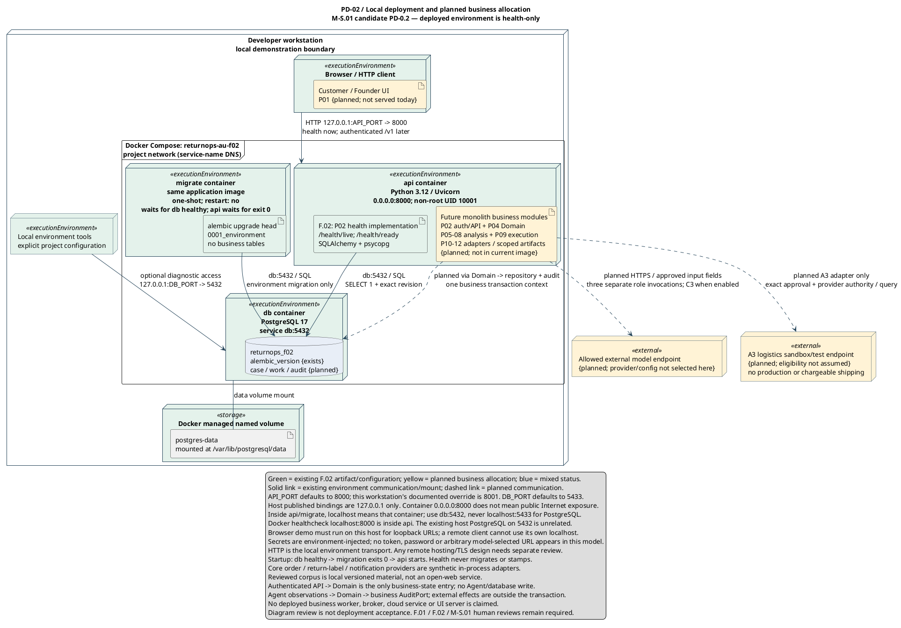

# Deployment Topology Diagram (`DEP-1`)

> **MBSE Model Type**: UML 2.5 Deployment Diagram (`DEP-1`)
>
> **Project Specification**: ELEC5620 Model-Based Software Engineering, Stage 1 (Criterion C13, Optional Group Model — 0.5 marks)
>
> **Status — 2026-09-18**: Candidate deployment topology baseline published under Task T11.
>
> **Contribution Statement (Hard Rules `H5` & `H11`)**:
> - **Member A (Jingbo Chai, 50% — Primary Author)**: Designed the Docker Compose node topology, container orchestration sequence (`db healthy → migrate exits 0 → api starts`), and the F.02 health-only implementation boundary; authored the PlantUML source code.
> - **Member B (Chengsi Li, 25% — Secondary Author)**: Contributed the Browser/HTTP client node specification and the `P01 apps/web` planned UI artefact placement; validated the `127.0.0.1` loopback binding semantics; authored the document wrapper, traceability cross-references, and viva defence rationale.
> - **Member C (Lucas Tao, 25% — Secondary Reviewer)**: Audited the external node classification (LLM endpoint, A3 logistics sandbox); verified that simulated/mock nodes are explicitly tagged `{planned}` with correct `<<external>>` stereotypes; confirmed no production or chargeable shipping claim is made.
>
> *Planned project effort split remains 45% (Member A) / 27% (Member B) / 28% (Member C) per `docs/07-frozen-work-allocation.md`. All members participated with non-zero contributions.*
>
> **Alignment Baseline**: [Lead-approved v1.0 candidate](../00-project-definition-v1.md), [Interface Contract v1.0 (rc.5)](../09-interface-contract-v1.md), [F.02 Docker Compose environment](../../compose.yaml), and [Package Dependency Diagram (`PKG-1`)](09-package-diagram.md).

---

## 1. Purpose, Architectural Context and Viewpoint Mapping

[Editable PlantUML source file](shared/deployment-topology.puml) · [Full SVG](shared/deployment-topology.svg)


### 1.1 Purpose and Distinction from Other Architecture Models

The **Deployment Diagram** (`DEP-1`) presents the **Physical View** of the system under Kruchten's 4+1 architectural framework (IEEE 1471 / ISO/IEC/IEEE 42010). While the Package Diagram (`PKG-1`, Criterion C12) captures logical module organisation and compile-time dependency direction, `DEP-1` addresses a different concern: **where software artefacts physically execute, which network protocols connect them, and which nodes are real versus simulated** in the current academic prototype.

A deployment diagram that clearly distinguishes existing infrastructure from planned business allocation serves three purposes:

1. **Honest scope declaration** — the marker can see at a glance that the F.02 environment runs health endpoints and database migrations only; full business modules are planned but not yet deployed.
2. **Node boundary verification** — the physical separation between the Docker Compose internal network (service-name DNS) and the host-only loopback binding (`127.0.0.1`) is made explicit, preventing the common misconception that `0.0.0.0:8000` inside a container implies public Internet exposure.
3. **Simulated-node taxonomy** — external provider nodes (LLM endpoint, A3 logistics sandbox) are tagged `<<external>>` and coloured yellow (`{planned}`), making the simulation boundary visible to examiners and future implementors.

### 1.2 Kruchten 4+1 Placement

| View | Addressed by | Concern |
|---|---|---|
| Logical | `CLS-1` (Class Diagram) | Design-time entity relationships and port contracts |
| Development | `PKG-1` (Package Diagram) | Module decomposition, dependency direction, build isolation |
| Process | `COL-1` (Collaboration Diagram), individual sequence diagrams | Runtime message ordering and concurrency |
| **Physical** | **`DEP-1` (this diagram)** | Node topology, container allocation, network protocols, real vs simulated |
| +1 Scenarios | `UCD-1` (Use Case Diagram), six use case specifications | Observable stakeholder goals |

---

## 2. PlantUML Model Specification



---

## 3. Node Inventory and Real vs Simulated Classification

### 3.1 Complete Node Taxonomy

The deployment topology distinguishes three categories of nodes by colour and stereotype, following the legend convention established in the PlantUML source:

| Colour | Meaning | Stereotype | Examples |
|---|---|---|---|
| **Green** (`#E4F2EB`) | **Existing** — deployed and verified in the F.02 environment | `<<executionEnvironment>>` | `api` container, `migrate` container, `db` container, Browser, Tools, Docker volume |
| **Yellow** (`#FFF3D6`) | **Planned** — designed but not yet deployed in the current image | `{planned}` | Customer/Founder UI (`P01`), future business modules (`P04`–`P12`), LLM endpoint, A3 sandbox |
| **Blue** (`#E8EEF7`) | **Mixed** — container exists but business tables are planned | — | `returnops_f02` database |

### 3.2 Detailed Node Descriptions

| Node | Physical Manifestation | Key Artefacts | Status |
|---|---|---|---|
| **Developer workstation** | The local demonstration boundary; all services run on this host | — | **Existing** (the development environment) |
| **Browser / HTTP client** | Modern web browser or `curl`/Postman on the same host | `Customer / Founder UI` (P01, planned) | **Existing** (browser); **planned** (served UI) |
| **Local environment tools** | IDE, `docker compose`, `psql`, `alembic` CLI | — | **Existing** |
| **`api` container** | Python 3.12, Uvicorn ASGI server, non-root UID 10001, port 8000 | `F.02 health endpoints` (existing), `future business modules` (planned) | **Partial** |
| **`migrate` container** | Same application image, one-shot execution, `restart: no` | `alembic upgrade head` — environment migration only | **Existing** |
| **`db` container** | PostgreSQL 17, service-name `db`, port 5432 (internal) | `returnops_f02` database with `alembic_version` table (existing); `case`, `work`, `audit` tables (planned) | **Partial** |
| **Docker named volume** | `postgres-data`, mounted at `/var/lib/postgresql/data` | Persistent database storage across container restarts | **Existing** |
| **LLM endpoint** | External model provider (provider and configuration not selected) | Three separate role invocations; C3 image input when enabled | **Planned / External** |
| **A3 logistics sandbox** | Australia Post test endpoint (eligibility not assumed) | Mock return-label generation; no production or chargeable shipping | **Planned / External** |

### 3.3 Container Orchestration Sequence

The Docker Compose startup enforces a strict ordering that prevents the API from serving requests before the database is ready:

```
db container starts → PostgreSQL healthcheck passes →
migrate container runs alembic upgrade head → migration exits 0 →
api container starts Uvicorn → /health/live responds
```

This sequence is **not configurable at the application level** — it is enforced by Docker Compose `depends_on` conditions with `service_healthy` and `service_completed_successfully` gates. The health endpoint (`/health/ready`) verifies both liveness and the exact Alembic migration revision, so a stale migration is detectable at runtime.

---

## 4. Network Topology and Communication Protocols

### 4.1 Communication Ledger

| Source | Target | Protocol | Transport | Status |
|---|---|---|---|---|
| Browser | `api` container | HTTP | `127.0.0.1:API_PORT → 8000` (host-to-container port mapping) | **Existing** (health); **planned** (authenticated `/v1`) |
| Tools | `db` container | PostgreSQL wire protocol | `127.0.0.1:DB_PORT → 5432` (optional diagnostic access) | **Existing** |
| `Health` artefact | `returnops_f02` database | SQL over `db:5432` | Docker internal service-name DNS | **Existing** |
| `Migration` artefact | `returnops_f02` database | SQL over `db:5432` | Docker internal service-name DNS | **Existing** |
| `Business` artefact | `returnops_f02` database | SQL via Domain → repository + audit | Docker internal service-name DNS | **Planned** |
| `db` container | `postgres-data` volume | Filesystem mount | Docker volume driver | **Existing** |
| `Business` artefact | LLM endpoint | HTTPS | Approved input fields; three role invocations | **Planned** |
| `Business` artefact | A3 sandbox | HTTPS | Exact approval + provider authority / query | **Planned** |

### 4.2 Critical Network Boundaries

1. **Host-only loopback binding (`127.0.0.1`)**: All published ports bind to the loopback interface only. The `0.0.0.0:8000` binding inside the `api` container is the **container's** listening address, not a host-level exposure. A remote machine cannot access these services without explicit network configuration.
2. **Docker Compose internal network**: Containers communicate via service-name DNS (`db:5432`, not `localhost:5432`). Inside the `api` or `migrate` container, `localhost` refers to **that container**, not the host. This distinction has caused configuration errors in prior projects and is documented in the diagram's legend.
3. **No TLS in the local environment**: HTTP is the local transport. Any remote hosting or production deployment requires a separate TLS/reverse-proxy design that `DEP-1` explicitly does not claim.

---

## 5. Architectural Invariants Visible in the Deployment Model

### 5.1 The Monolith-First Deployment Strategy

All business modules (`P02`–`P12`) are deployed inside a **single `api` container**. The multi-agent roles (Coordinator, Assessment, Risk Reviewer) are not separate microservice nodes — they are in-process invocations within the same Python runtime.

**Why this is a deliberate design choice, not a limitation:**
- Multi-agent workflows require strict, deterministic transaction atomicity. Deploying agents as separate networked services introduces distributed consensus overhead, split-brain state mutation risks, and out-of-order execution hazards.
- The `ApprovalGuard` re-validation at dispatch time (`P09`) requires reading the same database transaction context as the approval creation. A network boundary between these would require distributed transactions or compensating operations, neither of which is justified for a single-merchant prototype.
- Low-latency, bounded agent orchestration (`P05`) assumes in-process function calls, not HTTP round-trips.

### 5.2 The Simulation Boundary

The following nodes are **explicitly simulated** in the academic prototype:
- **LLM endpoint** — no specific provider or API key is committed; the model is invoked through an abstracted adapter port.
- **A3 logistics sandbox** — no production carrier contracts; simulated shipping labels and mock notifications represent the execution boundary.
- **Core order / return-label / notification providers** — synthetic in-process adapters (`P10`, `P11`), not external service calls.

The simulation boundary aligns with the project's non-goals (§1.3 of the master report): no autonomous financial execution, no live banking refunds, no binding logistics contracts.

### 5.3 Secrets and Configuration

Secrets (database credentials, API tokens) are **environment-injected** via Docker Compose environment variables and `.env` files (gitignored). No token, password, or model-selected URL appears in the PlantUML source, the SVG, or any committed artefact.

---

## 6. Traceability Cross-Reference

| Requirement | Description | Realising Use Case | Related Models |
|---|---|---|---|
| **NFR-002** | Safety — pre-effect guards and domain write isolation | UC-04 | `SC-1` (`pOps`), `PKG-1` (agent–execution firewall), **`DEP-1`** (single-container atomicity) |
| **NFR-005** | Performance — p95 latency < 120s | UC-02 | `SC-1` (`GCA`), **`DEP-1`** (in-process agent invocation, no network round-trip) |
| **NFR-007** | Maintainability — documented typed interfaces | UC-01–UC-05 | `CLS-1` (boundary ports), `PKG-1`, **`DEP-1`** (adapter replacement without container changes) |
| **BR-010** | Every provider effect requires fresh guard + provider authority | UC-04 | `PKG-1` (`P09` dependency), **`DEP-1`** (same-container guard re-validation) |
| **NFR-003** | Availability — health endpoint and migration sequencing | UC-01 | **`DEP-1`** (startup sequence, `/health/live`, `/health/ready`) |

---

## 7. Oral Defence and Viva Preparation

### 7.1 High-Frequency Examiner Questions

**Q1: "Show me on the deployment diagram which nodes are real and which are simulated for the academic prototype."**

> **Real (green) nodes:** Developer workstation, Browser/HTTP client, `api` container (Python 3.12 / Uvicorn), `migrate` container (Alembic), `db` container (PostgreSQL 17), Docker named volume (`postgres-data`), and local environment tools. These are deployed and verified in the F.02 Docker Compose environment.
>
> **Simulated/planned (yellow) nodes:** Customer/Founder UI (`P01`, not served today), future business modules (`P04`–`P12`, not in current image), LLM endpoint (provider not selected), and A3 logistics sandbox (eligibility not assumed, no production shipping).
>
> **Mixed (blue):** The `returnops_f02` database — the container and `alembic_version` table exist, but business tables (`case`, `work`, `audit`) are planned.

**Q2: "Why are the multi-agent roles located inside the API application container rather than deployed as independent microservice nodes?"**

> Three reasons, all grounded in the architecture:
> 1. **Transaction atomicity** — the `ApprovalGuard` must read the same transaction context as the `DomainService` that created the approval. A network boundary would require distributed transactions or compensating operations.
> 2. **Deterministic ordering** — the `WorkflowOrchestrator` (`P05`) dispatches agent roles in a bounded, deterministic sequence. Network latency and message reordering between microservices would introduce non-determinism that the governance model explicitly prohibits.
> 3. **Prototype proportionality** — for a single-merchant academic prototype processing a 30-case Gold set, the operational overhead of container orchestration (service mesh, health probes, circuit breakers) outweighs any scalability benefit. The monolith-first strategy is a deliberate design choice, not a limitation.

**Q3: "What happens if the PostgreSQL container fails to start before the API container?"**

> The Docker Compose startup sequence prevents this:
> - The `db` container must pass its PostgreSQL healthcheck before the `migrate` container starts.
> - The `migrate` container must exit with code 0 (successful migration) before the `api` container starts.
> - If `db` never becomes healthy, `migrate` never runs, and `api` never starts — the failure is surfaced immediately, not hidden by a partially initialised system.
>
> This is enforced by `depends_on` conditions (`service_healthy`, `service_completed_successfully`), not by application-level retry logic.

**Q4: "Why does the diagram distinguish `0.0.0.0:8000` inside the container from `127.0.0.1:API_PORT` on the host?"**

> They are different network interfaces:
> - `0.0.0.0:8000` is the Uvicorn bind address **inside** the `api` container. It means "listen on all interfaces within this container's network namespace". This does not expose the port to the host or the Internet.
> - `127.0.0.1:API_PORT` is the **host-side** port mapping, bound to the loopback interface only. Only processes on the same developer workstation can reach it.
> - Confusing the two is a common deployment error — publishing `0.0.0.0` on the host would expose the API to the local network, which is never intended in a development environment.

### 7.2 Member-Specific Defence Points

| Member | Their Deployment Scope | What They Should Be Able to Explain |
|---|---|---|
| **A** | `api` container, `migrate` container, `db` container, startup sequencing, business module allocation | The container orchestration sequence; why `alembic upgrade head` runs in a separate one-shot container; why `Health` reads `SELECT 1` and the exact revision but never migrates |
| **B** | Browser/HTTP client node, `P01 apps/web` planned UI artefact, host loopback binding | How the frontend will communicate with the API via public HTTP only; why the browser demo must run on the same host (loopback URLs); how `API_PORT` override works |
| **C** | External nodes (LLM endpoint, A3 sandbox), simulation boundary classification | Why the LLM endpoint has no committed provider; why A3 eligibility is not assumed; how the `RetrievalPort` corpus is local versioned material, not an open-web service |

---

## 8. Quality Assurance and Model Verification

### 8.1 Static Validation
- **PlantUML syntax**: `java -jar C:/tools/plantuml/plantuml.jar -tsvg shared/deployment-topology.puml` compiles without error.
- **SVG source pair**: `shared/deployment-topology.puml` ↔ `shared/deployment-topology.svg` verified by `python returnops-au/tools/model-checks/check.py` (included in the 23/23 SVG pair count at `main` `da1a09f`).
- **Node classification audit**: Every node in the PlantUML source verified against the colour legend — green for existing, yellow for planned, blue for mixed.

### 8.2 Orthography and Academic Integrity
- Australian English (en-AU) orthography applied throughout: *organisation*, *modelling*, *behaviour*, *defence*, *colour*, *recognised*.
- No fabricated sources, APIs, or facts. All node descriptions and network configurations are derived from the existing F.02 Docker Compose environment or the project definition's planned allocation.
- This document wrapper was prepared as part of the coursework development process. AI assistance is disclosed in `00_admin/AI_USE_LOG.md` and §17 of the master team report, in compliance with the 2026 Unit Outline AI policy (OQ-001).
