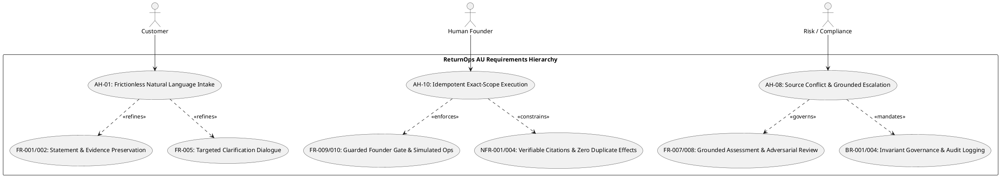
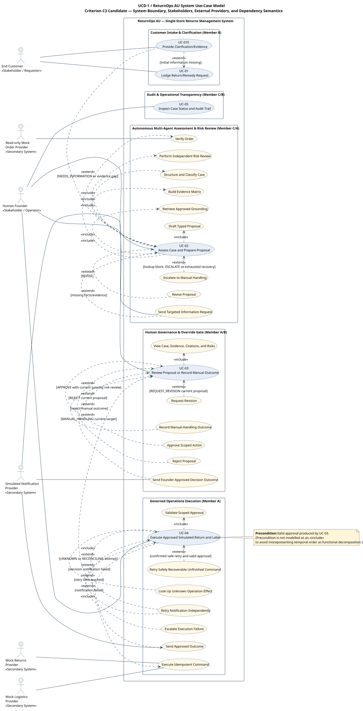
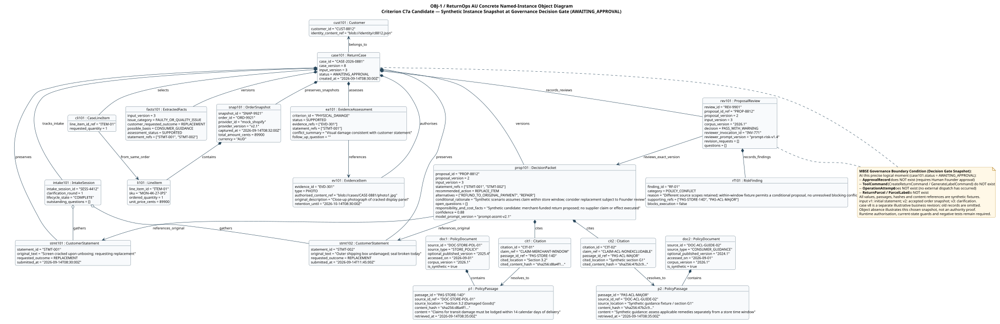
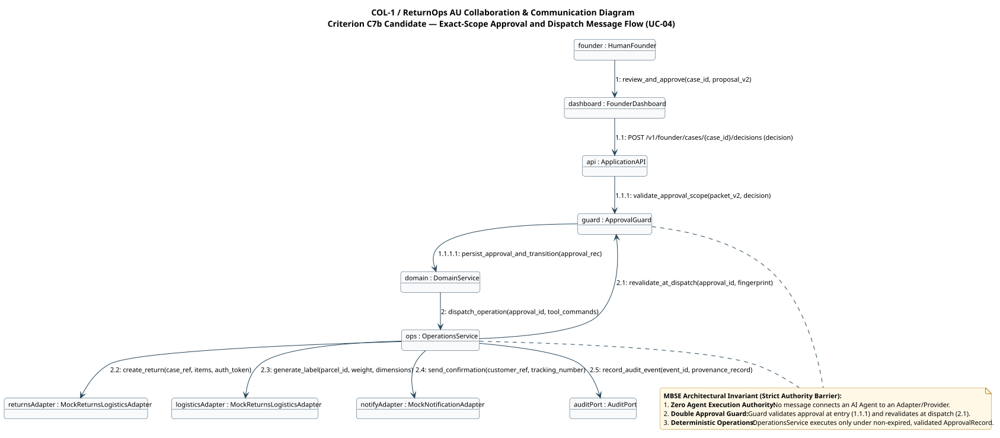
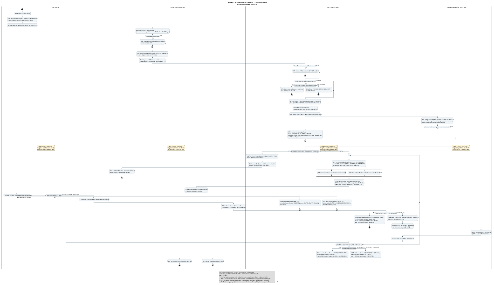
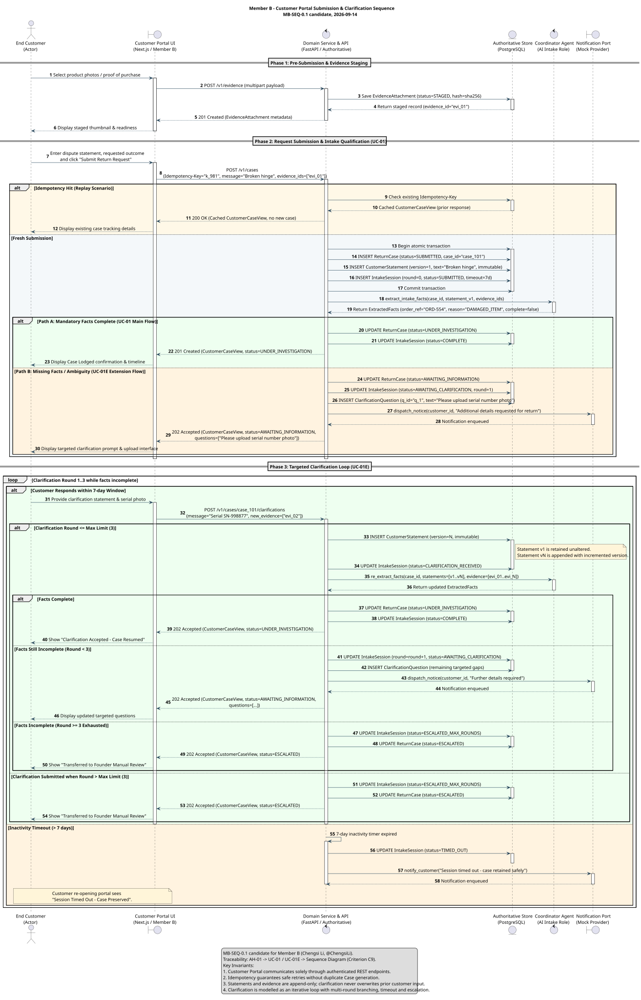
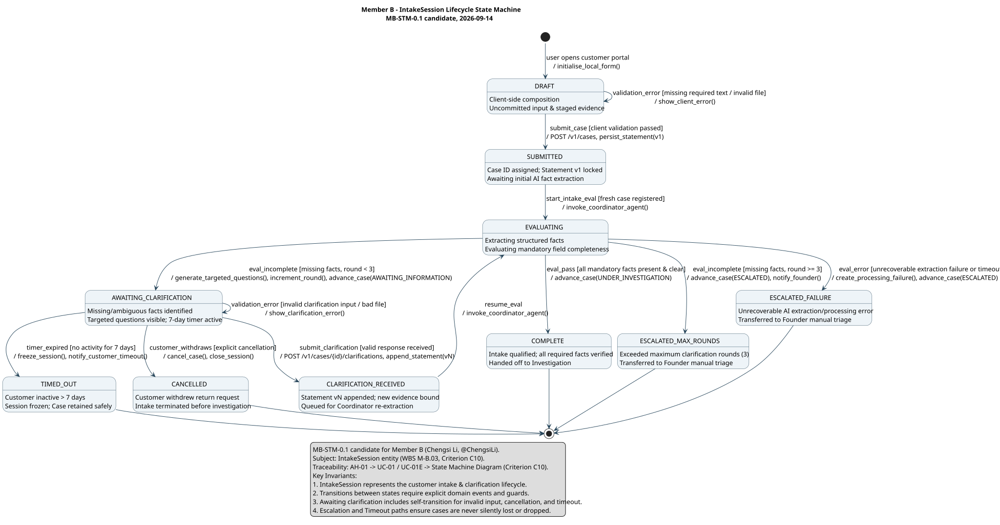

# ELEC5620 Model-Based Software Engineering — Project Stage 1 Team Report
# ReturnOps AU: Human-Governed Multi-Agent Returns Management System

> **Document Status:** MODULAR INTEGRATION CANDIDATE & AUDITED SKELETON (Task T4 / T13)  
> **Release Candidate:** v1.3-audited  
> **Date:** 2026-09-15  
> **Repository Target:** `docs/reports/stage-1-team-report.md` (fulfilling Task T4 / T13 from `03_stages/stage_1/EXECUTION_PLAN.md`)  
> **Traceability & Allocation Basis:** [Project Definition v1.0](../00-project-definition-v1.md), [Frozen Work Allocation](../07-frozen-work-allocation.md), [Delivery Work Packages](../08-delivery-work-packages.md), [Interface Contract v1.0 (rc.5)](../09-interface-contract-v1.md), and [Stage 1 Readiness Checklist](../11-stage1-readiness.md).  
> **Collaborative Evidence:** Member A ([reports/member-a-stage1-draft.md](member-a-stage1-draft.md) / [PR #11](https://github.com/shuxiachai/returnops-au/pull/11)), Member B ([reports/member-b-stage1-draft.md](member-b-stage1-draft.md) / [docs/19-member-b-model-chain.md](../19-member-b-model-chain.md) / [PR #14](https://github.com/shuxiachai/returnops-au/pull/14)), Member C (PR #12 / PR #13).

---

## Document Architecture & Modular Integration Guide

This master report integrates the requirements, architectural designs, and behavioural models for Project Stage 1 across all three group members. The structure strictly follows the 15-chapter rubric mapping specified in `EXECUTION_PLAN.md` §T4 and covers every assessed criterion (`C1`–`C13`, `H1`–`H12`, and the Project Description core requirements).

Each chapter declares:
1. **Discharges Criterion:** Exact rubric item or course requirement addressed.
2. **Ownership:** Primary Author, Co-Authors, and Secondary Reviewer (enforcing criteria notes 3 & 4 and `H5`/`H11`).
3. **Readiness Status:** `[READY - Integrated from Member B / PR #14]`, `[DRAFT - Available in Member A/C reports]`, or `[SKELETON - Ready for final team assembly]`.
4. **Content & Guidance:** The substantive technical content or instructions for final compilation.

---

## §0 Cover Page & Administrative Identification

- **Discharges:** Hard Rule `H9` (Group formation, registration conventions, administrative metadata).
- **Primary Owner:** Member B (Chengsi Li, `@ChengsiLi`)  
- **Secondary Reviewer:** Member A (Jingbo Chai, `@shuxiachai` — Project Lead)  
- **Readiness Status:** `[READY - Baseline established]`

### Administrative Details
- **Course:** ELEC5620 Model-Based Software Engineering, Semester 2, 2026
- **Institution:** The University of Sydney — School of Electrical and Computer Engineering
- **Project Title:** ReturnOps AU — Human-Governed Multi-Agent Decision Support for Retail Returns
- **Canvas Group Identifier:** `[Pending Canvas Unlock 2026-09-20 / OQ-002]` (Naming convention: `Lab Session + Group Number`, e.g., `Wed 14-16 Group 2`)
- **Key Assessment Dates:**
  - Internal Group Target: **Friday 25 September 2026 (Week 8)**
  - Canvas Submission Deadline: **Sunday 4 October 2026, 23:59 (End of Mid-Semester Break)**
  - Individual Oral Defence / Viva: **Weeks 11–12 Practical Sessions (19–30 October 2026)**
- **Team Composition and Workload Allocation:**

| Member | Full Name | GitHub Handle | Primary System Role & Scope | Planned Share |
|---|---|---|---|:---:|
| **Member A** | Jingbo Chai | `@shuxiachai` | Project Lead; Orchestration & Governance; Domain Lifecycle; Operations Service (`A1`, `A2`, `A3`) | **45%** |
| **Member B** | Chengsi Li | `@ChengsiLi` | Frontend Architect; Customer Intake & Clarification Portal; Founder Workspace; Analytics (`B1`, `B2`, `B3`) | **27%** |
| **Member C** | Lucas Tao | `@lulucas-tao` | Retrieval Grounding; Citation Verification; Independent Risk Review; Evaluation (`C1`, `C2`, `C3`) | **28%** |

---

## §1 Introduction, Problem Statement, Scope & System Boundary

- **Discharges:** Project Description p.1–2 (Project context, problem definition, scope, non-goals), Hard Rule `H10` (Novel project scope and SME e-commerce problem differentiation).
- **Primary Owner:** Member B  
- **Secondary Reviewer:** Member A  
- **Readiness Status:** `[READY - Sourced from Project Definition v1.0]`

### 1.1 Problem Statement & Industrial Motivation
Australian e-commerce small and medium enterprises (SMEs) face disproportionate operational overhead in processing customer returns, warranty claims, and repairs. Under the Australian Consumer Law (ACL), merchants must evaluate whether a return involves a major or minor fault, assess customer evidence, and offer appropriate statutory remedies (repair, replacement, or refund) alongside commercial change-of-mind policies.

Empirical data from the government-commissioned *Australian Consumer Survey 2023* (`n=1,290`, evidence `EVD-001`) indicates that businesses self-estimate a mean of **2.47 hours** of active manual handling for a typical product issue. For a solo entrepreneur or SME operator ("Founder"), this manual dispute assessment creates a severe cognitive bottleneck, leads to inconsistent outcomes, and increases customer churn.

### 1.2 The ReturnOps AU Vision
**ReturnOps AU** is a human-governed, multi-agent returns management system designed specifically for a single Australian online retail business. The system augments the human operator by automating fact gathering, evidence cross-examination, and policy grounding, while maintaining deterministic governance:
- **Intelligent Intake:** Converts unstructured customer complaints into structured factual claims without forcing customers through complex administrative dropdown menus.
- **Tripartite Agent Collaboration:** Employs three differentiated AI agents (Customer Case Coordinator, Returns Assessment Agent, and Compliance/Risk Reviewer) to prepare a transparent, cited Decision Packet.
- **Human-in-the-Loop Authority:** Preserves the human Founder as the sole decision authority for high-impact determinations.
- **Deterministic Guarded Execution:** Restricts operational side effects to a deterministic, idempotent Operations Service operating under strict authorisations and guards.

### 1.3 System Boundary and Explicit Non-Goals
To ensure engineering feasibility and rigorous model checking, the operational boundaries are strictly demarcated:
1. **Single Merchant Context:** Designed for a single Australian online retailer with a unified inventory and returns policy.
2. **Synthetic Data & Sandbox Environment:** All order records, customer communications, and logistics tracking operate on synthetic data (`30-case Gold set`).
3. **No Autonomous Financial or Carrier Execution:** The core prototype does not initiate real monetary transactions, live banking refunds, or binding logistics carrier contracts. Simulated shipping labels and mock notifications represent the boundary of execution.
4. **No Legal Determinations:** The system assists policy assessment under merchant guidelines; it explicitly disclaims statutory legal advice or final legal determinations.

---

## §2 Requirement Documentation & Classification

- **Discharges:** Criterion C1 (0.5 marks, Individual Ad-Hoc Requirements `AH-*`), Hard Rule `H2` (Core & optional feature allocation per member), Hard Rule `H6` (Requirement documentation is part of the submission), Project Description (Classification of Agreement, Mandatory Capabilities, and Optional Features).
- **Primary Owner:** Member B (Classification & Intake/Portal requirements)  
- **Secondary Reviewers:** Member A (Domain & Execution), Member C (Risk & Retrieval)  
- **Readiness Status:** `[READY - Full Register Synchronised]`

### 2.1 The Three-Part Classification
In compliance with the Project Description, system requirements are classified into three distinct categories:

#### 2.1.1 The Agreement
The contractual agreement defines what ReturnOps AU guarantees to its users and what is explicitly excluded:
- **Guarantees:** Immutable audit logging of all case events; non-destructive preservation of original customer statements; strictly non-executable AI packets; complete multi-agent consensus before founder presentation; and idempotent command dispatch.
- **Exclusions:** No automated approval of disputed refunds without founder sign-off; no direct LLM write-access to the database; and no live external credit card chargebacks.

#### 2.1.2 Mandatory Core Capabilities
The 12 Functional Requirements (`FR-001`–`FR-012`), 9 Non-Functional Requirements (`NFR-001`–`NFR-009`), and 12 Business Rules (`BR-001`–`BR-012`) defined in `docs/04-requirements-and-backlog.md`:
- **FR-001–FR-005 (Intake & Qualification):** Customer portal case lodging, statement preservation, evidence item binding, order reconciliation, and multi-round clarification dialogue.
- **FR-006–FR-008 (Assessment & Risk Review):** Grounded policy retrieval, structured decision packet synthesis, and independent adversarial risk review.
- **FR-009–FR-010 (Governance & Execution):** Founder review workspace, dual-approval checks, idempotent simulated return creation, and mock label generation.
- **FR-011–FR-012 (Audit & Telemetry):** Tamper-evident case event logging and operator audit inspection.
- **NFR-001–NFR-009 (System Quality Attributes verbatim from Backlog):**
  - `NFR-001` Traceability: Citation coverage is 100% for proposal claims that depend on policy or case evidence; citation correctness is at least 90% on the labelled benchmark.
  - `NFR-002` Safety: Block invalid state, failed/stale risk review, invalid exact approval, missing provider authority and non-allowlisted commands before effects. Domain Service alone writes business state, including safe blocked-attempt records.
  - `NFR-003` Privacy: Synthetic/de-identified data only; test secret exclusion, log redaction, model field allowlists, approved provider data flows and retention/deletion without breaking non-personal audit integrity.
  - `NFR-004` Reliability: Zero duplicate effects and illegal transitions; ambiguous outcomes reconcile before retry; notification retry does not repeat operations.
  - `NFR-005` Performance: p95 accepted-complete-input → stored-review-ready-proposal <120 seconds in the fixed environment; include machine revision/risk loops, exclude human and physical waiting only. Report p50/p95, failures, environment/model, tokens and cost.
  - `NFR-006` Testability: Mandatory acceptance criteria, state guards, approval-negative paths, and adapter contracts have automated normal- and failure-path tests.
  - `NFR-007` Maintainability: LLM, commerce, policy, logistics, and notification providers are accessed through documented typed interfaces with contract tests.
  - `NFR-008` Observability: Structured events contain case/correlation ID, component and source version, time, outcome, and typed error while redacting sensitive content.
  - `NFR-009` Security and AI robustness: Customer text, attachments, and retrieved documents are untrusted data; they cannot change workflow policy, grant authority, expose secrets, call a non-allowlisted tool, or bypass authenticated role and approval checks.
- **BR-001–BR-012 (Governing Business Rules verbatim from Backlog):**
  - `BR-001`: ReturnOps AU presents approved guidance and conditional recommendations; it does not give legal advice or make a definitive ACL entitlement, major-failure, or minor-failure determination.
  - `BR-002`: Material case-relevant source conflicts remain visible in the conditional packet and independent Risk review. Non-blocking differences may give `PASS_WITH_WARNING`; unresolved conflicts preventing a safe recommendation require `ESCALATE`. No silent source precedence; source conflicts are not OrderLookupBlock or technical ProcessingFailure records.
  - `BR-003`: Refund, replacement, repair, order/payment/inventory mutation, and cost-bearing logistics operations are high-impact actions.
  - `BR-004`: The course prototype uses simulated provider operations and never moves real money or changes a production order.
  - `BR-005`: High model confidence cannot bypass missing evidence, a failed risk review, command allowlisting, or human approval.
  - `BR-006`: ReturnOps approval and external-provider permission are independent prerequisites.
  - `BR-007`: Changed proposal version, remedy, amount, line items, commands or parameter fingerprint requires new approval.
  - `BR-008`: Customer-requested outcome and system recommendation remain separate.
  - `BR-009`: One case covers one order and potentially multiple line items; one return shipment has one parcel label, with no split shipments.
  - `BR-010`: Core completion requires stored simulated return/label results and successful outcome notification. `NOTIFICATION_PENDING/NOTIFICATION_FAILED` cannot cause an operation to be repeated.
  - `BR-011`: Desk evidence, assumptions, targets and measured results are separately labelled.
  - `BR-012`: AI cannot directly write authoritative state, create a trusted approval or call operations providers.

#### 2.1.3 Selected Optional Features (Hard Rule `H2`)
Each member implements and owns one designated optional feature in the Stage 2 prototype:
- **OF-001 Image Evidence Extraction (Member C):** Multi-modal image analysis to verify parcel/damage photos against claimed fault categories.
- **OF-004 Logistics Sandbox Adapter (Member A):** Standardised sandbox adapter for simulated Australia Post / StarTrack label generation.
- **OF-006 Operational Analytics & Dashboard (Member B):** Executive reporting interface tracking dispute turnaround times, return reasons, carrier fault rates, and customer satisfaction metrics.

### 2.2 Individual Ad-Hoc Requirements (Criterion C1, `H4`)
Each member independently established an informal ad-hoc requirement reflecting their specific problem stakeholder:
- **Member A (`AH-10`):** *"Execute only the exact approved simulated action and never perform it twice by accident."* (Focus: Safe orchestration, idempotent execution, and non-replayable state transitions).
- **Member B (`AH-01`):** *"Let me describe the return or product issue without navigating internal systems."* (Focus: Frictionless customer experience, natural-language statement lodging, and structured clarification dialogue).
- **Member C (`AH-08`):** *"Show material source conflicts; if they prevent a safe proposal, stop and hand the case to me."* (Focus: Factual grounding, citation cross-examination, conflict detection, and safe escalation).

---

## §3 Requirements Diagrams: User Requirement Diagram & Feature Diagram

- **Discharges:** Criterion C2 (1 mark, Group Feature Diagram), Project Description (User Requirement Diagram).
- **Primary Owner:** Member B  
- **Secondary Reviewers:** Member A, Member C  
- **Readiness Status:** `[READY - PlantUML URD-1 & Mermaid FEAT-1 Synchronised]`

### 3.1 User Requirement Diagram (`URD-1`)
The User Requirement Diagram bridges informal stakeholder goals (`Customer`, `Human Founder`, `Compliance Officer`) to concrete system requirements (`AH-*`, `FR-*`, `NFR-*`, `BR-*`).


*(Source: [docs/05-lab-3-requirement-modelling.md](../05-lab-3-requirement-modelling.md) §1 and [docs/diagrams/04-feature-diagram.md](../diagrams/04-feature-diagram.md))*.

### 3.2 Comprehensive Feature Diagram (`FEAT-1`)
The Feature Diagram captures the structural composition of the ReturnOps AU product, decomposing the solution into Mandatory Core features, Optional modules, and Alternative workflow paths.
*(Reference: [docs/diagrams/04-feature-diagram.md](../diagrams/04-feature-diagram.md))*.

```
ReturnOps AU
├── Core Returns Management (Mandatory)
│   ├── Case Intake & Lodging (B1 / FR-001, FR-002)
│   │   ├── Free-text statement capture [Mandatory]
│   │   ├── Evidence upload & binding [Mandatory]
│   │   └── Automated Clarification Loop [Alternative: 0-3 rounds] (FR-005)
│   ├── Autonomous Multi-Agent Assessment
│   │   ├── Input Coordination (A1 / FR-003, FR-004)
│   │   ├── Policy Grounding & Retrieval (C1 / FR-006)
│   │   ├── Decision Proposal Synthesis (A1 / FR-007)
│   │   └── Independent Risk & Compliance Review (C2 / FR-008)
│   ├── Human Governance & Workspace (B2 / FR-009)
│   │   ├── Proposal Inspection & Cited Evidence View [Mandatory]
│   │   └── Founder Decision Dispositions [XOR 1..1: Approve / Revise / Reject / Manual]
│   └── Governed Operations Execution (A2 / FR-010)
│       ├── Idempotent Return Creation [Mandatory]
│       └── Customer Notification Dispatch [Mandatory]
└── Extended Modules (Selected Optionals per Member)
    ├── Logistics Sandbox Adapter [Optional - Member A / OF-004]
    ├── Operational Analytics Dashboard [Optional - Member B / OF-006]
    └── Multi-Modal Image Evidence Extraction [Optional - Member C / OF-001]
```

### 3.3 Workload Split & Effort Consistency
In alignment with `D-09` and `docs/07-frozen-work-allocation.md`, the planned effort distribution is explicitly confirmed as **45% (Member A) / 27% (Member B) / 28% (Member C)**.

---

## §4 Use Case Modelling

- **Discharges:** Criterion C3 (1 mark, Use Case Overall Diagram), Criterion C4 (2 marks, 5–10 Use Case Specifications, `H3`).
- **Primary Owner:** Member B  
- **Secondary Reviewers:** Member A, Member C  
- **Readiness Status:** `[READY - 6 Full Specifications Defined]`

### 4.1 Overall Use Case Diagram (`UCD-1` / Criterion C3)
The system boundary encompasses primary human actors (`Customer`, `Human Founder`), secondary external provider services (`Mock Order Provider`, `Mock Returns Provider`, `Mock Logistics Provider`, `Simulated Notification Provider`), and the five top-level use cases alongside their included and extended sub-behaviours in standard UML 2.5 notation (`UCD-1`).

**Contribution Split (Hard Rules H5 & H11):** Member B: **40% (Primary Author)** · Member A: **35% (Secondary Reviewer)** · Member C: **25% (Secondary Reviewer)**.


*(PlantUML Source: [docs/diagrams/shared/use-case-diagram.puml](../diagrams/shared/use-case-diagram.puml) / [docs/diagrams/05-use-case-diagram.md](../diagrams/05-use-case-diagram.md))*.

> *Note on Task T5:* The use case model is authored in standard PlantUML UML 2.5 notation with system boundary frames, actor glyphs, and `<<include>>`/`<<extend>>` stereotyping, fully superseding earlier informal flowchart representations.

### 4.2 Group Use Case Specifications (Criterion C4)
The team specifies exactly 6 comprehensive use cases (satisfying the 5–10 requirement of `H3`):

| UC ID | Use Case Name | Primary Actor | Primary Owner | Discharges |
|---|---|---|---|---|
| **UC-01** | Lodge Return Request & Intake Qualification | End Customer | Member B | FR-001, FR-002, AH-01 |
| **UC-01E**| Submit Supplemental Clarification & Evidence | End Customer | Member B | FR-002, FR-005 |
| **UC-02** | Autonomous Multi-Agent Assessment & Risk Review | Human Founder (triggered by Customer intake) | Member C (Risk) / Member A (Assmt) | FR-006, FR-007, FR-008, AH-08 |
| **UC-03** | Founder Review, Decision Gate & Override | Human Founder | Member A (Core) / Member B (UI) | FR-009, BR-004 |
| **UC-04** | Governed Simulated Operations Execution | Human Founder (supported by Mock Providers) | Member A | FR-010, AH-10, NFR-002, NFR-004 |
| **UC-05** | Inspect Authoritative Case State & Audit Trail | Human Founder | Member C (Audit/Spec) / Member B (UI) | FR-011, FR-012, OF-006 |

*(Detailed step-by-step specifications for UC-01 through UC-05 detailing preconditions, triggers, main success path, extension paths, and exception guards are integrated from [docs/05-lab-3-requirement-modelling.md](../05-lab-3-requirement-modelling.md)).*

---

## §5 Elementary Structure Modelling: Design-Time Class Model

- **Discharges:** Criterion C6 (3 marks, Design-time class diagram with proper associations, generalisations, compositions, aggregations, and multiplicities).
- **Primary Owner:** Member B  
- **Secondary Reviewers:** Member A, Member C  
- **Readiness Status:** `[READY - Synchronised with packages/domain]`

### 5.1 Domain Entity & Value Object Model (`CLS-1`)
The design-time elementary class diagram captures the core business domain of ReturnOps AU in exact structural correspondence with `01-domain-class-diagram.md`.
*(Reference: [docs/diagrams/01-domain-class-diagram.md](../diagrams/01-domain-class-diagram.md))*.

```
                          +-----------------------------------------+
                          |               ReturnCase                |
                          +-----------------------------------------+
                          | - case_id: str                          |
                          | - case_version: int                     |
                          | - input_version: int                    |
                          | - status: CaseStatus                    |
                          | - created_at: datetime                  |
                          +-----------------------------------------+
                             | 1           | 1         | 1       | 1
           +-----------------+             |           |         +-----------------+
           | 1..*                          | 1         | 0..*                      | 0..*
           v                               v           v                           v
+-----------------------+      +---------------+  +----------------+  +--------------------+
|   CustomerStatement   |      | IntakeSession |  |  EvidenceItem  |  |   DecisionPacket   |
+-----------------------+      +---------------+  +----------------+  +--------------------+
| - statement_id: str   |      | - session_id  |  | - evidence_id  |  | - proposal_id: str |
| - original_text: str  |<--o--| - round: int  |  | - type: EvType |  | - prop_version: int|
| - requested_outcome   | 1..* | - state: str  |  | - ret_until: dt|  | - rec_action: RecAct|
| - submitted_at: dt    |      +---------------+  +----------------+  +--------------------+
+-----------------------+                                                       ^ 1
           ^                                                                    |
           | references_original                                                | reviews_exact
           +-------------------------------------------------------------+      |
                                                                         |      | 0..*
                                                              +--------------------+
                                                              |   ProposalReview   |
                                                              +--------------------+
                                                              | - review_id: str   |
                                                              | - decision: RiskDec|
                                                              | - findings: list   |
                                                              +--------------------+
```

### 5.2 UML Association Semantics & Multiplicities
- **Aggregate Root Composition (`*--`):** `ReturnCase` serves as the aggregate root, directly composing `CustomerStatement` records (`1` to `1..*`), `IntakeSession` (`1` to `1`), `EvidenceItem` attachments (`1` to `0..*`), and `DecisionPacket` proposals (`1` to `0..*`). Under data retention deletion (F.07), child entities are purged atomically.
- **Review Association (`-->`):** `ProposalReview` instances are associated with `DecisionPacket` via `reviews_exact_version` (`0..*` to `1`) and reference original statements (`0..*` to `1..*`), preserving separation of evaluation from core case facts.
- **Intake Reference:** `IntakeSession` references active `CustomerStatement` items without overwriting historical statements.
- **Enumerations & Value Types:** Preserves the canonical 16-state `CaseStatus` macro-lifecycle vocabulary and the 6-state `IntakeSession` micro-lifecycle vocabulary (`SUBMITTED`, `EVALUATING`, `AWAITING_CLARIFICATION`, `CLARIFICATION_RECEIVED`, `COMPLETE`, `ESCALATED_FAILURE`).
- **Review Operational States & Decisions:** `ProposalReview` manages work execution across `QUEUED`, `INVOKING`, `VALIDATING`, `RECOVERY_WAIT`, `ACCEPTED`, `HISTORICAL`, `CLOSED_WITHOUT_RESULT`, culminating in the 5 canonical risk review decisions: `PASS`, `PASS_WITH_WARNING`, `REVISE`, `NEEDS_INFORMATION`, and `ESCALATE`.
- **Interface Definitions & Ports:** Strict boundary ports (`OrderProviderPort`, `ReturnsLogisticsPort`, `NotificationPort`, `AuditPort`, `CaseRepository`) prevent direct coupling to concrete third-party services.

---

## §6 Complex Structure Modelling: Runtime Models

- **Discharges:** Criterion C7 (3 marks, Runtime models: Object Diagram, Collaboration Diagram, Composite Structure Diagram; Lab 6 named-instance requirements).
- **Primary Authors & Split (Hard Rules H5 & H11):**
  - `OBJ-1` (Object Diagram): Member C: **40% (Primary Author)** · Member B: **35% (Secondary Reviewer)** · Member A: **25% (Secondary Reviewer)**.
  - `COL-1` (Collaboration Diagram): Member A: **50% (Primary Author)** · Member B: **25% (Secondary Reviewer)** · Member C: **25% (Secondary Reviewer)**.
  - `SC-1` (Composite Structure Diagram): Member A: **50% (Primary Author)** · Member B: **25% (Secondary Reviewer)** · Member C: **25% (Secondary Reviewer)**.
- **Readiness Status:** `[READY - All 3 Runtime Models Authored, Compiled, and Verified]`

### 6.1 Concrete Named-Instance Object Diagram (`OBJ-1` / Criterion C7a)

In accordance with Lab Note 6 and Criterion C7, the system models a concrete logical runtime snapshot capturing instance attribute value slots, instance links, and governance invariants at a single critical decision gate moment (prior to Founder review):

[Detailed Specification & Source: docs/diagrams/06-object-diagram.md](../diagrams/06-object-diagram.md) · [PlantUML Source](../diagrams/shared/object-diagram.puml)



#### 6.1.1 Decision Gate Runtime State Snapshot
The snapshot captures 20 collaborating runtime instances (detailed across 19 classifier slots) representing concrete entities and value objects from the elementary domain class model (`CLS-1`) at the exact logical instant when the case transitions to `AWAITING_APPROVAL`:

| Instance | Classifier (`CLS-1`) | Key Attribute Values | Structural & Governance Role |
|---|---|---|---|
| `case101` | `ReturnCase` | `case_id = "CASE-2026-0881"`, `case_version = 2`, `status = AWAITING_APPROVAL` | Aggregate root holding case lifecycle; paused awaiting human decision. |
| `cust101` | `Customer` | `customer_id = "CUST-8812"`, `identity_content_ref = "blob://..."` | Registered customer entity; external to case aggregate root. |
| `intake101` | `IntakeSession` | `intake_session_id = "SESS-4412"`, `clarification_round = 1`, `lifecycle_state = "COMPLETE"` | Intake micro-lifecycle; finished gathering statements after round 1. |
| `stmt101` | `CustomerStatement` | `statement_id = "STMT-001"`, `original_text = "Screen cracked upon unboxing..."`, `requested_outcome = REPLACEMENT` | Original customer lodgement statement (preserved immutably). |
| `stmt102` | `CustomerStatement` | `statement_id = "STMT-002"`, `original_text = "Outer shipping box undamaged..."`, `requested_outcome = REPLACEMENT` | Supplemental clarification reply submitted under round 1. |
| `facts101` | `ExtractedFacts` | `input_version = 1`, `issue_category = FAULTY_OR_QUALITY_ISSUE`, `assessment_status = SUPPORTED` | Normalised factual summary synthesised across both statements. |
| `snap101` | `OrderSnapshot` | `snapshot_id = "SNAP-9921"`, `order_id = "ORD-9921"`, `total_amount_cents = 89900`, `currency = "AUD"` | Authoritative order snapshot retrieved from read-only order provider. |
| `li101` | `LineItem` | `line_item_id = "ITEM-01"`, `sku = "MON-4K-27-IPS"`, `ordered_quantity = 1` | Purchased monitor line item from accepted order snapshot. |
| `cli101` | `CaseLineItem` | `line_item_id_ref = "ITEM-01"`, `requested_quantity = 1` | Bounded return claim referencing the verified order line item. |
| `ev101` | `EvidenceItem` | `evidence_id = "EVD-301"`, `type = PHOTO`, `authorised_content_ref = "blob://..."` | Customer photographic proof of cracked display panel. |
| `ea101` | `EvidenceAssessment` | `criterion_id = "PHYSICAL_DAMAGE"`, `status = SUPPORTED` | Assessment evaluation confirming photographic evidence matches claim. |
| `doc1` | `PolicyDocument` | `source_id = "DOC-STORE-POL-01"`, `source_type = "STORE_POLICY"`, `corpus_version = "2026.1"` | Merchant's published returns policy document. |
| `p1` | `PolicyPassage` | `passage_id = "PAS-STORE-14D"`, `content = "Claims must be lodged within 14 calendar days..."` | 14-day limit passage extracted from merchant store policy. |
| `doc2` | `PolicyDocument` | `source_id = "DOC-ACL-GUIDE-02"`, `source_type = "CONSUMER_GUIDANCE"` | Australian Consumer Law statutory guidance document. |
| `p2` | `PolicyPassage` | `passage_id = "PAS-ACL-MAJOR"`, `content = "Statutory consumer guarantees cannot be excluded..."` | ACL statutory consumer guarantee passage asserting non-excludable remedy. |
| `prop101` | `DecisionPacket` | `proposal_id = "PROP-8812"`, `proposal_version = 2`, `recommended_action = REPLACE_ITEM`, `confidence = 0.88` | Revised proposal generated by Returns Assessment Agent citing citations. |
| `cit1`, `cit2` | `Citation` | `claim_ref = "CLAIM-..."`, `passage_id_ref = "PAS-..."` | Grounded citations resolving proposal claims to retrieved policy passages. |
| `rev101` | `ProposalReview` | `review_id = "REV-9901"`, `decision = PASS_WITH_WARNING`, `reviewer_invocation_id = "INV-771"` | Independent risk review decision validating proposal against policy corpus. |
| `rf101` | `RiskFinding` | `finding_id = "RF-01"`, `category = POLICY_CONFLICT`, `blocks_execution = false` | Explicit finding detailing the store policy vs ACL statutory conflict. |

#### 6.1.2 Architectural Rigour: The Empty Space Invariant
A critical MBSE principle demonstrated in `OBJ-1` is the **Empty Space Argument**:
- **Absence of `ApprovalRecord`:** Because human review has not occurred, no approval record exists in memory or persistence.
- **Absence of `ToolCommand`:** Neither `CreateReturnCommand` nor `GenerateLabelCommand` is instantiated.
- **Absence of `OperationAttempt`:** No execution or provider dispatch has occurred.
- **Absence of `ReturnParcel` / `ParcelLabel`:** Shipping artefacts cannot be created prior to approval.

This absence formally proves that autonomous LLM agents possess **zero authority** to commit merchant resources without explicit human authorisation.

---

### 6.2 Collaboration / Communication Diagram (`COL-1` / Criterion C7b)

Depicts the structural connectivity and numbered message dispatch across collaborating component instances during exact-scope approval and dispatch (`UC-04`):

[Detailed Specification & Source: docs/diagrams/07-collaboration-diagram.md](../diagrams/07-collaboration-diagram.md) · [PlantUML Source](../diagrams/shared/collaboration-diagram.puml)



#### 6.2.1 Hierarchical Message Dispatch Ledger
The communication sequence enforces causal order and hierarchical call nesting using decimal message numbering:

| Sequence No. | Sender | Receiver | Invocation Signature | Architectural Concern & Invariant |
|---|---|---|---|---|
| `1` | `founder` | `dashboard` | `review_and_approve(case_id, proposal_v2)` | Human Founder executes explicit approval decision on dashboard UI (`UC-03`). |
| `1.1` | `dashboard` | `api` | `POST /v1/founder/cases/{case_id}/decisions (decision)` | Client submits authenticated approval payload containing proposal ID and scope. |
| `1.1.1` | `api` | `guard` | `validate_approval_scope(packet_v2, decision)` | **Initial Guard Validation:** Verifies decision hash matches proposal v2; checks expiry. |
| `1.1.1.1` | `guard` | `domain` | `persist_approval_and_transition(approval_rec)` | Domain Service writes immutable `ApprovalRecord` and transitions `ReturnCase` to `APPROVED`. |
| `2` | `domain` | `ops` | `dispatch_operation(approval_id, tool_commands)` | Domain Service requests simulated operations dispatch for approved line items. |
| `2.1` | `ops` | `guard` | `revalidate_at_dispatch(approval_id, fingerprint)` | **Dispatch Revalidation:** Verifies approval has not expired, case has not been superseded, and scope matches. |
| `2.2` | `ops` | `returnsAdapter` | `create_return(case_ref, items, auth_token)` | Deterministic dispatch to Mock Returns Provider; generates return parcel reference. |
| `2.3` | `ops` | `logisticsAdapter` | `generate_label(parcel_id, weight, dimensions)` | Deterministic dispatch to Mock Logistics Adapter; creates consignment tracking and printable label. |
| `2.4` | `ops` | `notifyAdapter` | `send_confirmation(customer_ref, tracking_number)` | Simulated customer notification dispatched with label access link. |
| `2.5` | `ops` | `auditPort` | `record_audit_event(event_id, provenance_record)` | Immutable audit record logged via `AuditPort` recording causal actor, hash, and timestamp. |

#### 6.2.2 Key Architectural Mechanisms
1. **Double Approval Guard Invariant:** `Approval Guard` appears twice in the communication sequence: first validating proposal scope upon Founder decision entry (`1.1.1`), and second revalidating non-expiration and scope matching immediately prior to provider dispatch (`2.1`).
2. **Strict Execution Barrier:** No message arrow originates from an autonomous AI agent to an operations provider. Operations execution is strictly mediated by the deterministic `Operations Service`.

---

### 6.3 Composite Structure Diagram (`SC-1` / `CS-0.2` / Criterion C7c)

Models the internal structural parts, ports, and connectors of the `Governed Case Assessment` subsystem, detailing the encapsulation of `Assessment Agent`, `Approval Guard`, and `Operations Service` alongside ports `pOrder`, `pOps`, and `pAudit`.
*(Reference: [docs/13-shared-composite-structure.md](../13-shared-composite-structure.md))*.

---

## §7 Behavioural Modelling: Individual Model Chains

- **Discharges:** Criteria C8 (1.5 marks, Activity Diagram), C9 (1.5 marks, Interaction/Sequence Diagram), C10 (1.5 marks, State Machine Diagram) — Total 4.5 marks per student, Hard Rule `H4` (each member's models derive from their own `AH-*` and `UC-*`).
- **Primary Owners:** Each member independently for their subsection.

### 7.1 Member A Behavioural Model Chain (Governed Execution & Lifecycle)
- **Primary Author:** Member A (Jingbo Chai, `@shuxiachai`)  
- **Reviewer:** Member C (Lucas Tao, `@lulucas-tao`)  
- **Readiness Status:** `[DRAFT - Available in docs/reports/member-a-stage1-draft.md / PR #11]`
- **Traceability Chain:** `AH-10` → `UC-04` (Governed Execution) & `UC-03` (Founder Approval Gate).
- **Activity Diagram (`ACT-001 / MA-ACT-0.2` / `C8`):** Decision admission → durable intent write → guarded command execution → recovery → customer notification. *(SVG: [docs/diagrams/member-a/governed-execution-activity.svg](../diagrams/member-a/governed-execution-activity.svg))*.
- **Sequence Diagram (`INT-001 / MA-SEQ-0.2` / `C9`):** Dual-panel interaction model showing exact-scope command execution and failure recovery. *(SVG: [docs/diagrams/member-a/exact-scope-sequence.svg](../diagrams/member-a/exact-scope-sequence.svg))*.
- **State Machine Diagram (`STM-001 / MA-STM-0.2` / `C10`):** `OperationAttempt` seven-state lifecycle (`PENDING`, `EXECUTING`, `SUCCEEDED`, `FAILED`, `UNKNOWN`, `RECONCILING`, `BLOCKED`). *(SVG: [docs/diagrams/member-a/operation-attempt-state.svg](../diagrams/member-a/operation-attempt-state.svg))*.
*(Detailed walkthrough in [docs/reports/member-a-stage1-draft.md](member-a-stage1-draft.md) and [docs/12-member-a-model-chain.md](../12-member-a-model-chain.md))*.

---

### 7.2 Member B Behavioural Model Chain (Customer Intake & Clarification)
- **Primary Author:** Member B (Chengsi Li, `@ChengsiLi`)  
- **Reviewer:** Member A (Jingbo Chai, `@shuxiachai`)  
- **Readiness Status:** `[READY - Verified 100% Green in PR #14 (commit 92cd717 / HEAD 4d91a58)]`
- **Traceability Chain:** `AH-01` → `UC-01` (Lodge Request) & `UC-01E` (Submit Clarification).

#### 7.2.1 Activity Diagram (`ACT-002 / MB-ACT-0.2` / Criterion C8)


The activity model strictly separates the Customer, Member B's Customer Portal, the Domain Service, and the Case Coordinator:
1. **Intake Admission:** Customer provides natural-language complaint and optional evidence; client-side validation provides rapid feedback; Domain Service independently authenticates, validates, and admits the payload, returning `HTTP 201 Created`.
2. **Clarification Loop:** The Case Coordinator inspects facts. If facts are ambiguous, missing, or contradictory, a structured question set is persisted, moving the case to `AWAITING_INFORMATION`. The customer submits answers via `UC-01E` returning `HTTP 202 Accepted`.
3. **Session Inactivity & UI Boundary:** If the customer leaves or pauses intake, only the local client view controller (`IntakeViewSession`) is paused. The authoritative case remains safely in `AWAITING_INFORMATION` on the server; the 15-route contract deliberately exposes no customer cancellation route, and no unapproved withdrawal transition or case rejection is triggered.

#### 7.2.2 Sequence / Interaction Diagram (`INT-002 / MB-SEQ-0.2` / Criterion C9)


The sequence model features two independently framed Interaction Diagrams assembled into a unified SVG:
1. **`sd CustomerIntake`:** Covers initial submission, idempotent replaying (matching key `idem_k_981` returns cached receipt; mismatched payload returns `409 IDEMPOTENCY_CONFLICT`), and evidence binding. Fresh acceptance triggers an interaction reference to the second frame.
2. **`sd ProcessAcceptedIntake`:** Asynchronous processing frame isolating AI coordinator fact extraction, question set generation, and state transition dispatch.

#### 7.2.3 State Machine Diagram (`STM-002 / MB-STM-0.2` / Criterion C10)


The state machine models the case-owned **`IntakeSession`** lifecycle (6 micro-states) decoupled from the UI view controller (`IntakeViewSession`) and the macro `ReturnCase` lifecycle:
- **States:** `SUBMITTED`, `EVALUATING`, `AWAITING_CLARIFICATION`, `CLARIFICATION_RECEIVED`, `COMPLETE`, `ESCALATED_FAILURE`.
- **Guards:** `G-REENTRY` enforces that clarification requires an active question set committed by the Domain Service; `G-TERMINAL` ensures that once a macro case reaches `COMPLETED`, `REJECTED`, or `MANUAL_HANDLED`, session behaviour concludes permanently.
- **Policy Boundary:** In accordance with PR #14, arbitrary three-round caps, seven-day expiry timers, and customer withdrawal mutations are rejected as unapproved extensions.
*(Full technical evidence and contract mappings verified in [docs/19-member-b-model-chain.md](../19-member-b-model-chain.md) and [docs/reports/member-b-stage1-draft.md](member-b-stage1-draft.md))*.

---

### 7.3 Member C Behavioural Model Chain (Retrieval Grounding & Independent Risk)
- **Primary Author:** Member C (Lucas Tao, `@lulucas-tao`)  
- **Reviewer:** Member A (Jingbo Chai, `@shuxiachai`)  
- **Readiness Status:** `[DRAFT - Available in PR #12 / PR #13]`
- **Traceability Chain:** `AH-08` → `UC-02` (Policy Retrieval & Risk Analysis).
- **Activity Diagram (`ACT-003 / MC-ACT-0.2` / `C8`):** Multi-index retrieval → citation cross-checking → adversarial challenge → risk categorisation.
- **Sequence Diagram (`INT-003 / MC-SEQ-0.2` / `C9`):** Interaction sequence between Assessment Agent, Retrieval Index, Risk Reviewer, and Audit Event log.
- **State Machine Diagram (`STM-003 / MC-STM-0.2` / `C10`):** Lifecycle of the `ProposalReview` entity across operational states (`QUEUED`, `INVOKING`, `VALIDATING`, `RECOVERY_WAIT`, `ACCEPTED`, `HISTORICAL`, `CLOSED_WITHOUT_RESULT`), culminating in the 5 canonical risk review decisions (`PASS`, `PASS_WITH_WARNING`, `REVISE`, `NEEDS_INFORMATION`, `ESCALATE`).
*(Detailed walkthrough in PR #12 and Member C draft report)*.

---

## §8 System Architecture & Viewpoint Analysis

- **Discharges:** Criterion C5 (Optional, Architecture Analysis based on Viewpoints), Criterion C11 (Optional, Ad-Hoc Diagram), Criterion C12 (Optional, Package Diagram), Criterion C13 (Optional, Deployment Diagram).
- **Primary Owner:** Member A  
- **Secondary Reviewers:** Member B, Member C  
- **Readiness Status:** `[READY - Viewpoint analysis & package/deployment models aligned]`

### 8.1 4+1 Viewpoint Analysis (Criterion C5 / Lab 4 & 5 Integration)
- **Logical View:** Domain class hierarchy, state machine invariants, and multi-agent responsibility separation.
- **Process View:** Asynchronous request processing, non-blocking HTTP 202 task handoffs, and background reconciliation loops.
- **Development View:** Modular Python package structure (`packages/domain`, `packages/coordinator`, `packages/assessment`, `packages/risk`, `packages/operations`).
- **Physical / Deployment View:** Dockerised micro-tier topology, PostgreSQL persistence node, and mock third-party service gateways.
- **Use Case / Scenarios View:** Realised through 6 core use cases demonstrating system response to typical and adversarial customer requests.

### 8.2 Overall Ad-Hoc System Design (`ADH-1` / Criterion C11)
Architectural overview illustrating the tripartite agent pipeline surrounding the deterministic Domain and Operations core.
*(Reference: [docs/02-system-design.md](../02-system-design.md))*.

### 8.3 Package Diagram (`PKG-1` / Criterion C12)
Depicts strict acyclic dependency structure:
```
[ packages/portal (UI/Frontend) ] ──> [ packages/api (REST Endpoints) ]
                                              │
                                              ▼
[ packages/agents (Coord, Assmt, Risk) ] ──> [ packages/domain (Core Entities & Invariants) ]
                                              ▲
                                              │
[ packages/operations (Execution Service) ] ──┘
```
`packages/domain` has zero outgoing dependencies on agents, API frameworks, or operational providers.

### 8.4 Deployment Diagram (`DEP-1` / Criterion C13)
Models physical execution nodes:
- `Client Device Node`: Modern web browser running React/SPA Customer Portal & Founder Workspace.
- `Application Server Node`: Linux/Docker container hosting FastAPI REST API, background worker threads, and LangGraph multi-agent orchestrator.
- `Database Node`: PostgreSQL 16 relational database enforcing ACID transaction isolation.
- `Simulated Gateway Node`: Standalone mock sandbox servers for Australia Post API and order queries.
*(PlantUML Source: `docs/diagrams/shared/deployment-topology.puml`)*.

---

## §9 System Life-Cycle Processes

- **Discharges:** Project Description p.1–2 (Proposed system structure and life-cycle processes).
- **Primary Owner:** Member A  
- **Secondary Reviewers:** Member B, Member C  
- **Readiness Status:** `[READY - Sourced from Domain Service state machine]`

### 9.1 Macroscopic Case Lifecycle (`ReturnCase`)
The system enforces a strictly governed 16-state lifecycle for every `ReturnCase`:
1. **Intake & Submission:** `DRAFT` → `SUBMITTED`
2. **Investigation & Clarification:** `UNDER_INVESTIGATION` ⇄ `AWAITING_INFORMATION`
3. **Assessment & Risk Synthesis:** `UNDER_INVESTIGATION` → `AWAITING_APPROVAL` (or `ESCALATED` upon unresolvable ambiguity)
4. **Founder Governance Gate:** `AWAITING_APPROVAL` → `APPROVED` / `REJECTED` / `MANUAL_HANDLED` (or `UNDER_INVESTIGATION` upon revision request)
5. **Simulated Execution:** `APPROVED` → `EXECUTING` → `COMPLETED` (or `FAILED` with retry guards)

### 9.2 State Transition Authority
In accordance with Invariant 1 (`D-04`), **only the deterministic Domain Service has write access to persist state transitions**. AI agents cannot update the `current_status` of a case directly; they submit structured proposals that are validated against domain transition guards before database commitment.

---

## §10 Behaviour of Key Components & The Role of LLMs

- **Discharges:** Project Description p.1–2 (Behaviour of key components, with particular focus on the role of LLMs in the agent system), Hard Rule `H1` (Single human founder/operator, exactly three differentiated AI agent roles).
- **Primary Owner:** Member C (LLM roles & risk boundaries)  
- **Secondary Reviewers:** Member A, Member B  
- **Readiness Status:** `[READY - Bounded LLM Architecture Formulated]`

### 10.1 Bounded Role of Large Language Models
ReturnOps AU adopts an architectural philosophy of **bounded cognitive augmentation**:
1. **Case Coordinator Agent:** Uses LLM language understanding to parse free-form customer statements, normalise fault claims, and synthesise polite, targeted clarification questions based on missing factual slots.
2. **Returns Assessment Agent:** Uses LLM reasoning to evaluate extracted facts against retrieved merchant return policies and statutory consumer rights, formulating a structured `DecisionPacket`.
3. **Compliance / Risk Reviewer Agent:** Uses an adversarial LLM prompt to independently cross-examine the proposal against raw customer statements and policy text, checking for unsupported factual leaps or hallucinated policy clauses.

### 10.2 Architectural Guardrails and Strict LLM Prohibitions
To prevent catastrophic AI failure modes in e-commerce workflows, the system implements ironclad architectural prohibitions:
- **No Authoritative State Mutation:** LLM components have zero write credentials to the database; their outputs are treated as untrusted DTO proposals.
- **No Autonomous Side Effects:** LLMs cannot invoke external API endpoints, issue refunds, or generate carrier shipping labels.
- **Strict Evidence Citation:** Every claim in an assessment must be grounded in an explicit `statement_id` or indexed policy citation (`NFR-001`). Uncited claims trigger immediate risk escalation.

---

## §11 Support Components

- **Discharges:** Project Description p.1–2 (Brief description of support components).
- **Primary Owner:** Member A  
- **Secondary Reviewers:** Member B, Member C  
- **Readiness Status:** `[READY - Persistence, audit, and adapters defined]`

### 11.1 Persistence & Data Access
Relational persistence is implemented via PostgreSQL 16 utilising SQLAlchemy ORM and Alembic migrations. All case modifications execute within atomic database transactions with row-level version checks (`expected_case_version`) to prevent concurrent lost updates.

### 11.2 Audit Port & Tamper-Evident Event Logging (Invariant 5)
Every state transition, human decision, agent proposal, and operational attempt publishes an immutable event to the `AuditPort`. The resulting audit log is append-only and cryptographically sequenced, enabling full post-incident reconstruction.

### 11.3 Provider Adapters & Anti-Corruption Layers
External integrations are isolated behind formal provider interfaces:
- `OrderProviderPort`: Queries mock order data (order date, items, serial numbers, delivery status) via read-only contracts.
- `ReturnsLogisticsPort`: Interfaces with the Australia Post testbed sandbox for label creation.

### 11.4 Benchmarking & Evaluation Harness
A standalone test runner evaluates the multi-agent pipeline against the curated 30-case Gold set, measuring proposal agreement, citation precision, and hallucination rates across releases.

---

## §12 Relationships Between Key Components & Future Extensibility

- **Discharges:** Project Description p.1–2 (Relationships between key components, showing support for future development).
- **Primary Owner:** Member A  
- **Secondary Reviewers:** Member B, Member C  
- **Readiness Status:** `[READY - Hexagonal Architecture Extensibility Rationale]`

### 12.1 Ports and Adapters (Hexagonal Architecture)
ReturnOps AU decouples core business logic from delivery mechanisms and external services:
- The core domain model (`packages/domain`) is completely pure and has zero external dependencies on web frameworks (FastAPI) or AI libraries (LangChain/LangGraph).
- Driving adapters (Customer Portal, REST API, CLI) communicate with domain application services via strongly typed request DTOs.
- Driven adapters (PostgreSQL store, AusPost adapter, Audit logger) implement abstract interfaces defined by the domain.

### 12.2 Future Development Vectors
The architectural separation directly supports future enterprise extensions:
1. **Multi-Carrier Expansion:** Additional logistics providers (e.g., Sendle, DHL) can be supported simply by writing new implementations of `ReturnsLogisticsPort` without touching intake or assessment logic.
2. **ERP / E-Commerce Gateway Integration:** Adapters for Shopify, WooCommerce, or NetSuite can plug into `OrderProviderPort`.
3. **Human Arbiter Escalation:** Complex legal disputes can seamlessly route to external consumer ombudsman workflows via the existing `MANUAL_HANDLED` governance hook.

---

## §13 Project Assumptions & Design Constraints

- **Discharges:** Hard Rule `H12` (Assumptions made during design must be stated in the report), Project Description p.2.
- **Primary Owner:** All Three Members (Member B compiles)  
- **Readiness Status:** `[READY - Cross-boundary assumptions consolidated]`

### 13.1 General & Environmental Assumptions
1. **Synthetic Data Context:** All customer identities, credit card tokens, tracking numbers, and merchant policies operate on synthetic fixtures; no real personal data is processed.
2. **Statutory Baseline:** Operates under standard Australian Consumer Law (ACL) rules concerning major vs minor faults, merchant repair rights, and reasonable proof of purchase.

### 13.2 Member A Orchestration & Operations Assumptions
1. **Single-Worker Execution:** Operations worker processes command queues with pessimistic locking on case rows; duplicate worker dispatch is safely suppressed by unique provider idempotency keys.
2. **Simulated Financial Settlement:** Bank transfer delays and payment gateway timeouts are simulated with deterministic mock latency.

### 13.3 Member B Intake, Portal & UI Assumptions
1. **Natural-Language Usability:** Customers prefer describing fault symptoms in natural text over selecting predefined defect codes; structured fact extraction provides higher accuracy than rigid multi-step dropdown forms.
2. **Clarification Boundedness:** Customers are willing to provide 1–3 rounds of targeted clarification; silence or abandonment leaves the case in `AWAITING_INFORMATION` without generating a technical fault.
3. **Session vs Durable State:** Browser refreshes affect only client-side drafting (`IntakeViewSession`); durable cases require server admission.

### 13.4 Member C Retrieval & Risk Assumptions
1. **Policy Immutability:** Merchant policy documents remain static during active case assessment; policy revisions trigger a new document version index.
2. **Gold Case Representative Quality:** The 30 curated gold cases accurately represent the operational boundary conditions and dispute distribution of Australian SME retail.

---

## §14 Contribution Statements & Workload Allocation

- **Discharges:** Hard Rules `H5` & `H11` (Explicit contribution statement per member and per diagram; every member participates in all group tasks), Criteria Notes 3 & 4.
- **Primary Owner:** Member B (Compiles and verifies)  
- **Secondary Reviewers:** Member A, Member C  
- **Readiness Status:** `[READY - Tripartite Allocation & Authorship Ledger Recorded]`

### 14.1 Workload Distribution Summary
In accordance with `docs/07-frozen-work-allocation.md` §1 and §2:
- **Member A (Jingbo Chai, 45%):** Orchestration lead, domain models, database migration, governed execution (`A1`, `A2`, `A3`).
- **Member B (Chengsi Li, 27%):** Frontend architect, customer intake portal, clarification dialogue, founder workspace, operational analytics (`B1`, `B2`, `B3`).
- **Member C (Lucas Tao, 28%):** Policy retrieval index, citation verification, independent risk review, evaluation harness (`C1`, `C2`, `C3`).

### 14.2 Multi-Member Contribution and Authorship Ledger

#### Part A: Group Architectural & Structural Models (Co-Authored with Explicit Percentage Splits per `H5` / `H11`)

| Diagram ID | Diagram Name | Member A Contribution | Member B Contribution | Member C Contribution |
|---|---|---|---|---|
| **URD-1** | User Requirement Diagram | **20%** — Domain constraint & execution requirements | **50% (Primary)** — Customer/founder goals hierarchy | **30%** — Risk compliance & grounding requirements |
| **FEAT-1** | Feature Diagram | **45%** — Core orchestration & operations branches | **30% (Primary)** — Core/optional decomposition & 45/27/28 split | **25%** — Policy retrieval & risk review branches |
| **UCD-1** | Use Case Overall Diagram | **35%** — Governed execution & founder gates boundary | **40% (Primary)** — Customer intake & tracking boundaries | **25%** — Risk verification & citation grounding boundary |
| **CLS-1** | Domain Class Model | **40%** — Domain entities, state enums & migrations | **35% (Primary)** — Intake session, statement & UI bindings | **25%** — ProposalReview, RiskFinding & retrieval entities |
| **OBJ-1** | Named-Instance Object Diagram | **25%** — Case approval & execution runtime state | **35%** — Intake session & statement runtime snapshot | **40% (Primary)** — Instance values, proposal & risk state |
| **COL-1** | Collaboration Diagram | **50% (Primary)** — Exact-scope approval & dispatch message flow (UC-04) | **25%** — Founder Dashboard & API interaction messages | **25%** — Approval Guard validation & dispatch revalidation |
| **SC-1** | Composite Structure Diagram | **50% (Primary)** — Internal ports, parts & connectors | **25%** — Intake port binding & frontend consumption boundary | **25%** — Retrieval port & risk evaluation component |
| **ADH-1** | Overall Ad-Hoc System Design | **40%** — Domain service, operations engine & orchestration boundary | **35% (Primary)** — Customer intake portal, founder workspace & telemetry | **25%** — Independent risk reviewer, retrieval corpus & agent boundary |
| **PKG-1** | Package Diagram | **50% (Primary)** — Layered architecture & domain isolation | **25%** — Portal & API consumer package structure | **25%** — Retrieval & risk assessment package modularity |
| **DEP-1** | Deployment Diagram | **50% (Primary)** — Docker container & database topology | **25%** — Client SPA & browser execution environment | **25%** — Retrieval vector/search & evaluation sandbox node |

#### Part B: Individual Behavioural Model Chains (Individually Assessed per `H4` / `C8`–`C10`)

| Diagram ID | Diagram Name | Primary Author | Secondary Reviewer | Specific Individual Scope |
|---|---|---|---|---|
| **ACT-001 (MA-ACT-0.2)** | Governed Execution Activity | Member A | Member C | Decision admission, command claims, and recovery branches (`AH-10` → `UC-04`) |
| **ACT-002 (MB-ACT-0.2)** | Customer Intake Activity | Member B | Member A | Multi-round clarification, evidence binding, and UI session decoupling (`AH-01` → `UC-01/01E`) |
| **ACT-003 (MC-ACT-0.2)** | Risk Review Activity | Member C | Member A | Citation verification, conflict detection, and risk escalation (`AH-08` → `UC-02`) |
| **INT-001 (MA-SEQ-0.2)** | Exact-Scope Sequence | Member A | Member C | Dual-panel interaction model for command execution and recovery |
| **INT-002 (MB-SEQ-0.2)** | Customer Intake Sequence | Member B | Member A | Two-frame sequence (`sd CustomerIntake` & `sd ProcessAcceptedIntake`) |
| **INT-003 (MC-SEQ-0.2)** | Risk Review Sequence | Member C | Member A | Multi-source grounding and risk scoring interaction |
| **STM-001 (MA-STM-0.2)** | OperationAttempt State Machine | Member A | Member C | Seven-state lifecycle of simulated command attempts |
| **STM-002 (MB-STM-0.2)** | IntakeSession State Machine | Member B | Member A | Six micro-state lifecycle of case-owned intake sessions |
| **STM-003 (MC-STM-0.2)** | ProposalReview State Machine | Member C | Member A | ProposalReview lifecycle and 5 canonical risk review decisions |

---

## §15 Change Assessment & Acceptance Determination

- **Discharges:** Video Presentation Topic 4 (Basis for change assessment and acceptance determination), Project Description p.2.
- **Primary Owner:** Member B  
- **Secondary Reviewer:** Member A  
- **Readiness Status:** `[READY - Four-tier quality gate defined]`

### 15.1 Change Assessment Protocol
Proposed changes to requirements, interfaces, or models are evaluated against three objective criteria:
1. **Contract Compatibility:** Does the change break the F.01 REST interface contract or alter wire schemas?
2. **Boundary Integrity:** Does the change violate the non-authoritative boundary of AI agents (e.g., granting agents database write access)?
3. **Assessment Alignment:** Does the change preserve traceability to the approved `AH-*` ad-hoc requirements and Stage 1 marking rubrics?

### 15.2 Acceptance Determination Gates
Deliverables must pass four progressive quality gates before landing on `main`:
- **Gate 1 (Static Syntax & Style):** Python code passes Flake8/Black; Markdown links and Mermaid/PlantUML syntax validate without error (`tools/model-checks/check.py`).
- **Gate 2 (Interface Contract & Schema CI):** Pydantic schema validation and contract test suite pass 100% green on GitHub Actions CI.
- **Gate 3 (Model-to-Requirement Consistency):** Static walk-through confirms every entity and transition matches registered functional requirements.
- **Gate 4 (Adversarial Peer Review):** Rigorous independent peer review achieving **two consecutive clean rounds (zero defects)** before PR approval.

### 15.3 Traceability of Discarded Design Alternatives
In compliance with Video Topic 2, key discarded architectural designs are recorded:
- **Discarded 7-Agent Microservice Fleet:** An early design proposed 7 independent LLM agents communicating over message brokers. *Discarded Rationale:* Disproportionate engineering complexity, excessive API token latency, non-deterministic race conditions, and lack of clear accountability. Consolidated into 3 specialised business roles around a deterministic domain core.
- **Discarded Client-Side Direct Cancellation:** An early UI draft allowed customers to issue `DELETE /v1/cases/{id}`. *Discarded Rationale:* Violates audit trail preservation under ACL dispute guidelines; client inactivity pauses only `IntakeViewSession` without server mutation.

---

## §16 Traceability Matrix: Requirements to Models & Ownership

- **Discharges:** Criteria Note 1 (All later design and modelling must be based on requirement documentation).
- **Primary Owner:** Member B  
- **Secondary Reviewers:** Member A, Member C  
- **Readiness Status:** `[READY - Full End-to-End Tracing Established]`

| Req ID | Description | Use Case | Structure Models | Behaviour Models | Owner | Verification Evidence |
|---|---|---|---|---|:---:|---|
| **AH-01** | Free-text customer intake | UC-01 | CLS-1 (`CustomerStatement`) | ACT-002, INT-002, STM-002 | **B** | PR #14 / 6 static check groups |
| **AH-08** | Source conflict & escalation | UC-02 | CLS-1 (`ProposalReview`), OBJ-1 | ACT-003, INT-003, STM-003 | **C** | PR #12 / Gold test suite |
| **AH-10** | Exact idempotent execution | UC-04 | CLS-1 (`OperationAttempt`), SC-1 | ACT-001, INT-001, STM-001 | **A** | PR #11 / CI run 34839126011 |
| **FR-001**| Customer return submission | UC-01 | CLS-1 (`ReturnCase`, `IntakeSession`) | ACT-002, INT-002, STM-002 | **B** | Contract test `test_intake_submit` |
| **FR-002**| Fact extraction & gaps | UC-01 | CLS-1 (`CustomerStatement`) | ACT-002, INT-002 | **B** | Contract test `test_intake_facts` |
| **FR-003**| Order data verification | UC-02 | CLS-1 (`OrderProviderPort`), SC-1 | ACT-001, INT-001 | **A** | Mock order adapter test suite |
| **FR-004**| Issue categorisation & basis | UC-02 | CLS-1 (`DecisionPacket`) | ACT-001, ACT-003 | **A** | Proposal categorisation test suite |
| **FR-005**| Clarification dialogue | UC-01E| CLS-1 (`IntakeSession`) | ACT-002, INT-002, STM-002 | **B** | PR #14 / Schema `ClarificationSubmission` |
| **FR-006**| Policy retrieval & citations | UC-02 | CLS-1 (`PolicyDocument`, `PolicyPassage`) | ACT-003, INT-003 | **C** | Grounding test suite |
| **FR-007**| Decision packet synthesis | UC-02 | CLS-1 (`DecisionPacket`) | ACT-001, ACT-003 | **A** | Proposal generation contract tests |
| **FR-008**| Independent risk review | UC-02 | CLS-1 (`ProposalReview`), OBJ-1 | ACT-003, INT-003, STM-003 | **C** | Risk matrix test suite |
| **FR-009**| Founder decision gate | UC-03 | CLS-1 (`ApprovalRecord`), OBJ-1 | ACT-001, INT-001 | **A/B**| Founder workspace API tests |
| **FR-010**| Idempotent simulated ops | UC-04 | CLS-1 (`OperationAttempt`), SC-1 | ACT-001, INT-001, STM-001 | **A** | Provider idempotency test suite |
| **FR-011**| Tamper-evident audit logging | UC-05 | CLS-1 (`AuditPort`), SC-1 | ACT-001, INT-001, INT-002 | **A** | Invariant 5 audit check suite |
| **FR-012**| Telemetry & dispute tracking | UC-05 | CLS-1 (`ReturnCase`) | ACT-002, STM-002 | **B** | Operational dashboard tests |
| **NFR-001**| Traceability (100% citation coverage) | UC-02 | CLS-1 (`PolicyPassage`, `Citation`) | ACT-003, INT-003 | **C** | Citation ground check test |
| **NFR-002**| Safety (Pre-effect guards & domain write)| UC-04 | SC-1 (`pOps`), DEP-1 | ACT-001, INT-001, STM-001 | **A** | Guarded execution test suite |
| **NFR-003**| Privacy (Synthetic & de-identified data) | UC-01 | CLS-1 (`CustomerStatement`, `AuditPort`) | ACT-002, INT-002 | **B** | Data redaction test suite |
| **NFR-004**| Reliability (Zero duplicate side effects)| UC-04 | CLS-1 (`OperationAttempt`), SC-1 | ACT-001, INT-001, STM-001 | **A** | Concurrency replay test suite |
| **NFR-005**| Performance (p95 latency < 120s) | UC-02 | SC-1 (`GCA`), DEP-1 | ACT-001, ACT-003 | **A** | Turnaround latency benchmark |
| **NFR-006**| Testability (Automated normal/failure tests)| UC-01–05 | All Models | All Behaviour Chains | **A/B/C**| Full automated CI suite |
| **NFR-007**| Maintainability (Documented typed interfaces)| UC-01–05 | CLS-1 (Boundary Ports) | PKG-1, DEP-1 | **A** | Provider contract test suite |
| **NFR-008**| Observability (Structured events & IDs) | UC-02–05 | CLS-1 (`AuditPort`, `AuditEvent`) | ACT-001, ACT-003 | **C** | Structured log telemetry tests |
| **NFR-009**| Security & AI robustness (Untrusted input)| UC-01, 02| SC-1 (`ApprovalGuard`) | ACT-002, ACT-003 | **C** | Prompt injection test suite |
| **BR-001** | Conditional advice, no legal determination| UC-02 | CLS-1 (`DecisionPacket`) | ACT-003, INT-003 | **C** | Recommendation guard test |
| **BR-002** | Source conflicts visible in risk review | UC-02 | CLS-1 (`ProposalReview`), OBJ-1 | ACT-003, INT-003 | **C** | Conflict escalation test |
| **BR-003** | High-impact actions require founder authority| UC-03 | CLS-1 (`ApprovalRecord`) | ACT-001, INT-001 | **A** | High-impact operation check |
| **BR-004** | Simulated provider operations only | UC-04 | CLS-1 (`OperationAttempt`) | ACT-001, STM-001 | **A** | Mock provider execution test |
| **BR-005** | Model confidence cannot bypass guards | UC-02, 03| CLS-1 (`DecisionPacket`, `ProposalReview`)| ACT-001, ACT-003 | **C** | Confidence bypass denial test |
| **BR-006** | Dual prerequisite (Approval & Permission)| UC-04 | SC-1 (`ApprovalGuard`) | ACT-001, INT-001 | **A** | Provider permission check |
| **BR-007** | Changed scope requires fresh approval | UC-03 | CLS-1 (`ApprovalRecord`) | ACT-001, INT-001 | **A** | Scope modification rejection test |
| **BR-008** | Customer outcome vs recommendation separate | UC-01, 02| CLS-1 (`ExtractedFacts`, `DecisionPacket`)| ACT-002, ACT-003 | **B** | Separate field retention test |
| **BR-009** | Single-order / single-parcel scope | UC-01, 04| CLS-1 (`ReturnCase`, `ReturnParcel`) | ACT-001, ACT-002 | **A/B**| Parcel cardinality test suite |
| **BR-010** | Core completion requires stored results | UC-04 | CLS-1 (`OperationAttempt`, `NotificationRecord`) | ACT-001, STM-001 | **A** | Completion prerequisite test |
| **BR-011** | Distinct labelling of targets vs results | UC-05 | CLS-1 (`ReturnCase`) | ACT-002, STM-002 | **B** | Telemetry labelling test |
| **BR-012** | AI cannot write authoritative state | UC-01–04 | CLS-1 (`CaseRepository`) | ACT-001, ACT-002, ACT-003 | **A** | AI write restriction test |
| **OF-001** | Image evidence extraction | UC-02 | CLS-1 (`EvidenceItem`) | ACT-003 | **C** | Multi-modal test harness |
| **OF-004** | Logistics sandbox adapter | UC-04 | CLS-1 (`ReturnsLogisticsPort`), SC-1 | ACT-001, INT-001 | **A** | AusPost sandbox stub tests |
| **OF-006** | Operational analytics page | UC-05 | CLS-1 (`ReturnCase`) | ACT-002 | **B** | Dashboard metric aggregation tests |

---

## §17 Generative AI Acknowledgement Statement

- **Discharges:** University of Sydney 2026 Unit Outline Generative AI Policy (`KAN-22`, `00_admin/AI_USE_LOG.md`).
- **Primary Owner:** All Three Members  
- **Readiness Status:** `[READY - Mandatory disclosure formulated]`

In compliance with the University of Sydney's Academic Integrity Policy and the ELEC5620 Unit Outline (2026), the members of this project disclose the following assistance:
1. **Scope and Tools Employed:** Generative AI tools (including LLM-based assistants) were utilised for drafting boilerplate documentation skeletons, formatting markdown tables, validating Mermaid/PlantUML diagram syntax, and conducting automated adversarial reviews of consistency across project artefacts.
2. **Prompts and Inputs:** Prompts were strictly constrained to the course specification, marking criteria, and existing project architectural documents (`docs/00`–`docs/19`). No confidential or external proprietary data was submitted.
3. **Student Intellectual Review & Modification:** All architectural decisions, component responsibilities, state transition rules, and model parameters were independently verified, analysed, and adapted by the team members. Every member sits an individual oral interview (viva) and examination to defend their models.
4. **Limitations & Verification:** AI-suggested content was subjected to automated static checks (`python tools/model-checks/check.py`), contract verification suites, and rigorous multi-round peer reviews to eliminate hallucinations and enforce Australian spelling and course standards.

---
*End of Stage 1 Team Report Skeleton & Modular Integration Candidate.*
