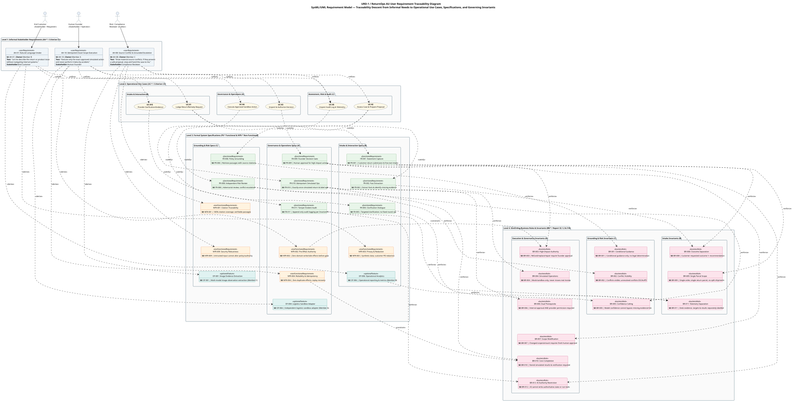
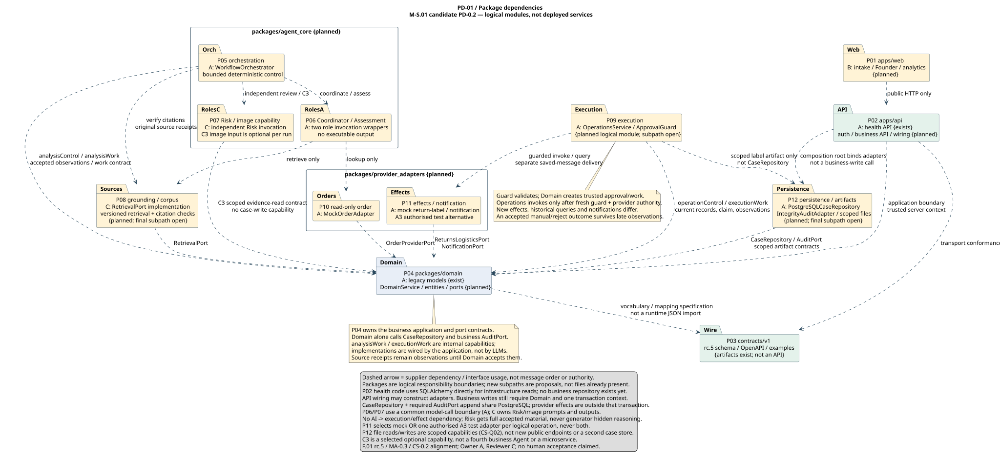
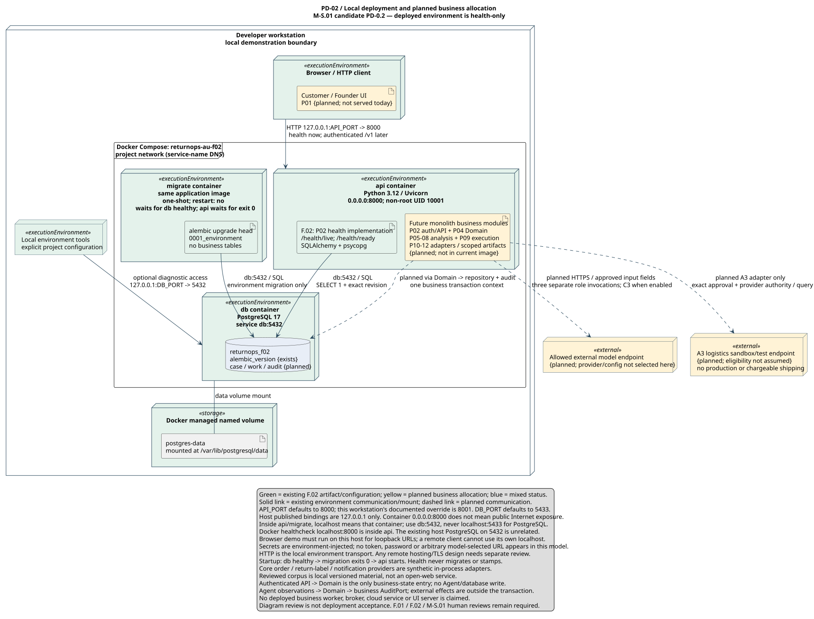

# ELEC5620 Model-Based Software Engineering — Project Stage 1 Team Report
# ReturnOps AU: Human-Governed Multi-Agent Returns Management System

> **Document Status:** MODULAR INTEGRATION CANDIDATE — TECHNICAL FOLLOW-UP; PERSONAL ACCEPTANCE PENDING (Task T4 / T13)
> **Release Candidate:** v1.4-followup
> **Date:** 2026-09-17
> **Repository Target:** `docs/reports/stage-1-team-report.md` (fulfilling Task T4 / T13 from `03_stages/stage_1/EXECUTION_PLAN.md`)  
> **Traceability & Allocation Basis:** [Project Definition v1.0](../00-project-definition-v1.md), [Frozen Work Allocation](../07-frozen-work-allocation.md), [Delivery Work Packages](../08-delivery-work-packages.md), [Interface Contract v1.0 (rc.5)](../09-interface-contract-v1.md), and [Stage 1 Readiness Checklist](../11-stage1-readiness.md).  
> **Collaborative Evidence:** Member A ([reports/member-a-stage1-draft.md](member-a-stage1-draft.md) / [PR #11](https://github.com/shuxiachai/returnops-au/pull/11)), Member B ([reports/member-b-stage1-draft.md](member-b-stage1-draft.md) / [docs/19-member-b-model-chain.md](../19-member-b-model-chain.md) / [PR #14](https://github.com/shuxiachai/returnops-au/pull/14)), Member C (PR #12 / PR #13).
> **Exact source and evidence boundary:** This follows B `6ddd8aa0c8b0c52d2d84b97143896cea4917165b`, preserving the earlier B personal chain and A/AI compatibility correction `4d91a58`. C integration text is taken from [MC-RPT-0.4 at `15c136a`](https://github.com/shuxiachai/returnops-au/blob/15c136a1f717ba074d4aa77a0572d159c28cda8c/docs/reports/member-c-stage1-draft.md#10-september-16-team-report-integration-text); those paragraphs are unchanged from C `048bf760`. This file is a separate repository candidate, not the shared Google Doc's current contents. [Follow-up disposition](../reviews/b-shared-model-followup-20260917.md) records exact scope and checks.
> **Interpretation:** Read architecture in this report as proposed requirements unless a dated exact-source execution record explicitly supports a narrower claim. Static checks, CI, AI review, personal explanation, shared contribution and acceptance are separate. Current source/CI after publication must be read from PR #14; older counts are not current-head evidence.

---

## Document Architecture & Modular Integration Guide

This master report integrates the requirements, architectural designs, and behavioural models for Project Stage 1 across all three group members. The structure strictly follows the 15-chapter rubric mapping specified in `EXECUTION_PLAN.md` §T4 and maps proposed coverage for `C1`–`C13`, `H1`–`H12` and the Project Description. This mapping is not a marks award or a completed course compliance audit.

Each chapter declares:
1. **Discharges Criterion:** Exact rubric item or course requirement addressed.
2. **Ownership:** Primary Author, Co-Authors, and Secondary Reviewer (enforcing criteria notes 3 & 4 and `H5`/`H11`).
3. **Readiness Status:** `[CANDIDATE - Integrated from Member B / PR #14]`, `[DRAFT - Available in Member A/C reports]`, or `[SKELETON - Ready for final team assembly]`.
4. **Content & Guidance:** The substantive technical content or instructions for final compilation.

---

## §0 Cover Page & Administrative Identification

- **Discharges:** Hard Rule `H9` (Group formation, registration conventions, administrative metadata).
- **Primary Owner:** Member B (Chengsi Li, `@ChengsiLi`)  
- **Secondary Reviewer:** Member A (Jingbo Chai, `@shuxiachai` — Project Lead)  
- **Readiness Status:** `[CANDIDATE - Baseline established]`

### Administrative Details
- **Course:** ELEC5620 Model-Based Software Engineering, Semester 2, 2026
- **Institution:** The University of Sydney — School of Electrical and Computer Engineering
- **Project Title:** ReturnOps AU — Human-Governed Multi-Agent Decision Support for Retail Returns
- **Canvas Group Identifier:** `[Pending Canvas Unlock 2026-09-20 / OQ-002]` (Naming convention: `Lab Session + Group Number`, e.g., `Wed 14-16 Group 2`)
- **Key Assessment Dates:**
  - B-proposed internal target: **Friday 25 September 2026** — team agreement is not recorded
  - Canvas Submission Deadline: **Sunday 4 October 2026, 23:59 (End of Mid-Semester Break)**
  - Individual Oral Defence / Viva: **Weeks 11–12 Practical Sessions (19–30 October 2026)**
- Canvas dates above are a prior observation, not a fresh unlocked-page check. The displayed 25 report points remain unexplained; B's report/interview interpretation is not an established course rule.
- **Team Composition and Planned Workload Allocation:**

| Member | Full Name | GitHub Handle | Primary System Role & Scope | Planned Share |
|---|---|---|---|:---:|
| **Member A** | Jingbo Chai | `@shuxiachai` | Project Lead; Orchestration & Governance; Domain Lifecycle; Operations Service (`A1`, `A2`, `A3`) | **45%** |
| **Member B** | Chengsi Li | `@ChengsiLi` | Frontend Architect; Customer Intake & Clarification Portal; Founder Workspace; Analytics (`B1`, `B2`, `B3`) | **27%** |
| **Member C** | Lucas Tao | `@lulucas-tao` | Retrieval Grounding; Citation Verification; Independent Risk Review; Evaluation (`C1`, `C2`, `C3`) | **28%** |

---

## §1 Introduction, Problem Statement, Scope & System Boundary

- **Discharges:** Project Description p.1–2 (Project context, problem definition, scope, non-goals), Hard Rule `H10` (Novel project scope and SME e-commerce problem differentiation).
- **Primary Owner:** Member B  
- **Secondary Reviewer:** Member A  
- **Readiness Status:** `[CANDIDATE - Sourced from Project Definition v1.0]`

### 1.1 Problem Statement & Industrial Motivation
Australian e-commerce small and medium enterprises (SMEs) face disproportionate operational overhead in processing customer returns, warranty claims, and repairs. Under the Australian Consumer Law (ACL), merchants must evaluate whether a return involves a major or minor fault, assess customer evidence, and offer appropriate statutory remedies (repair, replacement, or refund) alongside commercial change-of-mind policies.

In the government-commissioned *Australian Consumer Survey 2023*, a business sample (`n=1,290`, evidence `EVD-001`) **self-estimated a mean of 2.47 hours** to handle a typical problem requiring repair, replacement or refund. Per `EVD-001`'s stated limits, that figure covers **cross-industry end-to-end** problem handling: it is not an e-commerce active-handling measure, not SME-specific, and it does not supply the target value for `NFR-005`. Consistent with change proposal `CP-009`, it is cited as motivation for establishing a controlled manual baseline (Epic E1), not as an established fact about this system's users. For a solo entrepreneur or SME operator ("Founder"), dispute assessment of this kind creates a cognitive bottleneck, leads to inconsistent outcomes, and risks customer churn.

### 1.2 The ReturnOps AU Vision
**ReturnOps AU** is a human-governed, multi-agent returns management system designed specifically for a single Australian online retail business. The system augments the human operator by automating fact gathering, evidence cross-examination, and policy grounding, while maintaining deterministic governance:
- **Intelligent Intake:** Converts unstructured customer complaints into structured factual claims without forcing customers through complex administrative dropdown menus.
- **Tripartite Agent Collaboration:** Employs three differentiated AI agents (Customer Case Coordinator, Returns Assessment Agent, and Compliance/Risk Reviewer) to prepare a transparent, cited Decision Packet.
- **Human-in-the-Loop Authority:** Preserves the human Founder as the sole decision authority for high-impact determinations.
- **Deterministic Guarded Execution:** Restricts operational side effects to a deterministic, idempotent Operations Service operating under strict authorisations and guards.

### 1.3 System Boundary and Explicit Non-Goals
To ensure engineering feasibility and rigorous model checking, the operational boundaries are strictly demarcated:
1. **Single Merchant Context:** Designed for a single Australian online retailer with a unified inventory and returns policy.
2. **Synthetic Data & Sandbox Environment:** All order records, customer communications, and logistics tracking operate on synthetic data (`30-case Gold set`).
3. **No Autonomous Financial or Carrier Execution:** The core prototype does not initiate real monetary transactions, live banking refunds, or binding logistics carrier contracts. Simulated shipping labels and mock notifications represent the boundary of execution.
4. **No Legal Determinations:** The system assists policy assessment under merchant guidelines; it explicitly disclaims statutory legal advice or final legal determinations.

---

## §2 Requirement Documentation & Classification

- **Discharges:** Criterion C1 (0.5 marks, Individual Ad-Hoc Requirements `AH-*`), Hard Rule `H2` (Core & optional feature allocation per member), Hard Rule `H6` (Requirement documentation is part of the submission), Project Description (Classification of Agreement, Mandatory Capabilities, and Optional Features).
- **Primary Owner:** Member B (Classification & Intake/Portal requirements)  
- **Secondary Reviewers:** Member A (Domain & Execution), Member C (Risk & Retrieval)  
- **Readiness Status:** `[CANDIDATE - Full Register Synchronised]`

### 2.1 The Three-Part Classification
In compliance with the Project Description, system requirements are classified into three distinct categories:

#### 2.1.1 The Agreement
The contractual agreement defines what ReturnOps AU guarantees to its users and what is explicitly excluded:
- **Design commitments:** Non-personal audit integrity with lawful retention; preservation of original statements while available; non-executable AI packets; an independent Risk review with explicit five-outcome routing; and guarded idempotent command dispatch. Founder material may include an unsafe proposal for permitted revision/manual handling, or a genuine no-proposal failure/block. Consensus is not required or an authority grant.
- **Exclusions:** No automated approval of disputed refunds without founder sign-off; no direct LLM write-access to the database; and no live external credit card chargebacks.

#### 2.1.2 Mandatory Core Capabilities
The 12 Functional Requirements (`FR-001`–`FR-012`), 9 Non-Functional Requirements (`NFR-001`–`NFR-009`), and 12 Business Rules (`BR-001`–`BR-012`) defined in `docs/04-requirements-and-backlog.md`:
- **FR-001–FR-005 (Intake & Qualification):** Customer portal case lodging, statement preservation, evidence item binding, order reconciliation, and multi-round clarification dialogue.
- **FR-006–FR-008 (Assessment & Risk Review):** Grounded policy retrieval, structured decision packet synthesis, and independent adversarial risk review.
- **FR-009–FR-010 (Governance & Execution):** Founder review workspace, dual-approval checks, idempotent simulated return creation, and mock label generation.
- **FR-011–FR-012 (Audit & Telemetry):** Tamper-evident case event logging and operator audit inspection.
- **NFR-001–NFR-009 (System Quality Attributes verbatim from Backlog):**
  - `NFR-001` Traceability: Citation coverage is 100% for proposal claims that depend on policy or case evidence; citation correctness is at least 90% on the labelled benchmark.
  - `NFR-002` Safety: Block invalid state, failed/stale risk review, invalid exact approval, missing provider authority and non-allowlisted commands before effects. Domain Service alone writes business state, including safe blocked-attempt records.
  - `NFR-003` Privacy: Synthetic/de-identified data only; test secret exclusion, log redaction, model field allowlists, approved provider data flows and retention/deletion without breaking non-personal audit integrity.
  - `NFR-004` Reliability: Zero duplicate effects and illegal transitions; ambiguous outcomes reconcile before retry; notification retry does not repeat operations.
  - `NFR-005` Performance: p95 accepted-complete-input → stored-review-ready-proposal <120 seconds in the fixed environment; include machine revision/risk loops, exclude human and physical waiting only. Report p50/p95, failures, environment/model, tokens and cost.
  - `NFR-006` Testability: Mandatory acceptance criteria, state guards, approval-negative paths, and adapter contracts have automated normal- and failure-path tests.
  - `NFR-007` Maintainability: LLM, commerce, policy, logistics, and notification providers are accessed through documented typed interfaces with contract tests.
  - `NFR-008` Observability: Structured events contain case/correlation ID, component and source version, time, outcome, and typed error while redacting sensitive content.
  - `NFR-009` Security and AI robustness: Customer text, attachments, and retrieved documents are untrusted data; they cannot change workflow policy, grant authority, expose secrets, call a non-allowlisted tool, or bypass authenticated role and approval checks.
- **BR-001–BR-012 (Governing Business Rules verbatim from Backlog):**
  - `BR-001`: ReturnOps AU presents approved guidance and conditional recommendations; it does not give legal advice or make a definitive ACL entitlement, major-failure, or minor-failure determination.
  - `BR-002`: Material case-relevant source conflicts remain visible in the conditional packet and independent Risk review. Non-blocking differences may give `PASS_WITH_WARNING`; unresolved conflicts preventing a safe recommendation require `ESCALATE`. No silent source precedence; source conflicts are not OrderLookupBlock or technical ProcessingFailure records.
  - `BR-003`: Refund, replacement, repair, order/payment/inventory mutation, and cost-bearing logistics operations are high-impact actions.
  - `BR-004`: The course prototype uses simulated provider operations and never moves real money or changes a production order.
  - `BR-005`: High model confidence cannot bypass missing evidence, a failed risk review, command allowlisting, or human approval.
  - `BR-006`: ReturnOps approval and external-provider permission are independent prerequisites.
  - `BR-007`: Changed proposal version, remedy, amount, line items, commands or parameter fingerprint requires new approval.
  - `BR-008`: Customer-requested outcome and system recommendation remain separate.
  - `BR-009`: One case covers one order and potentially multiple line items; one return shipment has one parcel label, with no split shipments.
  - `BR-010`: Core completion requires stored simulated return/label results and successful outcome notification. `NOTIFICATION_PENDING/NOTIFICATION_FAILED` cannot cause an operation to be repeated.
  - `BR-011`: Desk evidence, assumptions, targets and measured results are separately labelled.
  - `BR-012`: AI cannot directly write authoritative state, create a trusted approval or call operations providers.

#### 2.1.3 Selected Optional Features (Hard Rule `H2`)
Each member implements and owns one designated optional feature in the Stage 2 prototype:
- **OF-001 Image Evidence Extraction (Member C):** Scoped image observations with uncertainty for permitted evidence; no proof of causality, damage or customer entitlement.
- **OF-004 Logistics Sandbox Adapter (Member A):** Independent authorised provider sandbox/test-mode integration beyond the core mock; Australia Post/StarTrack access remains unresolved.
- **OF-006 Operational Analytics & Dashboard (Member B):** Operational reporting of case counts, current case-state distribution, latest valid per-case RiskReview distribution and recorded proposal latency, with missing/failed measurements separate. A supplies the aggregates; B presents them. Targets, desk evidence and measured results stay distinct.

### 2.2 Individual Ad-Hoc Requirements (Criterion C1, `H4`)
Each member is assigned an informal ad-hoc requirement; their own explanation and genuine revisions remain required. The candidate chains use reflecting their specific problem stakeholder:
- **Member A (`AH-10`):** *"Execute only the exact approved simulated action and never perform it twice by accident."* (Focus: Safe orchestration, idempotent execution, and non-replayable state transitions).
- **Member B (`AH-01`):** *"Let me describe the return or product issue without navigating internal systems."* (Focus: Frictionless customer experience, natural-language statement lodging, and structured clarification dialogue).
- **Member C (`AH-08`):** *"Show material source conflicts; if they prevent a safe proposal, stop and hand the case to me."* (Focus: Factual grounding, citation cross-examination, conflict detection, and safe escalation).

---

## §3 Requirements Diagrams: User Requirement Diagram & Feature Diagram

- **Discharges:** Criterion C2 (1 mark, Group Feature Diagram), Project Description (User Requirement Diagram).
- **Primary Owner:** Member B  
- **Secondary Reviewers:** Member A, Member C  
- **Readiness Status:** `[CANDIDATE - PlantUML URD-1 & Mermaid FEAT-1 Synchronised]`

### 3.1 User Requirement Diagram (`URD-1`)

The User Requirement Diagram (`URD-1`) bridges informal stakeholder goals (`End Customer`, `Human Founder`, `Compliance Reviewer`) to concrete operational use cases, formal functional/non-functional specifications, and binding domain invariants in OMG SysML / UML 2.5 notation. *(Reference: [docs/diagrams/08-user-requirement-diagram.md](../diagrams/08-user-requirement-diagram.md) and [docs/05-lab-3-requirement-modelling.md](../05-lab-3-requirement-modelling.md))*.



`URD-1` demonstrates systematic traceability descent across four explicit abstraction tiers:
1. **Level 1 — Informal Stakeholder Needs (`AH-*` / Criterion C1):** Captures raw user-language problems:
   - `AH-01` (Customer / Member B): *"Let me describe the return or product issue without navigating internal systems."* (Frictionless natural-language intake).
   - `AH-10` (Founder / Member A): *"Execute only the exact approved simulated action and never perform it twice by accident."* (Idempotent orchestration and safety).
   - `AH-08` (Auditor / Member C): *"Show material source conflicts; if they prevent a safe proposal, stop and hand the case to me."* (Grounded assessment and safe escalation).
2. **Level 2 — Operational Use Cases (`UC-*` / Criterion C3):** Operationalises informal goals through `<<refine>>` dependencies into observable interactions: `UC-01` (Intake), `UC-01E` (Clarification), `UC-02` (Assessment & Risk), `UC-03` (Founder Gate), `UC-04` (Sandbox Ops), and `UC-05` (Audit & Telemetry).
3. **Level 3 — Formal Specifications (`FR-*`, `NFR-*`, `OF-*` / Criteria C1 & C2):** Connected via `<<satisfy>>` and `<<derive>>` edges to verifiable system contracts:
   - Customer interaction is specified by `FR-001` (submission), `FR-002` (fact extraction), `FR-005` (clarification), `NFR-003` (PII redaction), and `OF-006` (dashboard analytics).
   - Governed operations are specified by `FR-009` (human gate), `FR-010` (idempotent ops), `FR-011` (audit logging), `NFR-002` (pre-effect authority), `NFR-004` (zero duplicate side effects), and `OF-004` (logistics adapter).
   - Policy grounding is specified by `FR-006` (statutory citations), `FR-008` (independent risk review), `NFR-001` (100% citation coverage), `NFR-009` (prompt injection defence), and `OF-001` (image evidence).
4. **Level 4 — Governing Business Rules & Invariants (`BR-*` / §2.1.2 & §16):** Enforces statutory and domain boundaries via `<<enforce>>` and `<<constrain>>` dependencies:
   - Customer outcome requested and system recommendation remain permanently distinct (`BR-008`), restricted to single order and single parcel (`BR-009`), with operational telemetry targets maintained separately from measured results (`BR-011`).
   - High-impact mutations mandate explicit human founder authority (`BR-003`, `BR-007`), simulated sandbox execution only (`BR-004`), dual authorisation (`BR-006`), completion prerequisite (`BR-010`), and complete prohibition of direct AI writes (`BR-012`).
   - System outputs remain conditional non-legal guidance (`BR-001`), material conflicts force escalation (`BR-002`), and model confidence cannot bypass missing evidence (`BR-005`).
*(Source: [docs/diagrams/08-user-requirement-diagram.md](../diagrams/08-user-requirement-diagram.md) and [docs/diagrams/shared/user-requirement-diagram.puml](../diagrams/shared/user-requirement-diagram.puml))*.

### 3.2 Comprehensive Feature Diagram (`FEAT-1`)
The Feature Diagram captures the structural composition of the ReturnOps AU product, decomposing the solution into Mandatory Core features, Optional modules, and Alternative workflow paths.
*(Reference: [docs/diagrams/04-feature-diagram.md](../diagrams/04-feature-diagram.md))*.

```
ReturnOps AU
├── Core Returns Management (Mandatory)
│   ├── Case Intake & Lodging (B1 / FR-001, FR-002)
│   │   ├── Free-text statement capture [Mandatory]
│   │   ├── Evidence upload & binding [Mandatory]
│   │   └── Guarded Customer Clarification [No fixed round cap] (FR-005)
│   ├── Autonomous Multi-Agent Assessment
│   │   ├── Input Coordination (A1 / FR-003, FR-004)
│   │   ├── Policy Grounding & Retrieval (C1 / FR-006)
│   │   ├── Decision Proposal Synthesis (A1 / FR-007)
│   │   └── Independent Risk & Compliance Review (C2 / FR-008)
│   ├── Human Governance & Workspace (B2 / FR-009)
│   │   ├── Proposal Inspection & Cited Evidence View [Mandatory]
│   │   └── Founder Decision Dispositions [XOR 1..1: Approve / Revise / Reject / Manual]
│   └── Governed Operations Execution (A2 / FR-010)
│       ├── Idempotent Return Creation [Mandatory]
│       └── Customer Notification Dispatch [Mandatory]
└── Extended Modules (Selected Optionals per Member)
    ├── Logistics Sandbox Adapter [Optional - Member A / OF-004]
    ├── Operational Analytics Dashboard [Optional - Member B / OF-006]
    └── Multi-Modal Image Evidence Extraction [Optional - Member C / OF-001]
```

### 3.3 Workload Split & Effort Consistency
In alignment with `D-09` and `docs/07-frozen-work-allocation.md`, the planned effort distribution is explicitly confirmed as **45% (Member A) / 27% (Member B) / 28% (Member C)**.

---

## §4 Use Case Modelling

- **Discharges:** Criterion C3 (1 mark, Use Case Overall Diagram), Criterion C4 (2 marks, 5–10 Use Case Specifications, `H3`).
- **Primary Owner:** Member B  
- **Secondary Reviewers:** Member A, Member C  
- **Readiness Status:** `[CANDIDATE - 6 Full Specifications Defined]`

### 4.1 Overall Use Case Diagram (`UCD-1` / Criterion C3)
The system boundary encompasses primary human actors (`Customer`, `Human Founder`), secondary external provider services (`Mock Order Provider`, `Mock Returns Provider`, `Mock Logistics Provider`, `Simulated Notification Provider`), and the five top-level use cases alongside their included and extended sub-behaviours in standard UML 2.5 notation (`UCD-1`).

**Source and contribution status:** B published this shared PlantUML view; earlier shared sources and this A/AI-assisted correction are retained. Actual personal additions/reviews and all-member contribution remain to be recorded; no per-diagram percentages are verified.


*(PlantUML Source: [docs/diagrams/shared/use-case-diagram.puml](../diagrams/shared/use-case-diagram.puml) / [docs/diagrams/05-use-case-diagram.md](../diagrams/05-use-case-diagram.md))*.

> *Note on Task T5:* The use case model is authored in standard PlantUML UML 2.5 notation with system boundary frames, actor glyphs, and `<<include>>`/`<<extend>>` stereotyping, fully superseding earlier informal flowchart representations.

### 4.2 Group Use Case Specifications (Criterion C4)
The team specifies exactly 6 comprehensive use cases (satisfying the 5–10 requirement of `H3`):

| UC ID | Use Case Name | Primary Actor | Primary Owner | Discharges |
|---|---|---|---|---|
| **UC-01** | Lodge Return Request & Intake Qualification | End Customer | Member B | FR-001, FR-002, AH-01 |
| **UC-01E**| Submit Supplemental Clarification & Evidence | End Customer | Member B | FR-002, FR-005 |
| **UC-02** | Autonomous Multi-Agent Assessment & Risk Review | Human Founder (triggered by Customer intake) | Member C (Risk) / Member A (Assmt) | FR-006, FR-007, FR-008, AH-08 |
| **UC-03** | Founder Review, Decision Gate & Override | Human Founder | Member A (Core) / Member B (UI) | FR-009, BR-004 |
| **UC-04** | Governed Simulated Operations Execution | Human Founder (supported by Mock Providers) | Member A | FR-010, AH-10, NFR-002, NFR-004 |
| **UC-05** | Inspect Authoritative Case State & Audit Trail | Human Founder | C (spec/provenance), A (authorised service), B (UI) | FR-011, FR-012, OF-006 |

*(Detailed step-by-step specifications for UC-01 through UC-05 detailing preconditions, triggers, main success path, extension paths, and exception guards are integrated from [docs/05-lab-3-requirement-modelling.md](../05-lab-3-requirement-modelling.md)).*

---

## §5 Elementary Structure Modelling: Design-Time Class Model

- **Discharges:** Criterion C6 (3 marks, Design-time class diagram with proper associations, generalisations, compositions, aggregations, and multiplicities).
- **Primary Owner:** Member B  
- **Secondary Reviewers:** Member A, Member C  
- **Readiness Status:** `[CANDIDATE - Synchronised with packages/domain]`

### 5.1 Domain Entity & Value Object Model (`CLS-1`)
The design-time elementary class diagram captures the core business domain of ReturnOps AU in exact structural correspondence with `01-domain-class-diagram.md`.
*(Reference: [docs/diagrams/01-domain-class-diagram.md](../diagrams/01-domain-class-diagram.md))*.

```
                          +-----------------------------------------+
                          |               ReturnCase                |
                          +-----------------------------------------+
                          | - case_id: str                          |
                          | - case_version: int                     |
                          | - input_version: int                    |
                          | - status: CaseStatus                    |
                          | - created_at: datetime                  |
                          +-----------------------------------------+
                             | 1           | 1         | 1       | 1
           +-----------------+             |           |         +-----------------+
           | 1..*                          | 1         | 0..*                      | 0..*
           v                               v           v                           v
+-----------------------+      +---------------+  +----------------+  +--------------------+
|   CustomerStatement   |      | IntakeSession |  |  EvidenceItem  |  |   DecisionPacket   |
+-----------------------+      +---------------+  +----------------+  +--------------------+
| - statement_id: str   |      | - session_id  |  | - evidence_id  |  | - proposal_id: str |
| - original_text: str  |<--o--| - round: int  |  | - type: EvType |  | - prop_version: int|
| - requested_outcome   | 1..* | - state: str  |  | - ret_until: dt|  | - rec_action: RecAct|
| - submitted_at: dt    |      +---------------+  +----------------+  +--------------------+
+-----------------------+                                                       ^ 1
           ^                                                                    |
           | references_original                                                | reviews_exact
           +-------------------------------------------------------------+      |
                                                                         |      | 0..*
                                                              +--------------------+
                                                              |   ProposalReview   |
                                                              +--------------------+
                                                              | - review_id: str   |
                                                              | - decision: RiskDec|
                                                              | - findings: list   |
                                                              +--------------------+
```

### 5.2 UML Association Semantics & Multiplicities
- **Aggregate Root Composition (`*--`):** `ReturnCase` serves as the aggregate root, directly composing `CustomerStatement` records (`1` to `1..*`), `IntakeSession` (`1` to `1`), `EvidenceItem` attachments (`1` to `0..*`), and `DecisionPacket` proposals (`1` to `0..*`). Composition expresses model ownership, not blanket cascade deletion. F.07/rc.5 allows removal or de-identification of governed personal content while retaining permitted non-personal event IDs/hashes, historical unavailable-material tombstones and minimal deduplication records. Replay must respect deleted content; it must neither restore it nor create fresh work.
- **Review Association (`-->`):** `ProposalReview` instances are associated with `DecisionPacket` via `reviews_exact_version` (`0..*` to `1`) and reference original statements (`0..*` to `1..*`), preserving separation of evaluation from core case facts.
- **Intake Reference:** `IntakeSession` references active `CustomerStatement` items without overwriting historical statements.
- **Enumerations & Value Types:** Preserves the canonical 16-state `CaseStatus` macro-lifecycle vocabulary and the 6-state `IntakeSession` micro-lifecycle vocabulary (`SUBMITTED`, `EVALUATING`, `AWAITING_CLARIFICATION`, `CLARIFICATION_RECEIVED`, `COMPLETE`, `ESCALATED_FAILURE`).
- **Review Result and Internal Work:** The shared conceptual `ProposalReview` holds the accepted immutable result corresponding to wire `RiskReview`. C's separate internal work phases are `QUEUED`, `INVOKING`, `VALIDATING`, `RECOVERY_WAIT`, `ACCEPTED`, `HISTORICAL`, `CLOSED_WITHOUT_RESULT`; these are neither public case states nor RiskReview outcomes. The 5 result decisions remain: `PASS`, `PASS_WITH_WARNING`, `REVISE`, `NEEDS_INFORMATION`, and `ESCALATE`.
- **Interface Definitions & Ports:** Strict boundary ports (`OrderProviderPort`, `ReturnsLogisticsPort`, `NotificationPort`, `AuditPort`, `CaseRepository`) prevent direct coupling to concrete third-party services.

---

## §6 Complex Structure Modelling: Runtime Models

- **Discharges:** Criterion C7 (3 marks, Runtime models: Object Diagram, Collaboration Diagram, Composite Structure Diagram; Lab 6 named-instance requirements).
- **Source and contribution status:** B introduced `OBJ-1` and `COL-1` in PR #14; this A/AI-assisted follow-up corrects their shared semantics. `SC-1` is grounded in A's earlier CS-0.2 sources. C supplies a distinct `MC-OBJ-0.1` slice and C-boundary integration text. Per-diagram authorship percentages and completed all-member participation have not been established.
- **Readiness Status:** `[CANDIDATE - Source/render checks are documented separately; personal/shared acceptance pending]`

### 6.1 Concrete Named-Instance Object Diagram (`OBJ-1` / Criterion C7a)

In accordance with Lab Note 6 and Criterion C7, the system models a concrete logical runtime snapshot capturing instance attribute value slots, instance links, and governance invariants at a single critical decision gate moment (prior to Founder review):

[Detailed Specification & Source: docs/diagrams/06-object-diagram.md](../diagrams/06-object-diagram.md) · [PlantUML Source](../diagrams/shared/object-diagram.puml)


#### 6.1.1 Decision Gate Runtime State Snapshot
The synthetic snapshot contains 20 objects across 19 classifier types at a selected `AWAITING_APPROVAL` moment. All text, hashes, references and judgments are teaching fixtures, not retrieved legal quotations, a measured run or Gold evidence. Initial statement is input v1; accepted order snapshot is v2; the current-question-set answer is v3. Case/facts/proposal/review bind input v3, proposal v2 has a fresh independent review, and case v8 is a separate illustrative business revision. Historical records are omitted from the drawing, not purged:

| Instance | Classifier (`CLS-1`) | Key Attribute Values | Structural & Governance Role |
|---|---|---|---|
| `case101` | `ReturnCase` | `case_id = "CASE-2026-0881"`, `case_version = 8`, `status = AWAITING_APPROVAL` | Aggregate root holding case lifecycle; paused awaiting human decision. |
| `cust101` | `Customer` | `customer_id = "CUST-8812"`, `identity_content_ref = "blob://..."` | Registered customer entity; external to case aggregate root. |
| `intake101` | `IntakeSession` | `intake_session_id = "SESS-4412"`, `clarification_round = 1`, `lifecycle_state = "COMPLETE"` | Intake micro-lifecycle; finished gathering statements after round 1. |
| `stmt101` | `CustomerStatement` | `statement_id = "STMT-001"`, `original_text = "Screen cracked upon unboxing..."`, `requested_outcome = REPLACEMENT` | Original customer lodgement statement (preserved immutably). |
| `stmt102` | `CustomerStatement` | `statement_id = "STMT-002"`, `original_text = "Outer shipping box undamaged..."`, `requested_outcome = REPLACEMENT` | Supplemental clarification reply submitted under round 1. |
| `facts101` | `ExtractedFacts` | `input_version = 3`, `issue_category = FAULTY_OR_QUALITY_ISSUE`, `assessment_status = SUPPORTED` | Normalised factual summary synthesised across both statements. |
| `snap101` | `OrderSnapshot` | `snapshot_id = "SNAP-9921"`, `order_id = "ORD-9921"`, `total_amount_cents = 89900`, `currency = "AUD"` | Authoritative order snapshot retrieved from read-only order provider. |
| `li101` | `LineItem` | `line_item_id = "ITEM-01"`, `sku = "MON-4K-27-IPS"`, `ordered_quantity = 1` | Purchased monitor line item from accepted order snapshot. |
| `cli101` | `CaseLineItem` | `line_item_id_ref = "ITEM-01"`, `requested_quantity = 1` | Bounded return claim referencing the verified order line item. |
| `ev101` | `EvidenceItem` | `evidence_id = "EVD-301"`, `type = PHOTO`, `authorised_content_ref = "blob://..."` | Synthetic evidence reference; not actual photographic proof. |
| `ea101` | `EvidenceAssessment` | `criterion_id = "PHYSICAL_DAMAGE"`, `status = SUPPORTED` | Illustrative assessment; no measured image result. |
| `doc1` | `PolicyDocument` | `source_id = "DOC-STORE-POL-01"`, `source_type = "STORE_POLICY"`, `corpus_version = "2026.1"` | Synthetic merchant-policy fixture. |
| `p1` | `PolicyPassage` | `passage_id = "PAS-STORE-14D"`, `content = "Claims must be lodged within 14 calendar days..."` | 14-day limit passage extracted from merchant store policy. |
| `doc2` | `PolicyDocument` | `source_id = "DOC-ACL-GUIDE-02"`, `source_type = "CONSUMER_GUIDANCE"` | Synthetic consumer-guidance fixture; not an official quotation. |
| `p2` | `PolicyPassage` | `passage_id = "PAS-ACL-MAJOR"`, `content = "Synthetic guidance: assess applicable remedies..."` | Synthetic guidance showing a separate source scope. |
| `prop101` | `DecisionPacket` | `proposal_id = "PROP-8812"`, `proposal_version = 2`, `recommended_action = REPLACE_ITEM`, `confidence = 0.88` | Revised proposal generated by Returns Assessment Agent citing citations. |
| `cit1`, `cit2` | `Citation` | `claim_ref = "CLAIM-..."`, `passage_id_ref = "PAS-..."` | Grounded citations resolving proposal claims to retrieved policy passages. |
| `rev101` | `ProposalReview` | `review_id = "REV-9901"`, `decision = PASS_WITH_WARNING`, `reviewer_invocation_id = "INV-771"` | Independent risk review decision validating proposal against policy corpus. |
| `rf101` | `RiskFinding` | `finding_id = "RF-01"`, `category = POLICY_CONFLICT`, `blocks_execution = false` | Non-blocking source-scope warning in the synthetic within-window fixture. |

#### 6.1.2 Governance illustration and its limits

This chosen pre-approval snapshot has no ApprovalRecord, instantiated execution ToolCommand, OperationAttempt, ReturnParcel or ParcelLabel. A non-executable action preview may exist outside the selected slice. Object absence illustrates that moment; it cannot prove that a running system denies unauthorised effects. Domain guards, authenticated roles, current exact approval, provider authority and runtime negative/concurrency tests are still required.

The two synthetic source scopes remain visible. PASS_WITH_WARNING is appropriate only because this fixture assumes a within-window case with a safe conditional recommendation; it does not resolve an actual legal entitlement or permit a blocking conflict to pass. An unresolved conflict preventing a safe proposal requires ESCALATE.

---

### 6.2 Collaboration / Communication Diagram (`COL-1` / Criterion C7b)

Depicts the structural connectivity and numbered message dispatch across collaborating component instances during exact-scope approval and dispatch (`UC-04`):

[Detailed Specification & Source: docs/diagrams/07-collaboration-diagram.md](../diagrams/07-collaboration-diagram.md) · [PlantUML Source](../diagrams/shared/collaboration-diagram.puml)


#### 6.2.1 Message and transaction ledger

Logical message numbers identify calls and returns; repeated exchanges share edges in this condensed communication view. They are not additional public API methods.

| Step | Sender → receiver | Required meaning |
|---|---|---|
| 1 / 1.1 / 1.2 | Founder → dashboard → API → Domain | Authenticated exact-target decision with server-formed trusted context; the UI cannot create authority. |
| 1.3 / 1.4 | Domain ↔ Guard | Current-state decision check returns an internal verdict. Guard neither creates nor persists approval. |
| 1.5 (Tx A) | Domain → CaseRepository and AuditPort | Persist accepted decision, exact ApprovalRecord, required audit and applicable work together. |
| 2 / 2.1 (Tx B) | Domain → Operations; Operations ↔ Domain | Dispatch saved work, reload permitted current records and obtain durable claim/intent before a new effect. |
| 2.2 / 2.3 | Operations ↔ Guard / provider | Check final current scope/expiry/authority at each effect boundary, plus provider permission, allowlist and durable idempotency. Invoke return then label under their dependencies. |
| 2.4 (Tx C) | Operations → Domain → CaseRepository/AuditPort | Raw observations become trusted facts only after Domain validation and atomic state/audit/work acceptance. Save return before label; a label requires its controlled artifact reference before SUCCEEDED. |
| 3 / 3.1 | Domain → Operations → notification adapter | Only the accepted persisted outcome selects notification. Core success requires both saved effects first; reject/manual paths can notify without effects. |
| 3.2 (Tx D) | Operations → Domain → CaseRepository/AuditPort | Accept delivery result, state, required audit and any retry work together. Failed notification never replays return/label. |

#### 6.2.2 Authority and recovery

Domain alone calls CaseRepository and AuditPort. Each accepted business change, required audit and applicable work use one transaction context. Operations and Guard submit observations/verdicts back to Domain; neither directly writes trusted business audit. Provider effects remain outside the local database transaction.

Before each new effect, final current-state/authority checks must coordinate at the actual adapter call boundary; checking twice does not prove concurrency safety. Unknown effects reconcile the original attempt; a known label with incomplete artifact stays EXECUTING while only that artifact is recovered. Full result/reference persistence precedes SUCCEEDED. Saved effects precede success notification, whose retry never repeats return/label. The detailed MA-0.3/CS-0.2/AD-0.2 recovery and manual-outcome rules still apply.

---

### 6.3 Composite Structure Diagram (`SC-1` / `CS-0.2` / Criterion C7c)

Models the internal structural parts, ports, and connectors of the `Governed Case Assessment` subsystem, detailing the encapsulation of `Assessment Agent`, `Approval Guard`, and `Operations Service` alongside ports `pOrder`, `pOps`, and `pAudit`.
*(Reference: [docs/13-shared-composite-structure.md](../13-shared-composite-structure.md))*.

---

## §7 Behavioural Modelling: Individual Model Chains

- **Discharges:** Criteria C8 (1.5 marks, Activity Diagram), C9 (1.5 marks, Interaction/Sequence Diagram), C10 (1.5 marks, State Machine Diagram) — Total 4.5 marks per student, Hard Rule `H4` (each member's models derive from their own `AH-*` and `UC-*`).
- **Primary Owners:** Each member independently for their subsection.

### 7.1 Member A Behavioural Model Chain (Governed Execution & Lifecycle)
- **Primary Author:** Member A (Jingbo Chai, `@shuxiachai`)  
- **Reviewer:** Member C (Lucas Tao, `@lulucas-tao`)  
- **Readiness Status:** `[DRAFT - Available in docs/reports/member-a-stage1-draft.md / PR #11]`
- **Traceability Chain:** `AH-10` → `UC-04` (Governed Execution) & `UC-03` (Founder Approval Gate).
- **Activity Diagram (`ACT-001 / M-A.02 / MA-0.3` / `C8`):** Decision admission → durable intent write → guarded command execution → recovery → customer notification. *(SVG: [docs/diagrams/member-a/governed-execution-activity.svg](../diagrams/member-a/governed-execution-activity.svg))*.
- **Sequence Diagram (`INT-001 / M-A.03 / MA-0.3` / `C9`):** Dual-panel interaction model showing exact-scope command execution and failure recovery. *(SVG: [docs/diagrams/member-a/exact-scope-sequence.svg](../diagrams/member-a/exact-scope-sequence.svg))*.
- **State Machine Diagram (`STM-001 / M-A.04 / MA-0.3` / `C10`):** `OperationAttempt` seven-state lifecycle (`PENDING`, `EXECUTING`, `SUCCEEDED`, `FAILED`, `UNKNOWN`, `RECONCILING`, `BLOCKED`). *(SVG: [docs/diagrams/member-a/operation-attempt-state.svg](../diagrams/member-a/operation-attempt-state.svg))*.
*(Detailed walkthrough in [docs/reports/member-a-stage1-draft.md](member-a-stage1-draft.md) and [docs/12-member-a-model-chain.md](../12-member-a-model-chain.md))*.

---

### 7.2 Member B Behavioural Model Chain (Customer Intake & Clarification)
- **Primary Author:** Member B (Chengsi Li, `@ChengsiLi`)  
- **Reviewer:** Member A (Jingbo Chai, `@shuxiachai`)  
- **Readiness Status:** `[CANDIDATE - Original B chain plus 4d91a58 compatibility correction retained; current publication/CI and personal acceptance recorded separately]`
- **Traceability Chain:** `AH-01` → `UC-01` (Lodge Request) & `UC-01E` (Submit Clarification).

#### 7.2.1 Activity Diagram (`ACT-002 / MB-ACT-0.2` / Criterion C8)


The activity model strictly separates the Customer, Member B's Customer Portal, the Domain Service, and the Case Coordinator:
1. **Intake Admission:** Customer provides natural-language complaint and optional evidence; client-side validation provides rapid feedback; Domain Service independently authenticates, validates, and admits the payload, returning `HTTP 201 Created`.
2. **Clarification Loop:** The Case Coordinator inspects facts. If facts are ambiguous, missing, or contradictory, a structured question set is persisted, moving the case to `AWAITING_INFORMATION`. The customer submits answers via `UC-01E` returning `HTTP 202 Accepted`.
3. **Session Inactivity & UI Boundary:** If the customer leaves or pauses intake, only the local client view controller (`IntakeViewSession`) is paused. The authoritative case remains safely in `AWAITING_INFORMATION` on the server; the 15-route contract deliberately exposes no customer cancellation route, and no unapproved withdrawal transition or case rejection is triggered.

#### 7.2.2 Sequence / Interaction Diagram (`INT-002 / MB-SEQ-0.2` / Criterion C9)


The sequence model features two independently framed Interaction Diagrams assembled into a unified SVG:
1. **`sd CustomerIntake`:** Covers initial submission, idempotent replaying (matching key `idem_k_981` returns cached receipt; mismatched payload returns `409 IDEMPOTENCY_CONFLICT`), and evidence binding. Fresh acceptance triggers an interaction reference to the second frame.
2. **`sd ProcessAcceptedIntake`:** Asynchronous processing frame isolating AI coordinator fact extraction, question set generation, and state transition dispatch.

#### 7.2.3 State Machine Diagram (`STM-002 / MB-STM-0.2` / Criterion C10)


The state machine models the case-owned **`IntakeSession`** lifecycle (6 micro-states) decoupled from the UI view controller (`IntakeViewSession`) and the macro `ReturnCase` lifecycle:
- **States:** `SUBMITTED`, `EVALUATING`, `AWAITING_CLARIFICATION`, `CLARIFICATION_RECEIVED`, `COMPLETE`, `ESCALATED_FAILURE`.
- **Guards:** `G-REENTRY` enforces that clarification requires an active question set committed by the Domain Service; `G-TERMINAL` ensures that once a macro case reaches `COMPLETED`, `REJECTED`, or `MANUAL_HANDLED`, session behaviour concludes permanently.
- **Policy Boundary:** In accordance with PR #14, arbitrary three-round caps, seven-day expiry timers, and customer withdrawal mutations are rejected as unapproved extensions.
*(Full technical evidence and contract mappings verified in [docs/19-member-b-model-chain.md](../19-member-b-model-chain.md) and [docs/reports/member-b-stage1-draft.md](member-b-stage1-draft.md))*.

---

### 7.3 Member C Behavioural Model Chain (Retrieval Grounding and Independent Risk)

- **Owner / reviewer:** C / A, unchanged; personal explanation and A's exact-current-revision review remain pending.
- **Source:** [C report MC-RPT-0.4 at `15c136a`](https://github.com/shuxiachai/returnops-au/blob/15c136a1f717ba074d4aa77a0572d159c28cda8c/docs/reports/member-c-stage1-draft.md#10-september-16-team-report-integration-text).

Member C's candidate derives from **AH-08 → UC-02**, with **UC-05** specifying authorised historical inspection. The full models are **MC-ACT-0.1**, **MC-SEQ-0.1** and **MC-SM-0.1**; the readable overview panels are **MC-ACT-RPT-0.1**, **MC-SEQ-RPT-0.1** and **MC-SM-RPT-0.1**. The separate **MC-OBJ-0.1** is a synthetic blocking-conflict instance snapshot, not a system execution log or proof of C authorship of B's new OBJ-1. Source/view links and placement measurements are recorded in the exact C report §3 linked above.

The Activity model separates source retrieval, citation checks, complete proposal-bundle admission, independent review and five-outcome routing. The Sequence model preserves the Domain-mediated original material and a separate C2 invocation; neither Assessment reasoning nor a history preview substitutes for that input. The State model concerns internal review work, not public case states: QUEUED, INVOKING, VALIDATING, RECOVERY_WAIT, ACCEPTED, HISTORICAL and CLOSED_WITHOUT_RESULT. The accepted immutable RiskReview has exactly five outcomes; seven work phases do not add public enum values. A selected the guarded persistence/budget design; runtime concurrency proof and C's personal explanation remain open. B's review on C `c9f205d` is recorded, while A must review this later revision.

---

## §8 System Architecture & Viewpoint Analysis

- **Discharges:** Criterion C5 (Optional, Architecture Analysis based on Viewpoints), Criterion C11 (Optional, Ad-Hoc Diagram), Criterion C12 (Optional, Package Diagram), Criterion C13 (Optional, Deployment Diagram).
- **Primary Owner:** Member A  
- **Secondary Reviewers:** Member B, Member C  
- **Readiness Status:** `[CANDIDATE - Viewpoint analysis & package/deployment models aligned]`

### 8.1 4+1 Viewpoint Analysis (Criterion C5 / Lab 4 & 5 Integration)
- **Logical View:** Domain class hierarchy, state machine invariants, and multi-agent responsibility separation.
- **Process View:** Asynchronous request processing, non-blocking HTTP 202 task handoffs, and background reconciliation loops.
- **Development View:** 12-package modular decomposition (`apps/api`, `apps/web`, `contracts/v1`, `packages/domain`, `packages/agent_core`, `packages/grounding`, `packages/execution`, `packages/provider_adapters`, `packages/persistence`) enforcing inward dependency inversion towards `packages/domain` (`PKG-1`).
- **Physical / Deployment View:** Dockerised micro-tier topology, PostgreSQL persistence node, and mock third-party service gateways.
- **Use Case / Scenarios View:** Realised through 6 core use cases demonstrating system response to typical and adversarial customer requests.

### 8.2 Overall Ad-Hoc System Design (`ADH-1` / Criterion C11)
Architectural overview illustrating the tripartite agent pipeline surrounding the deterministic Domain and Operations core.
*(Reference: [docs/02-system-design.md](../02-system-design.md))*.

### 8.3 Package Diagram (`PKG-1` / Criterion C12)

Full documentation: [09-package-diagram.md](../diagrams/09-package-diagram.md) · PlantUML source: [package-dependencies.puml](../diagrams/shared/package-dependencies.puml)



The package diagram presents the **Development View** (Kruchten 4+1) of the system. Twelve logical packages (`P01`–`P12`) are arranged in a strict acyclic dependency graph where **all arrows point inward towards `packages/domain` (`P04`)**. This is the Clean Architecture / Hexagonal (Ports and Adapters) invariant made visible:

- **`P04 packages/domain` has zero outgoing dependencies** on agents, API frameworks, operational providers, or persistence implementations. It defines port interfaces only; adapters implement them.
- **No dependency runs from any agent package (`P05`–`P08`) to any execution or effect package (`P09`–`P11`).** This structural firewall ensures that AI agents propose observations — they cannot invoke provider effects. The only path from analysis to execution passes through `P04 Domain` → `P09 Execution`, where the `ApprovalGuard` enforces a fresh human-granted `ApprovalRecord`.
- **Adapters (`P10`, `P11`, `P12`) depend on `P04` via port interfaces.** Replacing a mock adapter with a production implementation requires changing only the adapter package and the composition root wiring in `P02` — never the domain layer.
- The acyclic property guarantees independent compilation and testing of each package, clear layering for future service extraction, and no hidden mutual coupling.

### 8.4 Deployment Diagram (`DEP-1` / Criterion C13)

Full documentation: [10-deployment-diagram.md](../diagrams/10-deployment-diagram.md) · PlantUML source: [deployment-topology.puml](../diagrams/shared/deployment-topology.puml)



The deployment diagram presents the **Physical View** (Kruchten 4+1). The F.02 Docker Compose environment is the deployed baseline; business modules are planned:

- **Real (green) nodes:** Developer workstation, Browser/HTTP client, `api` container (Python 3.12 / Uvicorn, non-root UID 10001), `migrate` container (one-shot Alembic, `restart: no`), `db` container (PostgreSQL 17, service `db:5432`), Docker named volume (`postgres-data`), and local environment tools. These are deployed and verified.
- **Planned (yellow) nodes:** Customer/Founder UI (`P01`), future monolith business modules (`P04`–`P12`), external LLM endpoint (provider not selected), and A3 logistics sandbox (eligibility not assumed; no production or chargeable shipping).
- **Mixed (blue):** `returnops_f02` database — container and `alembic_version` table exist; business tables (`case`, `work`, `audit`) are planned.

**Container orchestration sequence:** `db` healthy → `migrate` exits 0 → `api` starts. Health endpoints (`/health/live`, `/health/ready`) verify both liveness and the exact Alembic migration revision. All host-published ports bind to `127.0.0.1` only — no public Internet exposure. Multi-agent roles execute **in-process** within the `api` container (monolith-first strategy), ensuring deterministic transaction atomicity and bounded orchestration latency.

---

## §9 System Life-Cycle Processes

- **Discharges:** Project Description p.1–2 (Proposed system structure and life-cycle processes).
- **Primary Owner:** Member A  
- **Secondary Reviewers:** Member B, Member C  
- **Readiness Status:** `[CANDIDATE - Sourced from Domain Service state machine]`

### 9.1 Macroscopic Case Lifecycle (`ReturnCase`)

The rc.5 vocabulary is `SUBMITTED`, `AWAITING_INFORMATION`, `UNDER_INVESTIGATION`, `POLICY_ASSESSMENT`, `RISK_REVIEW`, `AWAITING_APPROVAL`, `APPROVED`, `ACTION_IN_PROGRESS`, `ACTION_FAILED`, `RECONCILING`, `ESCALATED`, `NOTIFICATION_PENDING`, `NOTIFICATION_FAILED`, `COMPLETED`, `REJECTED`, `MANUAL_HANDLED`. Permitted transitions and guards are defined in the [shared state model](../diagrams/02-state-machine-diagram.md), not inferred from enum order. Client draft/session state is separate. A stored proposal/risk result does not itself authorise execution; successful effects and successful notification are distinct. These are model requirements, not an implemented lifecycle claim.

---

### 9.2 State Transition Authority
In accordance with Invariant 1 (`D-04`), **only the deterministic Domain Service has write access to persist state transitions**. AI agents cannot update the `current_status` of a case directly; they submit structured proposals that are validated against domain transition guards before database commitment.

---

## §10 Behaviour of Key Components & The Role of LLMs

- **Discharges:** Project Description p.1–2 (Behaviour of key components, with particular focus on the role of LLMs in the agent system), Hard Rule `H1` (Single human founder/operator, exactly three differentiated AI agent roles).
- **Primary Owner:** Member C (LLM roles & risk boundaries)  
- **Secondary Reviewers:** Member A, Member B  
- **Readiness Status:** `[CANDIDATE - Bounded LLM Architecture Formulated]`

### 10.1 Three bounded AI roles and support services

The proposed architecture uses three business AI roles. A's Coordinator interprets customer statements and prepares targeted questions; A's Assessment combines authorised original statements, read-only order evidence and retrieved passages into a conditional, non-executable proposal. C1 retrieval is a supporting service, not a fourth business AI role: its initial keyword/BM25 design retrieves a small versioned corpus and verifies citation identity/location/hash. C2 Risk Reviewer uses a separate prompt and invocation to inspect claim support, missing material, source conflicts, safety and authority manipulation. Independence of invocation reduces direct sharing of generator reasoning but does not prove absence of correlated model error.

| Accepted result or observed condition | Planned continuation and boundary |
|---|---|
| PASS / PASS_WITH_WARNING | Founder review-ready candidate only; retain warnings. Exact-scope approval, current authority and deterministic pre-effect guards remain separate. |
| Correctable unsupported proposal / REVISE | An allowed automatic follow-up creates a new proposal and independent review. After the one-follow-up limit, retain the real second REVISE/current proposal and stop automatic processing; lawful Founder revision/manual handling remains available, never direct approval. |
| Missing required customer information / NEEDS_INFORMATION | Exit the machine loop and use the current authorised question-set/clarification path; valid new input is versioned and reviewed again. No arbitrary three-round customer cap is introduced. |
| Unresolved conflict preventing a safe proposal / ESCALATE | Preserve both sources and BLOCK finding. Present the actual unsafe proposal to the Founder for permitted revision/manual handling, not execution approval. |
| Technical error, removed/oversized material, or stale event | Use the existing typed error/guard rules at the actual stage. Do not invent a passing review, a sixth outcome, or a blanket business ESCALATE. Only an actual no-proposal failure/block target is manual-only. |

These are **design requirements**, not implemented or proven safety guarantees. Domain owns authoritative writes and checks current work/round/invocation/context together with state, required audit and applicable durable scheduling. An AccessGrant from A's new isolated F.03 candidate is only a checked observation; it is not approval, provider permission or a replacement for transaction-time revalidation. Neither an AI result nor a frontend-hidden button grants execution authority. The F.01/F.02/F.03 acceptance boundaries and Gate 1 remain open. C3 later contributes scoped image **observations with uncertainty**, not proof of damage, causality, customer entitlement or legal compliance.

The MC-D03 prototype-default design permits two durable invocation reservations per logical analysis call (initial attempt plus one technical retry) and one automatic REVISE follow-up per episode. A committed reservation consumes budget even if dispatch subsequently fails; this is not an actual network-call counter. Same-work identity, SDK retries and restarts cannot reset the durable budget. A case escalation after exhausted recovery does not rewrite a stored RiskReview result or discard its current proposal; ordinary customer clarification is a separate guarded path.

---

## §11 Support Components

- **Discharges:** Project Description p.1–2 (Brief description of support components).
- **Primary Owner:** Member A  
- **Secondary Reviewers:** Member B, Member C  
- **Readiness Status:** `[CANDIDATE - Persistence, audit, and adapters defined]`

### 11.1 Persistence & Data Access
The published F.02 reference in PR #11 (`3dd1ff6`) is a health-only FastAPI/PostgreSQL 17 environment with an environment-version migration. SQLAlchemy/Alembic availability and health tests do not establish business persistence. Guarded case writes, row/version checks, work reservations and concurrency recovery remain A-owned implementation and runtime verification tasks. C clean-Git/PG17 Compose reproduction and joint acceptance remain pending.

### 11.2 Audit Port & Tamper-Evident Event Logging (Invariant 5)
The design requires Domain to validate observations and build trusted non-personal AuditEvents, committing required audit with state and applicable work in one transaction context. rc.5 specifies provenance/history references and hash fields; F.05/F.07 must implement and test chain encoding, persistence, tamper detection and lawful retention. A cryptographically verified business audit service is not established by the health environment or this model.

### 11.3 Provider Adapters & Anti-Corruption Layers
External integrations are isolated behind formal provider interfaces:
- `OrderProviderPort`: Queries mock order data (order date, items, serial numbers, delivery status) via read-only contracts.
- `ReturnsLogisticsPort`: Separates core mock operations from the selected A3 provider test integration. The team has not supplied an Australia Post/StarTrack contract or test account; A3 access and any tutor-approved alternative remain unresolved.

### 11.4 Benchmarking & Evaluation Harness
The planned comparison is B1 (single LLM without retrieval/operation authority) versus B4 (full governed architecture). Thirty controlled Gold cases, a 20-case subset for blind human timing and a separate 10–20-case pilot have distinct roles. Label sealing, independent human answers, double review, frozen corpus/model/config and exact raw denominators are required before formal scoring. This update creates no labels, timings or formal B1/B4 results.

---

## §12 Relationships Between Key Components & Future Extensibility

- **Discharges:** Project Description p.1–2 (Relationships between key components, showing support for future development).
- **Primary Owner:** Member A  
- **Secondary Reviewers:** Member B, Member C  
- **Readiness Status:** `[CANDIDATE - Hexagonal Architecture Extensibility Rationale]`

### 12.1 Ports and Adapters (Hexagonal Architecture)
ReturnOps AU decouples core business logic from delivery mechanisms and external services:
- The core domain model (`packages/domain`) is completely pure and has zero external dependencies on web frameworks (FastAPI) or AI libraries (LangChain/LangGraph).
- Driving adapters (Customer Portal, REST API, CLI) communicate with domain application services via strongly typed request DTOs.
- Driven adapters (PostgreSQL store, AusPost adapter, Audit logger) implement abstract interfaces defined by the domain.

### 12.2 Future Development Vectors
The architectural separation directly supports future enterprise extensions:
1. **Multi-Carrier Expansion:** Additional logistics providers (e.g., Sendle, DHL) can be supported simply by writing new implementations of `ReturnsLogisticsPort` without touching intake or assessment logic.
2. **ERP / E-Commerce Gateway Integration:** Adapters for Shopify, WooCommerce, or NetSuite can plug into `OrderProviderPort`.
3. **Human Arbiter Escalation:** Complex legal disputes can seamlessly route to external consumer ombudsman workflows via the existing `MANUAL_HANDLED` governance hook.

---

## §13 Project Assumptions & Design Constraints

- **Discharges:** Hard Rule `H12` (Assumptions made during design must be stated in the report), Project Description p.2.
- **Primary Owner:** All Three Members (Member B compiles)  
- **Readiness Status:** `[CANDIDATE - Cross-boundary assumptions consolidated]`

### 13.1 General & Environmental Assumptions
1. **Synthetic Data Context:** All customer identities, credit card tokens, tracking numbers, and merchant policies operate on synthetic fixtures; no real personal data is processed.
2. **Statutory Baseline:** Operates under standard Australian Consumer Law (ACL) rules concerning major vs minor faults, merchant repair rights, and reasonable proof of purchase.

### 13.2 Member A Orchestration & Operations Assumptions
1. **Coordinated Execution Design:** Durable claims/intents, current-state and authority checks at the actual call boundary, stable effect identities and provider idempotency are required. AD-0.2 records the candidate coordination approach; concurrency/fault tests must verify it. A single worker or unique key alone does not prove safe duplicate suppression.
2. **Simulated Operations Boundary:** Core mock return/label effects and notification outcomes exercise governed execution; financial settlement and payment gateway integration are outside this prototype.

### 13.3 Member B Intake, Portal & UI Assumptions
1. **Natural-Language Usability:** Customers prefer describing fault symptoms in natural text over selecting predefined defect codes; structured fact extraction provides higher accuracy than rigid multi-step dropdown forms.
2. **Clarification Usability:** Customer willingness and number of needed exchanges are unmeasured assumptions. There is no fixed three-round cap or automatic exhaustion disposition. Silence/abandonment does not create a technical failure or customer-withdrawal mutation; the current durable state remains governed by the contract.
3. **Session vs Durable State:** Browser refreshes affect only client-side drafting (`IntakeViewSession`); durable cases require server admission.

### 13.4 Member C Retrieval and Risk Assumptions

1. The prototype uses project-reviewed consumer guidance and labelled synthetic merchant policy for three scoped categories. It does not assume external policy is permanently static. Bind each accepted input/review to its exact corpus and source versions; new context requires fresh admissible work. Freeze corpus/config/hash for an evaluation run. Legitimate retention removal remains a tombstone/unavailable-material path, not permission to reconstruct deleted content.
2. The 30-case Gold set is a small controlled project evaluation design, **not a representative sample of Australian retailers or disputes**. The 20 timing cases are a subset of those 30; a separate 10–20-case pilot supports development. No labels, seal, timing or formal B1/B4 results are created by this report update. Preserve the label-sealing and independent-human procedure in C's exact report §5 and the summary in §11.4 here.
3. Citation resolution is necessary but insufficient for claim support. Missing information, unsupported inference and blocking conflict require different dispositions; no claim of model legal correctness is made. Image observations and confidence cannot bypass evidence or human/Domain guards.

---

## §14 Contribution Statements & Workload Allocation

- **Discharges:** Hard Rules `H5` & `H11` (Explicit contribution statement per member and per diagram; every member participates in all group tasks), Criteria Notes 3 & 4.
- **Primary Owner:** Member B (Compiles and verifies)  
- **Secondary Reviewers:** Member A, Member C  
- **Readiness Status:** `[PENDING - Planned allocation retained; evidence-based personal/shared contribution records required]`

### 14.1 Planned Workload Distribution (not measured contribution)
In accordance with `docs/07-frozen-work-allocation.md` §1 and §2:
- **Member A (Jingbo Chai, 45%):** Orchestration lead, domain models, database migration, governed execution (`A1`, `A2`, `A3`).
- **Member B (Chengsi Li, 27%):** Frontend architect, customer intake portal, clarification dialogue, founder workspace, operational analytics (`B1`, `B2`, `B3`).
- **Member C (Lucas Tao, 28%):** Policy retrieval index, citation verification, independent risk review, evaluation harness (`C1`, `C2`, `C3`).

### 14.2 Multi-Member Contribution and Authorship Ledger

#### Part A: Shared model source and contribution record

The 45%/27%/28% feature allocation is planned effort. Earlier per-diagram percentages are removed because no measured author contributions substantiate them. Ownership/reviewer assignments do not establish completion or personal authorship. Preserve Git source authors and record exact personal changes, explanations and shared reviews before claiming every member's participation.

| Model / Artefact | Source and Integration Context | Authorship and Contribution Record |
|---|---|---|
| URD-1 | Authored by Member B under Task T15 (PlantUML source, vector SVG, and wrapper 08-user-requirement-diagram.md); reviewed by Member C (grounding/risk) and Member A (governance/ops) | Detailed qualitative contributions and 50%/25%/25% split recorded in 08-user-requirement-diagram.md |
| FEAT-1, CLS-1, ADH-1 | Earlier shared baseline and respective linked requirement/class/architecture sources; B assembled this report | Specific actual A/B/C elements, reviews and agreed attribution |
| UCD-1, OBJ-1, COL-1 | B-published PR #14 shared additions at `6ddd8aa`; A/AI-assisted corrections documented in this follow-up | B explanation/revision and A/C shared contribution or review evidence; no verified percentages |
| SC-1, PKG-1, DEP-1 | A/shared CS-0.2 and PD-0.2 sources; AI-assisted candidate preparation is disclosed; document wrappers [09-package-diagram.md](../diagrams/09-package-diagram.md) and [10-deployment-diagram.md](../diagrams/10-deployment-diagram.md) authored under Task T11 | A primary design (50%), B package/deployment wrapper authoring and web/API boundary specification (25%), C risk/grounding boundary audit and simulated-node verification (25%); detailed qualitative splits recorded in each wrapper |
| MC-OBJ-0.1 and C integration text | C PR #12 synthetic blocking-conflict slice and MC-RPT-0.4 at `15c136a` | C personal account and A/B integration acceptance; not authorship of OBJ-1 |

#### Part B: Individual Behavioural Model Chains (Individually Assessed per `H4` / `C8`–`C10`)

| Diagram ID | Diagram Name | Assigned Owner | Designated Reviewer | Candidate Individual Scope (personal explanation pending) |
|---|---|---|---|---|
| **ACT-001 (M-A.02 / MA-0.3)** | Governed Execution Activity | Member A | Member C | Decision admission, command claims, and recovery branches (`AH-10` → `UC-04`) |
| **ACT-002 (MB-ACT-0.2)** | Customer Intake Activity | Member B | Member A | Multi-round clarification, evidence binding, and UI session decoupling (`AH-01` → `UC-01/01E`) |
| **ACT-003 (MC-ACT-0.1)** | Risk Review Activity | Member C | Member A | Citation verification, conflict detection, and risk escalation (`AH-08` → `UC-02/05`) |
| **INT-001 (M-A.03 / MA-0.3)** | Exact-Scope Sequence | Member A | Member C | Dual-panel interaction model for command execution and recovery |
| **INT-002 (MB-SEQ-0.2)** | Customer Intake Sequence | Member B | Member A | Two-frame sequence (`sd CustomerIntake` & `sd ProcessAcceptedIntake`) |
| **INT-003 (MC-SEQ-0.1)** | Risk Review Sequence | Member C | Member A | Multi-source grounding and risk scoring interaction |
| **STM-001 (M-A.04 / MA-0.3)** | OperationAttempt State Machine | Member A | Member C | Seven-state lifecycle of simulated command attempts |
| **STM-002 (MB-STM-0.2)** | IntakeSession State Machine | Member B | Member A | Six micro-state lifecycle of case-owned intake sessions |
| **STM-003 (MC-SM-0.1)** | Internal Risk Review Work State Machine | Member C | Member A | Seven internal work phases; distinct accepted RiskReview has five outcomes |

---

## §15 Change Assessment & Acceptance Determination

- **Discharges:** Video Presentation Topic 4 (Basis for change assessment and acceptance determination), Project Description p.2.
- **Primary Owner:** Member B  
- **Secondary Reviewer:** Member A  
- **Readiness Status:** `[CANDIDATE - Four-tier quality gate defined]`

### 15.1 Change Assessment Protocol
Proposed changes to requirements, interfaces, or models are evaluated against three objective criteria:
1. **Contract Compatibility:** Does the change break the F.01 REST interface contract or alter wire schemas?
2. **Boundary Integrity:** Does the change violate the non-authoritative boundary of AI agents (e.g., granting agents database write access)?
3. **Assessment Alignment:** Does the change preserve traceability to the approved `AH-*` ad-hoc requirements and Stage 1 marking rubrics?

### 15.2 Acceptance Determination Gates
The following documentation checks support review; they do not replace the fixed runtime Gate 1/Gate 2 and S/F acceptance criteria in docs/07–08, which remain unchanged:
- **Document checks:** Use the repository's actual static checks, source/render correspondence and explicit rendering/visual inspection. `tools/model-checks/check.py` does not run a renderer or prove UML semantics.
- **Contract/schema checks:** Pydantic schema validation and contract test suite pass 100% green on GitHub Actions CI.
- **Model-to-requirement consistency:** Static walk-through confirms every entity and transition matches registered functional requirements.
- **Independent review:** Resolve concrete findings with the designated non-author reviewer and record exact-source disposition; no new two-clean-round team acceptance rule is established here.

### 15.3 Traceability of Discarded Design Alternatives
In compliance with Video Topic 2, key discarded architectural designs are recorded:
- **Discarded 7-Agent Microservice Fleet:** An early design proposed 7 independent LLM agents communicating over message brokers. *Discarded Rationale:* Disproportionate engineering complexity, excessive API token latency, non-deterministic race conditions, and lack of clear accountability. Consolidated into 3 specialised business roles around a deterministic domain core.
- **Discarded Client-Side Direct Cancellation:** An early UI draft allowed customers to issue `DELETE /v1/cases/{id}`. *Discarded Rationale:* Violates audit trail preservation under ACL dispute guidelines; client inactivity pauses only `IntakeViewSession` without server mutation.

---

## §16 Traceability Matrix: Requirements to Models & Ownership

- **Discharges:** Criteria Note 1 (All later design and modelling must be based on requirement documentation).
- **Primary Owner:** Member B  
- **Secondary Reviewers:** Member A, Member C  
- **Readiness Status:** `[CANDIDATE - Full End-to-End Tracing Established]`

Implementation collaboration below is a traceability aid, not a change to the single Owner/Reviewer or S/F fields of any work package in docs/07–08. Suggested verification remains planned unless an exact dated record is cited.

| Req ID | Description | Use Case | Structure Models | Behaviour Models | Implementation responsibility (docs/07–08) | Planned verification / separately scoped source evidence |
|---|---|---|---|---|:---:|---|
| **AH-01** | Free-text customer intake | UC-01 | CLS-1 (`CustomerStatement`) | ACT-002, INT-002, STM-002 | **B** | Source: B personal-chain models; follow-up checks separately recorded |
| **AH-08** | Source conflict & escalation | UC-02/05 | CLS-1 (`ProposalReview`), MC-OBJ-0.1 | ACT-003, INT-003, STM-003 | **C** | Source: C models/static scenarios; no formal Gold evaluation |
| **AH-10** | Exact idempotent execution | UC-04 | CLS-1 (`OperationAttempt`), SC-1 | ACT-001, INT-001, STM-001 | **A** | Source: A PR #11 at 3dd1ff6; model/contract/environment evidence, not business execution |
| **FR-001**| Customer return submission | UC-01 | CLS-1 (`ReturnCase`, `IntakeSession`) | ACT-002, INT-002, STM-002 | **A admission / B UI** | Planned: Contract test `test_intake_submit` |
| **FR-002**| Fact extraction & gaps | UC-01 | CLS-1 (`CustomerStatement`) | ACT-002, INT-002 | **A facts / B capture UI** | Planned: Contract test `test_intake_facts` |
| **FR-003**| Order data verification | UC-02 | CLS-1 (`OrderProviderPort`), SC-1 | ACT-001, INT-001 | **A** | Planned: Mock order adapter test suite |
| **FR-004**| Issue categorisation & basis | UC-02 | CLS-1 (`DecisionPacket`) | ACT-001, ACT-003 | **A** | Planned: Proposal categorisation test suite |
| **FR-005**| Clarification dialogue | UC-01E| CLS-1 (`IntakeSession`) | ACT-002, INT-002, STM-002 | **A guarded workflow / B UI** | Planned: PR #14 / Schema `ClarificationSubmission` |
| **FR-006**| Policy retrieval & citations | UC-02 | CLS-1 (`PolicyDocument`, `PolicyPassage`) | ACT-003, INT-003 | **C** | Planned: Grounding test suite |
| **FR-007**| Decision packet synthesis | UC-02 | CLS-1 (`DecisionPacket`) | ACT-001, ACT-003 | **A** | Planned: Proposal generation contract tests |
| **FR-008**| Independent risk review | UC-02/05 | CLS-1 (`ProposalReview`), MC-OBJ-0.1 | ACT-003, INT-003, STM-003 | **C** | Planned: Risk matrix test suite |
| **FR-009**| Founder decision gate | UC-03 | CLS-1 (`ApprovalRecord`), OBJ-1 | ACT-001, INT-001 | **A/B**| Planned: Founder workspace API tests |
| **FR-010**| Idempotent simulated ops | UC-04 | CLS-1 (`OperationAttempt`), SC-1 | ACT-001, INT-001, STM-001 | **A** | Planned: Provider idempotency test suite |
| **FR-011**| Tamper-evident audit logging | UC-05 | CLS-1 (`AuditPort`), SC-1 | ACT-001, INT-001, INT-002 | **A** | Planned: Invariant 5 audit check suite |
| **FR-012**| Telemetry & dispute tracking | UC-05 | CLS-1 (`ReturnCase`) | ACT-002, STM-002 | **A F.06 service / B UI** | Planned: Operational dashboard tests |
| **NFR-001**| Traceability (100% citation coverage) | UC-02 | CLS-1 (`PolicyPassage`, `Citation`) | ACT-003, INT-003 | **C** | Planned: Citation ground check test |
| **NFR-002**| Safety (Pre-effect guards & domain write)| UC-04 | SC-1 (`pOps`), DEP-1 | ACT-001, INT-001, STM-001 | **A** | Planned: Guarded execution test suite |
| **NFR-003**| Privacy (Synthetic & de-identified data) | UC-01 | CLS-1 (`CustomerStatement`, `AuditPort`) | ACT-002, INT-002 | **A F.07 / all consumers** | Planned: Data redaction test suite |
| **NFR-004**| Reliability (Zero duplicate side effects)| UC-04 | CLS-1 (`OperationAttempt`), SC-1 | ACT-001, INT-001, STM-001 | **A** | Planned: Concurrency replay test suite |
| **NFR-005**| Performance (p95 latency < 120s) | UC-02 | SC-1 (`GCA`), DEP-1 | ACT-001, ACT-003 | **A** | Planned: Turnaround latency benchmark |
| **NFR-006**| Testability (Automated normal/failure tests)| UC-01–05 | All Models | All Behaviour Chains | **A/B/C**| Planned: Full automated CI suite |
| **NFR-007**| Maintainability (Documented typed interfaces)| UC-01–05 | CLS-1 (Boundary Ports) | PKG-1, DEP-1 | **A** | Planned: Provider contract test suite |
| **NFR-008**| Observability (Structured events & IDs) | UC-02–05 | CLS-1 (`AuditPort`, `AuditEvent`) | ACT-001, ACT-003 | **A F.05/F.06 / C provenance** | Planned: Structured log telemetry tests |
| **NFR-009**| Security & AI robustness (Untrusted input)| UC-01, 02| SC-1 (`ApprovalGuard`) | ACT-002, ACT-003 | **A authority / C risk / all consumers** | Planned: Prompt injection test suite |
| **BR-001** | Conditional advice, no legal determination| UC-02 | CLS-1 (`DecisionPacket`) | ACT-003, INT-003 | **C** | Planned: Recommendation guard test |
| **BR-002** | Source conflicts visible in risk review | UC-02 | CLS-1 (`ProposalReview`), OBJ-1 | ACT-003, INT-003 | **C** | Planned: Conflict escalation test |
| **BR-003** | High-impact actions require founder authority| UC-03 | CLS-1 (`ApprovalRecord`) | ACT-001, INT-001 | **A** | Planned: High-impact operation check |
| **BR-004** | Simulated provider operations only | UC-04 | CLS-1 (`OperationAttempt`) | ACT-001, STM-001 | **A** | Planned: Mock provider execution test |
| **BR-005** | Model confidence cannot bypass guards | UC-02, 03| CLS-1 (`DecisionPacket`, `ProposalReview`)| ACT-001, ACT-003 | **C** | Planned: Confidence bypass denial test |
| **BR-006** | Dual prerequisite (Approval & Permission)| UC-04 | SC-1 (`ApprovalGuard`) | ACT-001, INT-001 | **A** | Planned: Provider permission check |
| **BR-007** | Changed scope requires fresh approval | UC-03 | CLS-1 (`ApprovalRecord`) | ACT-001, INT-001 | **A** | Planned: Scope modification rejection test |
| **BR-008** | Customer outcome vs recommendation separate | UC-01, 02| CLS-1 (`ExtractedFacts`, `DecisionPacket`)| ACT-002, ACT-003 | **B** | Planned: Separate field retention test |
| **BR-009** | Single-order / single-parcel scope | UC-01, 04| CLS-1 (`ReturnCase`, `ReturnParcel`) | ACT-001, ACT-002 | **A/B**| Planned: Parcel cardinality test suite |
| **BR-010** | Core completion requires stored results | UC-04 | CLS-1 (`OperationAttempt`, `NotificationRecord`) | ACT-001, STM-001 | **A** | Planned: Completion prerequisite test |
| **BR-011** | Distinct labelling of targets vs results | UC-05 | CLS-1 (`ReturnCase`) | ACT-002, STM-002 | **B** | Planned: Telemetry labelling test |
| **BR-012** | AI cannot write authoritative state | UC-01–04 | CLS-1 (`CaseRepository`) | ACT-001, ACT-002, ACT-003 | **A** | Planned: AI write restriction test |
| **OF-001** | Image evidence extraction | UC-02 | CLS-1 (`EvidenceItem`) | ACT-003 | **C** | Planned: Multi-modal test harness |
| **OF-004** | Logistics sandbox adapter | UC-04 | CLS-1 (`ReturnsLogisticsPort`), SC-1 | ACT-001, INT-001 | **A** | Planned: authorised A3 provider contract/recovery tests; access unresolved |
| **OF-006** | Operational analytics page | UC-05 | CLS-1 (`ReturnCase`) | ACT-002 | **B** | Planned: Dashboard metric aggregation tests |

---


C's historical evidence is narrowly scoped: September 14's 58 contracts plus 15-case C-F01 probe used a disclosed reconstructed exact test file; the published model checker has 12 tests. September 12's 15 Mermaid parses were older A-archive checks, and an 18-test checker snapshot was unpublished. None is a formal Gold run, business-runtime proof or current UML semantic verification. FR-011/012 and UC-05 retain A's authorised audit/history service and B's UI responsibilities; C contributes provenance verification, not ownership of those services.

## §17 Generative AI Acknowledgement Statement

- **Discharges:** University of Sydney 2026 Unit Outline Generative AI Policy (`KAN-22`, `00_admin/AI_USE_LOG.md`).
- **Primary Owner:** All Three Members  
- **Readiness Status:** `[CANDIDATE - Mandatory disclosure formulated]`

In compliance with the University of Sydney's Academic Integrity Policy and the ELEC5620 Unit Outline (2026), the members of this project disclose the following assistance:
1. **Scope and Tools Employed:** Generative AI tools (including LLM-based assistants) were utilised for drafting boilerplate documentation skeletons, formatting markdown tables, validating Mermaid/PlantUML diagram syntax, and conducting automated adversarial reviews of consistency across project artefacts.
2. **Prompts and Inputs:** Prompts were strictly constrained to the course specification, marking criteria, and existing project architectural documents (`docs/00`–`docs/19`). No confidential or external proprietary data was submitted.
3. **Student Intellectual Review & Modification:** AI-assisted candidates and technical checks do not establish each student's independent verification or understanding. Each member must record their own genuine decisions, revisions and shared contributions and personally explain their model chain at the course interview. These records and final team acceptance remain pending; no signature or personal review is supplied by this update.
4. **Limitations & Verification:** Each recorded check supports only its exact files, source version and stated scope. Static source/link checks do not prove model semantics; rendering and visual review do not prove runtime safety. Contract/environment tests are distinct from business/Gold evaluation, and AI technical review is distinct from member acceptance. The follow-up disposition lists the checks actually run on this revision and open work.

---
*End of Stage 1 Team Report Skeleton & Modular Integration Candidate.*
