# Native Google Docs snapshot

> Repository-readable rendition of a frozen native Google Docs response. The canonical Google Doc remains authoritative. Native PDF/DOCX companions, when supplied, are separately preserved exports; this Markdown rendition does not reproduce their page layout. Static headers and footers are retained once; blank layout paragraphs, page breaks and dynamic PAGE_NUMBER fields are intentionally not reproduced. Heading links use preserved native IDs. Native bookmark locations are not exposed by this source, so bookmark links retain their IDs in canonical cloud deep links.

<!-- NATIVE CONTENT START -->

<!-- NATIVE SECTION body -->

# ReturnOps AU

Stage One Requirements and Design Report

ELEC5620 Model Based Software Engineering University of Sydney Version 0\.4 — evidence and completeness revision 4 October 2026

A human governed multi agent returns operations system for one Australian online store\.

Team&#58; A \- Jingbo Chai; B \- Chengsi Li; C \- Yuwei Tao\.

Prepared with AI assistance\. Recorded deliverables, source attribution and remaining personal confirmations are distinguished in Section 11\. This revision is not a record of team acceptance or report submission\.

Design baseline&#58; F\.01 rc\.5 and the separately attributed A, B and C model sources \[P1, P10, P12, P14\]\. Implementation evidence was updated against main 6b45b714 on 4 October 2026 \[P20, P21\]\. The report presents the proposed design, not a claim that every depicted service is implemented\. Original source attribution and AI assistance are retained\.

# Contents

<a href="#heading-h.lxcjrc9d1dh6">1 Purpose and preparation status	3</a>

<a href="#heading-h.llyyulk981wb">2 Project problem and scope	3</a>

<a href="#heading-h.f4ec5k5ovku7">3 Requirements and feature model	4</a>

<a href="#heading-h.wp9arpl82b0n">4 Use cases	8</a>

<a href="#heading-h.ftkhtmywzcd1">5 System architecture and shared models	10</a>

<a href="#heading-h.29fzj16eydnn">6 Member A governed execution model	13</a>

<a href="#heading-h.xna2zwiyaqnv">7 Member B&#58; customer interaction and intake models	14</a>

<a href="#heading-h.zfiavx5vnmqu">8 Grounding and independent risk review	16</a>

<a href="#heading-h.t8t47hcoejvw">9 Design choices and change assessment	19</a>

<a href="#heading-h.gn0abb84naan">10 Verification and evaluation plan	20</a>

<a href="#heading-h.3iigzxz4b4fw">11 Delivery evidence and contribution record	23</a>

<a href="#heading-h.ula0uicn2uvh">12 Submission checks and unresolved decisions	24</a>

<a href="#heading-h.ccpv0bmju8cr">13 References	</a><a href="#heading-h.ccpv0bmju8cr">24</a>

<a href="#heading-h.bntzqq9itovk"><strong>14 Model figures	27</strong></a>

<a href="#heading-h.2yt60knmpb6r">Appendix A Review and provenance notes	52</a>

Figures are grouped in the Model figures appendix at a readable page size\. In\-text figure links jump to the corresponding model\. Figures are embedded images\. Editable PlantUML sources are retained in the project report materials for replacing revised figures\.

<strong>Assessment reading guide</strong>

Requirements and use cases&#58; Sections 2\-4; Figures 1\-3; six detailed use\-case specifications\.

Shared structure&#58; Section 5; classes in Figures 5\-8, runtime structures in Figures 9\-11, and the object snapshot in Figure 24\.

Individual chains&#58; Section 6/A \(AH\-10, UC\-04, Figures 13\-16\); Section 7/B \(AH\-01, UC\-01, Figures 17\-20\); Section 8/C \(AH\-08, UC\-02, Figures 21\-23\)\.

Design rationale, change assessment and verification&#58; Sections 9\-10; package and deployment views in Figures 4 and 12\.

Contributions, AI acknowledgement and submission checks&#58; Sections 1, 11\-12 and Appendix A\.

# 1 Purpose and preparation status

ReturnOps AU is a human\-governed returns operations design for one Australian online store\. This report integrates its requirements, six use cases, architecture, three personal model chains, shared models, design choices and verification plan\. The 4 October revision updates evidence and completeness without changing the fixed scope\. A dated implementation snapshot in Section 11 is distinct from the proposed design\.

A led the original integration with AI assistance; C authorised the current AI\-assisted completeness and evidence revision\. B's original personal chain and the A\-led MB\-0\.2 compatibility correction remain separately attributed \[P14\]; C's published report views retain their sources \[P12\]\. Section 11 records delivered artifacts and review actions without treating them as proof of personal explanation\. AI assistance is acknowledged under the unit outline \[C4\]\. Canvas requirements were rechecked on 4 October 2026&#58; one designated member submits one group PDF; the video is a separate upload of at most eight minutes, with YouTube supplementary\. Both are due 4 October at 23&#58;59\. The report carries 15 points, interviews 10 and video 5 \[C1, C5, C6\]\. The 11 October availability end is not an extension\. Section 12 separates final confirmations, exports and submission\.

The nine\-feature allocation \[P2\] remains unchanged\. The diagrams specify the target design without introducing new public APIs\. Stage 1 design review does not require claiming complete business implementation or joint contract acceptance\. Section 11 records the current bounded implementation and tests; Appendix A preserves the dated earlier snapshots\. The report itself has not been submitted by this revision\.

# 2 Project problem and scope

## Business problem and proposed outcome

A single store operator must combine a customer's description, purchase information, evidence, store policy and consumer guidance before deciding how to handle a return request\. Missing information, contradictory sources and uncertain operational results make a fluent answer alone insufficient\. The proposed system prepares a traceable decision packet, then presents it to the Human Founder for a specific decision\. Only a valid human approval can authorise the simulated operational steps\.

The course prototype serves one synthetic merchant rather than multiple tenants\. It supports faulty or damaged goods, wrong items, and change\-of\-mind requests\. A case concerns one order and may contain several order items\. One approved return parcel produces one label\. The automated success boundary is a saved simulated return and label outcome followed by successful outcome notification\. Physical receipt, inspection, stock adjustment, payment and real refund settlement remain outside the core\.

The three AI business roles are Customer Case Coordinator, Returns Assessment Agent and Compliance and Risk Reviewer\. The Coordinator extracts facts and asks relevant questions\. Assessment combines evidence with retrieved sources to draft a conditional recommendation\. Risk independently checks that recommendation\. These roles cannot grant approval or directly perform a high\-impact operation\. Domain Service owns authoritative business state, and a deterministic Operations Service performs only approved simulated commands\.

The project asks whether the complete governed architecture improves citation correctness and risky\-case detection relative to a single\-LLM baseline while meeting a target proposal p95 latency below 120 seconds\. These are research questions and prototype targets\. No measured improvement, pre\-existing ten\-minute handling baseline, legal correctness or production readiness is claimed\.

## Illustrative synthetic walkthrough

Illustrative synthetic walkthrough—not a Gold case or measured result\. A customer reports that a desk lamp arrived with a cracked base and requests a return\. Through UC\-01, the portal submits the original message and permitted synthetic evidence; Domain preserves them\. The Coordinator requests the missing order reference through UC\-01E\. Once accepted, read\-only order facts and versioned retrieved passages enter the evidence bundle\. Assessment drafts a conditional return proposal; citation checks confirm source identity and Risk independently checks support, conflicts and scope\. For this illustrative PASS outcome, the Founder inspects the sources and server\-generated ActionPreview, then approves the current proposal and exact return\-and\-label scope in UC\-03\. Domain records approval and work; Operations rechecks authority before each mock command in UC\-04\. The mock return is saved before its parcel's label, and Domain records both results\. If outcome notification fails, only notification is retried&#58; the saved return and label are not created again\. This illustrates the proposed design, not a legal entitlement or observed performance\.

## Evidence and assumptions

The requirements were informed by secondary desk research, recorded in the frozen evidence register \[P3\]\. No merchant interviews, field observations or primary usability study have been completed\. The source summary below explains design consequences rather than reproducing the full research appendix\. Public pages \[R1–R4\] were read again on Sep 7, 2026; this check does not revise the frozen research methodology or establish field validation\.

ACCC guidance describes different remedy paths and circumstances in which businesses are responsible for resolving product problems\. It also describes return\-cost responsibilities and explains that original packaging is not required for a faulty\-product return \[R1\]\. The design therefore separates the issue category, requested outcome, possible basis and unresolved assessment\. A retrieved passage informs a conditional proposal; an AI classification is not a final determination of legal entitlement\. Store policy and reviewed guidance retain separate source types, and their material conflicts are shown for review\.

ACCC proof\-of\-purchase guidance describes alternatives to an original paper receipt, including relevant payment and transaction records \[R2\]\. Intake therefore preserves an optional order number, supports relevant alternative evidence and asks targeted follow\-up questions\. The project does not make every possible complaint field mandatory for every case\. When evidence is missing or conflicting, it records that condition instead of inventing facts or rejecting the request automatically\.

Shopify's versioned returnCreate reference assumes that the return request has already been approved \[R3\]\. This supports separating request intake from operational return creation, while the compulsory Human Founder gate remains the project's own governance choice\. The course implementation uses mock commerce providers; the reference does not imply a live Shopify integration or permission to access production orders\.

OAIC explains that many small businesses are exempt from the Privacy Act while specified exceptions apply \[R4\]\. ReturnOps AU therefore states data minimisation, controlled access, redaction and retention as project safeguards without asserting that every target merchant has identical statutory obligations\. Demonstration data is synthetic or de\-identified\. Non\-personal integrity records can be preserved separately from removable content, subject to an explicit retention design; a hash alone does not establish that retained metadata is non\-personal\.

The assumed operating context is one Human Founder, a small reviewed corpus, synthetic orders, test\-only adapters and intermittent provider or model failures\. The team currently has no Australia Post or StarTrack contract or test account\. The selected logistics extension remains an unresolved external dependency; the core mock cannot be counted again as its implementation \[P4\]\. User validation, provider access, actual workload and performance all require later evidence\.

# 3 Requirements and feature model

## Stakeholders and agreement

The Customer supplies a request and evidence and receives clarification and an outcome\. The Founder reviews sources, uncertainty and proposed actions and decides whether to approve, reject, revise or handle a case manually\. The student maintainers develop the prototype and its evidence\. Tutors assess the design and individual contributions\. External model, order and operational providers supply bounded inputs or capabilities\. The reviewed course corpus, retrieval and citation verification are internal components; none replaces the Founder's authority\.

The lead\-approved agreement fixes one store, three AI roles, six detailed use cases, nine assigned features and a simulated operational endpoint\. This is the current planning agreement, with team and tutor adoption feedback still to be resolved\. Each member owns two core features and one selected optional\. A/B/C's 45/27/28 effort split is a planning estimate, not measured contribution or a marking allocation\.

<a href="https://docs.google.com/document/d/1xvGO8EA_yZwWj1It3UM7AKDFEoQjsj5eJJXbCz4bcnc/edit#bookmark=id.c7ki4yqx189b">Figure 1\. Stakeholder requirements and their design consequences</a>

The user requirement view relates stakeholder needs to capabilities and qualities\. The informal individual requirements are A AH\-10, execute only the exact approved action without duplicate effects; B AH\-01, lodge the original request through a usable customer interface; and C AH\-08, expose material source conflicts and escalate an unsafe proposal\. The corresponding personal model chapters develop UC\-04, UC\-01 and UC\-02 respectively\.

## Mandatory capabilities

| <strong>ID</strong> | <strong>Required capability</strong> | <strong>Planned acceptance evidence</strong> |
| --- | --- | --- |
| FR\-001 | Accept and preserve the original customer request and any supplied requested outcome | Intake and API tests preserve the submitted statement |
| FR\-002 | Extract facts and ask targeted questions about missing information | Pilot cases distinguish missing, conflicting and irrelevant facts |
| FR\-003 | Perform a read\-only order lookup | MATCHED, NOT\_FOUND, CONFLICT, AUTHORITY\_DENIED and PROVIDER\_FAILURE tests |
| FR\-004 | Separate issue type, customer preference, possible basis and assessment status | Distinct typed fields; no automatic entitlement determination |
| FR\-005 | Maintain a criterion\-level evidence matrix | PRESENT, MISSING, CONFLICTING and NOT\_APPLICABLE examples |
| FR\-006 | Retrieve versioned reviewed policy and guidance | Reproducible retrieval with source location, version and content hash |
| FR\-007 | Generate a versioned non\-executable decision packet | Structural validity, original\-statement references and resolvable citations |
| FR\-008 | Independently review evidence, risk and scope | Five business outcomes and separate technical\-failure tests |
| FR\-009 | Record a current, authorised Founder decision | Exact target, version, scope, actor and expiry checks |
| FR\-010 | Execute only approved simulated return and label work, then notify | Provider\-effect, retry, reconciliation and notification tests |
| FR\-011 | Preserve traceable business history with retention controls | Correlated audit and authorised role\-specific history tests |
| FR\-012 | Provide Founder case and decision visibility | Current\-state, evidence, operation and notification read\-model tests |

The operational rules are cumulative&#58; a schema\-valid proposal does not authorise an action; a passing risk review does not approve it; a stored approval is insufficient if its scope, version, identity, expiry or provider permission is no longer valid at dispatch\. Any non\-proposal manual decision must identify the current technical failure or order\-lookup block and cannot create an approval or operation\.

## Governing business rules \(BR\-001–012; derived from the fixed requirements \[P23\]\)

BR\-001&#58; Give approved guidance and conditional recommendations, not legal advice or definitive ACL entitlement/failure determinations\.

BR\-002&#58; Keep material source conflicts visible\. Non\-blocking differences may yield PASS\_WITH\_WARNING; unresolved conflicts preventing a safe recommendation require ESCALATE\. No silent source precedence or relabelling as lookup/technical failure\.

BR\-003&#58; Refund, replacement, repair, order/payment/inventory mutation and cost\-bearing logistics are high\-impact actions\.

BR\-004&#58; Use simulated provider operations; never move real money or change a production order\.

BR\-005&#58; Model confidence cannot bypass evidence, Risk review, allowlists or human approval\.

BR\-006&#58; ReturnOps approval and external\-provider permission are independent prerequisites\.

BR\-007&#58; A changed proposal version, remedy, amount, items, commands or parameter fingerprint requires fresh approval\.

BR\-008&#58; Keep the customer\-requested outcome separate from the system recommendation\.

BR\-009&#58; One case covers one order and potentially multiple items; one return shipment has one label, with no split shipments\.

BR\-010&#58; Core completion requires stored simulated return/label results and successful outcome notification; notification pending/failure cannot repeat the operation\.

BR\-011&#58; Label desk evidence, assumptions, targets and measured results separately\.

BR\-012&#58; AI cannot directly write authoritative state, create trusted approval or call operations providers\.

## Quality requirements and selected options

| <strong>ID</strong> | <strong>Quality concern</strong> | <strong>Verification approach</strong> |
| --- | --- | --- |
| NFR\-001 | Traceability | Resolvable citations and requirement to model to test links |
| NFR\-002 | Safety and human control | No unauthorised effect under identity, version, scope and expiry negatives |
| NFR\-003 | Privacy | Synthetic data, access isolation, model field allowlists and retention tests |
| NFR\-004 | Reliability | Durable attempts, at\-most\-once effects, ambiguous\-outcome recovery |
| NFR\-005 | Performance | p50/p95 proposal latency with explicit boundaries and failure reporting |
| NFR\-006 | Testability | Deterministic mocks, observable effects, reproducible failure injection |
| NFR\-007 | Maintainability | Typed ports and separate ownership of UI, domain, agents and providers |
| NFR\-008 | Observability | Correlation identifiers, versions, provenance and authorised audit queries |
| NFR\-009 | Prompt and input robustness | Untrusted\-input tests and no direct Agent\-to\-Operations authority |

<a href="https://docs.google.com/document/d/1xvGO8EA_yZwWj1It3UM7AKDFEoQjsj5eJJXbCz4bcnc/edit#bookmark=id.9na5boaialtk">Figure 2\. Mandatory capabilities and product family options</a>

The feature view distinguishes product\-family variability from this team's fixed selection\. A owns A1 lifecycle and proposal preparation, A2 approval and simulated execution, and selected OF\-004 logistics sandbox integration\. B owns B1 intake, B2 Founder review and selected OF\-006 analytics\. C owns C1 retrieval and citation verification, C2 risk review and selected OF\-001 image observations\. The selected options remain course commitments\. Their implementation is not a prerequisite for producing this design report\.

## Selected extensions&#58; design and planned acceptance

These selected features remain course commitments under the fixed allocation\. The following design summary does not claim implementation or provider access\.

| <strong>Feature</strong> | <strong>Trigger and inputs</strong> | <strong>Output and integration</strong> | <strong>Failure and planned acceptance</strong> |
| --- | --- | --- | --- |
| A3 / OF\-004 Logistics test adapter | UC\-04, after exact approval and verified test authority; saved return, parcel and approved parameters\. | An independent adapter maps authorised test\-provider results to the existing Operations interfaces; Domain records bound observations\. | Blocked&#58; no Australia Post/StarTrack contract or test account\. Later verify no production charge, deduplication and original\-effect/artifact recovery\. Core mock work cannot count twice; no replacement is approved\. |
| B3 / OF\-006 Operations analytics | An authorised Founder opens UC\-05 analytics; A supplies validated filters and one as\_of snapshot\. | B displays each selected case once&#58; current status, latest valid current\-input/proposal review, and measured proposal latency\. Missing current reviews remain separate\. | Reconcile sample\_count \+ failed\_count \+ unmeasured\_count \= case\_count\. Test empty/error views and fixed fixtures\. When sample\_count\=0, omit p50/p95 and show unavailable, not zero\. |
| C3 / OF\-001 Image observations | After the text workflow is stable, orchestration requests authorised images bound to case\_id, input\_version and evidence\_ids\. | C returns evidence\_id\-linked visible\_observations, limitations and confidence\. Domain validates bindings; Assessment and Risk receive observations with original\-image references, never approval or legal authority\. | Compare the same synthetic case with/without authorised images&#58; clear images yield attributable visible observations; blurred/unrelated images add no invented detail\. Test image\-text injection without changed authority\. Record unreadability in limitations; visible\_observations may be empty\. Retain C\-owned extraction\-module, test and demo evidence distinct from B's upload component\. No new outcome enum; confidence thresholds and continuation rules still require A/C review\. |

Additional languages, live Shopify integration, inventory restocking and anomaly scoring remain unselected product\-family options\. Hybrid retrieval, Redis/Celery/Outbox, extensive observability tooling, B2/B3 experimental ablations and expansion towards 100 cases are deferred portfolio work\. The core is intentionally bounded to a small reviewed corpus, keyword/BM25 retrieval and 30 double\-reviewed Gold cases for the later formal comparison of the single\-LLM baseline \(B1\) with the full governed configuration \(B4\)\. Experimental B1\-B4 labels identify configurations; member B's B1/B2/B3 labels identify features\.

# 4 Use cases

## System boundary and catalogue

<a href="https://docs.google.com/document/d/1xvGO8EA_yZwWj1It3UM7AKDFEoQjsj5eJJXbCz4bcnc/edit#bookmark=id.pepro98kty7x">Figure 3\. Overall use case model with human and external actors</a>

The six specifications below provide the report's complete use\-case catalogue\. B is the document owner for UC\-01 and UC\-01E, C for UC\-02 and UC\-05, and A for UC\-03 and UC\-04\. These assignments are modelling responsibilities rather than exclusive ownership of all code touched by a use case\. For example, UC\-05 uses B's interface and A's authorised queries while C checks evidence consistency\. The source specifications remain in docs/05 \[P5\]\.

## UC01 Lodge a return or remedy request

Actor&#58; Customer\. Goal&#58; preserve one original request and receive an authoritative acknowledgement\. Preconditions&#58; the request uses a valid customer context and permitted synthetic input; an order identifier may be missing\. Trigger&#58; the customer submits the form\. Success&#58; Domain stores the original statement, any supplied requested outcome and the initial case, then returns the accepted case reference\.

The Customer enters the problem and desired outcome, optionally supplying an order reference and permitted evidence\. The portal checks input presentation and uploads attachments through the authorised backend\. The API validates identity, request shape and the scoped idempotency key\. Domain accepts the original statement without replacing it with an AI summary, links authorised evidence and records the case and audit transaction\. The portal displays only the server's acknowledgement; an accepted request is not a completed return\.

If the network result is unclear, the client preserves the original request identity instead of starting a duplicate\. The same key with changed content is rejected\. If the original receipt content has been removed under retention rules, replay returns the specified conflict response without recreating content or effects; the client uses authorised current\-state recovery\. Invalid uploads and unauthorised access are rejected\. Further clarification is modelled separately in UC\-01E\. Trace&#58; AH\-01; FR\-001/002/005/011; B1 and A1, server\-side demo identity and authorisation \(F\.03\), and attachment upload, references and authorised reads \(F\.04\)\.

## UC01E Provide clarification or evidence

Actor&#58; Customer\. Goal&#58; answer current questions within the same case\. Preconditions&#58; the authenticated customer owns the case and the current server state is AWAITING\_INFORMATION with the matching current question set\. Trigger&#58; the customer responds to those questions\. Success&#58; a new accepted input revision preserves prior statements and becomes available for reassessment\.

The portal loads current questions and permitted evidence requirements\. The customer supplies answers and authorised attachment references\. The API checks ownership, case/input version, legal material\-admission state and request identity\. Domain stores the additional statement and the new input revision with audit history\. The Coordinator then resumes the case workflow\. The interface refreshes from server facts\.

An outdated question or version is rejected and refreshed\. Unsupported attachments, a different customer's reference, a post\-review append outside a legal admission state or a reused key with different content cannot silently mutate the case\. Missing information stays explicitly missing\. Reasonable alternative proof can be considered without universal original\-packaging or paper\-receipt requirements\. Trace&#58; FR\-002/005/011; B1, A1 and F\.04\.

## UC02 Assess the case and prepare a proposal

Beneficiary and operator&#58; Founder; trigger&#58; an accepted case/input revision\. Preconditions&#58; authorised, bounded inputs and configured read\-only providers are available\. Main success&#58; Domain stores a current non\-executable packet and a matching PASS or PASS\_WITH\_WARNING review, entering AWAITING\_APPROVAL for Founder review\. Alternative exits request clarification or escalate for manual handling without an operation\.

The Coordinator extracts typed facts and identifies missing or conflicting information\. A read\-only order lookup returns a typed result\. Assessment obtains C1's versioned retrieved passages\. Deterministic wrappers forward the original retrieval result and full conflicts through the orchestrator for Domain to accept the source receipt\. Assessment then supplies a conditional candidate packet and evidence matrix\. The orchestrator invokes C1 to verify the candidate's citations, preserves the original verification result, and submits the packet with the complete evidence bundle to Domain\. Domain validates and atomically commits the packet and bundle before the orchestrator supplies that accepted bundle and exact proposal revision to an independent Risk invocation\. Risk checks support and authority risks and returns a structured outcome; the orchestrator submits the unchanged review to Domain for acceptance and routing\.

PASS and PASS\_WITH\_WARNING permit Founder review, not execution\. REVISE requests a new packet and review; NEEDS\_INFORMATION opens an authorised clarification route; ESCALATE blocks approval of that proposal\. Model errors, malformed responses or stale bindings never become PASS\. NOT\_FOUND asks for more information; pre\-proposal order CONFLICT/AUTHORITY\_DENIED and technical failure remain distinct targets for manual handling\. Source conflicts stay with evidence and Risk\. Trace&#58; AH\-08; FR\-002–008/011; A1 and C1/C2\.

## UC03 Review a proposal or record a manual outcome

Actor&#58; authorised Founder\. Goal&#58; make an informed decision on the current eligible target\. Preconditions&#58; the Founder can access the case; the current target is exactly one proposal revision, technical ProcessingFailure or pre\-proposal OrderLookupBlock\. Success&#58; the specific decision and required subsequent work are durably recorded\.

The dashboard shows original requests, evidence, source citations, uncertainty, current review and version\. For a proposal, the server first generates an ActionPreview bound to the current target, case version, command parameters, limits and expiry\. The dashboard shows this exact scope before the Founder confirms it\. APPROVE returns the server\-owned preview\_id and scope\_fingerprint; an expired preview or changed version requires a fresh preview and confirmation\. The Founder chooses APPROVE, REJECT, REQUEST\_REVISION or MANUAL\_HANDLING\. Approval includes the exact permitted command scope, parameters, monetary ceiling where applicable and validity period\. Domain verifies trusted identity, current target/version and review eligibility and stores the decision, approval where appropriate, audit and pending work atomically\. Rejection or manual handling generates the appropriate notification work; revision invalidates assumptions about earlier approval and requires a new reviewed proposal\.

Only PASS/PASS\_WITH\_WARNING proposals are eligible for execution approval\. ESCALATE, stale or missing reviews cannot be overridden by a client flag\. Without a proposal, only MANUAL\_HANDLING is legal; the decision targets the current failure or lookup block and creates no ApprovalRecord or return/label work\. Duplicate requests preserve the original accepted meaning subject to the retention\-aware receipt rule\. Trace&#58; FR\-009/011/012; A2 and B2\.

## UC04 Execute the approved simulated action

Trigger&#58; committed work associated with valid Founder approval\. Supporting actors&#58; mock returns, logistics and notification providers\. Preconditions&#58; current authority, scope, provider permission and durable intent pass the final dispatch guards\. Success&#58; the return and label results are saved, outcome notification is SENT and Domain records the permitted completed outcome\.

Operations claims unfinished work through Domain, revalidates the exact approval and records the original command/attempt identity before invocation\. The return adapter executes first\. Label creation depends on the saved return result for the same parcel\. Operations returns typed observations to Domain, which persists results and audit\. Once the appropriate operational result is complete, notification is sent and its separate outcome recorded\.

Unknown effects enter reconciliation using the original identity; a timeout alone does not justify a new effect\. A known label success with an unavailable local file remains EXECUTING with artifact\-only recovery, not an UNKNOWN effect\. Retrying notification never repeats a successful return or label\. Current manual/reject outcomes survive late historical confirmations\. Missing authority or unresolved overlapping effects block new dispatch\. Recovery of old facts uses its own current authorisation and cannot grant permission for new actions\. Trace&#58; AH\-10; FR\-009–012; A2 and A3 extension\.

## UC05 Inspect case state and audit history

Actor&#58; authorised Founder\. Goal&#58; understand the current case and reconstruct relevant decisions\. Preconditions&#58; access is verified before current or historical content is returned\. Success&#58; the Founder sees consistent, versioned case, proposal, review, decision, operation and notification information\.

The Founder opens the list or case detail\. The query service authorises access and reads Domain's persisted facts\. The interface presents current status separately from historical revisions, shows citations and uncertainty, and distinguishes operation status from notification status\. An authorised history request resolves exact object revisions and provenance rather than synthesising current data as an old receipt\. The analytics view uses case\-based denominators and the defined current\-review selection rule\.

Missing or removed content is explicitly marked; retention never recreates deleted text\. Customer history uses a separate role\-limited projection and must not reveal Founder\-only material\. UNKNOWN is not presented as an ordinary failure inviting unrestricted retries\. Empty statistics, unavailable measurements and failures are displayed with sample counts\. Trace&#58; FR\-011/012; audit and read\-only queries \(F\.05\), metrics and statistics API \(F\.06\), and privacy, model\-input and retention controls \(F\.07\); B2/B3 and C's evidence review\.

# 5 System architecture and shared models

## Components and control flow

The proposed deployment is a modular application with PostgreSQL as the sole authoritative business store\. A thin API authenticates and validates requests; Domain owns legal transitions, accepted versions and trusted audit\. An orchestrator coordinates typed calls to the three AI roles and retrieval without creating another state store\. Provider adapters translate bounded input and observations\. The web application presents server facts and submits user intent\. The evaluation runner operates on declared datasets and frozen configurations\.

This separation makes model\-generated suggestions distinguishable from trusted decisions\. Coordinator and Assessment are A's implementations; retrieval, independent Risk and image observations belong to C; B implements the two interfaces and analytics\. Shared authentication, attachments, history, metrics, deployment and integration remain A's responsibility\. Operations is a deterministic service, not a fourth AI business role\.

<a href="https://docs.google.com/document/d/1xvGO8EA_yZwWj1It3UM7AKDFEoQjsj5eJJXbCz4bcnc/edit#bookmark=id.4ela4qpnujhf">Figure 4\. Shared package responsibilities</a>

The package view summarises the existing PD\-0\.2 candidate for report readability\. It is an architectural explanation, not evidence that all packages are implemented\. Browser, server and provider credentials are separated; raw attachment content and provider secrets are not passed through arbitrary model\-generated references\. C receives only controlled evidence inputs and returns observations which Domain must accept against their original case/input binding\.

## Design time class structure

<a href="https://docs.google.com/document/d/1xvGO8EA_yZwWj1It3UM7AKDFEoQjsj5eJJXbCz4bcnc/edit#bookmark=id.s615ajmpz53u">Figure 5\. Core case and evidence classes</a>

The report class view abbreviates the detailed shared class model \[P6\] while retaining the relationships that drive behaviour\. A Customer may have many cases\. A case preserves several statements and input/proposal revisions but only one order identity; repeated snapshots are historical views of that order\. CaseLineItem refers to the accepted order's LineItem, and a case has at most one return parcel\. The parcel has at most one label result, regardless of how many merchandise items it contains\.

IntakeSession is the durable, case\-owned intake record, preserving clarification rounds and outstanding questions\. Figure 20 models this object \[P14\]\. IntakeViewSession is a separate transient UI controller&#58; it may exist before a case reference is known, and several views can refer to one case\. Closing a view does not destroy the domain record or its statements, reopen a case or cause a business transition\. This internal lifecycle refinement changes no public API\.

DecisionPacket aggregates references to evidence and cited PolicyPassages\. Policy sources can support several cases and are not owned by a single case\. The shared\-class ProposalReview result maps to the wire RiskReview and binds one exact packet revision with one of five outcomes\. It is distinct from C's internal review\-work lifecycle \[P12\]; technical invocation failure is a separate processing observation\. FounderDecision has exactly one target among a proposal, a technical failure and an order\-lookup block\. Only an eligible APPROVE decision creates an ApprovalRecord, which authorises the two scoped command types\. Each command retains its individual OperationAttempts\.

<a href="https://docs.google.com/document/d/1xvGO8EA_yZwWj1It3UM7AKDFEoQjsj5eJJXbCz4bcnc/edit#bookmark=id.ijxbxjks2oqf">Figure 6\. Decision and execution record relationships</a>

<a href="https://docs.google.com/document/d/1xvGO8EA_yZwWj1It3UM7AKDFEoQjsj5eJJXbCz4bcnc/edit#bookmark=id.rlvg4gylu6r4">Figure 7\. Approval and service interfaces</a>

<a href="https://docs.google.com/document/d/1xvGO8EA_yZwWj1It3UM7AKDFEoQjsj5eJJXbCz4bcnc/edit#bookmark=id.k3gl7y2tpnn1">Figure 8\. Analysis classes, typed ports and AI role responsibilities</a>

The analysis class view supplies the design\-time types behind the runtime parts&#58; Coordinator, Assessment, IndependentRisk and BoundedOrchestrator, together with read\-only order and retrieval/citation ports\. Their methods exchange typed requests and observations\. Domain alone validates and accepts the original evidence bundle, proposal and review; the orchestrator retrieves that accepted bundle for the independent reviewer\. These report names map to the existing shared\-class roles and do not add public endpoints or give the AI roles business\-write authority\.

ToolCommand is abstract, with CreateReturnCommand and GenerateLabelCommand specialisations\. Provider interfaces separate the core mock from a potential authorised test adapter\. Domain methods require a trusted principal, current expected versions and validated typed inputs; they return accepted records or explicit errors\. recordDecision cannot accept a client\-manufactured approval\. acceptReview checks proposal/input/source bindings\. recordObservation accepts only an observation bound to existing trusted work\. readHistory applies role and retention rules before returning content\. Their names are report\-level method contracts, not additional public API endpoints\.

Composition indicates ownership of record lifecycles; aggregation/reference expresses shared material\. The conceptual class relationship does not by itself authorise indefinite retention\. Request receipt storage, historical content and attachment bytes must obey the same deletion policy while minimal deduplication and non\-personal audit evidence retain a documented purpose\. Exact database columns and the unresolved attempt counter interpretation remain implementation decisions to review rather than inferred facts from a diagram\. The proposal revision is named DecisionPacket\.proposal\_version consistently across the report\. The domain\-result class ProposalReview maps to the rc\.5 RiskReview DTO; neither name denotes the internal review\-work lifecycle in Figure 23\. Figures 5–8 select conceptual attributes, whereas Figure 24 uses selected DTO slots\. Omitted fields are not assertions of absence, and this explanatory mapping makes no public\-contract change\.

## Runtime structure and collaboration

<a href="https://docs.google.com/document/d/1xvGO8EA_yZwWj1It3UM7AKDFEoQjsj5eJJXbCz4bcnc/edit#bookmark=id.7tu4fcoddh47">Figure 9\. Runtime parts and ports of the governed case system</a>

<a href="https://docs.google.com/document/d/1xvGO8EA_yZwWj1It3UM7AKDFEoQjsj5eJJXbCz4bcnc/edit#bookmark=id.b91m03xhe4bo">Figure 10\. Analysis collaboration with independent Risk</a>

<a href="https://docs.google.com/document/d/1xvGO8EA_yZwWj1It3UM7AKDFEoQjsj5eJJXbCz4bcnc/edit#bookmark=id.w2e8swrr131b">Figure 11\. Execution collaboration with approvals and audit</a>

Figures 9–11 specify parts of structured classifiers&#58; role &#58; Type denotes an internal part, not a recorded running\-instance snapshot\. Figure 9's GovernedCaseSystem encloses api &#58; API, domain &#58; DomainService, analysis &#58; AnalysisSystem and execution &#58; ExecutionSystem\. This report boundary includes the application API context around the GovernedCaseAssessment collaboration in docs/13 \[P6\]; it is not an identical alias for that narrower classifier\. API denotes the existing authenticated application boundary, not a newly required implementation class\. AnalysisSystem and ExecutionSystem are report short names for GovernedAnalysis and GovernedExecution\. Figures 10 and 11 expand those same analysis and execution parts, using the role/service types in Figures 7–8\. Store and audit denote CaseRepository and AuditPort boundaries\. Each shown role is logical, not a limit on cases or workers\. These structural names require no additional Python class, microservice or deployment process; Domain retains the authority to accept facts, change business state and record business audit\.

The three report views derived from CS\-0\.2 show runtime parts, ports and connectors rather than merely repeating package dependencies\. The overall case collaboration delegates to analysis and execution\. Within analysis, deterministic wrappers preserve the raw order/retrieval/citation receipts before Domain accepts them; Risk receives those accepted materials, not the generator's self\-reported evidence or hidden reasoning\. The independent invocation has its own prompt and structured result\.

Within execution, Operations reaches provider interfaces only through approval and work guards\. Only Domain calls CaseRepository and creates trusted business AuditEvents\. Domain and AuditPort share a transaction context for facts and required audit; diagnostic logs do not replace that atomic record\. A saved intent must precede an external call because a database rollback cannot undo a provider effect\. Notifications have separate work and state so a communications retry does not replay a return\.

Figure 24 adds a C\-supplied synthetic object snapshot for the existing shared structure task M\-S\.02 \[P12, P13\]\. Named instances, selected slot values and links describe one pre\-Founder\-decision ESCALATE case, unlike the typed parts in Figures 9–11\. It records no approval or execution and does not establish a running system or completed shared contribution\.

Automatic retries and REVISE follow\-ups are bounded; customer clarification has no fixed round cap\. Exhaustion stops automatic work and preserves the actual result and any current proposal; escalation uses lawful targets and existing guards, without fabricating ProcessingFailure or an ESCALATE review\. Human waiting and physical parcel movement are not counted as machine proposal latency\. These are proposed runtime collaborations; their correctness still requires implementation, failure injection and independent review\.

## Proposed deployment and existing environment

<a href="https://docs.google.com/document/d/1xvGO8EA_yZwWj1It3UM7AKDFEoQjsj5eJJXbCz4bcnc/edit#bookmark=id.xllaw9m8qlsx">Figure 12\. Proposed local deployment and trust boundaries</a>

The original F\.02 evidence covered a health\-only API, PostgreSQL environment, migration entry point, locked dependencies and Compose\. As of 4 October, main also contains the bounded customer, synthetic\-order investigation, Founder\-read and lifecycle\-guard increments recorded in Section 11 \[P20, P21\]\. Figure 12 remains a proposed deployment, not a claim that all fifteen contract operations or every agent/provider are implemented\. A future web interface reaches the API, which controls database and adapter access\. Inputs remain synthetic; live secrets stay outside Git and this report\.

## Personal chains and shared\-model links

Figure references identify current report candidates, not individual completion or acceptance\. Figure 24 supplements shared structure with a synthetic object snapshot\. B's later shared candidates and index are separately sourced in \[P15\]&#58; UCD\-1 is an overall use\-case view, OBJ\-1 a synthetic named\-instance snapshot, and COL\-1 a numbered collaboration\. They supplement the current overview, Composite and C object views; publication does not establish runtime behaviour or completed shared contribution\.

| <strong>Requirement and use case</strong> | <strong>Activity</strong> | <strong>Interaction and state</strong> | <strong>Shared structure</strong> |
| --- | --- | --- | --- |
| A&#58; AH\-10 → UC\-04; UC\-03 approval context | <a href="https://docs.google.com/document/d/1xvGO8EA_yZwWj1It3UM7AKDFEoQjsj5eJJXbCz4bcnc/edit#bookmark=id.5cmh8j5fbczt">Figure 13</a> | Sequences&#58; <a href="https://docs.google.com/document/d/1xvGO8EA_yZwWj1It3UM7AKDFEoQjsj5eJJXbCz4bcnc/edit#bookmark=id.5vqmlb2gq640">Figures 14–15</a> State&#58; <a href="https://docs.google.com/document/d/1xvGO8EA_yZwWj1It3UM7AKDFEoQjsj5eJJXbCz4bcnc/edit#bookmark=id.9bmil9zcr6vt">Figure 16</a> | Classes&#58; <a href="https://docs.google.com/document/d/1xvGO8EA_yZwWj1It3UM7AKDFEoQjsj5eJJXbCz4bcnc/edit#bookmark=id.s615ajmpz53u">Figures 5–8</a> Runtime&#58; <a href="https://docs.google.com/document/d/1xvGO8EA_yZwWj1It3UM7AKDFEoQjsj5eJJXbCz4bcnc/edit#bookmark=id.7tu4fcoddh47">Figures 9</a> and 11 |
| B&#58; AH\-01 → UC\-01; UC\-01E clarification | <a href="https://docs.google.com/document/d/1xvGO8EA_yZwWj1It3UM7AKDFEoQjsj5eJJXbCz4bcnc/edit#bookmark=id.9rlzgp8ypdk9">Figure 17</a> | Sequences&#58; <a href="https://docs.google.com/document/d/1xvGO8EA_yZwWj1It3UM7AKDFEoQjsj5eJJXbCz4bcnc/edit#bookmark=id.2wco8e7ki64s">Figures 18–19</a> State&#58; <a href="https://docs.google.com/document/d/1xvGO8EA_yZwWj1It3UM7AKDFEoQjsj5eJJXbCz4bcnc/edit#bookmark=id.caaa9cna8q2c">Figure 20</a> | IntakeSession and UI mapping&#58; <a href="https://docs.google.com/document/d/1xvGO8EA_yZwWj1It3UM7AKDFEoQjsj5eJJXbCz4bcnc/edit#bookmark=id.s615ajmpz53u">Figures 5–8</a> Runtime&#58; <a href="https://docs.google.com/document/d/1xvGO8EA_yZwWj1It3UM7AKDFEoQjsj5eJJXbCz4bcnc/edit#bookmark=id.7tu4fcoddh47">Figures 9–10</a> |
| C&#58; AH\-08 → UC\-02; UC\-05 document responsibility | <a href="https://docs.google.com/document/d/1xvGO8EA_yZwWj1It3UM7AKDFEoQjsj5eJJXbCz4bcnc/edit#bookmark=id.yob7ra45allo">Figures 21A–21B</a> | Sequence&#58; <a href="https://docs.google.com/document/d/1xvGO8EA_yZwWj1It3UM7AKDFEoQjsj5eJJXbCz4bcnc/edit#bookmark=id.pl3vpuim0rgt">Figure 22</a> State&#58; <a href="https://docs.google.com/document/d/1xvGO8EA_yZwWj1It3UM7AKDFEoQjsj5eJJXbCz4bcnc/edit#bookmark=id.n7wv812z15mp">Figure 23</a> | Evidence/review/classes&#58; <a href="https://docs.google.com/document/d/1xvGO8EA_yZwWj1It3UM7AKDFEoQjsj5eJJXbCz4bcnc/edit#bookmark=id.s615ajmpz53u">Figures 5–8</a> Runtime&#58; <a href="https://docs.google.com/document/d/1xvGO8EA_yZwWj1It3UM7AKDFEoQjsj5eJJXbCz4bcnc/edit#bookmark=id.7tu4fcoddh47">Figures 9–10</a> |

# 6 Member A governed execution model

## Requirement and modelling rationale

A's individual chain is AH\-10 to UC\-04, with UC\-03 as its approval precondition and alternative manual/reject boundary\. The requirement is to execute only the approved simulated action and avoid duplicate effects\. The models distinguish a proposed recommendation, a committed decision, a durable command intent, a provider effect, a saved result and a delivered notification\. Combining these into one approval\-success flag would conceal recoverable failures and unsafe retries\.

These figures summarise MA\-0\.3; detailed guards and full diagrams remain in docs/12\. C's published technical review is recorded separately in \[P17\]\. A's personal explanation, any remaining designated review and joint acceptance are distinct confirmations, not inferred from publication\.

<a href="https://docs.google.com/document/d/1xvGO8EA_yZwWj1It3UM7AKDFEoQjsj5eJJXbCz4bcnc/edit#bookmark=id.5cmh8j5fbczt">Figure 13\. A activity for governed execution and outcome notification</a>

<a href="https://docs.google.com/document/d/1xvGO8EA_yZwWj1It3UM7AKDFEoQjsj5eJJXbCz4bcnc/edit#bookmark=id.5vqmlb2gq640">Figure 14\. A interaction for exact scope approval and dispatch</a>

<a href="https://docs.google.com/document/d/1xvGO8EA_yZwWj1It3UM7AKDFEoQjsj5eJJXbCz4bcnc/edit#bookmark=id.dkvrqlqj8lky">Figure 15\. A interaction for recovery and notification</a>

<a href="https://docs.google.com/document/d/1xvGO8EA_yZwWj1It3UM7AKDFEoQjsj5eJJXbCz4bcnc/edit#bookmark=id.9bmil9zcr6vt">Figure 16\. A OperationAttempt state machine</a>

## Normal and exceptional walkthroughs

For a normal eligible proposal, UC\-03 checks trusted Founder identity and exact current scope and persists decision, approval, pending work and audit\. UC\-04 then records and claims work, checks authority again at the actual adapter invocation boundary and performs the simulated return\. Label work references the saved return identity\. Domain accepts complete results, then the independent notification path finishes the case\. A duplicate HTTP request or worker must reuse the original accepted meaning or unfinished work; it must not mint an effect identity to bypass deduplication\.

For an ambiguous label invocation, a previously successful return remains successful\. If no trusted effect confirmation exists, abandoned work can become UNKNOWN and then RECONCILING under an authorised claim\. A temporary NOT\_FOUND does not prove that the original invocation cannot complete\. If a trusted label success receipt exists but downloading or saving the file failed, the attempt remains EXECUTING with only original\-artifact retrieval/storage permitted\. It becomes SUCCEEDED only after the complete result, bound label evidence and required audit are durable\. Deleted content must not be recreated by recovery\.

For an escalated case with no proposal, UC\-03 may record only a manual decision on the current ProcessingFailure or OrderLookupBlock\. It creates no approval or command\. A successful manual outcome notification can then produce MANUAL\_HANDLED\. If earlier effects are later confirmed, authorised history reconciliation records those facts while preserving an already accepted manual or rejection outcome\.

## State interpretation and open design decision

OperationAttempt uses PENDING, EXECUTING, SUCCEEDED, FAILED, UNKNOWN, RECONCILING and BLOCKED\. FAILED requires conclusive no\-effect evidence; UNKNOWN preserves uncertainty; RECONCILING records active inquiry\. Artifact\-only recovery is an internal EXECUTING subphase rather than a new wire state\. Notification retries do not change a successful attempt\. New effects still require current approval and provider authority, whereas authorised recovery of historical facts uses a distinct permission scope\.

The AD\-0\.2 proposal for a one\-based attempt sequence is not part of the frozen rc\.5 wire semantics&#58; the schema still accepts zero\. This report does not adopt a stricter minimum or redefine public fields\. A and C must resolve the ID/count mapping and concurrency protocol before implementation\. Local locking also cannot make the database and an external provider atomic; the mock must expose durable deduplication and effect observations, and any external test provider needs independent capability evidence \[P7\]\.

# 7 Member B&#58; customer interaction and intake models

Figures 17–20 are report views of B's published MB\-0\.2 chain \[P14\], derived from the original B delivery at 92cd717 through an A\-led, AI\-assisted compatibility correction\. They present an Activity, two independent Sequence definitions and a durable IntakeSession state model\. B's explanation and acceptance of the corrected candidate remain pending; later shared candidates and index corrections are separately recorded in \[P15\]\.

## Requirement, responsibility and use\-case boundary

The informal need AH\-01 is to describe a return or product problem without navigating internal systems\. Its refined goal, UC\-01, is to lodge one traceable request while preserving what the customer actually said\. UC\-01E supplies requested clarification or evidence when the server identifies missing information\. This chain covers FR\-001, FR\-002, FR\-005 and FR\-011, with privacy, observability and untrusted\-input constraints from NFR\-003, NFR\-008 and NFR\-009\. Its sources are the <a href="https://github.com/shuxiachai/returnops-au/blob/64582a3007fea0fa3d1b1c3c212168b96af6b607/docs/05-lab-3-requirement-modelling.md">use\-case specifications, sections 4\.3–4\.4</a>, <a href="https://github.com/shuxiachai/returnops-au/blob/64582a3007fea0fa3d1b1c3c212168b96af6b607/docs/07-frozen-work-allocation.md">fixed allocation, sections 2\.4–2\.6 and 4</a>, and <a href="https://github.com/shuxiachai/returnops-au/blob/64582a3007fea0fa3d1b1c3c212168b96af6b607/docs/09-interface-contract-v1.md">rc\.5 contract, sections 3–5, 7, 9 and 10\.4</a>\.

B owns the Customer Intake and Clarification Portal, Founder Review Dashboard and selected Operations Analytics optional feature\. This personal chain develops customer intake\. A owns authentication, authoritative state, attachment binding and API effects\. C owns retrieval, risk review and image observation\. B renders authorised outputs and writes interface tests, without a second case database or transferring all tests to C\.

For UC\-01, a verified demonstration customer enters an original message and optionally an order identifier, requested outcome and evidence\. Missing optional fields do not prevent submission\. The server preserves the original statement independently of extracted facts\. A successful resource creation returns a case reference; analysis may subsequently produce questions or progress towards assessment\. Neither a submitted request nor a displayed receipt approves a remedy\. Only synthetic or de\-identified demonstration data is in scope\.

## Activity and interaction design

Figure 17 describes one intake traversal\. Its two ordinary admission actions refer only to the admission prefix of sd CustomerIntake \(Figure 18\), through the 201/202 or receipt/error response and excluding that interaction's processing ref\. Only freshly accepted input/work then invokes sd ProcessAcceptedIntake \(Figure 19\), exactly once\. Freshly accepted clarification follows the single return path to processing; replay or rejection ends this traversal\. Questions are displayed only when this traversal's valid current result has committed them; the overview does not recommit questions or treat historical questions as a new result\. Figure 19 has independent lifelines and an accepted\-work precondition, not a continuation after replay or rejection\. Stop symbols in Figure 17 end this traversal, not the durable session\. Domain alone accepts business changes; A's Coordinator returns non\-authoritative observations for its validation\. G\-A denotes the applicable fresh creation/clarification admission guards below\. R1 is IDEMPOTENCY\_CONFLICT for a changed accepted payload; R2 is non\-retryable INVALID\_STATE after receipt content is removed\.

<a href="https://docs.google.com/document/d/1xvGO8EA_yZwWj1It3UM7AKDFEoQjsj5eJJXbCz4bcnc/edit#bookmark=id.9rlzgp8ypdk9">Figure 17\. </a><a href="https://docs.google.com/document/d/1xvGO8EA_yZwWj1It3UM7AKDFEoQjsj5eJJXbCz4bcnc/edit#bookmark=id.9rlzgp8ypdk9">MB\-ACT\-0\.2 — One intake traversal&#58; admission prefix and one processing invocation\.</a>

<a href="https://docs.google.com/document/d/1xvGO8EA_yZwWj1It3UM7AKDFEoQjsj5eJJXbCz4bcnc/edit#bookmark=id.2wco8e7ki64s">Figure 18\. </a><a href="https://docs.google.com/document/d/1xvGO8EA_yZwWj1It3UM7AKDFEoQjsj5eJJXbCz4bcnc/edit#bookmark=id.2wco8e7ki64s">MB\-SEQ\-0\.2a — sd CustomerIntake; only fresh acceptance invokes processing\.</a>

<a href="https://docs.google.com/document/d/1xvGO8EA_yZwWj1It3UM7AKDFEoQjsj5eJJXbCz4bcnc/edit#bookmark=id.g8ggbkj0bxq9">Figure 19\. </a><a href="https://docs.google.com/document/d/1xvGO8EA_yZwWj1It3UM7AKDFEoQjsj5eJJXbCz4bcnc/edit#bookmark=id.g8ggbkj0bxq9">MB\-SEQ\-0\.2b — Independent sd ProcessAcceptedIntake; accepted work only\.</a>

Uploads first create private STAGED attachments\. Current candidate restrictions are JPEG, PNG or PDF, at most 10 MiB per file and ten references per submission; these are proposed technical limits, not course marking rules\. Browser checks help the user, while A's server validates actual content, ownership, availability and binding\. Creation or accepted clarification atomically binds eligible references; an upload alone changes no case input\. Previews escape customer text, and downloads use authorised evidence references rather than storage credentials\.

A fresh clarification is admitted only for the owner's case in AWAITING\_INFORMATION, with the current question\_set\_id and expected\_case\_version\. Answers append a statement; they do not edit the original\. An old question set, stale version or unsuitable state receives a blocking response\. The interface reloads and asks the customer to confirm any genuinely new intent\. There is no general customer append or reopen path after review or approval\. UC\-01E may repeat only when a refreshed authorised view exposes another current request for information\.

Each POST uses a stable key for its logical request\. An uncertain response is recovered with the same key and unchanged body\. Authentication, the current route\-role check, request validation and current resource authorisation also apply to every replay\. The API rejects an invalid identity or role; Domain verifies current case/evidence access before reading or returning receipt content\. Historical acceptance and a matching key cannot restore revoked access or disclose a former owner's data\. Only then may a matching accepted request reuse its original readable receipt, followed by GET for current facts; this is not new admission against today's question set\. Fresh state, version, question\-set and attachment\-binding checks remain distinct from those always\-required access checks\. If permitted deletion makes an otherwise authorised receipt unavailable, rc\.5 returns 409 INVALID\_STATE with retryable\=false\. The UI must neither reveal removed text nor automatically generate a replacement key\. A known case reference permits an authorised current/history read\. Without a known reference, the UI presents the unresolved recovery condition; these models invent no customer case\-search endpoint\.

## Durable IntakeSession and interface separation

MB\-STM\-0\.2 models the durable, case\-owned IntakeSession required by M\-B\.04 \[P14\]\. Its lifecycle\_state labels are internal design values, not new wire or ReturnCase states\. COMPLETE and ESCALATED\_FAILURE are quiescent states, not UML finals\. G\-REENTRY requires an already committed legal Domain transition to AWAITING\_INFORMATION, a current case/input\-bound ClarificationSet and existing source/state/effect/authority guards\. From failure it additionally requires lawful proposal\-bound Founder REQUEST\_REVISION followed by an assessment gap; a no\-proposal failure has no restart, revision or re\-entry path\. Only authoritative COMPLETED, REJECTED or MANUAL\_HANDLED satisfies G\-TERMINAL\. The separate IntakeViewSession controls local drafting, pending/error display and closing/reopening; it cannot create these domain transitions\. HTTP 201 means creation and 202 means acceptance, not completed processing\. Replay or a rejected request creates no new lifecycle transition or work\.

<a href="https://docs.google.com/document/d/1xvGO8EA_yZwWj1It3UM7AKDFEoQjsj5eJJXbCz4bcnc/edit#bookmark=id.caaa9cna8q2c">Figure 20\. </a><a href="https://docs.google.com/document/d/1xvGO8EA_yZwWj1It3UM7AKDFEoQjsj5eJJXbCz4bcnc/edit#bookmark=id.caaa9cna8q2c">MB\-STM\-0\.2 — Durable IntakeSession, quiescent states and guarded re\-entry\.</a>

Three choices shape the design\. First, server\-owned state makes refresh and concurrent\-window behaviour consistent, at the cost of explicit loading and conflict handling\. Second, staged uploads permit recoverable file selection before submission, but require atomic server binding and cleanup rather than trusting a preview\. Third, stable request identity protects against duplicate cases after lost responses, while requiring the UI to distinguish uncertain acceptance, a readable historical receipt and a removed receipt\. Removing a duplicate\-click button alone would not provide these guarantees\.

Role isolation applies to data, not just navigation\. The customer receives CustomerCaseView and customer history kinds STATEMENT, EVIDENCE and OUTCOME\_MESSAGE; outcome messages are safe, already\-sent messages\. Founder proposals, risk records, approvals and internal audit are not downloaded and hidden with CSS\. Preview windows are bounded, not complete history\. Full history starts at its prescribed cursor and preserves the snapshot; tombstones remain unavailable instead of restoring deleted content from older revisions or local caches\.

## Walkthroughs and B's discussion actions

In the normal walkthrough, a customer submits a faulty\-item message without an order number\. One case is created; later current questions permit a matching clarification with 202\. A fourth still\-incomplete round remains AWAITING\_INFORMATION\. The exception walkthrough distinguishes a lost response recovered with the same key, a removed receipt, a rejected stale intent and an actual current Coordinator failure after accepted initial or clarification input\. Only the last, after bounded recovery, can persist a real ProcessingFailure under exact\-target guards\. Missing facts, UI silence and admission errors cannot supply that target\. Revoked access blocks receipt recovery; unauthorised attachments remain unbound\. Browser reopening does not restart a no\-proposal failure\.

B must personally inspect the original PR 14 delivery and the A/AI\-assisted MB\-0\.2 correction \[P14\], record attributable revisions, and explain the independent interactions and guarded durable\-session transitions\. Accessibility, safe error wording and correspondence with current API examples still require B's own review\. The unknown\-case\-reference recovery experience, optional attachment replacement, and retained local draft lifetime need A/B discussion within the data and interface contract \(F\.01\), server\-side authorisation \(F\.03\), and privacy, model\-input and retention controls \(F\.07\)\. Later acceptance requires B\-owned component/E2E evidence and non\-author review under M\-B\.01–\.06 and B1\.01–\.05\. The diagrams alone establish none of those outcomes\.

# 8 Grounding and independent risk review

C published the MC\-0\.1\.2/MC\-RPT\-0\.3 report views used in Figures 21–23 and the shared object snapshot in Figure 24 \[P12\]\. Figure 21 was clarified as two guarded control\-flow panels with AI assistance under C’s authorisation on 21 September 2026; Figures 22–24 retain their published sources\. Personal explanation, attributable revisions and shared participation remain required\.

## Requirement, use case and responsibility

AH\-08 states&#58; “Show material source conflicts; if they prevent a safe proposal, stop and hand the case to me\.” The corresponding UC\-02 prepares an evidence\-grounded decision packet for the Human Founder\. A successful assessment ends with a stored, versioned, non\-executable packet and a current PASS or PASS\_WITH\_WARNING review\. It does not approve or execute a return\. Missing information or an unresolved blocking conflict produces an explicit alternative path\. This chain primarily addresses FR\-006, FR\-008 and NFR\-009, with FR\-007 and FR\-011 supporting proposal and audit traceability\.

Under the fixed allocation, C1 provides versioned retrieval and citation verification, C2 provides independent risk review, and the selected C3 feature later extracts observations from authorised synthetic images\. A owns Assessment, orchestration and authoritative state changes; B owns the interfaces\. C also maintains the UC\-05 specification for inspecting case status and history\. That documentation responsibility does not transfer B's dashboard implementation or A's authorised history API to C\. UC\-05 supports explanation of review provenance and uncertainty, while the personal behaviour chain below remains centred on AH\-08 and UC\-02\. Each historical page must recheck current permission and snapshot/query binding; legitimate removal remains a tombstone rather than reconstructed content \[P16\]\.

## Evidence and authority boundaries

C1 retrieves from a small, reviewed corpus\. Each passage preserves its source identity, type, applicable version, access date, location, content hash and retrieval time\. NO\_MATCH is a valid retrieval result, not a successful risk review or a technical exception\. Citation verification checks whether a reference resolves to the expected version, location and content; C2 separately asks whether that content supports the proposal's actual claim\.

The rc\.5 RiskReviewRequest contains the packet, original statements, authorised attachment references, order lookup, evidence matrix, complete accepted retrieval result, citation verification and optional image observations\. The evidence matrix is Assessment's interpretation, not an independent source of truth\. Known conflicts remain present even when the packet cites no passage\. Domain validates matching case, input, proposal and corpus bindings, assembles the complete historical evidence bundle, and accepts that bundle atomically with the new proposal before review\. It cannot replace full evidence with a dashboard preview, silently truncate necessary material, or claim removed source content was checked\.

The C\-F01 fixture\-oracle correction \[P10\] checks that retained verification binds the historical proposal ID/version and exactly its citation IDs\. A failed citation status alone is not a reason to discard retained history; it is not evidence that a claim is supported or that a Risk outcome passes\.

C2 uses a separate prompt and model invocation without Assessment's hidden reasoning\. Its structured response remains untrusted until Domain validates its shape and current bindings\. Every accepted review identifies the exact case, input version, proposal ID/version and corpus version\. C2 cannot edit the proposal, write authoritative state, create an approval or call an operations provider\.

## Behaviour models and outcome handling

The C activity model follows AH\-08 through UC\-02\. C1 retrieves versioned sources and preserves the original conflicts; Assessment drafts a candidate, and C1 verifies its citation references\. Domain validates and atomically accepts the complete packet, evidence bundle and required audit before the orchestrator invokes independent C2 review\. Figure 21 separates admissible current material, stale events and bounded technical recovery from the five accepted business outcomes\. A resolvable citation is not proof that a claim is supported\. The routing table contains exactly five business outcomes&#58;

| <strong>Outcome</strong> | <strong>Domain\-controlled continuation</strong> |
| --- | --- |
| PASS | Offer the current packet for Founder review; no execution authority follows\. |
| PASS\_WITH\_WARNING | Show explicit warnings before Founder review; no blocking finding is permitted\. |
| REVISE | Return specific revision requests to Assessment; a new proposal needs a new review\. |
| NEEDS\_INFORMATION | Return questions through Coordinator and UC\-01E; preserve the input history\. |
| ESCALATE | Present reasons to the Founder\. For a current proposal, a valid REQUEST\_REVISION may request a new proposal and independent review, or MANUAL\_HANDLING records a manual outcome\. The escalated proposal cannot receive execution approval\. |

<a href="https://docs.google.com/document/d/1xvGO8EA_yZwWj1It3UM7AKDFEoQjsj5eJJXbCz4bcnc/edit#bookmark=id.yob7ra45allo">Figure 21A–B\. C activity&#58; validation, bounded recovery and five\-outcome routing</a>

The sequence model shows that Domain supplies the accepted evidence bundle to C2 instead of trusting Assessment to reconstruct supporting sources\. A timeout or malformed response follows bounded technical recovery and cannot become PASS\. A validly shaped but stale response is rejected for current use\. Neither failure nor staleness creates a sixth business outcome\. A proposal\-level ESCALATE does not remove the Founder's valid revision path&#58; any return to execution requires a new proposal and a new PASS or PASS\_WITH\_WARNING review, followed by exact approval\. The stricter manual\-only rule applies when no current proposal exists and the target is a persisted ProcessingFailure or OrderLookupBlock; those targets never permit revision or execution approval\.

<a href="https://docs.google.com/document/d/1xvGO8EA_yZwWj1It3UM7AKDFEoQjsj5eJJXbCz4bcnc/edit#bookmark=id.pl3vpuim0rgt">Figure 22\. C interaction&#58; accepted evidence and an independent reviewer</a>

The state model follows one internal ProposalReview work lifecycle bound to a proposal/input/corpus, separate from the shared\-class result and wire RiskReview\. Its seven phases are not ReturnCase states, business outcomes or new wire fields\. An accepted RiskReview remains immutable when retired to history; its old passing result cannot authorise a later proposal\. Domain owns guarded acceptance, recovery, retirement and business audit\.

Same\-version recovery follows the selected MC\-D01–03 design\. Seven review\-work phases remain internal and each accepted RiskReview is immutable with the existing five outcomes\. G\_START checks queued work/round before an invocation exists\. Domain atomically matches selected work, round, invocation and phase for reply, validation, timeout, retirement, retry, exhaustion and audit effects\. A stale event cannot alter a replacement invocation or its business audit outcome\. Each logical analysis call permits at most two durable reservations \(initial plus one technical retry\); each admitted episode permits one automatic REVISE follow\-up\. The 2/1 defaults persist with the episode, so retry, restart and redelivery do not reset them; a valid clarification answer or proposal\-bound Founder REQUEST\_REVISION admits a separate episode\. These are prototype configuration defaults, not public wire fields, measured optima or implemented race protection\.

If the follow\-up again returns REVISE, Domain preserves that actual outcome and current proposal, stops automatic processing and records the budget reason; it does not rewrite REVISE to ESCALATE or fabricate ProcessingFailure\. The current proposal remains available for lawful REQUEST\_REVISION or MANUAL\_HANDLING but not APPROVE\. A real initial or admitted\-revision technical failure with no current proposal instead uses the existing manual\-only ProcessingFailure target\.

<a href="https://docs.google.com/document/d/1xvGO8EA_yZwWj1It3UM7AKDFEoQjsj5eJJXbCz4bcnc/edit#bookmark=id.n7wv812z15mp">Figure 23\. C state model&#58; review acceptance, failure and historical validity</a>

## Design choices and walkthroughs

<strong>Deterministic citation checks plus semantic review\.</strong> A resolvable citation can still fail to support a claim\. Splitting these checks makes a wrong hash distinguishable from unsupported reasoning, at the cost of additional interfaces and tests\. Keyword/BM25 retrieval keeps the initial corpus inspectable; vector retrieval is a later comparison, not a prerequisite for this report\.

<strong>Independent review rather than self\-approval\.</strong> A separate invocation can challenge the generator without inheriting its hidden reasoning\. It adds latency and model cost; correlated model error can remain despite separate prompts and calls \[P16\]\. Domain validation and the separate Founder gate remain necessary even after a passing response\.

<strong>Immutable evidence rather than reconstructed history\.</strong> Saving the accepted bundle makes a past recommendation explainable against the sources actually used\. Storage and retention handling become more demanding; deleted content must remain unavailable rather than being reconstructed through an old review\.

Three synthetic walkthroughs test consistency without claiming measured performance\. In the normal path, matching order evidence and supporting passages produce a conditional packet, valid citations and a current PASS; Domain offers it to the Founder\. In the conflict path, store\-policy and guidance passages disagree materially; C1 preserves both and C2 returns ESCALATE when no safe proposal can be supported\. This is a business finding, not an OrderLookupBlock\. In the missing\-information path, C2 returns NEEDS\_INFORMATION with a relevant question; an accepted answer changes the input version, and the regenerated proposal requires another independent review\.

## Verification plan and remaining confirmation

Planned C tests cover source provenance, missing and altered citations, all five outcomes, prompt injection, invalid output, stale bindings and failure recovery\. The evaluation plan uses separate pilot inputs, 30 double\-reviewed Gold cases and a required single\-LLM B1 versus governed B4 comparison\. The 30\-case set is a small controlled project evaluation, not a representative sample of Australian retailers or disputes \[P16\]\. Targets and procedures are not results; this draft contains no Gold labels\. C must confirm the conflict criteria, question quality, lifecycle guards, actual personal edits and shared\-model contributions\. A/C must review the hand\-off semantics together\. Personal explanation, non\-author review, implementation evidence and measured evaluation remain outstanding\.

Source basis&#58; project definition, frozen allocation, Lab 3 specifications and F\.01 rc\.5 \(project documents 00, 07, 05 and 09\)\. The course Stage 1 rubric requires the personal requirement/use\-case/activity/interaction/state chain and identifiable participation in shared work\.

# 9 Design choices and change assessment

The design combines layered presentation/application/domain responsibilities, typed ports and adapters, and bounded orchestration\. It uses specialised AI roles for interpretation and independent review while retaining deterministic authority at Domain and Operations\. This choice provides a concrete application of the architecture and class\-design work requested in Laboratory 5 \[C3\]\. It does not require microservices or every agent pattern mentioned in the laboratory\.

| <strong>Decision</strong> | <strong>Reason and requirement impact</strong> | <strong>Cost or limitation</strong> |
| --- | --- | --- |
| One modular application and PostgreSQL | A single authority simplifies version checks and audit; NFR\-004/007 | Shared process/resources need bounded work and careful failure isolation |
| Structured AI output and deterministic gates | Models interpret evidence; only trusted services grant effects; FR\-007–010 | Schema validity is insufficient without semantic and runtime checks |
| Independent Risk invocation | Challenges evidence support and scope; FR\-008/NFR\-009 | Adds latency and cost and may share model biases |
| Keyword/BM25 over a reviewed corpus | Inspectable provenance and a manageable baseline; FR\-006 | Vocabulary mismatch may reduce retrieval quality |
| Versioned decisions and stable work identities | Avoid stale approval and duplicate effects; NFR\-002/004 | Requires durable transactions, concurrency coordination and recovery |
| Separate notification and operation state | Communication retries do not duplicate returns; FR\-010/011 | More explicit states and failure handling in the interface |
| Synthetic mock\-first delivery | Repeatable safe tests and observable effects; NFR\-003/006 | Does not establish production\-provider behaviour |

A single unrestricted prompt was not selected for deployment because it would combine interpretation, recommendation and tool authority without independently verifiable boundaries\. It remains the offline B1 comparison with no retrieval or operational permission\. Automatically following a failing or escalated review was rejected because it would turn model failure into permission\. Broad exception handlers that retry all operations were rejected because an unanswered call can still have produced an external effect\.

Microservices, a distributed queue, vector infrastructure and a live commerce integration were deferred to keep the course prototype testable\. The selected logistics test extension remains an independent increment over the core mock, but it cannot proceed without suitable access and recovery semantics\. The team must assess a concrete authorised alternative with the lead and, where needed, tutor; merely renaming the mock does not satisfy that requirement\.

A proposed change is reviewed against requirement IDs, affected use cases and model elements, public compatibility, safety, workload and verification evidence\. Its record identifies the problem, alternatives, selected decision, owner and affected acceptance checks\. Naming and presentation corrections require consistency review; public semantics require producer/consumer review and a compatible or versioned migration\. Changes to fixed scope, ownership, selected options, dependencies or acceptance strength require an explicit material\-change decision\. The project's Stage 1 design review checks consistent requirement\-to\-use\-case\-to\-model traces, normal and exception paths, identifiable authority/state changes, readable diagrams, explicit assumptions and accurate contributions\. These documentation checks support review; they do not replace the runtime Gate 1/Gate 2 and S/F prerequisites in the frozen delivery plan\. Later implementation acceptance additionally requires the applicable normal, failure, concurrency and recovery tests and measured evaluation where required by the relevant work package\. Accepted and rejected alternatives remain traceable\.

The current report retains three specific questions for discussion&#58; the interpretation of attempt identifiers and count; how original effect recovery interacts with new approvals; and how current authority is coordinated with dispatch at a provider boundary\. The rc\.5 correction already distinguishes a known label effect with unfinished artifact storage from an unknown effect\. None of these design descriptions proves the future concurrency implementation\.

# 10 Verification and evaluation plan

## Model and implementation verification

Verification starts by walking the same scenarios through requirements, use cases, activity, sequence and state models\. For customer intake, the relevant cases are a normal request, missing information, stale questions and a lost acknowledgement\. For Risk, they are supported evidence, material conflict, missing information, invalid output and stale bindings\. For execution, they are exact approval, wrong scope, duplicate work, ambiguous effects and notification failure\. Each walkthrough must identify guards and the last durably known state, not simply reach a desired ending\.

Later implementation evidence includes contract, unit, API/database, provider, UI and end\-to\-end tests\. A tests authoritative state, authentication, attachments, approval, concurrency, recovery, privacy and integration\. B tests its components and user flows\. C tests retrieval, citations, independent Risk and image observations and coordinates evaluation\. Each member fixes and explains their own failures; evaluation coordination does not make C responsible for everyone else's tests\.

| <strong>Requirement and model example</strong> | <strong>Implementation responsibility</strong> | <strong>Planned decisive test</strong> |
| --- | --- | --- |
| FR\-001/002, B intake Activity/Sequence/State | B1 interface with A1, identity/authorisation \(F\.03\) and attachment backend \(F\.04\) | Lost response, same request identity and legal clarification preserve one case |
| FR\-006/008, C grounding and review models | C1/C2 with A1 orchestration | Unsupported or stale evidence never yields eligible current approval |
| FR\-009/010, A execution models | A2 and identity/authorisation \(F\.03\) | Wrong scope, actor, version or expiry produces zero provider effects |
| NFR\-004, OperationAttempt recovery | A2\.04/\.05 | Ambiguous effect is queried using its original identity; no duplicate |
| FR\-010/011, A recovery Sequence | A2\.06 and audit queries \(F\.05\) | Notification\-only retry leaves successful return/label effect counts unchanged |
| NFR\-003/009, role and retention boundaries | Attachment backend \(F\.04\), privacy, model\-input and retention controls \(F\.07\), B interface and C input handling | Removed receipt content is unavailable and cannot be reconstructed or replayed as new work |
| FR\-012, Founder view and UC\-05 | B2/B3, audit queries \(F\.05\) and statistics API \(F\.06\) | Counts use the defined case/current\-review denominator, including missing data |

## Controlled comparison

## Two distinct evaluation activities

| <strong>Study</strong> | <strong>Cases and access</strong> | <strong>Activity and timing</strong> | <strong>Planned reporting</strong> |
| --- | --- | --- | --- |
| Student\-operator baseline | 20 stratified cases from the 30 Gold inputs; A/B work independently without labels, using the same order, evidence and corpus\. | Time active reading, checking, recording and decision\-packet preparation\. Pause simulated customer, provider, Founder and physical waiting; retain the existing randomisation and sealing protocol\. | Per\-operator and pooled medians, IQRs, omissions, scenario mix and learning/order effects\. This is not merchant performance or end\-to\-end resolution time\. |
| Automated B1 versus B4 | All 30 Gold cases under fixed model conditions\. B1 has no retrieval or operation authority; B4 includes retrieval, independent review and deterministic gates\. | Use the configuration\-specific packet endpoints below&#58; B1 saves its candidate response; B4 saves a reviewed packet\. Include machine work; disclose valid timing samples, failures and unmeasured cases\. Score frozen outputs\. | Quality/safety counts, denominators, failures, p50/p95, tokens and cost\. Compare the architecture bundle; no isolated multi\-agent causal claim or measured result is implied\. |

The planned formal dataset contains 30 double\-reviewed Gold cases across the three supported categories, complete and incomplete inputs, conflicts, escalation, out\-of\-scope requests and representative prompt injection\. A separate set of 10–20 pilot cases supports prompt and rule development\. Gold labels are not tuning data, and this draft does not create or disclose them\.

Twenty timed student\-operator cases form a stratified subset of those 30 inputs\. C seals all initial labels, source reasons, versions and hashes before reading any timed answers\. A and B independently process the inputs in separately randomised orders without Gold labels, each other's answers or scoring feedback\. After both outputs are locked, C hands over the sealed labels, A reviews all cases, B arbitrates unresolved disagreements and C freezes the final manifest before scoring\. Source\-based changes retain the original labels and rationale; the process cannot adjust answers to improve observed agreement\. The operators also participate in later review, so the study does not claim external blind adjudication or merchant representativeness\.

The required experiment compares offline single\-LLM B1, without retrieval or operation permission, against full governed B4\. Both use the same formal cases and underlying model conditions while preserving their defined architectural differences\. The comparison estimates the effect of the whole architecture bundle; it cannot isolate the causal benefit of multi\-agent decomposition\. B2/B3 ablations are portfolio work and are not confused with member B's feature identifiers\.

Metrics include classification macro\-F1, mandatory\-information recall, unnecessary follow\-up, critical\-fact fabrication, provenance and packet completeness, citation coverage/correctness, risk recall/specificity, schema validity, completion/failure rates, latency and model cost\. Existing prototype targets are macro\-F1 at least 0\.85; mandatory\-information recall at least 95%; unnecessary follow\-up at most 15%; zero critical\-fact fabrication on frozen negative cases; 100% source\-provenance completeness; packet completeness at least 95%; citation correctness at least 90%; risk\-escalation recall at least 95%; specificity at least 80%; zero unauthorised or duplicate effects; and proposal p95 below 120 seconds\. Claims requiring sources need 100% citation coverage\. Required fields, eligibility and denominators must be frozen before scoring\. Empty denominators, missing outputs and failures remain explicit\. These are project targets, not measured results or additional course\-wide Stage 1 requirements\.

Proposed benchmark timing requires team confirmation\. Use the same frozen complete input&#58; start B1 at offline runner acceptance and B4 at Domain acceptance, before machine processing\. End B1 when its offline runner saves the schema\-valid candidate packet and self\-declared disposition; end B4 when Domain saves a current ready packet and its bound PASS, PASS\_WITH\_WARNING or ESCALATE review\. Include all permitted machine work under the frozen configuration&#58; B1 remains single\-call, while B4 includes review/revision and bounded recovery\. REVISE continues the episode; NEEDS\_INFORMATION without a later ready packet is unmeasured\. Exclude only human/physical waiting\.

Freeze the cutoff and select the latest assessment episode for the current input, without inherited timing from earlier inputs&#58; count each case once as a valid measured packet, a terminal technical failure without a valid packet, or otherwise unmeasured; totals equal 30 separately for each automated configuration\. Incomplete inputs and valid pre\-proposal stops are unmeasured\. Revisions are not extra samples\.

For sorted valid times x\(1\), \.\.\., x\(n\), nearest\-rank Pq\=x\(ceil\(q\*n\)\), q\=0\.50/0\.95; n\=0 is unavailable\. Display n/30 and failed/unmeasured counts beside p50/p95; log failure durations separately\. Conditional p95 alone cannot establish reliable performance\. Preserve raw times, outcome counts, failure examples, tokens/cost, environment and dataset/corpus/prompt/model/configuration/scoring\-code/commit versions\. These are benchmark conventions, not rc\.5 analytics changes or measured results; the small sample cannot establish population performance\.

## Scoring clarification proposed for the label guide

Before formal runs, confirm and freeze scoring eligibility and missing\-output treatment\. Proposed citation coverage is source\-dependent claims with resolvable citations divided by all source\-dependent claims; correctness is supported claim–citation links divided by submitted claim–citation links\. Without citations, correctness is unavailable, never 100%; missing required citations reduce coverage\. Without source\-dependent claims, coverage is unavailable\. A missing packet remains a failure in all\-30 accounting; report each metric's eligible count\. These proposed conventions do not change rc\.5 analytics or create results\.

Proposed risk convention, requiring team confirmation&#58; before outputs, freeze a common B1/B4 risk cohort expected to reach proposal review\. Gold positive means source\-supported unresolved evidence/authority problems require ESCALATE; negative means otherwise\. Legitimate pre\-proposal clarification/order blocks remain in all\-30 workflow accounting; observed failure never removes eligibility\. B4 predicts from its last current Domain\-accepted review at the frozen cutoff\. B1 self\-declares the same disposition in its single\-LLM response; no extra reviewer, retrieval, API or operation authority is added\. ESCALATE predicts positive; PASS, PASS\_WITH\_WARNING, REVISE and NEEDS\_INFORMATION predict negative for escalation only, not workflow completion or permission\.

Missing, malformed, stale or technically failed predictions are unavailable&#58; U\+ or U\- by Gold class\. Technical ESCALATED case states do not count as Risk predictions\.

Valid predictions form TP/FN/TN/FP\. Ordinary recall\=TP/\(TP\+FN\) and specificity\=TN/\(TN\+FP\) are conditional on availability\. Separately, conservative target checks use TP/\(TP\+FN\+U\+\) and TN/\(TN\+FP\+U\-\); never label these ordinary metrics or claim attainment from valid\-only rates\. Undefined denominators are unavailable; retain U counts and all 30 workflow outcomes\.

Non\-Gold arithmetic illustration only&#58; four risk\-eligible toy cases are \(Gold, prediction, valid seconds\)&#58; \(\+, ESCALATE, 12\), \(\+, PASS, 20\), \(\-, PASS, 16\), \(\-, technical failure, unavailable\)\. TP/FN/TN/FP\=1/1/1/0; U\+/U\-\=0/1\. Ordinary recall/specificity are 50%/100%; conservative checks are 50%/50%\. Sorted valid times 12,16,20 give nearest\-rank p50\=16s and p95\=20s\. Sample/failed/unmeasured\=3/1/0\. This is hand calculation, not performance evidence or an added case\-count commitment\.

# 11 Delivery evidence and contribution record

## Existing evidence and its limits

The GitHub implementation snapshot supports the report’s proposed design with scoped backend foundations&#58; access control, persistent intake/clarification and order data, Founder read queries and lifecycle guards\. The proposal, Risk\-review, Founder\-decision, approval, operation and notification producers are not registered by these increments; a complete multi\-agent workflow and personal/joint acceptance remain unestablished\. Detailed delivery, review and test records for the pinned snapshot are retained in Appendix A \[<a href="https://github.com/shuxiachai/returnops-au/tree/6b45b7141126292a06ed783f5e4a3adcf9955210">P20</a>, <a href="https://github.com/shuxiachai/returnops-au/actions/runs/37114940915">P21</a>\]\.

| <strong>Member</strong> | <strong>Personal model chain</strong> | <strong>Shared modelling contribution and assistance</strong> |
| --- | --- | --- |
| A \- Jingbo Chai | AH\-10 → UC\-04; Activity \(Figure 13\), Interaction \(Figures 14–15\), State \(Figure 16\)\. | A\-led, AI\-assisted shared class/runtime views \(Figures 5–11\), integration and compatibility corrections \[<a href="https://github.com/shuxiachai/returnops-au/blob/64582a3007fea0fa3d1b1c3c212168b96af6b607/docs/diagrams/01-domain-class-diagram.md">P6</a>, <a href="https://github.com/shuxiachai/returnops-au/blob/64582a3007fea0fa3d1b1c3c212168b96af6b607/docs/14-member-a-design-decisions.md">P7</a>, <a href="https://github.com/shuxiachai/returnops-au/blob/32c704f6bf4b86139b0bcbe53419fe23530fdd97/docs/18-member-c-model-chain.md">P10</a>, <a href="https://github.com/shuxiachai/returnops-au/commit/92cd717a87a1aff745044342498d4caae196dc15">P14</a>, <a href="https://github.com/shuxiachai/returnops-au/blob/1b094289c219727d9e42e694ade6f13431c34c7b/docs/diagrams/05-use-case-diagram.md">P15</a>\]\. Earlier B/C sources and review contributions remain separately attributed\. |
| B \- Chengsi Li | AH\-01 → UC\-01; Activity \(Figure 17\), Interaction \(Figures 18–19\), State \(Figure 20\)\. | B\-published shared Feature/Use\-case/model\-index material and intake\-chain modelling \[<a href="https://github.com/shuxiachai/returnops-au/pull/8">P6</a>, <a href="https://github.com/shuxiachai/returnops-au/commit/92cd717a87a1aff745044342498d4caae196dc15">P14</a>, <a href="https://github.com/shuxiachai/returnops-au/blob/1b094289c219727d9e42e694ade6f13431c34c7b/docs/diagrams/05-use-case-diagram.md">P15</a>\], plus <a href="https://github.com/shuxiachai/returnops-au/commit/0667e03dec316abb2d46b826ca9b921ec8551ed9">URD\-1</a> and <a href="https://github.com/shuxiachai/returnops-au/commit/9c921c1574cebca262141989525420f15820d662">package/deployment document wrappers</a> \[<a href="https://github.com/shuxiachai/returnops-au/commit/0667e03dec316abb2d46b826ca9b921ec8551ed9">P22</a>\]\. Later A/AI corrections remain separately attributed\. |
| C \- Yuwei Tao | AH\-08 → UC\-02; Activity \(Figures 21A–21B\), Interaction \(Figure 22\), State \(Figure 23\)\. | C\-owned, AI\-assisted object snapshot \(Figure 24\), classification/traceability, course mapping and model\-boundary review \[<a href="https://github.com/shuxiachai/returnops-au/blob/32c704f6bf4b86139b0bcbe53419fe23530fdd97/docs/18-member-c-model-chain.md">P10</a>, <a href="https://github.com/shuxiachai/returnops-au/blob/c9f205d578595fd7c9b4e65c67c6ff3c65d3fa44/docs/18-member-c-model-chain.md">P12</a>, <a href="https://github.com/shuxiachai/returnops-au/blob/b3b3b5869d33704e9f1da5b777c8c9338de6b565/docs/19-course-assessment-requirements.md">P13</a>, <a href="https://github.com/shuxiachai/returnops-au/blob/15c136a1f717ba074d4aa77a0572d159c28cda8c/docs/reports/member-c-stage1-draft.md">P16</a>\]\. C authorised the dated report\-completeness revision; no unaided authorship is claimed\. |

Contribution interpretation&#58; the table records attributable delivery, integration and review, not an invented percentage of unaided authorship\. Each personal chain comprises the named ad hoc requirement, use case and Activity, Interaction and State Machine models\. The rubric additionally requires every member to participate in shared Feature, overall Use\-case, Class and Complex Structure tasks \[C1\]\. To confirm that condition, each member must identify their concrete model element or substantive review action, revision and explanation status\. The available records do not yet establish every person's participation in every shared task or personal understanding of the current corrected chain\. These confirmations remain open in one place here\. The 45/27/28 split is planned effort only, not measured contribution\.

Requirements coverage is integrated in Sections 2–4&#58; scope, stakeholders, FR\-001–012, NFR\-001–009, governing BR\-001–012, selected options and six detailed use cases\. Section 10 records the prototype acceptance targets and evaluation procedures\. Section 5 links the shared models and Sections 6–8 each personal chain\. The course map \[P13\] also covers Lab 6's named\-instance object snapshot\. Optional rubric modelling rows do not cancel the nine fixed features or the three selected optional features\.

## Report and implementation sequence

The available presentation recording is 6 minutes 8\.2 seconds, within the eight\-minute limit; its actual duration supersedes the script's proposed rehearsal timing\. The signed\-in Canvas video page displayed a submitted attempt dated 4 October 2026 at 10&#58;32, with the presentation file, during this preparation session\. That is video submission evidence only, not report submission, marking or proof of each member's explanation\. The supplementary YouTube link is https&#58;//youtu\.be/At8S69udFXg\. A coordinates integration/submission and C checks evidence/accessibility; individual interviews remain separate \[C1, C6\]\.

The report and video assignment instructions were rechecked on 4 October 2026 \[C5, C6\]\. One designated member submits the group PDF; the separate video must be uploaded to Canvas and remain within eight minutes\. Both deadlines are 4 October 2026 at 23&#58;59; availability until 11 October is not an extension\. Preserve draft, research and AI\-use records for the stated one\-year period\. Check the submitting account's displayed time and each member's assigned Week 11/12 practical interview slot\. This revision deliberately does not upload or submit the report\.

Business implementation continues under the frozen work\-package prerequisites, not simply because changes appear in main\. The bounded increments in \[P20\] provide evidence for their stated scopes only; they do not close F\.01/F\.02 jointly or authorise all later integration\. The deterministic fixed\-proposal/mock\-review milestone must establish approval, effects, recovery and audit before an LLM reaches an executable path\. Formal B1/B4 evaluation and the selected optional features remain separate deliverables; A3 still depends on authorised test access\.

Detailed CI statistics and their limits appear in Appendix A \[<a href="https://github.com/shuxiachai/returnops-au/actions/runs/37114940915">P21</a>\]\.

# 12 Submission checks and unresolved decisions

These remaining decisions are assessed against the bounded implementation snapshot \[P20\]\. Current components provide tested transactional authority/version checks, durable intake/investigation recovery and a private separately authorised denial\-audit protocol, but do not implement external\-effect dispatch or establish whole\-package or joint acceptance\. The following decisions remain open rather than silently adopted\. B with A must agree a contract\-consistent customer recovery experience when an accepted creation response and its receipt are unavailable and no case identifier is known; the current API contains no customer case\-search endpoint\. A with C must record attempt ID/count mapping and compatibility impact&#58; frozen rc\.5 still accepts zero, so this report adopts no new one\-based wire minimum\. A with C must specify authority/concurrency at provider dispatch and tests for uncertain effects; a database transaction cannot make an external provider atomic\. C with team review must refine claim support, material conflict and question criteria, and freeze benchmark eligibility, timing and missing\-output rules before formal runs\. C with A/B must define image\-observation admission, unreadability and injection cases without adding approval authority\. A must obtain authorised A3 logistics test access or record an explicitly accepted scope change; the core mock does not count again as that extension\. Each decision requires a dated owner response and updates to affected requirements, models and tests\. These statements identify required decisions, not completed implementation or acceptance\.

For the remaining personal confirmations in Section 11, each member should trace one normal and one principal exception path through their requirement, use case, three behavioural models and relevant shared structure, identifying authority/state changes, actual contributions and AI assistance\. This is the team's proposed evidence check, not an additional course submission item\. A draft or technical approval cannot replace the member's own explanation\.

The report retains the stated nine\-feature scope and reviewed model sources\. The open alternatives above are not adopted API rules or implementation results\. A3 remains subject to actual test access and the required scope/tutor decision\.

Before report submission, the designated submitter should confirm the source\-attributed contribution record with the three members, retain accurate AI acknowledgement, check the complete requirements coverage and open decisions, and review the final PDF for readable figures, working references and correct pagination\. This preparation revision is not uploaded to Canvas\. The video has a separately observed submitted attempt; interview preparation and formal team acceptance remain separate\. No unverified signature, contribution percentage, benchmark result or implementation completion has been filled in to satisfy the checklist\.

# 13 References

\[C1\] ELEC5620 teaching team\. Project Stage 1 Marking Criteria\. Local course PDF, pages 1–2\. Individual chains, shared modelling, video and interview requirements\.

\[C2\] ELEC5620 teaching team\. Project Description\. Local course PDF, pages 1–2\. Requirements documentation, architecture, modelling, assumptions and later prototype delivery\.

\[C3\] ELEC5620 teaching team\. Laboratory 5\. Local course PDF, page 1\. Architecture patterns, rationale, class attributes/methods, interfaces and multiplicities\.

\[C4\] University of Sydney\. ELEC5620 2026 unit outline, Semester 2 \(S2C\-ND\-CC\)\. Assessment and use of generative artificial intelligence\. Accessed Sep 8, 2026\. <a href="https://www.sydney.edu.au/units/ELEC5620/2026-S2C-ND-CC">Official ELEC5620 2026 unit outline</a>

\[R1\] Australian Competition and Consumer Commission\. Repair replace refund cancel\. Accessed Sep 7, 2026\. <a href="https://www.accc.gov.au/business/problem-with-a-product-or-service-you-sold/repair-replace-refund-cancel">ACCC remedy guidance</a>

\[R2\] Australian Competition and Consumer Commission\. Receipts bills proof of purchase\. Accessed Sep 7, 2026\. <a href="https://www.accc.gov.au/business/selling-products-and-services/receipts-bills-proof-of-purchase">ACCC proof of purchase</a>

\[R3\] Shopify\. returnCreate mutation, Admin GraphQL API 2025\-10\. Accessed Sep 7, 2026\. <a href="https://shopify.dev/docs/api/admin-graphql/2025-10/mutations/returnCreate">Shopify returnCreate API</a>

\[R4\] Office of the Australian Information Commissioner\. Small business\. Accessed Sep 7, 2026\. <a href="https://www.oaic.gov.au/privacy/privacy-guidance-for-organisations-and-government-agencies/organisations/small-business">OAIC small business guidance</a>

\[P1\] ReturnOps AU\. F\.01 rc\.5 review and source tree\. <a href="https://github.com/shuxiachai/returnops-au/pull/11">PR 11</a>; source commit 64582a3007fea0fa3d1b1c3c212168b96af6b607\. New report\-specific content is not in that commit\.

\[P2\] ReturnOps AU\. Project definition, frozen allocation and delivery work packages\. <a href="https://github.com/shuxiachai/returnops-au/blob/64582a3007fea0fa3d1b1c3c212168b96af6b607/docs/00-project-definition-v1.md">Product definition</a>, <a href="https://github.com/shuxiachai/returnops-au/blob/64582a3007fea0fa3d1b1c3c212168b96af6b607/docs/07-frozen-work-allocation.md">fixed allocation</a>, and <a href="https://github.com/shuxiachai/returnops-au/blob/64582a3007fea0fa3d1b1c3c212168b96af6b607/docs/08-delivery-work-packages.md">delivery work packages</a>, pinned to the technical reference revision\.

\[P3\] ReturnOps AU\. <a href="https://github.com/shuxiachai/returnops-au/blob/64582a3007fea0fa3d1b1c3c212168b96af6b607/docs/06-requirements-desk-research-evidence.md">Requirements Desk\-Research Evidence Register</a>\. Frozen research cut\-off Aug 25, 2026; report summarises its design implications\.

\[P4\] ReturnOps AU\. <a href="https://github.com/shuxiachai/returnops-au/blob/64582a3007fea0fa3d1b1c3c212168b96af6b607/docs/17-logistics-sandbox-feasibility.md">A3 Logistics Sandbox Feasibility</a>\. User\-confirmed absence of Australia Post/StarTrack contract and test access, with unresolved options\.

\[P5\] ReturnOps AU\. <a href="https://github.com/shuxiachai/returnops-au/blob/64582a3007fea0fa3d1b1c3c212168b96af6b607/docs/05-lab-3-requirement-modelling.md">Laboratory 3 Requirement Modelling</a>\. Six source use\-case specifications and ad\-hoc requirement mapping\.

\[P6\] ReturnOps AU\. Shared class and feature/use\-case models, MA\-0\.3, CS\-0\.2 and PD\-0\.2\. <a href="https://github.com/shuxiachai/returnops-au/blob/64582a3007fea0fa3d1b1c3c212168b96af6b607/docs/diagrams/01-domain-class-diagram.md">Class model</a>, <a href="https://github.com/shuxiachai/returnops-au/blob/64582a3007fea0fa3d1b1c3c212168b96af6b607/docs/12-member-a-model-chain.md">A models</a>, <a href="https://github.com/shuxiachai/returnops-au/blob/64582a3007fea0fa3d1b1c3c212168b96af6b607/docs/13-shared-composite-structure.md">shared runtime structure</a>, and <a href="https://github.com/shuxiachai/returnops-au/blob/64582a3007fea0fa3d1b1c3c212168b96af6b607/docs/15-package-deployment-models.md">package/deployment</a>\. Prior B contribution&#58; <a href="https://github.com/shuxiachai/returnops-au/pull/8">B shared\-model PR 8</a>\.

\[P7\] ReturnOps AU\. <a href="https://github.com/shuxiachai/returnops-au/blob/64582a3007fea0fa3d1b1c3c212168b96af6b607/docs/14-member-a-design-decisions.md">Member A Design Decisions</a> and <a href="https://github.com/shuxiachai/returnops-au/blob/64582a3007fea0fa3d1b1c3c212168b96af6b607/docs/16-demo-identity-authorization.md">Demo Identity/Authorization</a>\. Proposed recovery, work coordination and trusted\-context rules\.

\[P8\] ReturnOps AU\. <a href="https://github.com/shuxiachai/returnops-au/actions/runs/34124765642">PR CI run</a> and <a href="https://github.com/shuxiachai/returnops-au/actions/runs/34124762875">push CI run</a>\. Source head 64582a3; PR synthetic checkout b3fe4d07ac805bc0e1d1870f1404416636be63d0\.

\[P9\] ReturnOps AU\. <a href="https://github.com/shuxiachai/returnops-au/blob/64582a3007fea0fa3d1b1c3c212168b96af6b607/docs/11-stage1-readiness.md">Stage 1 readiness and recorded Canvas observations</a>\. <a href="https://canvas.sydney.edu.au/courses/74323/assignments/695832">Canvas report entry</a>; <a href="https://canvas.sydney.edu.au/courses/74323/assignments/695833">Canvas video entry</a>\. Prior C Jira\-guide contribution&#58; <a href="https://github.com/shuxiachai/returnops-au/pull/7">C Jira\-guide PR 7</a>\.

\[P10\] ReturnOps AU\. <a href="https://github.com/shuxiachai/returnops-au/blob/32c704f6bf4b86139b0bcbe53419fe23530fdd97/docs/18-member-c-model-chain.md">C models</a>, <a href="https://github.com/shuxiachai/returnops-au/blob/32c704f6bf4b86139b0bcbe53419fe23530fdd97/docs/reports/member-c-stage1-draft.md">C report contribution</a> and <a href="https://github.com/shuxiachai/returnops-au/blob/32c704f6bf4b86139b0bcbe53419fe23530fdd97/docs/reviews/member-c-followup-20260914.md">C follow\-up</a> at commit 32c704f; <a href="https://github.com/shuxiachai/returnops-au/commit/3dd1ff637693a826990eee5712cfb239a3c3da7b">A correction</a> at 3dd1ff6; MC\-D01–03 technical disposition in <a href="https://github.com/shuxiachai/returnops-au/pull/12#pullrequestreview-5196102404">PR \#12 review</a>\. Exact sources for the earlier C integration and its limits\.

\[P11\] ReturnOps AU\. B consumer\-boundary review of the exact A source at 3dd1ff6&#58; <a href="https://github.com/shuxiachai/returnops-au/pull/11#pullrequestreview-5196057965">PR \#11 review</a>\.

\[P12\] ReturnOps AU\. <a href="https://github.com/shuxiachai/returnops-au/blob/c9f205d578595fd7c9b4e65c67c6ff3c65d3fa44/docs/18-member-c-model-chain.md">C model chain</a> and <a href="https://github.com/shuxiachai/returnops-au/blob/c9f205d578595fd7c9b4e65c67c6ff3c65d3fa44/docs/reports/member-c-stage1-draft.md">report contribution</a>, MC\-0\.1\.2/MC\-RPT\-0\.3 at c9f205d; Figures 22–24 retain its report views; Figures 21A–B adapt the C activity model with dated AI\-assisted clarification on 21 September 2026\.

\[P13\] ReturnOps AU\. <a href="https://github.com/shuxiachai/returnops-au/blob/b3b3b5869d33704e9f1da5b777c8c9338de6b565/docs/19-course-assessment-requirements.md">Course assessment requirements</a> at b3b3b586; recorded rubric and Lab 6 coverage, not a fresh Canvas check\.

\[P14\] ReturnOps AU\. <a href="https://github.com/shuxiachai/returnops-au/commit/92cd717a87a1aff745044342498d4caae196dc15">Original B delivery</a> at 92cd717; MB\-0\.2 compatibility correction at 4d91a58&#58; <a href="https://github.com/shuxiachai/returnops-au/blob/4d91a58f8f05f489ac61e05605852df4bc428c24/docs/19-member-b-model-chain.md">B model chain</a>, <a href="https://github.com/shuxiachai/returnops-au/blob/4d91a58f8f05f489ac61e05605852df4bc428c24/docs/reports/member-b-stage1-draft.md">report contribution</a> and <a href="https://github.com/shuxiachai/returnops-au/blob/4d91a58f8f05f489ac61e05605852df4bc428c24/docs/reviews/b-model-compatibility-disposition-20260914.md">correction disposition</a>\. Original B authorship, A\-led AI\-assisted correction and the derived report views are distinct; B's personal explanation/acceptance remain pending; later shared candidates and index are separately cited in \[P15\]\.

\[P15\] ReturnOps AU\. Shared candidates and model\-index correction at 1b094289c219727d9e42e694ade6f13431c34c7b&#58; <a href="https://github.com/shuxiachai/returnops-au/blob/1b094289c219727d9e42e694ade6f13431c34c7b/docs/diagrams/05-use-case-diagram.md">overall use\-case model</a>, <a href="https://github.com/shuxiachai/returnops-au/blob/1b094289c219727d9e42e694ade6f13431c34c7b/docs/diagrams/06-object-diagram.md">object snapshot</a>, <a href="https://github.com/shuxiachai/returnops-au/blob/1b094289c219727d9e42e694ade6f13431c34c7b/docs/diagrams/07-collaboration-diagram.md">collaboration model</a>, <a href="https://github.com/shuxiachai/returnops-au/blob/1b094289c219727d9e42e694ade6f13431c34c7b/docs/reports/stage-1-team-report.md">shared index and traceability</a>, and <a href="https://github.com/shuxiachai/returnops-au/blob/1b094289c219727d9e42e694ade6f13431c34c7b/docs/reviews/b-shared-model-followup-20260917.md">correction disposition</a>\. Original B delivery and A\-led, AI\-assisted corrections remain distinct; final shared acceptance is pending\.

\[P16\] ReturnOps AU\. <a href="https://github.com/shuxiachai/returnops-au/blob/15c136a1f717ba074d4aa77a0572d159c28cda8c/docs/reports/member-c-stage1-draft.md">C boundary clarifications</a> at 15c136a, selected from MC\-RPT\-0\.4; <a href="https://github.com/shuxiachai/returnops-au/pull/14#issuecomment-5696352699">C integration review</a> is an AI\-assisted static review, not C's personal sign\-off\. The later text adds no new figure or runtime evidence; \[P12\] retains the current C figure sources\.

\[P17\] ReturnOps AU\. C evidence and signed\-in Canvas observations recorded on Sep 20, 2026\. Source a3679456 \(<a href="https://github.com/shuxiachai/returnops-au/pull/17">open PR 17</a>\)&#58; <a href="https://github.com/shuxiachai/returnops-au/blob/a3679456e1df78d6190e03933f2079d29206ceb7/README.md#unlocked-canvas-report-rules-verified-on-september-20">unlocked report rules</a> and <a href="https://github.com/shuxiachai/returnops-au/blob/a3679456e1df78d6190e03933f2079d29206ceb7/docs/reports/member-c-contribution-and-interview.md">contribution record</a>, <a href="https://github.com/shuxiachai/returnops-au/blob/a3679456e1df78d6190e03933f2079d29206ceb7/docs/reviews/member-c-f01-review-20260920.md">six\-scope F\.01 review</a>, <a href="https://github.com/shuxiachai/returnops-au/blob/a3679456e1df78d6190e03933f2079d29206ceb7/docs/reviews/member-c-pg17-reproduction-20260920.md">PG17 Compose reproduction</a>\. Technical execution was AI\-assisted under C's authorization; this revision does not repeat those historical technical runs\. The separate 4 October assignment\-page check is recorded in \[C5, C6\]\.

\[P18\] ReturnOps AU\. Model\-index and report navigator,<a href="https://github.com/shuxiachai/returnops-au/pull/18">PR18</a>, merged 26 September 2026 at 08292520c54be75b162f8e69c8ba8798aff801ea\. A\-led, AI\-assisted preparation retains B's M\-S\.03 ownership; publication is not proof of complete shared participation or final acceptance\.

\[P19\] ReturnOps AU\. Notification\-fixture correction,<a href="https://github.com/shuxiachai/returnops-au/pull/19">PR19</a>, merged 26 September 2026 at 87654825fe8c9e145a0beb878fc357ff79b7d888, following C\-F01\-20260920\-01\. Twelve customer strings across six synthetic snapshots, two regressions and four injected semantic mutations address the narrow wording finding\. No runtime notification delivery or joint F\.01 acceptance is established\.

\[P20\] ReturnOps AU\. Main implementation snapshot, 6b45b7141126292a06ed783f5e4a3adcf9955210, checked 4 October 2026\. Bounded increments&#58; PR15, PR22, PR24, PR26, PR28, PR30, PR32 and PR34\. <a href="https://github.com/shuxiachai/returnops-au/tree/6b45b7141126292a06ed783f5e4a3adcf9955210">https&#58;//github\.com/shuxiachai/returnops\-au/tree/6b45b7141126292a06ed783f5e4a3adcf9955210</a>

\[P21\] ReturnOps AU\. Actual main CI run 37114940915, 3 October 2026, exact source 6b45b714; both jobs and raw logs inspected 4 October\. <a href="https://github.com/shuxiachai/returnops-au/actions/runs/37114940915">https&#58;//github\.com/shuxiachai/returnops\-au/actions/runs/37114940915</a>

\[P22\] ReturnOps AU\. B\-published follow\-ups&#58;<a href="https://github.com/shuxiachai/returnops-au/commit/0667e03dec316abb2d46b826ca9b921ec8551ed9">0667e03</a> \(URD\-1\),<a href="https://github.com/shuxiachai/returnops-au/commit/9c921c1574cebca262141989525420f15820d662">9c921c1</a> \(package/deployment wrappers\),<a href="https://github.com/shuxiachai/returnops-au/commit/1378c66764e8bad4efa1b6ba78082cd924a7b1bf">1378c66</a> \(VID\-1 script/storyboard\) and<a href="https://github.com/shuxiachai/returnops-au/commit/1878ffa190e45ae2ecc3907c0ea075cfe1b911ad">1878ffa</a> \(research\-evidence limitation\)\. These are artifact deliveries, not proof of unaided authorship or personal explanation\.

\[P23\] ReturnOps AU\. Requirements and backlog, docs/04\-requirements\-and\-backlog\.md at main 6b45b714; FR, NFR and BR register and prototype acceptance targets\. <a href="https://github.com/shuxiachai/returnops-au/blob/6b45b7141126292a06ed783f5e4a3adcf9955210/docs/04-requirements-and-backlog.md">https&#58;//github\.com/shuxiachai/returnops\-au/blob/6b45b7141126292a06ed783f5e4a3adcf9955210/docs/04\-requirements\-and\-backlog\.md</a>

# 14 Model figures

<strong>Figure 1  Stakeholder requirements and their design consequences</strong>

Source&#58; requirements\-map\.puml &#124; report discussion candidate

<strong>Figure 2  Mandatory capabilities and product family options</strong>

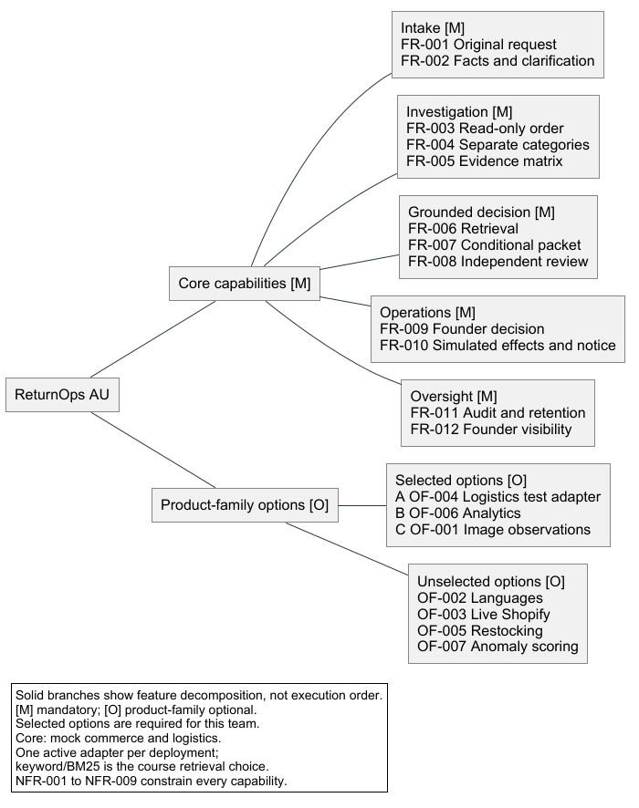

Source&#58; feature\-overview\.puml &#124; report discussion candidate

<strong>Figure 3  Overall use case model with human and external actors</strong>

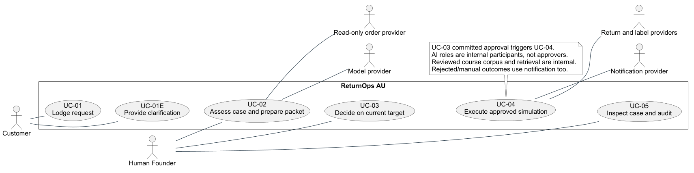

Source&#58; use\-case\-overview\.puml &#124; report discussion candidate

<strong>Figure 4  Shared package responsibilities</strong>

Source&#58; package\-dependencies\.puml &#124; report discussion candidate

<strong>Figure 5  Core case and evidence classes</strong>

Source&#58; domain\-records\.puml &#124; report discussion candidate

<strong>Figure 6  Decision and execution record relationships</strong>

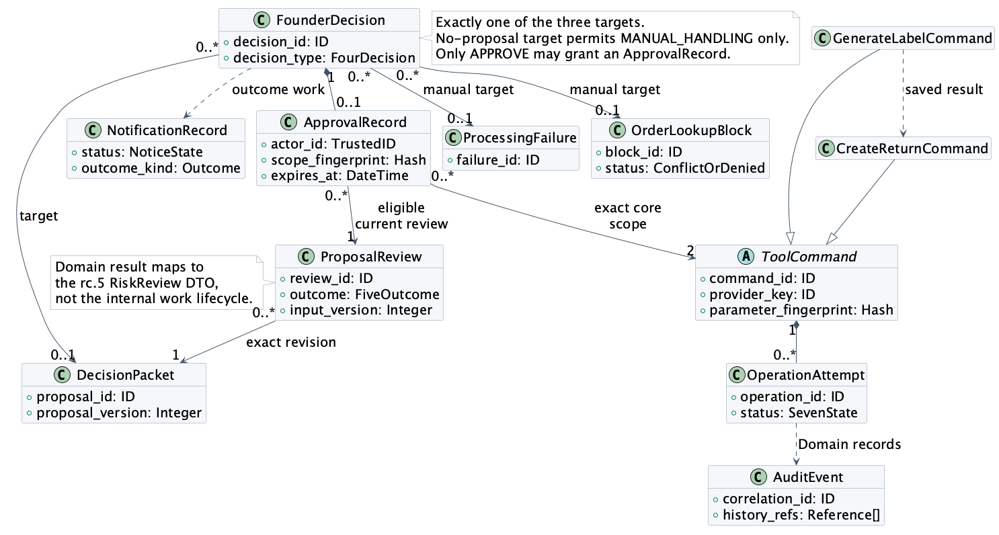

Source&#58; v0\.3 Figure 6, based on \[P6, P7, P10\]; AI\-assisted reconstruction, 21 Sep 2026\. Naming/mapping clarification only\.

<strong>Figure 7  Approval and service interfaces</strong>

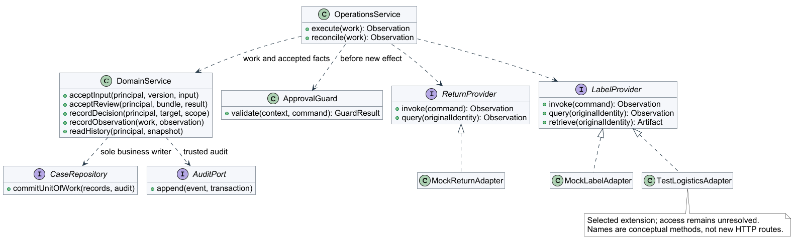

Source&#58; domain\-services\.puml &#124; report discussion candidate

<strong>Figure 8  Analysis classes, typed ports and AI role responsibilities</strong>

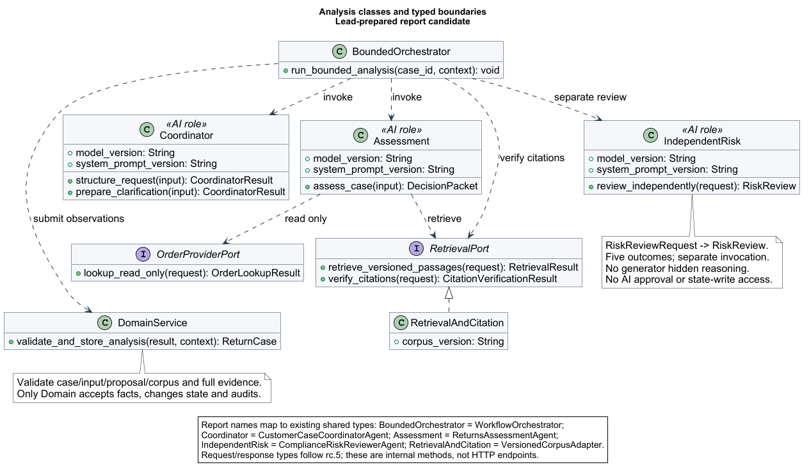

Source&#58; domain\-analysis\.puml &#124; report discussion candidate

<strong>Figure 9  Runtime parts and ports of the governed case system</strong>

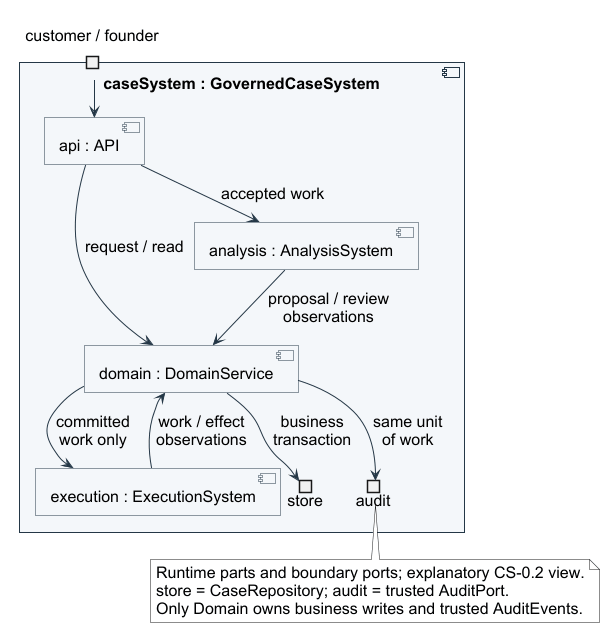

Source&#58; governed\-case\-composite\.puml &#124; report discussion candidate

<strong>Figure 10  Analysis collaboration with independent Risk</strong>

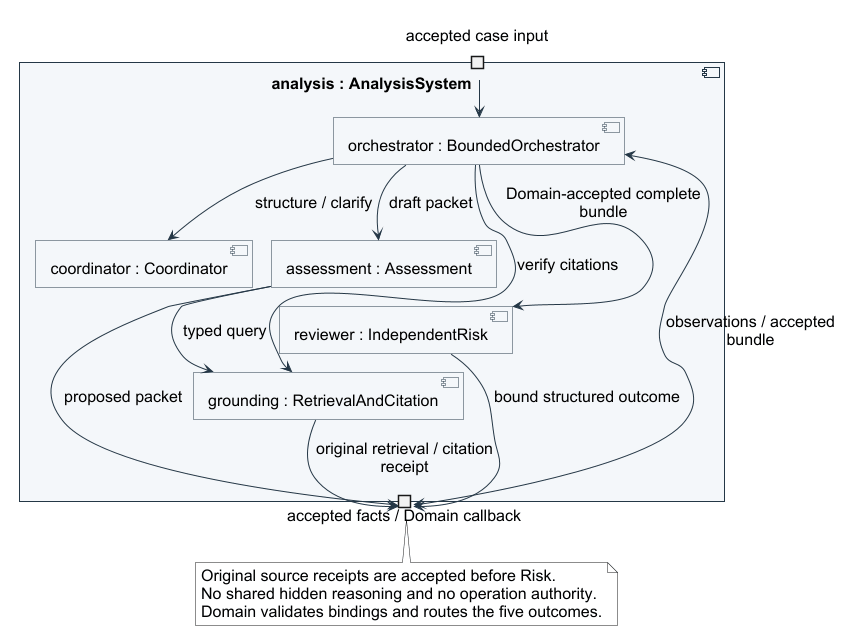

Source&#58; governed\-analysis\-composite\.puml &#124; report discussion candidate

<strong>Figure 11  Execution collaboration with approvals and audit</strong>

Source&#58; governed\-execution\-composite\.puml &#124; report discussion candidate

<strong>Figure 12  Proposed local deployment and trust boundaries</strong>

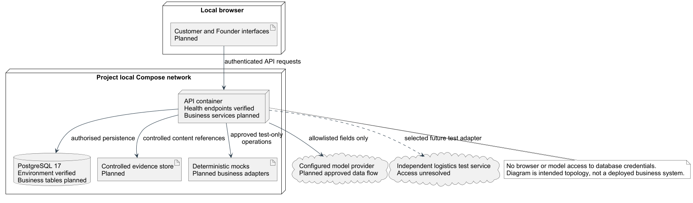

Source&#58; deployment\-topology\.puml &#124; report discussion candidate

<strong>Figure 13  A activity for governed execution and outcome notification</strong>

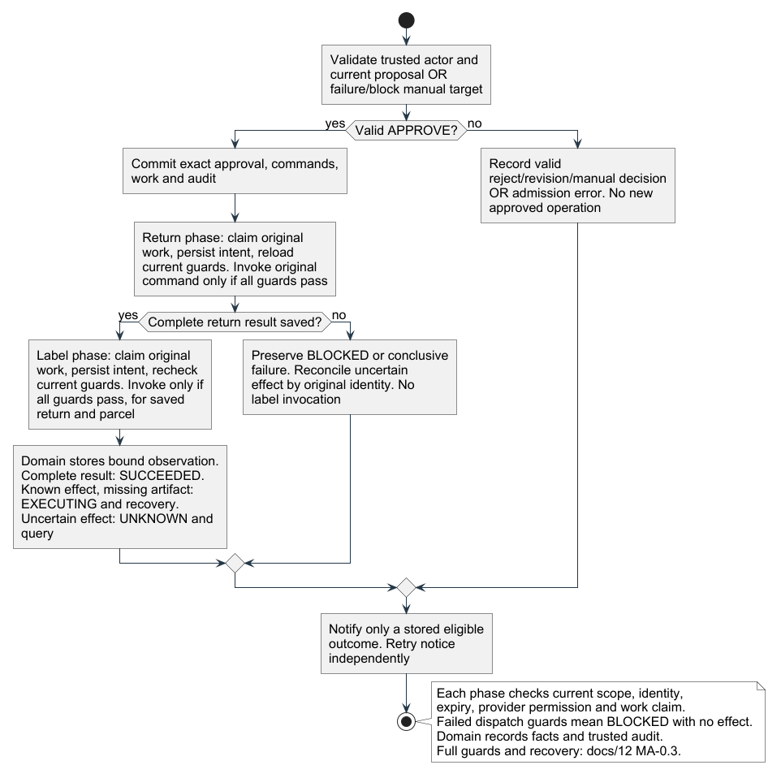

Source&#58; governed\-execution\-activity\.puml &#124; report discussion candidate

<strong>Figure 14  A interaction for exact scope approval and dispatch</strong>

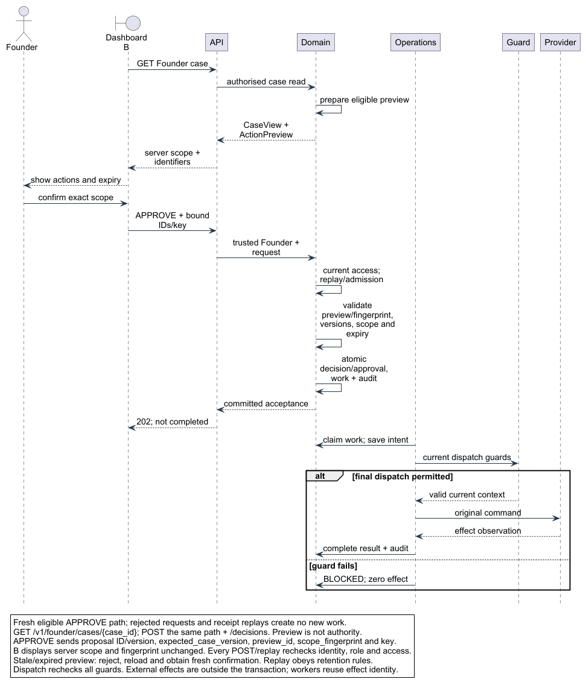

Source&#58; exact\-scope\-sequence\.puml &#124; report discussion candidate

<strong>Figure 15  A interaction for recovery and notification</strong>

Source&#58; recovery\-notification\-sequence\.puml &#124; report discussion candidate

<strong>Figure 16  A OperationAttempt state machine</strong>

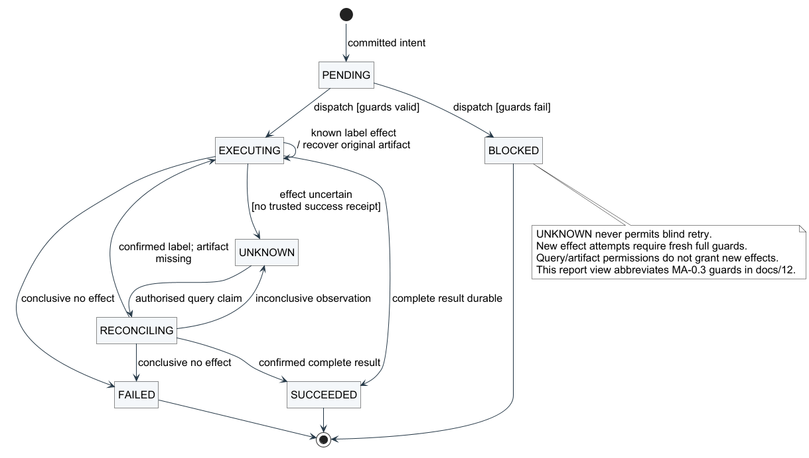

Source&#58; operation\-attempt\-state\.puml &#124; report discussion candidate

<strong>Figure 17  </strong><strong>MB\-ACT\-0\.2 — One intake traversal&#58; admission prefix and one processing invocation\.</strong>

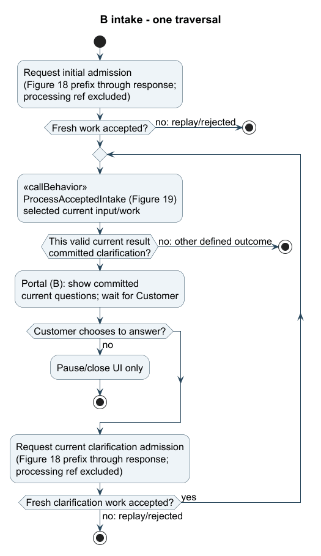

Source&#58; member\-b\-activity\-report\.puml &#124; report adaptation of B MB\-0\.2 \[P14\]\.

Admission prefixes exclude the processing ref; stops end this traversal, not the durable session\.

<strong>Figure 18  </strong><strong>MB\-SEQ\-0\.2a — sd CustomerIntake; only fresh acceptance invokes processing\.</strong>

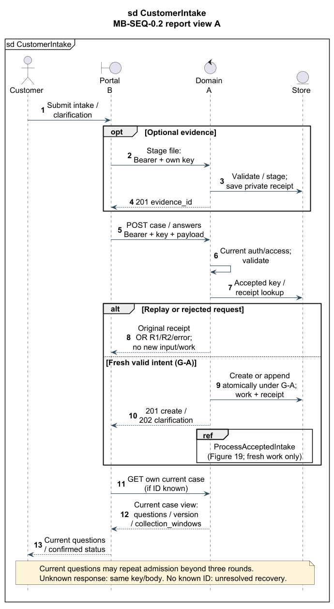

Source&#58; member\-b\-sequence\-admission\-report\.puml &#124; report adaptation of B MB\-0\.2 \[P14\]\.

G\-A/R1/R2 and complete admission/replay guards are defined in Section 7\.

<strong>Figure 19  </strong><strong>MB\-SEQ\-0\.2b — Independent sd ProcessAcceptedIntake; accepted work only\.</strong>

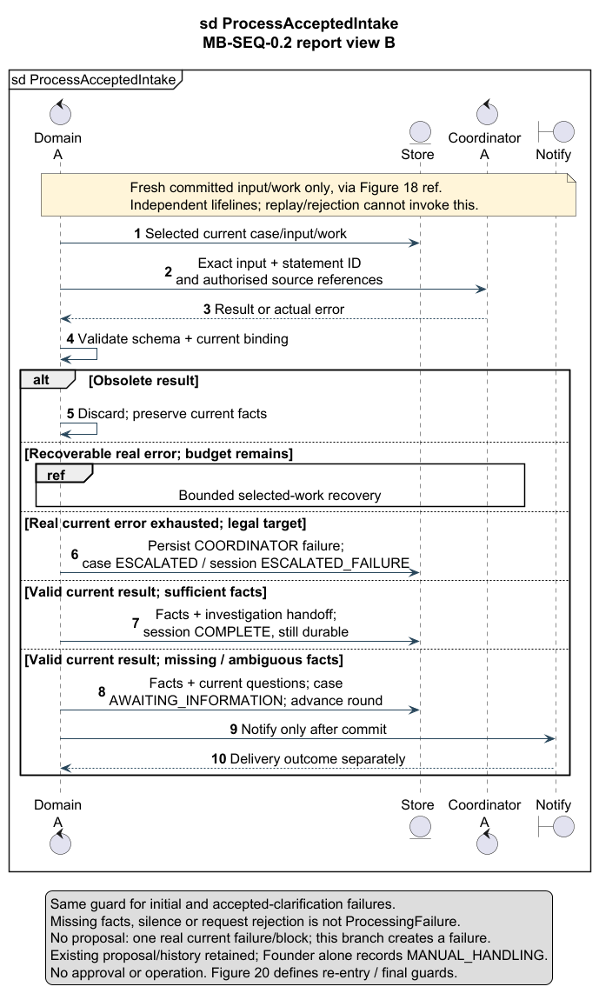

Source&#58; member\-b\-sequence\-processing\-report\.puml &#124; independent interaction view \[P14\]\.

<strong>Figure 20  </strong><strong>MB\-STM\-0\.2 — Durable IntakeSession, quiescent states and guarded re\-entry\.</strong>

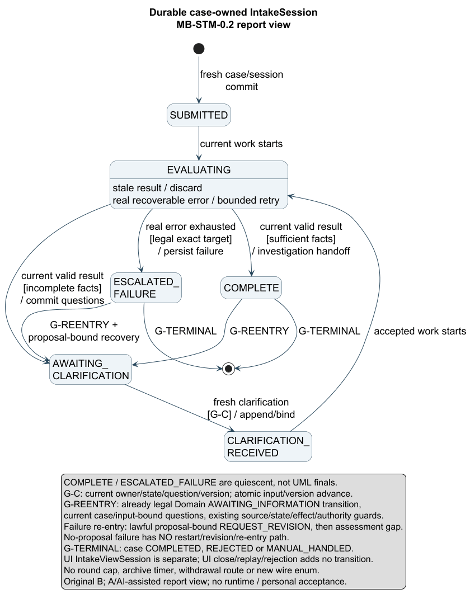

Source&#58; member\-b\-state\-report\.puml &#124; durable IntakeSession report view \[P14\]\.

<strong>Figure 21A  C activity&#58; complete\-input validation and bounded recovery</strong>

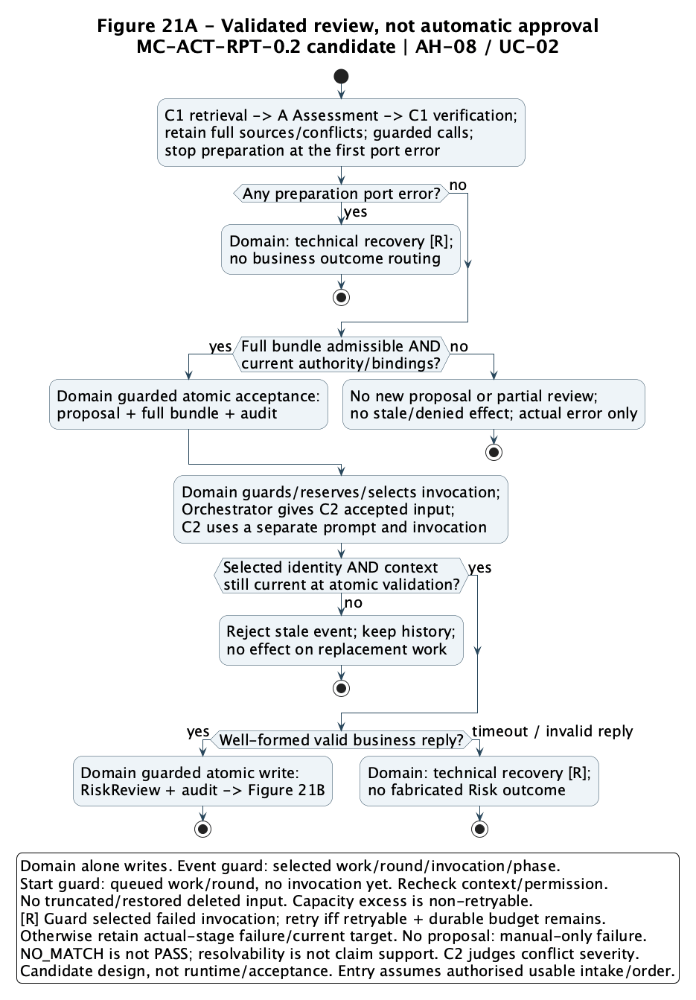

Source&#58; C model chain \[P12\]; AI\-assisted control\-flow clarification, 21 Sep 2026\. Continue with Figure 21B\.

<strong>Figure 21B C activity&#58; routing the five accepted business outcomes</strong>

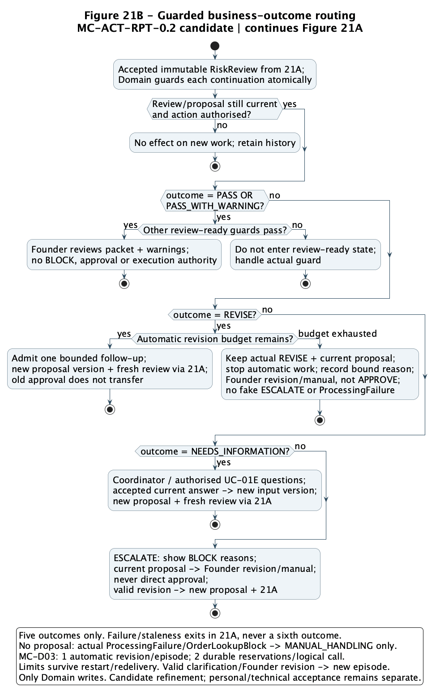

Source&#58; C model chain and revision bound \[P12, P13\]; AI\-assisted control\-flow clarification, 21 Sep 2026\. Candidate design, not runtime or personal acceptance\.

<strong>Figure 22  C interaction&#58; accepted evidence and an independent reviewer</strong>

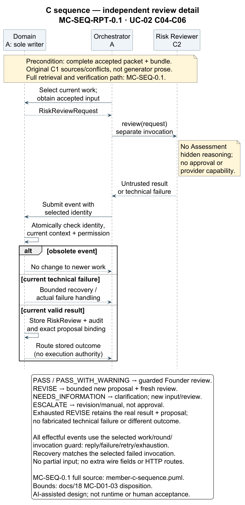

Source&#58; member\-c\-sequence\-report\.puml &#124; C\-published discussion view \[P12\]

<strong>Figure 23  C state model&#58; review acceptance, failure and historical validity</strong>

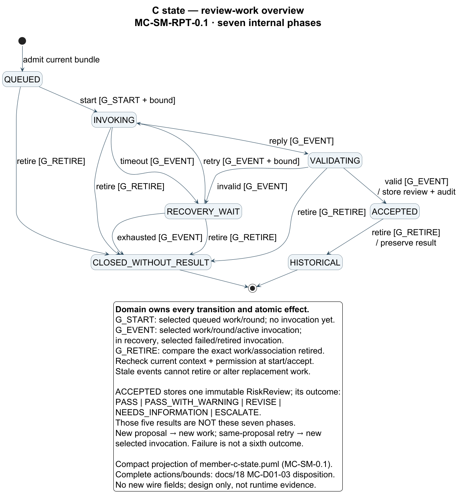

Source&#58; member\-c\-state\-report\.puml &#124; C\-published discussion view \[P12\]

<strong>Figure 24  C object snapshot&#58; source conflict before the Founder decision</strong>

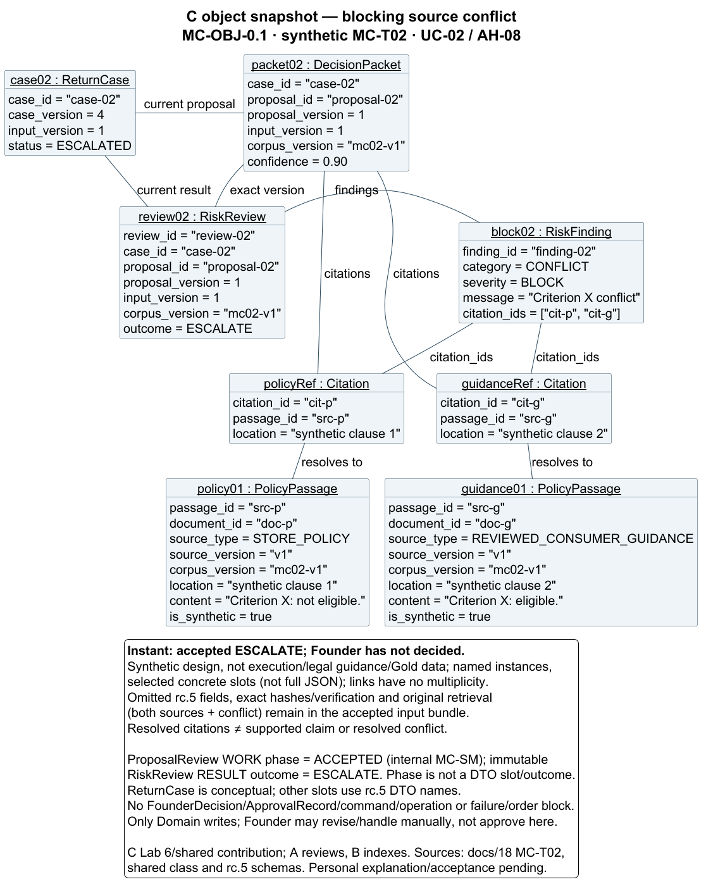

Source&#58; member\-c\-object\-conflict\.puml &#124; synthetic design snapshot \[P12, P13\]

# Appendix A Review and provenance notes

## Technical reference and report provenance

The original design reference was rc\.5 at 64582a3007fea0fa3d1b1c3c212168b96af6b607 through PR11 \[P1\]\. Current B report views derive from the separately published compatibility correction \[P14\] and C figure sources from \[P12\]\. Those report\-specific sources are not retroactively covered by the original CI\. The 4 October implementation/evidence update uses main 6b45b714 and its actual CI \[P20, P21\], without changing the historical test claims below or treating proposed models as complete runtime implementations\.

## Implementation snapshot and scoped delivery evidence

Pinned implementation reference, checked Oct 4, 2026&#58; main at 6b45b7141126292a06ed783f5e4a3adcf9955210 \[<a href="https://github.com/shuxiachai/returnops-au/tree/6b45b7141126292a06ed783f5e4a3adcf9955210">P20</a>\]\. Since the original rc\.5 design baseline, A\-led, AI\-assisted deliveries have added identity/access foundations, initial PostgreSQL storage, seven customer operations for sessions, evidence, intake/history and clarification, a read\-only synthetic order provider, durable order investigation, four authorised Founder read queries and persisted lifecycle guards\. PR34 adds a private controlled\-caller harness for rollback followed by a separately authorised safe denial audit\. Proposal/Risk/Founder\-decision/approval/operation/notification producers are not registered by these increments\. They do not establish a complete multi\-agent workflow, Gate 1, whole A1\.03 acceptance, formal Gold results or personal/joint acceptance\. Historical rc\.5 preparation checks remain in Appendix A\.

B recorded approval of five consumer\-boundary items for exact A source 3dd1ff6 \[<a href="https://github.com/shuxiachai/returnops-au/pull/11#pullrequestreview-5196057965">P11</a>\]\. C published the six\-scope F\.01 review and exact\-A PG17 Compose reproduction in PR17, which remains open \[<a href="https://github.com/shuxiachai/returnops-au/pull/17">P17</a>\]&#58; 32 environment tests, repeated migration and same\-API database outage/recovery\. C's notification\-fixture finding was corrected and merged in PR19 on Sep 26, 2026 \[<a href="https://github.com/shuxiachai/returnops-au/pull/19">P19</a>\]\. PR18's navigator was also merged, with M\-S\.03 still B\-owned \[<a href="https://github.com/shuxiachai/returnops-au/pull/18">P18</a>\]\. A's approvals on PR8/12/14 explicitly record authorised Codex technical review; they are not personal B/C signatures\. These facts establish scoped delivery/review evidence, not personal explanation or joint F\.01/F\.02 acceptance\.

B's later commits also added the <a href="https://github.com/shuxiachai/returnops-au/commit/1378c66764e8bad4efa1b6ba78082cd924a7b1bf">VID\-1 script/storyboard</a> and the <a href="https://github.com/shuxiachai/returnops-au/commit/1878ffa190e45ae2ecc3907c0ea075cfe1b911ad">research\-evidence wording correction</a> \[<a href="https://github.com/shuxiachai/returnops-au/commit/1878ffa190e45ae2ecc3907c0ea075cfe1b911ad">P22</a>\]\. These artifact deliveries do not establish unaided authorship or personal explanation\.

The CI run for the pinned implementation snapshot checked out 6b45b714 in both jobs and passed \[<a href="https://github.com/shuxiachai/returnops-au/actions/runs/37114940915">P21</a>\]\. Eight distinct suites totalled 878 cases&#58; security 244, storage 74, environment 32, customer 153, orders 64, investigation 41, Founder reads 158 and lifecycle 112\. It also passed 68 contract tests, six static groups, 12 model\-checker tests, seven runner tests and 14 Mermaid parses\. PostgreSQL was 17\.11 and migration head 0007\_lifecycle\_guards\. The 36\-storage/82\-customer offline subsets overlap those totals and are not added again\. Static checks matched 23 SVG/source pairs without visual review; the WBS Git\-baseline comparison was explicitly skipped on main\. That evidence review inspected logs but did not rerun tests\. No agent\-quality, legal\-correctness, p95 or formal Gold/B1–B4 result is inferred\. Jira remains the planning history and GitHub the technical evidence record; the original evidence review did not update either service\.

## Meaning of preparation evidence

The original discussion candidates were prepared under the lead's direction; current B originals and A/AI\-assisted corrections are distinguished in \[P14\], and C\-published report views are attributed in \[P12\]\. Their existence does not establish member approval, completed implementation or independent assessment completion\. A's model syntax checks do not establish runtime safety\. Publication, green checks, model syntax and personal authorship are distinct facts\. Actual contribution and review records remain necessary\. The unit outline permits AI with acknowledgement \[C4\]; the dated Canvas task\-page verification is recorded below, while final announcements and the assigned interview slot remain to be checked\. Permitted assistance does not establish independent authorship or satisfy the rubric's individual and shared\-contribution conditions by itself\.

## Recorded rc\.5 checks

At the Sep 7, 2026 review snapshot, PR 11 contained source head 64582a3\. Both push and PR CI runs succeeded \[P8\]\. Each reported 56 contract checks, six static checking groups, 12 model\-checker regressions, five runner regressions, 15 Mermaid parses and 32 environment/API/PostgreSQL tests, including four database tests\. The PR workflow checked a synthetic merge commit; the push workflow checked the source head\. These are implementation\-preparation checks, not business\-runtime, benchmark or team\-acceptance evidence\.

## C follow\-up evidence and limits

C supplied MC\-0\.1\.1/MC\-RPT\-0\.2 at 32c704f \[P10\]\. The earlier integration verified C’s saved evidence/logs and source correspondence&#58; 58 contract tests against reconstructed source and a 15\-case binding/coverage matrix for the published A correction at 3dd1ff6\. It is not a fresh clean\-Git run and does not implement Domain/history services, prove claim support or prompt independence, or replace C’s clean Git/PG17 Compose reproduction, personal explanation, A’s personal confirmation or joint acceptance\. Later exact\-source technical evidence is separately recorded in \[P17\]\.

B formally approved the exact A source at 3dd1ff6 for five consumer\-boundary items \[P11\]\. This does not establish joint F\.01 acceptance; B's personal chain has been delivered and compatibility\-corrected \[P14\]; later shared candidates and index have a separately sourced correction \[P15\]; personal explanation and final shared acceptance remain outstanding\.

## Team\-managed production and report scope

The report records requirements, design, evidence and accurate source attribution\. Video preparation, the available recording and the separately observed Canvas video submission are documented below\. They do not establish report submission, team acceptance or completion of individual interviews\.

## Recorded assessment details — checked 4 October 2026

Earlier dated observations are retained for provenance&#58; the 8 September task page was locked, and the 20/21 September checks resolved the 25\-point report\-page grouping as report 15 plus individual interviews 10\. The current 4 October check confirms one designated member submits one group PDF, while the video is a separate Canvas upload of at most eight minutes worth 5 points \[C5, C6\]\. Both are due 4 October 2026 at 23&#58;59\. Unlimited attempts and availability until 11 October do not change the deadline\. YouTube is supplementary, not a replacement upload\. Project Description \[C2\] covers requirements/classification, rationale including rejected alternatives, models and change/acceptance criteria; no separate PPTX upload requirement was found\. Ed clarifications recommend slides and each member explaining their part without requiring every diagram in full detail\. Individual interviews occur in Weeks 11–12 practicals; the assigned slot remains to be checked\. AI assistance must be acknowledged and work/draft/output/research records retained for the stated period\. No report upload or submission was performed by this revision\.

## Planning\-record interpretation and navigation

The 89 WBS entries are acceptance checks, not an instruction to create 89 separate cards\. F\.01 is mapped to <a href="https://lucastaooo.atlassian.net/browse/KAN-32">KAN\-32</a> and F\.02 to <a href="https://lucastaooo.atlassian.net/browse/KAN-33">KAN\-33</a>, both linked to PR 11\. C's dated update \[P17\] records In Review; this report does not re\-audit the live board\. Technical reproduction is recorded in \[P17\]; joint F\.01/F\.02 acceptance remains outstanding\.

## Sources for the current assignment\-page check

\[C5\] ELEC5620 Canvas\. Stage One Report Submission\. Course 74323, assignment 695832\. Rechecked 4 October 2026; earlier 21 September observation retained in the editing record\. Official report assignment\.

\[C6\] ELEC5620 Canvas\. Stage One Video Presentation Submission\. Course 74323, assignment 695833\. Rechecked 4 October 2026\. The task showed the separate submitted video attempt dated 4 October at 10&#58;32; this does not establish report submission\. Official video assignment\.

21 September 2026 editing record&#58; C authorised AI\-assisted clarification of class/DTO naming, C activity control\-flow presentation, open\-decision responsibilities and current assessment\-page observations\. Source attribution and pending personal/shared contribution confirmation remain intact\. This edit does not constitute team acceptance, business implementation, a completed video or assessment submission\.

<strong>Presentation materials and recording status — 4 October 2026</strong>

The nine\-slide deck and ABC narration script were shared on 21 September for review and rehearsal\. These preparation files remain distinct from the final recording and Canvas receipt\.

<a href="https://docs.google.com/presentation/d/1oE-d_TP1XjoBB7gYHby2aZRRSqM9tBBB/edit?usp=drive_link&amp;rtpof=true&amp;sd=true">ReturnOps Stage 1 Video PPT</a>&#58; nine editable slides with speaker notes\.

<a href="https://docs.google.com/document/d/1wum-DFCBYcmXA8seB770K_n2R4qxWb7t/edit?usp=drive_link&amp;rtpof=true&amp;sd=true">ReturnOps Stage 1 ABC Script</a>&#58; English narration, Chinese comprehension prompts, timing and visual cues\.

The presentation files are in the 2026S2 ELEC5620 shared folder\. GitHub PR20 retains their versioned preparation history and remains open at the 4 October check; it is not a video\-submission receipt\.

The rehearsal plan allocated slides 1/3/7 to A, 2/4/5 to B, 6/8 to C and slide 9 to A/C, with an estimated 7&#58;30 duration\. The actual available recording is 6&#58;08\.2\. The local preparation audit verified format/duration and sampled frames, not a complete listening assessment or each member's actual speaking contribution\.

The materials were prepared with AI assistance\. The signed\-in Canvas video page subsequently displayed a submitted attempt on 4 October 2026 at 10&#58;32 with ReturnOps\_AU\_Stage1\_Presentation\.mp4\. Its supplementary YouTube link is https&#58;//youtu\.be/At8S69udFXg\. Video submission is distinct from report submission, grading, personal understanding and team acceptance\. This report revision was prepared without uploading or submitting the report\.

<!-- NATIVE SECTION footers -->

ReturnOps AU  &#124;  Preparation revision v0\.4  &#124;
